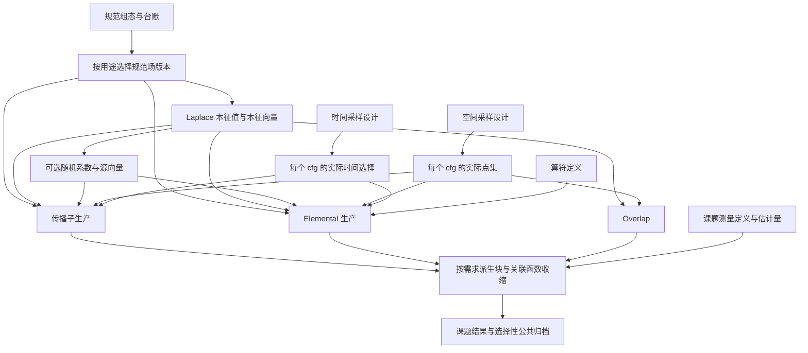

# 本软件 架构

`symmetry` 是群表示、旋转与子空间投影的基础模块，供算符模块消费，不依赖生产、测量或收缩流程。接口和约定见[格点对称性](docs/modules/symmetry/README.md)。

[Correlator 完整缩并架构设计与迁移状态](docs/architecture/correlator-workflow.md)
记录2026-10-22确认的整体vertex准备/计算边界、两步规划和读取原计划的操作生成器；
含复用/修改清单并开始分阶段实施。新前端API仍为草案，已实现范围以对应模块文档为准。

普通 Diagram 整体源路线中，同一介子算符的 dense/diagonal/point_diagonal 分量按实际有序端点绑定形成一个整体输入。
B 保留每项支持证明，C 的默认空 spatial_support 配方描述匹配位置，X 准备只嵌入声明内条目；
P 不据结构标签展开全局 term，也不搜索核内路径。全 diagonal、纯 dense 和单分量沿原快路；
设计、数值及 CSNS 同设备性能范围见[介子整体顶点](docs/modules/execution/meson-whole-vertex.md)。
隔离候选的默认 anytime / meson_matrix 矩阵入口已交付中立 whole core；P 只粗价完整
connected/trace join 及其存储，不搜索 component/unit-spin/FWR 内部因子。X 复用固定局部
mode GEMM、phase 和原 FWR 宽累加，完整坐标/尾批档案已由 CSNS CPU 与真实 GPU 核验。
同设备跨类性能另作门禁，尚不据数值通过自动切换主线；范围及证据见上述介子页。

胶球接入见[零连接顶点与已有数据 term](docs/architecture/glueball_architecture.md)：
保留现有算符构造，binding 接入胶球数据作为独立 term，不执行夸克缩并，
由原结果配方与介子/重子 term 装配。复用原规划、执行和存储，不另建胶球计算流程；
已接通普通/structured 单强子、固定坐标、时间扫描和 Dataset/计划回放；平台验收见该文。

关联函数的高层入口、联合规划、
有界执行、固定回放与 elemental 自动准备归 `contraction`；通用数据集执行和回执服务归
`runtime`。基础产物只读数据规划归相应生产模块，纯定义与兼容决定仍由 `planning` 提供。
EV/NV/PR/SS/TS 和独立 EL 的计算、保存分别调用，由用户脚本组合；库不提供基础产物
计算并保存的入口，也不内置空间点集生产桥。受管测量的 elemental 自动准备继续保留。

单流独立外腿的专家数值入口位于 `contraction.external_current`，只消费完整流时间片
解场及真实算符，不解析文件、不调度求解；`contraction.external_current_measurement` 组织逐腿贡献
和线性包含概率装配。它与 meson_matrix 一样是显式单流专家路径，不是普通多流
Diagram 的替代工作流，见[输入与估计量](docs/modules/measurements/external_current.md)。PR 的 high 点提取、
EL 的规范输运以及统一抽样概率内核仍由原模块提供。

关联函数默认在 E 完整描述后、P 选路前统一计算精度：最低浮点分量精度决定任务 dtype，
有复数输入/系数时保留复数。原始物理读取 dtype 保留在输入契约中；逻辑规格、准备配方、
临时转换工作区记录计算 dtype，X 只转换当前所需块。新输出配方以 `dtype` 记录最终精度，
float32/complex64 任务另显式记录 float64/complex128 的 `intermediate_dtype`，仅输出表达式
的系数、乘积和求和保持宽精度直到字段最终转换；输入和大矩阵乘法沿任务精度。
P 计入宽临时 owner 与最终窄字段的重叠，CPU/GPU 固定回放消费同一合同。
新规划的终端三输入 tiled FWR 将其内部叶子显式保留为 complex128，供 one-point
共享和 disconnected 乘积消费；最终字段仍为任务 dtype。输入准备、普通 GEMM 和
四输入 connected 结果维持原精度。旧 core 缺少 `output_dtype` 时保持原 cast 语义。
旧配方缺少该字段时保留原逐节点精度，不在读档时升级。执行器拒绝混合精度缩并计划；
旧混合精度档案需要重新准备。精度转换不是路径搜索，也不修改原始文件或科学身份。
动态 Session 的已读数组也由 B 在编译前应用同一精度规则。普通 Calculation 和完整 cfg
的固定回放共用 X 的执行绑定身份/生命周期规则；收缩编排持有缓存 owner，不再各自实现数值绑定。
单坐标输出共用 R 的装配绑定；输入、驻留、队列及求值结果始终属于本次运行。

X 的 CUDA raw 准备、打包和输出复制核可在布局绑定时固定 64 位参数槽及不可变常量地址。每个调用线程
只复用自己的主机参数容器，通过本机 uint64 内存视图填入当前输入和新输出地址，
避免每次地址赋值进入 NumPy 标量转换；参数槽的字节布局与地址表不变。提交返回或抛错后
清空这些动态槽，不持有输入、输出或历史指针。较宽布局在绑定时将相邻动态槽整理为清零区间，
提交后通过同一线程的字节视图批量清理。较宽且零散的布局预存固定模板字节，
通过一次主机复制恢复固定标量、常量地址及零动态槽；短布局仍逐槽清理。
支持普通 CUDA Function/driver ABI 时，
线程也复用指向这些槽的主机参数表，沿 RawKernel 选择的当前设备 Function 和当前 stream
提交同一个内核；线程首次使用该 Function 时建立运行时上下文。没有逐操作同步。
缺少此 driver 能力及合作组核继续使用持有单元素主机视图的 CNumpyArray，
不将整数地址交给 CPointer 构造器。不另建调度器，不改变内核数学、设备工作区或 P/A 的记录。
延迟结果引用按当前 owner 加保存偏移直接提供整数地址；分块在绑定时保存输入索引及输出 lane 偏移，
不逐次切分输入或包装 NumPy 指针标量。打包和输出仍遵守原有有界布局缓存与工作区额度。
已绑定的数组地址契约可直接逐项填写主机槽，省去逐输入 getter 和延迟视图方法调用；
每次仍区分当前延迟结果、NumPy 与设备数组，不缓存输入类型或地址。其它 getter 沿原调用。
debug、HIP、缺少 CNumpyArray 的后端与自定义核保留原始参数交付。
已选 GEMM 组的指针设置核也可沿此固定 raw 参数 ABI 交付当前矩阵、指针表及新结果地址；
各打包 mask 在绑定时固定参数位置，正常调用不重新解析数组参数。debug 与不支持该 ABI 的核
继续原参数交付；指针表额度、数值核、当前 stream 和异常清理均沿原安排。

有界 thin-wide reduction 的 tile 提交也复用这一参数 ABI：每种输入步幅至多保留完整块与
尾块各一对参数模板；单块固定起点和计数，多块仅在线程本地主机槽更新起点。
模板数量不随 tile 数增长，不持有当前输入、部分和或输出 owner；核源码、跨块
complex128 累加顺序和设备工作区额度保持原约定。不支持该 ABI 时沿原 RawKernel 提交。

thin-wide core 构造及读档将通过验证的整数几何绑定一次；至多2048种完整有序
方程/shape/large-operand/tile/输出精度组合共享不可变派生元数据，不合并 core/Action
对象身份，不改变档案字段或求值结果。维数映射仍返回独立字典，缓存不含数组、reader或指针。

新 CUDA 计划在既有选中路线交付时，可按成本和完整存储预算选择更宽的 thin-wide tile。
仅比较少量宽度，不扩 E 或重新搜索缩并；有序输入、保留轴、输出精度和共享关系不变。
宽度参与 core、结果名字、partial/accumulator 和实际存储排程，发布前恢复规范 tuple 表。
新 partial 的规划策略上限为8MiB，所有 retained/shared lane 与 K blocks 都计入；
完整预算不可行时保留原计划，已有合同错误仍抛出。普通入口默认启用，
高级 `factorized_retile=False` 可关闭新规划后处理。完整档案只消费保存宽度，拒绝显式改写。

同一执行模板的 native thin-wide Action 还可按完整不可变 core 和 backend 共享数值工厂，
每个 Action 命中前仍核对其方程、wide 标记、有序输入 shape/dtype 及输出 shape/dtype。
工厂不捕获 Action 或张量名字；动作各自绑定当前输入和输出身份。CUDA 工厂绑定时解析不变几何，
正常调用和 tile 循环消费局部整数、shape 与 dtype，不重复展开 core 的递归属性。
共享的 stride 布局缓存仍最多64项，动态参数仍按调用线程隔离；没有全局数值或跨任务缓存。

兼容参数 `factorized_gram_tiling=True`（显式 False 关闭该复用）使 CUDA tiled thin-wide 的第一阶段对严格互斥、有序的矩阵轴复用相邻2×2输出点的
输入读取。每点的宽精度乘积、K 分区与归约次序保持；partial 布局、finish、跨 tile 累加
和已选资源安排不变。不适用几何和较小 tile 沿通用核，细节见[执行 L2](docs/modules/execution/execution.md)。

`factorized_gram_strategy='gemm'` 则由 P 在新离线准备中选择显式的数值策略，
保存独立身份、两个 complex128 输入包与完整 Gram 的重叠预算、成本及生命周期。
X 只消费该保存策略，宽 GEMM 后沿同一宽收尾方程一次输出；旧 reduction 档案不能由
执行开关升级成未计费的 GEMM。默认 None 对新 CUDA P 尝试保守 GEMM 候选，对其它新任务
为 reduction，对档案沿保存实现；显式 reduction 保留原路径，2×2 为策略 tiled。旧 bool 缺省
None，明确 False/True 分别兼容 reduction/tiled，不会静默覆盖显式关闭。固定回放不重选数值策略。

X 准备的布局键始终来自本次输入的 dtype、形状和步幅。较宽输入序列在首尾发现相同数组对象时，
可在单次调用内复用该对象的布局元组，并保留每个 lane 的原顺序和重复；下一次调用重新读取。
临时索引只保存对象 ID 与布局元数据，不保存数值 owner、地址或跨坐标状态；debug 沿逐项取值。
上述较宽 raw 调用可将同一个当前输入对象在单个分块中重复使用的指针合为一个参数槽，
有序首次出现位置模式进入调用缓存身份；每个 leaf 的逻辑视图、类型转换和数值表达式仍独立。
相等但独立的数组不合并，后续调用重建模式；debug 保留独立 raw 输入参数。
此处仅压缩 X 的主机参数交付，不改变 P 的数据身份、准备顺序、驻留或资源预算。

收缩编排的增量 cfg 执行先由输出配方和完整轻量坐标表确定输出布局及累加/打包额度，再将该额度
加入已选模板的保留内存，交给 P 的窗口生产者。输出描述不包含数值调度；X 仍消费共同
CfgPlan 窗口，收缩编排复用原 Dataset writer 跨窗口累加，仅在完整坐标流成功后发布。此入口不
将首窗口冒充完整持久计划；完整档案回放入口保持不变。

固定生产任务先将兼容通道、表示行与径向需求组成一个嵌套 correlator，再选定路径。
收缩编排的 `Calculation.run(output=...)` 通过已有完整 cfg 窗口服务绑定当前输入，
只接受运行绑定/坐标，不接受新算符、搜索或优化参数；不在前端循环构造窗口或重新 E/P。
跨 cfg 的结构、池关系及包含概率仍由原生绑定核验，不兼容直接报告。
窗口资源排程与路径搜索是不同阶段；该入口不会自动发现其它独立 calculate 调用中的通道。
调用层必须遵守 correlator/Dispatch skill 的完整任务声明约束，不能用全局缓存猜测任务。

源码与本对话改动核对：2026-10-07。当前能力以本文及模块 L2 为准。
## 常用数据源前端

`lqcdweave.preset.Dataset(directory).load(cfg)` 按共享目录登记读取指定 cfg；
裸 NPY 便利函数 `load/save` 与 `adapters.preset` 专用 reader 用于已有输入；
便利函数要求显式 `kind`，从 NPY 头读取 shape/dtype，按对象校验轴布局；
传播子时间约定、elemental 分量/相位/前三轴及点坐标轴顺序必须显式声明。
`save` 保留输入数组的 dtype、字节序和轴顺序，默认拒绝覆盖，不把科学约定写进 NPY
或从文件名推断身份；新持久数据按 cfg 保存完整 NPY 或 HDF5，并由共享 `dataset.json` 登记。
storage 发布在目录锁内增量追加压缩登记；公共部分缩小时只重基受影响的差异，
不恢复和重新提取全部旧 cfg。指定 cfg 的读取只恢复当前记录，v1 格式与原子发布回滚保持不变。
文件解释、布局和范围检查、已登记数据集适配都在 adapters/storage 执行。数据源与返回的适配器持有映射，不要求普通用户管理读取器；
计算继续使用现有 binding/expansion/planning/execution。未知科学身份保持未知，
不通过简化入口制造登记或跳过严格兼容检查。具体接口与所有权见[数据源说明](docs/modules/storage/preset.md)。

Correlator 的收缩编排在每次原生 `calculate(configuration=cfg)` 调用中，通过 adapters
解析 preset 声明，再用 B 的 `with_reader` 创建独立顶点绑定。算符、图、数据源声明与
共同计算选项可放在 cfg 循环外；B 不解释文件格式，E 仍只接收已绑定 reader 的元数据。
显式 reader 保持其原组态，自定义 DiagramData 适配器保持显式接线；不新增任务、缓存或调度系统。

缩并端 `sparse_color=True` 由收缩编排组合 `adapters.sparse_color` 的实际颜色记录与 reader
视图，已有全颜色数据读入后按实际点池和有序点标签施加固定单色掩码。B 保留真实端点，
E 对点重合类型的概率 RHS 补入 `3**k` 再反演 scene，预权 elemental 的局部分母仍只含
空间权重；生产与点采样模块不因此改变。掩码保留 Nc=3 核接口，同点异色项未覆盖，
实际选择及缺口随普通结果保存；支持范围见[缩并前端](docs/modules/correlator/correlator_frontend.md)。
实际颜色可跨调用复用；收缩编排每次绑定创建独立端点注册域，避免 compact 槽号对应不同
物理时间时混入旧reader的池，也不让颜色记录长期持有旧数值输入。

blending 比较所需的单组 QR 列前缀由 `adapters.dilution_prefix` 组合已有 reader：
完整父空间不变，列选择产生明确的边际样本身份和新的 m；预权局部 elemental 按概率比
修正。B/E 消费同一 DilutionSource 契约，不放宽原始数据上部分组选择的拒绝规则；
该视图不支持原样本与前缀样本的联合缩并。共同抽样维度的三路脚本见
[比较说明](docs/modules/measurements/blending_comparison.md)。

明确物理映射的 compact 局域/空间时间槽可消费固定单色视图；compact 时间位移路径仍拒绝。

收缩编排的固定、完整 cfg、窗口与兼容 session 数值工作流统一返回 `Calculation`，以 `.run()`、
`.value`、映射 `.report` 交付；旧类型和字段经收缩编排兼容层转接，X 内部 ExecutionResult 保持纯契约。
约定、惰性输出及归档边界见[共同返回说明](docs/modules/correlator/calculation.md)。

数值结果通过收缩编排的 `save_correlator/load_correlator` 组合既有 DatasetWriter/Reader，
默认保持容器、算符维度与时间坐标；显式源时间平均由 TS 的纯服务进行周期 dt 对齐，存储边界协调并
保存计数与约定，不改变计算内核或默认估计量。计划保存/导入通过
`save_calculation_plan/load_calculation_plan` 成对使用，普通固定绑定与完整跨 cfg
档案分别要求当前 expected 或 reader-role 绑定；加载不搜索。

## 基础计算与稀疏化：六个独立模块

[L0/L1 规格](docs/architecture/production-l0-l1.md)规定时间稀疏化、空间稀疏化、eigenvector、elemental、
perambulator、noisevector 六块的目录、输入输出、所有权和错误职责；对应 L2 在 `docs/modules/`。
数值内核沿用已有实现，各块消费实际数据契约。登记、发布和恢复统一复用 storage/runtime 与 runtime.datasets/project_datasets。

介子、空间流和重子 VVV 共用 `contraction.correlator.Elemental`，声明实际登记的规范场、基底及版本化配方目录；介子可含 V/D 和点集，重子可含三个独立 V 基底。普通 calculate 在元数据规划后、缩并执行前汇总实际请求，调用既有 Dataset 服务复用兼容覆盖、只补缺失时间并保存。介子坐标合批保留原始物理请求，完整 cfg 回放沿用同一准备入口；重子当前验收固定坐标收缩。计权从 calculate 的单一 elemental_weighted 选项绑定。范围与验证见[自动准备](docs/modules/correlator/managed_elemental.md)；时间路径和 D/P 重子仍未支持。

独立 NV 模块位于 `production/noisevector/`，公开 NoisevectorGenerator 生成实际 dilution 向量；
默认 QR，旧相位规则显式兼容，实际分组与来源交给下游。[NV L2](docs/modules/noisevector/noisevector.md)
记录已实现范围与归一化。生成的实际向量可通过通用 storage 服务保存和读回；NV 不求解 Dirac，PR 不生成噪声，两者通过实际向量数据交接。

传播子 V/P/D 的[统一 PR 模块](docs/modules/perambulator/perambulator.md#vpd-target)已在
`production/perambulator/` 实现：V/D 共用向量输入与数值核，支持九类直接产品及显式
Gamma5 反向转换；保存端固定为 VSV、PSV、PSP、VSD、PSD、DSD 六类，读取端提供九类视图。
新 `pr-six-pairs-v1` 存储以物理 `[sink_time, source_time]` 对为首轴，并在反向转换时交换实际
时间、端点标签与 D 随机记录。PR 只消费实际 dilution vector，不生成系数、重组父模式或施加
估计权重。EL 九类 V/D/P 扇区共用向量数值核，普通 Meson Diagram 通过实际 D 来源和
分组消费这些数据；同一个 `elemental_weighted` 控制局部预权与整图 D 分量包含余权。
同池按实际混合向量标签的相等关系计权，复用 P 的相等分区服务，不重连物理传播子。
可估计的不同分量数、来源和池身份、独立实现声明及
验收范围见 [EL dilution](.agents/skills/lqcdweave-elemental/references/dilution.md)。
`ModePartition`/`HighmodeBasis` 以完整 low+medium 父空间定义高模投影；PR 可通过
`highmode_basis` 直接生产五类 P 高模块（包括 PSD、DSP），`project_highmode_block` 可从已有完整父传播子派生高模块。
投影点的物理名称为 H=Q eta，保留 P endpoint/product 编码和 `high_mode_projection` 来源；
不新建 H schema 或 elemental 扇区。H 的直接源/汇投影属于 PR，Elemental 保留原始点核，
整图仍由 `elemental_weighted` 管理统计权重。生产规划比较直接 H 源、共享 V/D 解场及已有
完整父块派生的成本，不默认补产全父传播子。见[H 契约](docs/modules/perambulator/point_highmode.md#h-contract)。
`production.perambulator.pair_planning` 的 metadata-only indexed planner 检查实际父覆盖、互不重叠的兼容分片和 Gamma5；pair 生产由脚本显式调用 `calc`，再用 `PropagatorWriter.write` 保存已有结果，不自动补缺求解；旧 `plan_indexed_perambulators` 仍只支持四类 V/P 与旧 `source_time` 布局，两种布局不能互换。
实际 NV 保存/读回、九扇区 elemental 与普通 Meson Diagram 完整消费已有 CPU SU(3) Wilson 闭环验证，见[三分区闭环](docs/modules/perambulator/three_sector_production.md)。完整九类设备闭环、逐块设备生产、自动重要性分组、D 重子/专用矩阵、MPI 和完整生产规模仍需各自验收。

EV 统一使用 `LaplaceEigenvectorGenerator(..., backend=...)`，backend 必填且不接受 None；
字符串 numpy/cupy/quda 选择已有后端，非字符串按 LaplaceBackend 协议注入。
构造器只通过 `adapters.laplace.resolve_laplace_backend` 接线，不初始化 runtime 或选择替代求解器；
该精确服务边不授权其它 production→adapters 依赖。用户脚本统一直接构造 `LaplaceEigenvectorGenerator`。
`iter_slices()` 默认全物理时间；显式 selection 只求解所选物理片并保持有序槽，不增加保存或调度层。
NPY 自描述 shape/dtype 可省略重复声明，外部格式与 QIO 分派仍留在 adapters。

空间采样唯一入口 `sample_spatial_points(SpatialSamplingDesign(...), seed=..., selection=...)` 返回 `SpatialPointSet`；所有空间点坐标均采用 `(time,point,xyz)`，`coordinates` 为只读 `int64`。`adapters.spatial_points.SpatialPointHandle` 以 `.Np/.load(cfg)` 适配实际对象或已保存 NPY/通用产物；读回数组保持 `(Nt,Np,3)` 和 `int64`，复用已有读取器，不在 PR 中分派格式，不创建新存储框架。裸 NPY 不含采样历史；来源未知时保持未知。详细契约见[空间采样](docs/modules/spatial_sampling/spatial_sampling.md)和[数据保存格式](docs/modules/storage/data_storage.md)。

### 生产脚本与公共服务边界

跨 cfg 及其它独立任务的领取统一使用已有 `runtime.dispatch.Dispatch` 和 MPI 适配入口，脚本组织原则见 [任务分配 skill](.agents/skills/lqcdweave-dispatch/SKILL.md)。共同定义、可兼容计划和输出规则在任务循环前准备，逐任务仍组合原计算与 storage/runtime 服务；完整 cfg iterator 入口保留连续有界预读。任务分配不新增数值、计划或恢复系统，队列领取不等于产物完成。

各任务的推荐入口与适用边界见[技能共同约定](.agents/skills/README.md)。通用 DatasetRequest、DatasetWriter/Reader、索引、回执与执行服务继续维护实际身份和已完成覆盖，不另建存储或恢复框架。

时间选择区分周期搜索模板 `TimeSelection` 与实际有序记录 `TimeSelectionRecord`，二者统一定义在 `contracts/time_selection.py`。生产用 `select_t(..., cfg=cfg)` 在评分选出模板后施加由 cfg 确定的随机周期平移，保留环绕后的槽顺序。`storage.time_selection` 保存/读取实际时间整数 NPY；读取时显式绑定物理 Lt，不从最大坐标或文件名推断。`realize_time_selection(template,cfg=...)` 可复用已搜索模板生成各 cfg 记录；后续生产和重建复用保存记录，不重新抽平移；该小文件入口不登记基础产物或代替既有覆盖/恢复机制，TS 数值核仍不执行文件读写。

### 显式时间选择的跨模块交接

生产器的规范场和求解保持 physical Lt；selection-aware 输入通过有序记录映射，输出按 Nt
紧凑存储。现有 DatasetSpec.conventions.time_coordinates 保存各时间轴记录、slot 域和布局，
不新增存储或恢复框架。EV 仅解所选片，PR 每个所选源仍解完整 Dirac 场但只做所选汇投影。
同片 consumer 在 B 边界核对选择与科学身份，E/P/X 使用槽；计划身份包含真实有序选择。
新结果默认绝对源槽×汇槽，旧循环差槽必须显式声明。TS 按实际物理 dt 聚合，R/收缩编排适配容器，storage 保存
贡献数及缺失规则，保留容器与算符轴，不重建缺失逐源数据。跨时间端点按物理偏移映射，
不可把相邻槽当作物理相邻片。用法与验收边界见[时间流程](docs/modules/temporal_sampling/temporal_production.md)。

## Correlator：L0 / L1 / L2

### 显式执行目标与统一设备执行

规划所在机器与目标执行设备独立。收缩编排通过 M 的设备档案解析 `target_hardware` 名称，
将 C 的纯目标记录、成本模型及目标预算交给 P；离线规划不初始化目标 backend，
不以本机空闲资源代替目标容量。X 只在执行启动时核对目标实现和实际资源。
通用输入准备配方由 E 描述、X 执行；完整 cfg 保存普通 Action、特殊操作和合批的
共同执行安排及 host/device 包络。独立矩阵设备上下文由通用设备执行上下文替代，
旧矩阵档案不迁移，现有前端声明和结果语义保留。

默认仅在外部边界和最终计划交付时执行必要核验；已冻结的内部交接默认可信。
P 在完整 cfg 绑定中仅替换已接受准备记录的输入/块 ID，沿用其固定配方、常量与资源字段；
默认不重复运行这些记录的构造校验。绑定后块 ID 的唯一性仍检查，最终依赖与资源检查
保留；`debug=True` 或扩展记录类型沿用完整构造路径。不增加公开参数或档案字段。
普通一元/二元缩并的完整轴规范形式在当前模板绑定内登记为整数编号；坐标循环只
用规范编号和实际输入 ID 判定共享。正序、逆序与相等输入仍按原轴语义选择编号，
原生宽缩并与 FWR 使用完整值语义键，区分宽/窄、输入角色、输出布局及 tile，
科学 term 的证明位置不构成数值身份；其它特殊/扩展操作保留完整语义键。
登记表不进入档案或全局缓存，选定路径不变。
准备依赖在当前模板的坐标循环前按原首次发现次序展开一次，并绑定原始块/准备结果的
取值位置；每个坐标只替换实际 ID，不递归遍历相同依赖。环依赖、缺失依赖与 load
来源检查在展开时保留，坐标共享、ID 分配次序和最终资源核算不变；不增加持久字段。
P 的窗口生成器在首个非空窗口接受固定输入描述，复制外部请求、规格及读取元数据表，
一次绑定依赖、轴身份、取值函数、模板和工作区；相邻窗口及同一窗口的额度重试复用
该私有绑定。每个窗口重新分配实际 ID、共享表、事件、所有权与资源包络，不保留历史
窗口或数值数组；独立调用重新绑定，生成器结束、异常或关闭时释放。公开入口不变。
坐标内的 Action 遍历位置及坐标间偏移严格递增，普通输入、结果和原始块的最后使用
位置直接更新；跨结果的合批所有者寿命延长仍取最大值。释放表的首次插入次序、
全局 ID、共享和最终资源区间保持不变，不增加默认逐操作断言。
模板入口已核验计算消费者在生产者之后；每个已产生节点同时进入最后使用表，
该表也作为坐标绑定的产生标记，不另维护重复字典。按首次 load 顺序记录实际产生的
准备项，成本汇总只遍历这些记录，保持成本求和顺序与未使用准备项的排除规则。
已接受 Action 的主机/设备工作区在模板阶段按选定路径位置绑定；标准准备记录的固定
工作区同时合并，坐标循环只取对应额度。`debug=True` 和扩展准备类型仍使用绑定后
记录的实际工作区，合批部分复用的打包额度扣除及最终资源可行性判断保持不变。
窗口内合并同一物理读取的标准请求时，每个基准描述只去除一次 aliases；有序读取
备选不变时保留既有冻结记录。debug 和扩展读取类型仍执行原构造路径，不改变读取身份。
`debug=True` 可开启额外状态回放、重复审计和诊断同步；资源额度、依赖事件、
固定 DAG 存储调度消费已审计的计算片段及工作区，在同一次生命周期遍历中生成
资源轨迹并检查依赖、所有权和容量；不逐操作再次复制完整逻辑状态。
独立代数与资源回放仅用于 debug 对照；通用外部轨迹校验仍执行完整回放。
P 为新 NumPy 高维浮点/复数 dense 合批保存显式连续矩阵打包及其成本、工作区，
X 复用共同合批内核调用 BLAS；多维自由轴与缩并轴按已保存布局展平。
未保存打包 dtype 的既有 CPU 计划继续沿原内核执行，不在运行时改选实现。
完整 Cartesian 合批允许某个输入没有物理自由轴：P 在该侧保存一个批内单例轴，
将独立输入堆叠为矩阵行/列，并明确保存结果需要去除的批内轴。C 的共同合批记录
承载此布局，X 复用既有打包/GEMM 内核，A 原样保存和恢复；这不改变科学轴、
逻辑 Action 或缩并顺序，不融合连续缩并。工作区、完整输出所有者和成本仍由 P 核算。
P 的合批连通遍历只展开一次每个输入身份的邻接表，候选 producer 由一次索引查询，
避免高复用输入导致重复扫描全部边或全部 Action；选择、顺序和合法性条件不变。
完整 Cartesian 候选若仅因多个自由轴尺寸变化而不能直接拼接，P 按每侧最后一个
变化轴以外的自由尺寸划分互不重叠的子网格，再以相同成本及资源规则选择既有合批。
不补算缺失边，不更改单次缩并或结果布局，X/A 继续消费同一批注格式。
合批候选扩展须与原候选集合按完整计算成本比较，计入生产者布局复用变化带来的
打包成本；局部合批有利不代表整体有利。只调度所选集合，不重复构建完整执行图。
X 的普通固定执行表可直接调用已绑定的 dense kernel 并保存结果，省去逐操作构造
计时包装；引用型结果仍按原规则复制。debug/measure 保留解释路径，自定义 operation
保留原操作调用，均不改变物理次序或缓冲所有权。
普通固定合批同样直接调用已绑定打包与缩并程序，省去逐批空计时包装；需要测量
时保留原计时边界，结果在全部切片描述或数组 view 建好后一次发布。
X 的固定结果视图把已知单例轴的切片与去轴合并为一次索引，打包输出的非标量
lane 直接索引，省去重复 reshape/squeeze。NumPy 标量仍保持零维数组视图，完整
输出 owner、公开 tuple 结果及字段顺序不变；不扫描数组或改变科学轴。
固定执行表的结果快照按保存的 shape/dtype 一次绑定分组、分块与复制程序；
内部结果的重复规格核验仅 debug 开启，独立快照及外部输入边界仍保留。
支持的 CuPy 类型使用实际 stride 的有界指针复制变体，最多 16 个输入参数，
每个绑定最多 8 个布局变体、代码缓存最多 64 项；不缓存数组或指针，不增加工作区。
直接调用的未冻结输出布局、不支持的类型/后端和诊断路径继续使用原复制边界。
已有免复制拼接先核对全部输入是否共用同一底层 owner；独立分配尽早回到打包。
单个恒等轴输入先以已保存 shape、dtype 和数组 C 连续标志证明原 owner 可直接使用，
避免重复构造逻辑 shape/stride；置换、插入轴、类型提升或非连续输入仍走完整布局证明。
只有 owner 相同时才检查完整逻辑 shape、实际 stride、地址次序及覆盖边界；适用条件、
工作区和所有权不变，不将必要的物理布局证明移入 debug。
X 内部 `BoundOutputLayout.copy` 在关闭校验与 execution debug 的固定 CuPy 路径中，
可通过仍兼容 tuple 的私有快照子类把当前布局身份交给输出程序；首次交接仍完整核对
每项 term ABI。后续仅对同一布局身份核验分组 owner 的数量、backend、shape 和 dtype。
输出程序最多保留 16 项布局弱身份及纯 owner schema，不强持有布局、窗口、数组或指针；
外部构造的 tuple/`PackedOutputs`、NumPy、debug 与身份未命中的交接仍逐 term 完整核验。
序列化丢弃该内部标记并回到普通 `PackedOutputs`，快照身份不进入计划或持久档案。
内置 GPU 数据集输出消费者可接收 X 私有的 owner/位置快照，省去提前构造全部
Term 视图。首次交接核对冻结布局与输出配方的逐 Term ABI，之后只核验 owner；
间接参数表从 owner 指针、lane 偏移及实际步幅产生，直接数组参数才按需创建视图。
视图只在当前快照内复用，快照随既有完成事件保活，不进入绑定缓存或持久计划。
普通消费者、公开结果和 debug 继续使用原 tuple 交接，不增加前端选项或数值工作区。

- [L0 架构概览与 L1 接口契约](docs/architecture/correlator-l0-l1.md)：目录、公开依赖与跨模块交付要求。
- [流程图与 H01—H10 交接契约](docs/architecture/correlator-target-architecture.md)：交付字段、保证、所有权和错误职责。
- [L2 模块详细设计](docs/modules/README.md)：精确类/方法/状态/算法/异常及测试。
- [前端使用](docs/modules/correlator/correlator_frontend.md)：rho–pi-pi、重子守恒流、中子半轻衰变三个统一脚本。

本文件是总体架构的统一入口；各分层文档按上述职责维护规格。
交接契约中的对象和操作名称用于说明模块关系，精确签名、默认值与当前支持限制由对应 L2 维护，
交接文档通过链接引用。目标约定、已实现能力和验收状态分别标注；历史迁移资料不作为当前规格。

### 当前规划与执行流程

S/O 声明连接与算符，B 绑定真实数据及准备配方，E 直接生成整数 Term 或矩阵目录。
P 完成所选路径和资源安排，R 冻结输出配方；需要跨坐标/cfg 复用时，由 P/收缩编排在保存前
补全全部参数化实例、输入需求、生命周期、预读与输出缓冲，再交给 A。
完整档案执行由收缩编排绑定兼容来源和 cfg，X 按保存事件读取及计算，R/收缩编排组装并交付结果。
X 内的固定准备与输出打包融合核只消费已有 recipe/输出布局，限制每次参数及缓存大小，
保持类型舍入、原序累加与所有权，不增加可保存 IR 或后端选择规则。
固定 raw 准备核按当前程序内的常量数组身份合并重复参数；每个叶子的原数组仍独立交接，
只共享同一常量对象的参数，不以数值相等或地址相邻推断共享。核中的原叶子索引与数值
表达式保持原样，别名模式纳入代码变体；参数额度、缓存上限和结果所有权不变。
已准入上传的计算就绪通过流事件依赖表达，staging 与两域额度到实际传输完成才回收；
结果迭代沿既有双槽队列。
连续预读只启动一次持续 I/O worker，读票共用完成通知，按原事件顺序每至多 64 票通知一次。
CPU 或零设备输入最多保留 128 个待消费票；GPU 小输入按当前窗最大 host/device 输入上界
和两域容量选择 128–1024 的上限，实际准入仍逐票保留两域字节额度。零字节输入也受数量
上限约束，早退或异常仍交付此前已接纳的票，避免不可见读取阻塞清理。
读票在同一条件锁内登记等待者，完成时仅在该票有等待者时通知，避免其它票完成时
反复唤醒正在等待未来读取的消费者。关闭仍通知全部等待者，不改变读取顺序或缓冲额度。
入队前仍准入两域字节额度，关闭时取消未开始的读取并等待正在读取的 owner 清理。
CuPy 事件完成使用其 `done` 属性查询；支持其它后端的 `query()` 协议。
完成查询接口按事件类型绑定，不因缺少 CuPy 的 `query()` 而将每次读取退回主机同步。
输出融合核的语言标准与舍入选项属于 X 私有实现约定，CUDA/HIP 分别映射编译选项；
用户接口、科学身份及持久计划不保存这些工具链参数。X 有界复用生成核对象，CuPy
负责按真实数组签名和设备编译及缓存二进制。创建核对象不等于完成编译，首次实际
调用可能支付 JIT；离线规划不编译，不为预热展开全量坐标或创建假输入。
X 在执行设备上按模板与事件模式一次绑定固定调用序列，正常热路径不再逐 Action
分派类型或遍历无效合批成员；debug/measure 保留逐操作诊断路径。绑定只解释既有
Action/StorageEvent，不新建可保存 IR；资源事件、输入边界与清理始终有效。
窗口复用 mask 只派生实际改变复用标志或清零成本的不可变 Action；其余记录直接共享，
整份 mask 不改变描述时沿用原状态，避免绑定阶段重建全部操作记录。
采用公开矩阵入口时，已展平为二维的 CuPy 矩阵乘在绑定时选择 `dot`，省去通用 gufunc 的
广播/形状分派；带批次维的矩阵乘和 NumPy 保持 `matmul`。矩阵布局、dtype、
数值操作域及结果所有权不变，不增加连续缩并融合核。
固定 CUDA 二元矩阵布局及 Cartesian 批可直接交接当前数组指针和已绑定的 GEMM 几何，
在原轴步幅恰好等价于展平矩阵的 C/F 布局时，免建输入 transpose/reshape 和二维结果视图。
结果直接按保存的自由轴布局分配。原张量需要打包时，支持已有 raw 打包服务的 CUDA
路径可将保存的排列直接编码到原数组步幅，在原工作区内写入二维矩阵，免建输入
transpose/reshape header；可直接交付 GEMM 的另一侧仍借用当前 owner，不增加副本。
没有此能力或含单例轴时沿原布局转换。打包后仍使用同一 GEMM；当前非默认精度
模式保留公开矩阵乘的策略，已打包矩阵不重复复制。debug、公共批轴及非 CUDA 沿原路径。
这只替换同一个 GEMM 的调用准备，不改收缩次序、精度、工作区上界或所有权；绑定不初始化设备。
CuPy 参考二元缩并中的混合浮点/复数 dtype 及单侧求和可在 X 预绑定既有 sum/cast/GEMM；
保持参考路径的求和 dtype 和收缩轴顺序，只有准备副本及矩阵打包满足原通用工作区上界才采用。
重复指标、单位/空维或不支持的类型仍沿既有参考核；不另建计算图或改变保存的路径。
对混合浮点/复数的二元小输出缩并，X 可直接按结果类型转换每个乘数并归约，避免整块
输入转换和矩阵打包。只支持无重复指标、相同共享轴尺寸、最多128个输出及有共享消去轴
的既有 Action；最多32份部分和，其工作区不得超过原通用额度。这是单个缩并的设备实现，
不融合连续 Action，输出独立拥有存储；CPU及不支持的后端仍用原实现。
固定合批的打包布局在 X 绑定为有界参数的复制核，复用已保存的工作区额度；
指针 ABI 每次最多 32 个独立输入，含目标指针共 264 字节；旧 CArray ABI
仍按原 8 个输入和保守的 3072 字节参数额度分块，工作区及所有权不变。
CuPy 原始复制核按实际 stride 的有界变体绑定，核参数仅交接数组指针，
不逐调用重建 CArray 的类型/维度包装；兼容协议及不支持类型保持原复制实现。
固定合批的原始复制核可将保存的 permutation/批内单例轴合并到 stride 描述，
直接读取当前原数组，避免先为每个输入创建 transpose/expand view。连续拼接复用
仍须证明完整 owner、指针次序、逻辑尺寸及步幅；成功后只创建最终借用视图。
CPU、诊断及旧复制 ABI 保留原视图路径，计算几何、打包额度与结果所有权不变。
raw 打包以当前原数组的完整 byte-stride 元组查找有界变体；保存的 permutation
与 singleton 轴仅在布局首次绑定时转换为核的逻辑步幅。普通逻辑输入与原数组输入
分别标记调用模式，避免相同步幅键误用不同轴映射；同组打包沿用该规则。
每次仍交接当前数组，不缓存数组或指针，布局变化继续重新绑定，变体上限不变。
相同准备结构在 loader 内共享代码与布局变体，实际输入始终按当前驻留 ID 解析。输出程序按
冻结模板身份复用，结构比较仅在遇到新模板时执行。以上缓存不保存输入数值或更改路径。
已冻结的完整准备表经 E 的 reader 恢复和 X 的 closure 合并保持冻结；可变外部映射
继续快照或保留既有失效检查，合并不丢失组件配方。冻结表的重复依赖审计仅 debug 开启。
X 对冻结的设备准备配方按完整数值结构复用已有 spin/stack 准备程序；每个驻留 ID
只绑定当前原始输入引用，避免为同一结构重复构造逐成员 callable 和常量表。
结构缓存限于单个 loader，最多 512 项；实际输入和结果不进入缓存，debug 和不支持
的结构沿原准备路径，不跨设备 scope 共享数值常量，也不改变准备舍入或工作区。
完整 cfg 的模板可附带冻结的完整准备配方闭包及规格；它们是已有输入描述，
不新增计算图或改变 Action。P 保存所有成员的本地角色，实例仍绑定当前驻留 ID。
X 在一个 loader 内按完整模板一次绑定 spin/stack 程序及有序叶子角色；后续实例
直接由角色查找当前 raw 输入，省去按新驻留 ID 重复递归解析。缓存只留模板描述、
程序和角色，不留输入数组或指针；没有完整闭包的旧模板、CPU/debug 和可变表沿旧路径。
首次绑定模板时，X 从 loader 的冻结全局准备表建立驻留 ID 到原始输入 ID 的只读索引。
从已接受 IntArrayRecord 创建的内部整数 node binding 可使用同一只读索引的整数键版本。
至少四叶的模板角色在绑定时固定有序索引提取器，消费时提取当前 raw 数组，省去逐叶字符串
转换和 Python 循环；原顺序、重复引用、首次消费错误及所有权不变。外部映射、小角色和
debug 保留原解析，高复用实例绑定仍优先；索引缓存只持有固定描述与输入名称。
回放只以当前实例的叶子角色查该索引及当前 raw 表，不逐叶读取配方或判断种类。
索引与 loader/backend 同寿命，只保存标识；未使用模板的 loader 不建立索引。
同一准备角色至少引用8次叶且至少一半为重复时，X 预先绑定独立本地叶及原序展开器。
每次消费只读取一次这些叶的当前 raw 输入，再按原次序重复引用；实例绑定亦复用
相同规则。仅去重明确相同的本地角色，不以共享程序或相同配方推断输入身份。
展开器不缓存数值、指针或实例 ID；没有采用整数索引提取的低复用角色仍逐叶读取，debug 沿原路径。
冻结准备程序可将已知 shape/stride 绑定为数组指针 ABI，复用原 spin/profile/stack
数值表达式，省去每次 Elementwise CArray 包装。指针 ABI 每次最多 32 个独立 leaf，
按指针、两个标量及输出指针的真实参数字节核算；旧 ABI 保持 8 个 leaf。
分块只划分同一已选准备结果的独立叶子，不改变叶内的运算顺序或输出分配。
按未合并的指针数量保守控制 3072 字节参数预算；较宽分块减少大 stack 的启动次数，
仍由执行设备实测确认耗时，不从启动数直接推断端到端收益。
每程序最多 8 个布局变体，代码缓存
最多 64 项；参数仍有界，不额外创建指针表或数值副本。debug、可变表及不支持后端
保留原准备路径，准备输出仍独立拥有存储，不融合连续缩并。
准备调用缓存统一以当前 raw 输入的 dtype/shape/stride、目标布局和 ABI 为键；
常量数组的核签名不覆盖该键。布局命中时直接交接当前输入并启动既有调用，
不重建叶元数据；debug 仍执行完整描述检查。
指针 ABI 的已绑定逻辑 stride 包含准备配方的轴排列，命中时直接传原数组指针，
不创建 transpose 视图；legacy CArray 仍接收原有逻辑视图。

同 dtype/MKN 且在既有 Action 首位置依赖完成、输入已驻留的 3–21 个独立
Cartesian 批可由 P 注为 C 的 `DenseGemmGroup`，仍放在共同 `kernel_batches`。
它引用原批及 Action，不增加计算图或前端参数；不提前读输入。X 在 CUDA 上以
一个指针表准备核和一次 cuBLAS batched GEMM 执行，输出 cube 与 512 字节设备
指针表共同存活至最后结果释放。X 在每次调用中一次分配两者的总字节，固定 512 字节
指针表置于前缀，结果位于其后的对齐区域；结果视图自然持有整个分配，不另建所有权包装。
P 重审同时打包及完整 owner 峰值，成本明确为
基于现有 dense 模型的估计。CPU/HIP 规划保持既有批；cfg 部分复用退回原子批。
档案保存该选择，执行加载不重新发现分组。
21 个子批的上限来自固定指针表：64 个 uint64 槽，每个子批占三个地址；C/P/X
共享此 ABI 容量。P 仍按模型和双域资源选择可行宽度，不提前加载未来输入。
X 可将同组一个输入侧的多次 raw 打包写入同一 cube，字节数等于原子批已预留的
该侧打包总量。每次核最多32个输入，较宽输入在绑定时分块，切点可位于子批内部；
各块直接写最终 cube 的原有位置。已有连续 owner、prepared 输入、debug 或
不支持的 ABI 保留原子批打包。
绑定及最多8个 stride 变体只持有代码和布局，不持有数值数组或指针。
整组打包侧直接交付完整连续缓冲，设备指针准备核按保存的矩阵跨度生成各 lane
地址；正常路径不为这些输入创建子矩阵 view。另一侧和免复制回退交付当前
连续子批缓冲，不为只需地址的参数建立二维 view；debug 保留二维转换及逐矩阵检查。
选择仅来自本次打包结果，不改变 P 的顺序、
字节额度、计算内核或输出所有权；异常完成事件前保留已产生的打包缓冲。
CUDA 组执行在绑定时固定 cuBLAS 几何及主机标量地址，并持有标量 owner。
无计时回调时直接打包、准备指针及调用已绑定缩并，不逐组创建计时闭包。
显式测量仍分别包围打包、指针准备和缩并；异常清理继续持有已分配的工作区。
准备调用的私有布局缓存以规范化 dtype、当前 shape/strides 区分输入，避免逐叶
生成 dtype 字符串。只持有四种受支持类型的纯 dtype，不持有输入 dtype 的 metadata；
不支持的类型仍在既有冷路径返回，不写入调用缓存。内核代码及持久描述不改变。
模板自旋叶按 C 已冻结的单输入契约直接读取当前 raw block，保留叶的次序和重复
出现位置；不为每个叶创建单元素生成器，不缓存实例数组或改变数值准备配方。
X 在固定调用表绑定时收集实际执行的非复用 load 角色。对于至少64次叶引用、
引用数至少为独立叶数四倍的准备变体，模板绑定有界缓存局部叶位置；每个实例
只解析一次当前 gid/raw id，随后仍从当前 raw 表取数值。实例绑定只持有 ID，
不持有数组或指针；低复用和不完整绑定不作实例级预解析，debug 沿原路径。该选择
不移动准备、读取或释放事件，不改变 P 的路径、工作区或持久格式。

首次执行的窗口流水线沿用相同交接：P 可逐窗口交付资源可行的 `CfgPlan`，每个窗口
结束其数值驻留；X 消费已交付窗口时，收缩编排可驱动 P 准备下一窗口。生成器不交付尚未确定
释放点的半成品，不隐式跨窗口保留数值结果；有界任务队列与现有连续 IO 队列分别控制
规划描述和数值缓冲。已保存完整计划的运行仍不规划。生成器、并发执行及完整输出发布
分别验收。
私有规划进程的交接按完整值相等复用上一窗口的冻结模板和同键准备描述，后续响应只传
引用及变化的窗口记录。准备描述的匹配包含完整配方、常量、依赖与工作区；局部输入 ID
仍由当前窗口的请求表解析，不沿用上一窗口的数组或 reader。接收侧保留相同描述身份，
避免重复构造大规模状态。缓存仅保留上一响应的模板和准备表，结束、失败或关闭时释放；
不缓存历史窗口或输入数组，持久档案继续使用 A 的既有格式。
已匹配模板中的固定 TensorSpec 也可通过模板位置与准备键交接，避免全局规格表再次
传递同一规格的嵌套科学描述。匹配显式包含 TensorDescription，不能依赖 TensorSpec
用于数值比较时省略 description 的相等规则；规格发生变化时交付当前完整记录。
接收侧从上一模板解析规格，复用其冻结身份，不增加独立规格缓存或延长窗口生命周期。
私有响应中重复出现的同一描述通过 pickle 对象 memo 复用，只在首次出现时解析上一
响应的引用；解析上下文仅在当前接收调用内有效，线程间隔离，异常及嵌套接收后恢复。
该优化不省略科学描述匹配，也不把此私有通信格式用于用户档案。

X 的完整 cfg GPU 热路径可将普通 Cartesian 批及固定 GEMM 组的结果切片暂存为 owner 与已绑定的
形状、步幅和字节偏移。后续数值消费者按需创建并复用该切片的数组视图；固定输出
快照复制直接传递当前 owner 的地址和已证明的切片步幅。切片描述不持有历史数组，
数值引用沿用当前全局 ID 和 P 的释放事件，合批的指针表仍由 owner 保持存活。
当前结果 owner 在发布时只读取一次自身固定存储的基地址；切片消费者直接加已绑定的
字节偏移。地址与该数值 owner 同寿命，每次新结果都新建 owner，不进入模板、程序缓存
或持久计划；释放事件及异步计算依赖保持不变。
普通数组表、CPU、measure 和 debug 使用原有视图路径，不改变输出副本、计算顺序
或持久计划，也不为此增加设备分配或同步。
固定 raw 打包也可直接读取当前延迟切片的 owner 地址及已证明的 shape/stride，
不为只需指针的复制先创建数组视图。连续拼接仍核对共同 owner、完整步幅、
地址次序与字节范围；命中后仅构造所需的最终借用视图。复制参数保留当前引用，
不缓存数值 owner 或指针，普通数组及 debug 路径保持原交接。
固定打包侧在 X 绑定一次有序输入取值器；完整 cfg 的正常路径按当前实例映射批量取得
全局数组引用，省去逐项 Python 回调。取值器只保留模板键，重复输入、次序、缺失键错误
及 owner 生命周期不变；debug 和未提供内部批量取值协议的数组表继续按原路径解析。

| 路线 | 路径选择与存储处理 | 保证与范围 |
|---|---|---|
| 默认 anytime | 初始共享操作分类，基础名额及边界同分扩展的指纹图 DFS；最终计算审计、固定 DAG 驻留消费释放排程与物理审计 | 启发式；搜索仍受预算约束，后处理超限直接报错，没有暂存搜索 |
| exact / dynamic_programming | 同一完整物理操作域，在容量约束内最小化准备计算、快照与缩并的模型成本 | 穷尽并完成证明时对该成本域最优；预算中断只交付已审计可行方案；不证明异步 wall-clock 全局最优；限单个完整 Problem |
| none | 固定 direct 规则并审计 | 不搜索；仍遵守当前合法操作域与资源要求 |
| meson_matrix | 既有调用的兼容别名 | 按 anytime 生成共同 Action/SceneStoragePlan，无独立矩阵执行路线 |

普通局部路径档案与完整 cfg 档案是不同的交付范围。后者由
`calculate(plan_archive=...)` 在展开前加载；只需绑定来源，不需要原 correlator。
执行仍需解码、header 兼容检查、数值准备和队列通知，这些不属于重复规划。
完整 cfg 保存已选 Action、输入准备、special operation、DenseKernelBatch 和 host/device
资源安排；当前可序列化描述的重子 join 与稀疏 bridge 可沿共同路径执行。NumPy 与 CuPy
均通过 X 的统一设备路径支持 memory 和 Dataset 输出。coordinate-batched sparse GPU
及缺少可保存 preparation recipe 的 opaque 输入仍不支持。所有 GPU 核、DCU/MPI 与生产规模仍待验收。

### Diagram 的统一整数连接格式

当前支持路线的整数迁移已完成；受影响 CPU 模块验证通过。所有 GPU 核及生产规模仍待验收；保留旧链接锚点。C 唯一的 `AxisPattern` 使用 `inputs: tuple[tuple[int, ...], ...]` 和
`output: tuple[int, ...]`。`ContractionTerm.subscripts` 在构造后为 `AxisPattern`；
`Factor.labels`、`Action.equation`、`BaryonJoinSpec` 的自旋/模态槽位及固定矩阵模板的
`equation` 也保存整数关系。C 的 `parse_axis_pattern` 是外部字符串的唯一入口：支持显式
输出和隐式输出（仅出现一次的 ASCII 字母，按 ASCII 顺序），标签限 ASCII 字母且不支持省略号；
直接传入 `ContractionTerm` 的字符串仍要求显式输出。解析后不在下游保留字符串。

全部 Diagram 相关路线统一采用数据 ID、整数指标连接和模板引用：普通标量图、结构化
矩阵、介子、重子、current、V/P 扇区、P2P 稀疏桥、非连通网络、模态分区、时间扫描、
动态 getter、直接/搜索/预制路径及档案交付均遵守。当前已支持的物理域保持；统一格式
本身不增加尚未支持的图或后端。前端继续声明连接矩阵、算符、数据源和输出，无需手写
einsum 方程、编号或转换对象。

连接矩阵已给出顶点和夸克腿的连接。S 保留有序槽位与符号关系，B 提供实际数据 ID、
具名轴和端点；E 根据这些已知关系及输出要求直接构造整数连接，不重新匹配以发现
连接，也不生成方程字符串。E 的批次轴取现有轴 ID 最大值加一。邻接数量不足以确定
轴关系时使用原声明的腿槽和 B 的轴描述，缺少必要信息时报错。具名物理轴及科学约定
继续保留，与连接 ID 分开。前端继续声明连接矩阵、算符、数据源和输出，无需手写
方程、分配 ID 或处理转换对象。

下表描述现有 C 契约及搜索登记的字段语义；它们共用既有交付对象，不建立另一套执行 IR：

| 共享内容 | 保存形式与作用 |
|---|---|
| 数据登记表 | 数据 ID → shape、dtype、具名轴、来源/选择、准备配方或稀疏核心；所有 Term 引用同一登记 |
| 指标模板 | `AxisPattern(inputs, output)`；输入为有序 `tuple[tuple[int, ...], ...]`，输出为 `tuple[int, ...]`；相同整数表示同一指标，另由数据规格核对维度 |
| Term | term ID、有序输入 ID 和 `subscripts: AxisPattern`；必要的核心/图操作引用及系数、输出布局由有明确归属的记录描述 |
| Factor、Join 与固定矩阵模板 | `Factor.labels`、Join 槽位为整数元组；模板 `equation` 为 `AxisPattern`，不保存标签字符串 |
| 成分与线性映射 | 唯一成员数据/结果 ID 表、分组及选择索引、系数记录；保留部分成员共享，原顺序通过映射恢复 |
| 计算/结果登记 | 计算 ID → 操作类型、输入 ID、规范化局部连接、输出轴、核/稀疏配方；匹配成功的计算引用同一结果 ID |
| Action 与模板实例 | `Action.equation: AxisPattern \| None`、已选计算/结果引用、执行核描述、实例绑定与资源事件；继续交付既有完整计划 |

指标整数只表示等价关系，不表示计算顺序。一个指标可出现在多个因子或输出中；
求和、逐元素对齐、单因子重复轴归约、开放轴及批次轴必须由输入和输出关系明确区分。
例如输入轴 `((0,1),(0,1))`、输出轴 `(0,)` 保留第一轴并求和第二轴。
不同实际输入、腿槽、轴排列或输出保留关系不因相同 shape 而合并。
拓扑模板可复用局部指标编号；编译路径复用另须核对维度、dtype、共享关系、准备布局、
核参数及资源包络。登记排序不限制操作执行顺序。

线性算符、成分、分区及多个输出尽量保留为轴、线性映射和输出配方。它们由连接和
绑定描述自动构造，不要求按粒子/拓扑手写通用方程。整组成分不遮蔽成员 ID；兼容的
共同成员可作为共享计算组，独有成员独立引用。不得为紧凑表示擅自物化原稀疏核心、
扩大输入读取、遗漏准备成本或消除独立的系数/输出。重子核心仍由 Baryon 登记，
P2P 仍保留两端 spin/point/color 及稀疏记录；两者的计算方式由已选核决定。

跨 Term 共享只比较实际输入 ID、规范化局部连接、输出轴及操作配方；匹配结果统一
登记为计算/结果 ID，后续更新、分类和回放复用该标记。hash 用于索引，不替代必要的
语义与最终路径核对；未知科学身份保持未知。无需反复展开或比较整段符号表达式。

P 的 Scene/DFS/exact/DP 搜索、成本与尺寸推导、独立回放、存储规划和资源审计消费整数关系；
M 据此统计操作特征，R 按整数输出轴解析并恢复用户结果。通用 `compile_plan` 将整数轴
关系交给 `opt_einsum.paths`，保存整数操作 DAG。受影响 CPU 模块验证通过；更广 GPU 覆盖与生产规模仍待验收。

X 的 dense、baryon 和 sparse 核路线已迁到 `AxisPattern`/整数元组。NumPy 使用交错数组和
整数参数，已支持的 GPU matmul 路径直接消费关系；需要字符串表达式的实际后端只在调用处
生成局部标签，字符串不进入计划或档案。dense、baryon 和 sparse 消费链均已完成整数迁移；
原有物理域、后端和 GPU 支持边界保持不变。调用期适配不触发搜索、共享发现、路径回放、生命周期重算
或成本预测；数值核消费已选路径。

A 当前新写档案 envelope 使用版本 8，保存 `AxisPattern`/整数元组且拒绝字符串连接记录。普通
`plan-bundle` reader 直接接受版本 5/6/7/8；v4 generic bundle 由 `migrate_plan_bundle` 显式离线转换。
`storage-schedule`、`correlator-plan` 和 `complete-cfg-plan` 的直接 reader 仅接受版本 8；
`migrate_plan_archive(source, destination)` 显式转换 v4/v5 `correlator-plan` 与 `storage-schedule`，
以及 v5 `plan-bundle`。同一显式入口还可将 v8 通用 `storage-schedule` 的
`StorageBlock.artifact` 字段另存为 `dataset`；只改字段名称，保留身份值、操作、事件、
预算、成本模型和预测，不重新搜索或排程。普通加载仍拒绝旧字段。这不是存储契约升级，
其它不符合当前契约的档案须重新规划。旧 complete-cfg/matrix
格式没有迁移器。运行时 `load` 不隐式转换。新档案拒绝字符串连接记录；持久科学身份继续采用既有来源契约。
exact/DP 的目标与证明范围限定为当前计算/准备/快照模型成本，不覆盖异步 wall-clock 全局最优；本次迁移不扩大物理域或后端能力，不据此宣称性能提升。

Correlator 的统一目标是[完整规划并保存，加载后直接执行](docs/architecture/correlator-target-architecture.md#完整规划与直接执行)。
保存前完成一份可复用 cfg 的计算模板、参数化输入要求、跨坐标复用、存储释放、预读及输出安排；
已有优化路径和固定核可离线补全后保存。普通搜索与专用矩阵核共用既有 C 计划契约
和 A 档案体系，重复结构保存为模板与实例引用，不建立第二套执行 IR。
完整档案加载不先展开任务，执行不调用固定路径重演、存储重排或成本重算；按需
解码已存片段和接入 reader 属于执行准备，未来坐标的规划不能推迟到此时。
普通 correlator-plan 档案也直接恢复已保存的 prediction 与 storage trajectory；
坐标、模型或 reserves 改变时须重新规划并保存新档案。
每个 worker 的预读队列跨时间对和已领取 cfg 持续推进，启动依赖和额度在保存前确定，
读/算/输出同时占用满足已审计包络。各节点共享只读计划；现有 Dispatch 在主线程逐项
分配 cfg，后台线程只读取已领取输入。前端沿用 calculate 和保存/加载习惯，用户不管理内部表。

[完整 cfg 架构](docs/architecture/meson_matrix_architecture.md)沿用共同 Action、模板/实例和档案。
E 描述纯输入配方，X 在首次消费前执行准备，A 加载时恢复已保存的实现、布局、工作区和事件。
收缩编排使用执行设备档案解析预算和模型，普通与完整 cfg 统一采用目标 backend；执行期不更换驻留策略。
完整 cfg 保留已选合批；部分结果复用时，由 P 明确保存该实例的逐 Action 执行选择。
重子、稀疏特殊操作接受已有完整输入描述；缺少可保存配方的绑定仍须报告未支持。
新的 GPU/DCU 路线、生产规模和真实多 worker 验收分别记录，CPU 通过不替代设备验收。
旧矩阵档案不兼容，需重新生成；不提供迁移器，也不删除用户档案。

输入描述已补充 C 的 SourceReadRequest、TensorPreparation 和 ArrayConstant；普通
dense 输入和矩阵常量/成分堆叠采用纯准备记录。E 可从记录及已打开 reader 恢复 loader，
在数值读取前核对布局、坐标、约定和共享关系。只读 header 检查仍由 E 完成，档案执行不构图或
生成路径。

完整 cfg 的统一路径支持档案直接加载、多时间对/cfg、连续预读和 DatasetWriter 流式输出；
执行按保存的通用 Action、准备配方及批注运行，不重排或重算计划。
meson55 结果策略保留 I=0/I=1 `two_point` 的 dt=1..127 结果和 10×10 分区组合，不保留
1560 个逐时间对矩阵。I=0 `two_point` 不做 ensemble VEV 扣除；只为 I=0 恒等表示
A1/P+/C+/R+ 保留 40 个实际时间槽的 `vacuum_sink/source` 单圈辅助量，不累计 dt。
不另存独立 connected/disconnected 字段，也不为其它表示保存真空字段。共 162 个具名字段，
包括 160 个 two_point 和两项单圈字段。每 cfg 的 HDF5 字段保留原始 shape/dtype，
公共 metadata 和 cfg 信息由共享根 `dataset.json` 登记；失败 cfg 不登记为完成。

历史打包字段容量估算不再代表当前文件格式。dt-packed 模型峰值包络 90,823,557,816 bytes
（84.59 GiB），输出缓冲 9,829,970,704 bytes（9.16 GiB）；这些是旧计算资源模型，
不等于新 HDF5 磁盘容量或实际数值运行 RSS。

整数迁移后，受影响 CPU 模块已验证；所有 GPU 核、MPI 和 401 cfg 全量生产仍待验收。

跨模块通过 api 或中立 contracts 通信；收缩编排组装流程，P 不读数值，X 不重新搜索，R 不做网络缩并。
重子 dense-V 入口通过已有 `BaryonJoinSpec` 分别交付自旋与空间核心；B 完成基变换/源端变换，C 保存不可变非零自旋系数，P 保留路径与预算，X 在同一 `baryon_join` 内执行匹配的稀疏自旋或稠密实现。
P 的正式精确规划统一在存储限制下最小化完整 `SceneStoragePlan.seconds`，即准备计算、逻辑快照
和缩并的模型成本。物理读取、传输与资源移动仍受操作合法性和容量轨迹约束，但不计入该秒数。
Dijkstra 与分层 DP 共用完整物理搜索域；搜索引擎只依赖状态键、合法后继、累计成本、可行性和
终点协议，不读取 CostProfile 字段或识别原子操作类型。最优性证明仅适用于保留成本域，不代表
异步执行下的全局 wall-clock 最优。新增操作由 P 的操作域及对应 C/M/X 契约承接；分层 DP
另需单调层级证明。SourceSpec-only 与纯计算旧路线已移到项目外归档。
目前精确入口要求单个完整 Problem；分批/自动批宽的全局最优尚未支持，遇到时在读取前拒绝。
默认 `anytime` 使用独立的 `optimizers/graph_dfs.py`、`integer_space.py`、`graph_session.py`：
逐 Term 枚举初始合法操作，按完整操作身份匹配并合并类别；默认自动把各类别保留的根分支交给同一个 CPU 进程池，每根内部继续 DFS。
根宽度是严格上限，后续宽度是基础名额；默认仅在后续层保留边界上主评分完全相等的全部候选，同分内优先最近改写项重叠较多的操作。
`include_ties=False` 可严格限制名额；两种模式都保持原搜索预算和独立末端排列消除。
`component_workers=None` 自动按本机 CPU affinity、Slurm 配额和实际工作数确定总并发上限，显式 1 使用原串行路线，显式正整数限制总 worker 数；不按目标 GPU 数量配置规划进程。不同类别及其根分支共用一个池，不嵌套创建进程池。所有根分支共享总状态/transition 额度与绝对截止时间，并为排队分支分配有限时间片。每根保留独立搜索图；同类别只选一条最佳完整路线，不合并替代分支的中间结果。worker 先交付紧凑逻辑路线及只读登记定义，主进程只展开并审核各类别最佳根，再线性合并固定操作、结果与规格，统一检查依赖及物理资源；重复的全路径逻辑回放仅在 debug 开启。
分类不预测未来共享、不检查存储；普通及带批次轴的外积均不进入操作域，逐元素对齐乘法和标量乘法保留。
当前 dense 分类快路仍未统一宽边界和直接终端 FWR 的身份；此启发式分类不能代替合法性证明。
worker 路径交付后的 owner 独立匹配核对各 Term 的实际 dtype、宽边界及配方精度，
并保留 FWR 归约 trigger 覆盖。共享其它合法操作导致传递连组，不代表宽/窄配方可混用。
分类仅用于启发式搜索，不证明各类别后续独立；exact/DP 在排除外积的完整物理操作域内给出证明。
256 位状态指纹作为历史节点 ID；节点保留最低成本、最佳父、终态/历史标记、后继 ID 和成本剪枝待探索操作 ID。
数据定义、指标模板、计算配方和操作 ID 统一登记；连接到操作 ID 的映射及操作增量集中保存。
后继关系不随最佳父节点变化而删除；便宜到达沿保留连接传播成本，历史节点不重演、不重新展开。
活动分量持有整数 Term 数组：因子 ID 元组、指标模板 ID、完成标记；回溯只记录被改行。
`integer_scoring.py` 提供独立可替换的候选评分；排序分数与真实计算增量分开保存，评分不改变成本、合法性或剪枝依据。
默认按共享收益排序（`shared_savings`，−C×(k−1)）；`incremental_time` 仍可显式选择。其他评分包括表达式缩小、逻辑存储增量、单位共享/缩小量时间及一步共享机会估计。
普通 dense 缩并的收尾阶段保留规范输出布局，并登记各消费者要求的输出轴排列；同一布局同时更新全部匹配 Term。
计算搜索优先展开仍会保留其他因子的操作，延后只完成输出的操作；全部候选均为收尾时，按稳定计算族次序处理，
每族选择缩并与必要输出重排合计费用最低的布局，不枚举独立收尾族的交错顺序。剩余工作全是独立收尾时，整段计费并复用相同状态或未变族的配方，不再逐步建立 DFS 节点；只为最终最佳路线展开执行步骤。成本仍由原 CostProfile 与共同 Action 核算，
最终输出、缓存复用及轴顺序由独立回放核对；exact/DP 的操作域与证明不变。
布局索引仅随受影响的计算族更新；未变动族保留既有描述，缓存是否可复用仍在每次候选枚举时按当前状态判断。
可选评分计时分别报告截至首解和整个搜索的开销；首解预测计算成本与后续最好成本分别报告。
Baryon 自行登记兼容成分之和的逻辑 spin/laplace_vector 核心；P 只消费核心描述及实际传播子轴绑定。
P2P 核心保留两端 spin/point/color 轴及完整稀疏记录身份，两类核心均不分配稠密六阶数据。
已探索历史节点不重开；累计成本剪枝发生在新状态登记前。父节点降价后只对待探索操作恢复已知前缀并首次探索。
搜索阶段不更新 IO 或存储状态。普通 `anytime` 在搜索停止后，即使搜索预算耗尽，只要已有完整路径，仍必须依次完成逻辑路径审计、固定 DAG 存储优化、独立资源审计和交付；没有完整路径或任何阶段失败/未完成时拒绝交付。
排程保留计算节点、次数、核规格和完整计算模型成本，只改变满足生产者和 Term 更新依赖的顺序。IO 时间不计价；真实读取字节、依赖与生命周期仍由存储审计约束。对每个驻留数据，按可释放字节数除以完成其剩余消费者及未完成前置依赖所需的新计算次数排序；零新计算优先。共享 DAG 计算只计一次，缓存复用更新不算新计算；借用视图不独立计底层字节，原始 block 按所有依赖它的逻辑来源之消费者联合判断消费完成；最终输出不能作为释放目标。每次完成目标后重新选择；没有可释放目标时，按稳定节点顺序执行一个 ready 节点。所有图规模使用同一算法，默认同时受 1 秒和 1024 次扩展上限约束，耗尽后按原顺序补全，并保留原计划回退；不保证最低峰值。
统一交付检查要求 `stats["storage_schedule"]` 中 `required=True` 且 `completed=True`，统计另报告 `policy="resident_consumption_release"`；`storage="bounded"` 或评分选项不能跳过末端调度。后处理超限报错，不搜索替代路径或暂存，不保证存储限制内完整时间最优；exact/DP 不经过此末端流程，其证明仅适用于上文所述的计算/准备成本域。此流程只适用于普通 `anytime`；`meson_matrix` 沿用 `anytime` 搜索，`none` 不搜索，完整档案执行不重跑规划或存储调度。
指纹碰撞可能影响启发式质量，最终路径必须通过完整回放。宏步骤准备与交付域保留；旧宏步骤 DFS 与表达式搜索域已退役。
统一模块职责、参数及限制见[规划 L2](docs/modules/planning/planning.md#统一-anytime-优化器的模块设计)。
只保留 anytime、exact、dynamic_programming 与 none；旧非最优构造、广度束搜索、随机重启、后缀修复、
portfolio 及其配置和专属测试已移除。通用 compiler/workload 的 greedy 保持独立含义。
精确操作域与证明范围独立保留；共享重子结果身份包含自旋和模态轴标签。
无暂存轨迹由 delivery.py 转换为既有 Action/StorageEvent，保留固定回收与输出之后清理，CPU 执行及保存仍可用。
单路径 NumPy CPU 计划可通过显式 TemporaryArrayStore 暂存和恢复 owned contiguous 数组，档案只保存资源描述；缺少正磁盘上限或运行期 store 时在输入 IO 前拒绝。执行前核对文件头与 payload 的文件字节上限和 IO 主机预留，不涵盖文件系统簇/metadata；GPU 迁移、跨批共享和生产规模仍待补充。接口见[执行 L2](docs/modules/execution/execution.md)和[档案 L2](docs/modules/plan_archive/plan_archive.md)。
计划回放的有界后台读取接口、内存预算和验收状态见[执行 L2](docs/modules/execution/execution.md#有界后台读取)。

当前已授权实施并同步完善 L2；源码和测试决定能力与验收状态，设计文件不替代平台证据。
较早的重复 Correlator 提案已移到外层迁移记录，当前接口以 L0/L1 和各模块 L2 为准。

## 1. 软件目的与范围

等时 dense-V/V 介子模式分块由 S 的 `split_eigenmodes` 定义，B 绑定逐槽模式选择，
E 将相连传播子选择和真实块尺寸交给原 C/P/X/R 链。它不建立第二套优化或执行系统；
公开接口、PC 配对和验收边界见 [介子模式分块](docs/modules/operators/meson_mode_blocks.md)。

已实现的 Diagram 计算门面位于 `contraction.correlator.calculate`：只编排 metadata describe、现有 scene 搜索、物理存储规划与可选 replay。`contracts.correlator.api` 定义适配器返回的纯数据契约边界，适配器负责图与已有数据的映射；流程 不识别文件格式、不改变 Diagram 符号语义。CPU V/V 参考适配器为 `adapters.vsv_diagram.VSVData`，生产 campaign 和其它图类型的适配不因此视为完成。使用与限制见 `docs/modules/correlator/correlator_frontend.md`。

在格点 QCD 计算中，提供从规范组态到关联函数的完整计算流程。核心设计服务于大规模计算：通过 Distillation、稀疏点及适用的随机源方法，将昂贵计算形成可被多个课题复用的数据产物。

已明确的方向：

- 按统一的领域对象、数据契约和模块职责组织计算。
- 原始规范组态通常每个 cfg 一个文件，由台账登记基本信息。
- 传播子、elemental、采样方案和基底是可独立登记与复用的产物。
- 关联函数主要保存在课题目录，公共数据层选择性保留具有完整来源和稳定身份的成果。
- 数据规模超过单机内存或显存是正常使用场景。

本软件负责计算定义、基础数据生产、依赖规划、收缩与结果导出。能谱拟合、散射分析和特定课题的统计研究不作为核心模块；保留相应输出和来源信息供下游使用。

## 2. 统一设计原则

1. **先定义物理对象和数据契约，再确定实现。** 目录名、文件扩展名和类名不能充当物理定义。
2. **按依赖判断复用。** 数据可用性由输入身份、约定、精度与覆盖范围共同决定，不由文件存在与否决定。
3. **计算定义与执行策略分离。** GPU 批量、MPI 划分和 Slurm 参数不能改变估计量的定义。
4. **公共基础设施只有一套。** 各模块不另建配置、存储、任务状态、日志或设备管理系统。
5. **产物有明确边界。** 已发布数据不可原地改变含义；新增覆盖或修正结果作为新的数据集发布。
6. **复用需考虑成本。** 对一次求逆的多个投影尽量共享求解；对大型中间量按重算、存储和读取成本决定是否保留。
7. **外部数据可登记接入。** 不要求移动或复制整个既有数据目录，也不要求数据生产者必须是本软件。

## 3. 核心对象

以下是领域概念，尚不要求逐项建立一个 Python 类。

| 对象 | 职责与主要内容 |
|---|---|
| Ensemble / Configuration | 系综及组态身份、格点几何、已知物理参数、输入校验信息 |
| Gauge variant | 原始规范场的派生版本，明确 smearing 等变换及用途 |
| Sampling design | 时间或空间采样的规则、参数、适用域和随机化策略 |
| Sampling realization | 某个 cfg 实际采用的时间、空间坐标、顺序及随机实现 |
| Basis | Laplace 本征基底、点基底或随机源表示，绑定父基底及生成规则 |
| Operator definition | 味、自旋、空间路径、动量、投影系数和端点时间关系 |
| Measurement definition | 关联函数、收缩图、估计量、时间需求与归一化 |
| Dataset | 可定位、可验证的数据产物，含依赖、轴语义、覆盖与质量记录 |
| Production request | 一组希望获得的产物及覆盖，可先于具体课题提出 |
| Execution plan / Run | 缺失计算、资源划分、实际执行尝试及检查点 |

采样规则与实际选取的坐标必须区分；产物记录实际坐标及其顺序，不能只保存生成参数。

## 4. 数据产物与生产流程

箭头表示可能的依赖。具体方法只声明实际所需依赖；纯点源计算不强制依赖 Laplace 本征系统。时间采样也不要求先裁剪规范场或先生成整套全时间产物。

### 4.1 规范场与基底

- Laplace 算符所用规范链接、Dirac 算符所用规范链接、elemental 输运所用规范链接分别明确引用；不得隐式认为三者相同。
- 本征值、本征矢绑定同一本征系统身份，包括实际向量基底及其顺序。相同 Ne 和生成参数不足以保证两次计算的基底坐标相同。
- 从已存本征系统截取 Ne 子集时，记录父产物与索引；不另称一次本征求解。
- 随机系数、稀释方案、生成后的空间源向量分别建模。明确随机算法、实现、归一化和适用的估计规则。
- Overlap 绑定实际本征基底、实际点集及复共轭约定。

当前 `production.LaplaceEigenvectorGenerator` 从显式规范场句柄逐时间片求三维 Laplacian 低模，并可选对空间链接做 SU(3) 投影或 stout 变换。CPU 使用 SciPy；CuPy/QUDA 通过显式后端接入。当前前端的 CPU 路径已验证，GPU/QUDA 路径仍待目标平台验收，MPI 域划分尚未接入。输出是每个时间片的本征值及 `(Ne,Lz,Ly,Lx,3)` 向量；生产层不保存文件或赋予持久基底身份。具体约定见 [使用说明](docs/modules/eigenvector/laplace_eigvector.md)。

本征基底生产由调用脚本直接组合 `LaplaceEigenvectorGenerator.load/calc` 和所选保存方式；默认全时间，显式稀疏化时读取同 cfg 的选择文件，在物理时间求解并按 Nt 槽成对保存基底与本征值。用法见 [eigenvector skill](.agents/skills/lqcdweave-eigenvector/SKILL.md)。`production.eigenvector.planning` 保留只读预览；`planning.laplace` 的 builder 与纯估算器独立保留，不自动保存、恢复或保证资源上限。

### 4.2 传播子

统一以汇端基底、源端基底、Dirac 定义和时间覆盖描述。V 表示本征基底，P 表示点基底，S 表示夸克传播子：

| 产物 | 数学表示 | 生产与复用要求 |
|---|---|---|
| VSV / perambulator | V† S V | 本征矢源反演后投影 |
| PSV | P† S V | 与 VSV 可共享本征矢源求解 |
| VSP | V† S P | 独立计算或在明确适用条件下从反向 PSV 重建 |
| PSP | P† S P | 点源反演后在点集抽取 |

逻辑上可消费的产物不必都独立存盘。重建规则必须声明所需的时间覆盖、基底对应和对称性条件，不能把缺少的数据静默补零。

传播子契约包括质量、作用量、边界条件、源汇身份、轴语义、求解收敛信息和存储精度。求解容差与存储 dtype 是不同字段。

当前可使用 `production.PerambulatorGenerator` 按单个源时间计算 VSV/PSV/VSP/PSP，返回预分配的借用数组。
构造时选择产品；计算方法省略 products 时使用该源类型中实际已分配的产品，只加载并暂存这些产品所需的端点。显式汇基底始终保留；仅省略汇句柄时默认复用源基底。
构源和投影由 production 负责，求解通过 `PropagatorBackend` 注入；adapters 提供小矩阵 CPU 参考后端和单进程 PyQUDA/QUDA 后端。
输入句柄提供 `load(key)`，生产层不发现文件路径、不修改全局后端；`describe()` 返回已知来源和当前缓冲状态，不代替数据集登记。
默认覆盖全部汇时间，由调用者遍历全部源时间；分布式 MPI 域划分和跨 rank 归约尚待接入。具体接口见 [使用说明](docs/modules/perambulator/propagator.md)。

传播子脚本使用 PR 公开生成器，并按需调用 `production.perambulator.planning` 的只读预览。实际源汇基底/点集和完整 Dirac 定义由输入契约绑定，保存格式、所需产品与执行策略由调用方选择。用法见 [perambulator skill](.agents/skills/lqcdweave-perambulator/SKILL.md)及[生产交接](docs/architecture/generic_production.md)；分布式和整体生产规模保持待验收。

纯规划估算器可根据登记元数据估算已知逻辑内存；调用脚本按实际后端另行核对求解工作区、host staging、完整 Lt 输出和借用缓冲有效期。估算不等同于原生后端或进程 RSS 的硬上限；已删除固定 runner 的 strict/estimate 准入不构成公共生成器能力。

### 4.3 Elemental 与派生块

`production.elemental.api` 提供介子/重子空间计算，脚本选择实际路径/导数、动量、扇区、复系数、分块和保存方式。`planning.production`、`planning.baryon` 的科学记录与纯内存模型保留；需要登记产物时组合公共 writer/index/runtime。具体调用与限制见 [Elemental L2](docs/modules/elemental/elemental_production.md)与 [elemental skill](.agents/skills/lqcdweave-elemental/SKILL.md)。

现有 `production/elemental/` 统一负责路径输运、双线性与三线性收缩及空间配方；`operators/single_hadron/` 只定义算符系数与表示耦合，`contraction.binding.api` 从已有 elemental 读取空间块并生成保留端点时间的自旋/空间因子。算符构造不依赖生产器，不自动补算缺失数据。稠密数组、NPY 和裸二进制访问由 `adapters/elemental.py` 提供；其中旧无动量轴的空间 gaugelink V/P 数据由专用读取器绑定实际点集、路径与动量表，在消费块时施加 Fourier 相位。旧稀疏 P/P HDF5/NPZ 格式未产生生产数据，其读取器及兼容入口已舍弃。当前稀疏 P/P 使用 `elemental_p2p_row_sparse` Dataset，通过 `DatasetElemental` 和现有稀疏记录协议消费。使用方式见 [数据读取说明](docs/modules/data_readers/data_readers.md)。

- 介子：普通、导数、位移和路径结构。
- 路径表示：原始路径产物与投影后的产物分开登记；投影后不能承诺恢复任意原始路径。
- 重子：三夸克空间与颜色结构，明确支持的位移范围。
- 电流与跨时间路径：明确 V/P 两端、方向、端点时间和相位约定。
- generalized / density perambulator、高模补偿及部分收缩属于按需派生能力，其依赖由具体定义决定。

跨时间有向电流的 V/V 单链由 `ElementalGenerator.calc_path_blocks` 生产；脚本显式给出路径、端点、midpoint 相位和边界配方。`contracts.current` 定义八方向 raw 布局；`CurrentTerm` 与 `ConservedVectorInsertion` 保留 Wilson 系数及真实端点偏移。`planning.directed_current` 检查登记的实际基底、具名轴和物理约定，`adapters.directed_current_dataset` 物化已有布局，`contraction.directed_current` 提供单链与双电流闭环核。只读 pair/chain 规划及行写出服务保留，生产与发布由脚本组合通用机制。跨时间槽不能替代物理 t+1；严格 Wilson 守恒性还须核验实际链接、作用量/r、边界、归一化及物理验证。逐时间写出不保证总内存上限，GPU/MPI 未验收。

自旋、味道与空间结构可以在适用时分开复用；具体分解方式由算符定义决定。

空间 V/P、P/V、P/P elemental 由公开 `ElementalGenerator.calc_path_blocks` 计算，纯 P/P 不依赖 Laplace。只读规划可消费登记的 gauge/basis/points；实际左右点产物、点数和有序标签分别绑定。P/P 的具名左行槽格式由实际点坐标与路径重建 COO 支持，不从数值零推断。适配器和 Diagram binding 保留端点身份、source dagger、独立点池与显式采样补偿契约；脚本选择需要的扇区和保存方式。跨时间路径保留真实端点与开放边界语义；未覆盖配方、整体内存上限及 GPU/MPI 保持待验收。

受限 temporal point-ended current 的数据契约使用 `lattice.current.point-ended-directed-one-link/v1`：E 将 graph source/row 映射到 bar 端点，将 graph sink/column 映射到 field 端点；点池对应一致。V/V 的完整八方向产物可由精确 6/7 component view 消费。公开数值与只读规划保留这些约定，持久测量由脚本组合 `calculate` 和所选保存方式；open 越界、任意路径、Ward identity、GPU/MPI 和生产规模能力仍按实际契约与验证证据判断。

Diagram 测量使用 `contraction.correlator.calculate`，输入是已有数据适配器及显式图/时间/算符/采样定义。`planning.diagram_measurement` 与 `contraction.diagram_measurement.plan_indexed_diagram_measurement` 保留纯科学定义及登记输入预检；脚本调用公开 calculator 并按需组合通用 writer。测量文件的覆盖、来源、实际父项和续算继续由公共 storage/runtime 管理，删除固定 scalar Meson runner 不改变 E/X 的数值公式与端点契约。用法见 [correlator skill](.agents/skills/lqcdweave-correlator/SKILL.md)及 [Diagram 说明](docs/modules/measurements/diagram_measurement.md)。

符号关联函数前端由 `operators/correlator/` 定义味结构、表示行与群投影，`operators.correlator.api` 组合符号时间、dagger 和 Wick 图。旧 contraction 和包根的符号转发入口已删除，用户脚本直接使用 S.api；符号算法仍只有一份。此符号构造阶段不读取数组或绑定实际产物；后续数值连接由 B/E/收缩编排的公开接口完成，已支持的介子、dense-V 重子及 current/P2P 路线以对应 L2 为准，不能据此推断任意多强子／多点组合均受支持。数据绑定时仍须使用 planning/adapters/storage 检查实际身份与覆盖，不能让图符号的动量索引替代产物坐标。使用范围见[符号前端说明](docs/modules/correlator/correlator_frontend.md)。

单强子矩阵可显式选择 `gen_correlator(..., structured=True)`。S 的独立 `structured.py` 保存算符轴和 Wick 模板，B 的同名文件登记无权重介子成分并保留重子原生核心，E 的同名文件将共享基础图交给现有 native provider，R 的同名文件组合既有 `OutputNode/OutputRecipe`。模式投影只记录区间，在 E 中转换为完整有序块及输出权重，不构造整张投影符号矩阵。`calculate`、存储规划、执行和档案入口继续使用同一共同契约；具体粒子类别来自 Hadron/绑定，不要求前端另行分类。不推断矩阵共轭对称性，不自动做真空减除。当前限一或两个线性单强子插入；重子时间扫描、多强子插入和 directed-current 的结构化展开仍待支持。

稠密矩阵输入保留共享成分、算符轴系数和物理切片，统一送入 P 的规划后执行路径。
`optimize="meson_matrix"` 保留为 `anytime` 别名，专用 K/H 内核仅作为现有数值核保留，
不再通过独立矩阵上下文改选执行设备或调度。
固定坐标、原生 NumPy dense V/V 的结构化介子矩阵在默认 `anytime` 下先由 E 的
`try_expand_search_matrices` 使用共享矩阵目录展开。成分堆叠和算符系数保持为普通张量因子；
模态分区通过 `Meson.with_mode_indices` 贯穿顶点和传播子端点，登记实际矩形输入。
每个有序块的完整矩阵/圈为一个 Term，不逐输出元素或成分对构造符号图。
PC 投影由 R 对小块结果按既有权重组合，不用全 Ne 的零掩码代替物理切片。
该路线不携带固定矩阵核标记，P 的通用 DFS 自行选择缩并，最终独立回放并审计存储。
收缩编排前端与 C 的 Action/输出/档案契约保持一致。它改变启发式搜索的因子化和可选路径，
不保证与标量展开选到相同成本；exact/DP 继续原域。扫描及不支持的请求保留原展开。
输入堆叠与完整输出的数值存储仍必须纳入目标设备资源核算。

`contraction/vsv_graph.py` 额外提供有界 CPU 参考收缩：只消费显式回调提供的等时介子 V/V 顶点和 VSV 块，按旧图的自旋／模态配对执行 SymPy 图表达式；不发现文件、不生产缺失数据、不处理点端、重子或跨时间 current。rho–ππ CPU 参考测试 在 3³×2 立方格子上从规范场走到全时间的 `ρ0/ππ(p_z=±1)` 二乘二矩阵，并与独立旧数值入口的固定样本比较。这一有界参考不构成一般多强子图的计划、恢复或生产规模执行器。

当前通用 IR 与签名记录唯一维护于 `contracts/correlator/`；路径、存储计划和优化器位于 `contraction/planning/`，数值执行器与原子核位于 `contraction/execution/`。`exact` 与 `dynamic_programming` 使用同一完整物理 primitive-action 搜索域和 `SearchSession`；`anytime` 使用整数逻辑表达式域，由独立 `FingerprintDFS` 执行，结束后对固定路径安排物理存储。旧优化实现已归档，旧 scene optimizer/search facade、通用 operations facade 和 forwarding-only compiler/executor/lowering 入口已移除。`archive/scene-contraction-architecture` 分支只作为历史算法来源，不是运行依赖。一次 contract 同步替换全部适用 Term；`exact` 使用 Dijkstra，`dynamic_programming` 按剩余收缩工作分层并在层内优化 load/release；两者使用同一 `CostProfile` 和内存约束，不保证普遍高效。通用 data binding、campaign 扫描和若干前端能力仍待接通，未校准档案不能作为真实性能结论。

同步 `ContractionSession` 唯一位于 `contraction/contraction_session.py`，组合 B/E/P/X/R 公开服务。动态 Diagram 的 getter 路由与调用期数组快照归 B，结构与系数预检/项展开归 E，结构编译和缓存归 P，数值执行归 X，乘积/堆叠归 R；重子四个纯记录由 C 唯一定义。会话只接受 greedy，默认 NumPy，显式传递后端，不依赖全局后端。存档会话通过注入的 A loader/validator 打开并验证一次，核对存在的 runtime 环境指纹（包括空 mapping），通过 X 准备并反复执行已编译批次，禁止动态重新规划。有限 workload 调度器仍只提供 whole/half/single output-group 的预算可行 greedy 候选，不代表集中 scene 优化器的全局搜索能力。

旧 `contraction/session.py`、`diagram_adapter.py`、`baryon_adapter.py`、`_backend.py`、`scheduled.py`、`runtime_identity.py`、`structural_frontend.py` 已移除，使用收缩编排/B/E/P/X/R/C 和 `runtime.environment` 的正式入口，无旧路径转发层。动态 simple 先完成 B 的读取，再由 E 构造 Term 并在 C `parse_axis_pattern` 边界解析方程，因此后续 getter 错误可先于较早的方程错误报告；重子仍先完成全图 E/B 预检再读取数组。动态快照不构成整体内存受控证明。此清理保持 PlanBundle 格式，CPU 与真实 GPU 验收分别记录。

稀疏 P2P 桥接不允许普通二元缩并直接消费受保护的传播子端点。只有桥接两侧表示同一空间点（显式 `same_point` 或图中共用点指标），且下游同片 P2V 因子仍需该点指标时，桥接专用核才保留点轴供后续缩并；两侧空间点无关的项继续使用原稀疏闭合。该路径依赖输入图已用显式约定表达真实点身份，不从时间或 shape 推断重合。已支持的保留点环沿 bounded COO join 执行，并保持坐标批次的 lane 隔离；闭合局部覆盖环沿两阶段核。具体端点条件与独立数值参考见 `tests/correlator/execution/test_sparse_cycle_retained_point.py`，不能由此推断任意开放点图均已支持。

`contraction/planning.api` 的 `SceneBasisBatch` 与 `combine_basis_problems` 把共享同一实际有序基底的不同 Ne/Np 请求合成一个全 Term 问题，按区域内 Ne、Np 的联合最大尺寸计一次读取并禁止重新打开。`adapters/scene_basis_region.py` 在回放时从该区域生成稠密或稀疏视图。旧 `contraction/scene_basis_batch.py` facade 已删除。实际文件与基底身份由调用者显式绑定；现有接口尚未自动连接旧 campaign 的数据读取器。

`contraction/planning/storage.py` 在上述数值计划内部进一步分离原始物理块与逻辑源，按显式依赖生成单次读取与最后需求后的释放表。`contraction/planning/optimizers/session.py::solve_storage` 按策略分派：exact/DP 联合搜索准备、缩并和释放，每步淘汰物理超限候选；普通 anytime 搜索逻辑计算路径后，必须完成固定 DAG 存储调度和独立资源审计，再在交付前核对完成标记。搜索预算耗尽不跳过末端流程，`storage="bounded"` 或评分选项也不能关闭它。调度未完成或审计失败直接拒绝交付，不回到搜索选择替代路径。`plan_scene_storage` 负责独立核算原始缓存、逻辑快照、准备/核工作区及输出副本。数值执行复用 `contraction/execution/scene_runtime.py` 核；`adapters/scene_storage.py` 负责 NPY 选择读取，物理身份与实际选择由调用者绑定。这个数值计划不替代 `planning` 的产物兼容性规划或 `runtime` 的持久任务生命周期。原始缓存、源变换、快照和核工作区分别计量；未绑定的源变换不能自动视为零成本。

NPY 前缀合并按调用方核实的产物/有序基底身份统一最大请求；共享文件系统可显式采用整文件读取再裁剪，分别计整个有效载荷、主机暂存和实际 H2D 大小。`reserved_host_bytes` / `reserved_device_bytes` 把进程常驻等外部预留加入每一步峰值检查。`adapters/scene_device_budget` 仅为已选定设备的默认 CuPy 池设置有作用域的分配上限并检查非池基线；不选择设备、不管理任务，不能限制池外库分配。PSV→VSP Gamma5 数值实现归 `production/perambulator`；`contraction.propagator_views.psv_to_vsp_dagger` 仅导入该公共兼容入口，旧 V/P 数组高模接口保留在 contraction；三分区点端投影与 typed 高模派生归 PR。反向 block API 负责交换实际源汇时间和端点记录。

## 5. 可选的时间选择

计算默认使用全部时间片（Nt=Lt）。只有用户明确要求时间稀疏化时，才选取时间子集并启用相应的关联函数重建。未指定时间方案时按全时间片处理，不自动搜索稀疏方案；规划器不得为了节省计算量自行启用时间稀疏化。

相关产物记录实际时间坐标、顺序及源汇覆盖；后续计算根据所需时间检查数据是否可用。

两点收缩按 `selection.Nt` 个源槽/循环时间差槽组织已有数据，脚本直接调用 `reconstruct_two_point_from_coordinates(data, selection)`；TS 内部映射到 `selection.Lt` 个物理时间差并计算配对平均。此逻辑槽数不改变规范场或 Dirac 算符的物理 Lt。特殊平移/顺序保留兼容坐标入口，精确参数见[TS L2](docs/modules/temporal_sampling/temporal_sampling.md)。

## 6. 软件模块边界

以下是当前逻辑模块；具体 Correlator 与生产模块入口以上述 L0/L1 和 L2 为准。

| 模块 | 拥有的职责 | 不应承担 |
|---|---|---|
| contracts | 领域描述、轴与约定、身份和校验规则 | 文件读取、GPU 初始化、作业提交 |
| sampling | 时间选择、点集、随机化及覆盖验证 | Dirac 求解、课题误差择优 |
| operators | 算符结构、投影系数、味与自旋定义 | 存储路径与资源调度 |
| production | 本征系统、源、传播子和 elemental 的生产算法 | 自建台账和批处理系统 |
| contraction | 测量定义的展开、派生块与共享收缩 | 改变采样估计量、直接提交 Slurm |
| planning | 合并需求、查找可复用产物、推导缺失任务、保留父闭包与删除顺序等纯决定 | 实现数值内核或修改物理定义 |
| storage | 共享数据集登记、NPY/HDF5 读写、受限视图、验证与发布 | 推断物理含义、自动改变精度 |
| runtime | 进程级设备／MPI 生命周期、执行协调和资源观察 | 定义算符或采样权重 |
| adapters | 外部格式、QUDA、集群与存储实现的适配 | 将后端专属对象泄漏为公共契约 |
| contraction 高层入口 | 关联函数联合规划、调度、回放、结果输出和内部 elemental 自动准备 | 独立基础产物生产 runner；复制底层算法与基础设施 |

依赖规则：

- contracts 位于底层；不依赖其余模块。
- sampling 与 operators 依赖 contracts，彼此不通过内部实现耦合。
- production 与 contraction 的数值内核消费显式描述和数据访问／数值后端接口，不 import 课题脚本、Slurm 或规划器；contraction/planning 本身是 P 的合法所有者，收缩编排组合 P 与 X。
- E 的 dense-V 重子 provider 由 `contraction.expansion.api.BaryonDiagramBinding` 公开；`NativeDiagramBinding` 使用同一 E 类实现，adapter 转发路径不再保留。
- elemental 生产在显式启用 blending 时调用本地 `production.elemental.mode_weights.dilution_pair_weights` 计算模对包含概率；此实现与独立的 `sampling.mode_weights` 公式保持一致，production 不依赖 sampling，也不在生产器内选择采样方案。
- planning 消费需求和产物索引接口，输出任务图；runtime 执行该图。
- 持久缩并 workload 的静态内存估算与有限候选调度归 P.api；中立内存记录归 contracts.memory。`runtime.memory` 只归一化显式后端并观察 host/device 资源，再调用 P.api 的纯上限合成；P 不探测系统资源。X 使用同一服务逐批检查，收缩编排组合启动上限与纯规划，hardware adapter 复用公开观察。旧 root budget/schedule_planner 已退役，不建立第二套设备管理或任务调度系统。接口与独立政策见[资源服务 L2](docs/modules/runtime_memory/runtime_memory.md)。
空间点集由脚本显式调用 `sample_spatial_points` 后使用所选保存接口写入；runtime 不内置点集计算与保存的组合生产器。
- 当前有界 Wilson 参考链通过 `planning.dataset.plan_stage` 对 storage 已验证的观察结果给出复用、缺失范围或阻塞判断；`production.wilson_reference.plan_wilson_reference` 只读组合这些决定，实际产物身份未知时不推断下游兼容性。
- `storage.dataset` 以共享根 `dataset.json` 登记数据集的公共 metadata 和逐 cfg 文件信息；简单数组默认每 cfg 一个整块 NPY，多字段结果用 HDF5。`DatasetReader(directory, cfg=cfg)` 按 cfg 读取，`DatasetIndex`、`DatasetView` 与 `DatasetRequest` 支持科学兼容查询、有序坐标视图和依赖声明。`planning.dataset.plan_requirement` 判断实际身份、坐标子集与缺失范围；`runtime.dataset_stage.run_dataset_graph` 消费显式依赖图和生产器，按 cfg 写入完整文件并在完成后登记。详细格式见[数据保存说明](docs/modules/storage/data_storage.md)。
- Wilson 小格点数值参考由调用脚本组合公开 Laplace/PR/elemental/收缩接口；只读预览可继续使用 `production.wilson_reference`，通用依赖图的复用与恢复由 DatasetRequest/runtime 提供。该参考不代表生产规模或 GPU/MPI 已验收。
- runtime 通过 storage 的公开读取接口检查已登记 cfg；写入中的缺失范围保存在临时 `.state`，发布完成后清除。高级崩溃恢复、跨进程锁和保留行为按实现及验收另行核对。
- `ContractionSession` 保留已有张量/重子/标量图执行及注入档案的 `from_plan/execute_cfg` 策略；已保存 Workload 的纯元数据校验由 C.api 提供，按已保存配方组装数值结果由 R.api 提供，session 只组合两者。描述/getter builder 已迁入 E/B.api，收缩编排提供持久 Meson 规划、存档、打开会话和单 cfg 执行入口；原 `structural_frontend` 文件已移除。无消费者且只抛未实现异常的 `scenes/evaluate` 空入口已移除。点/current 符号图从 `contraction.correlator.calculate` 进入现有展开、规划、执行和组装模块，支持范围取决于对应数据适配器，不在 session 再造旧 prepare/bind 框架。
- `runtime.dispatch` 保留旧共享文件队列的取项/锁语义，接收显式通信对象；`adapters.mpi_dispatch` 才绑定 `mpi4py`。取走任务不等于产物完成，失败后的队列/输出对账和任务重交由调用方控制。使用边界见[Dispatch 说明](docs/modules/dispatch/dispatch.md)。
- storage 和 adapters 实现边界接口，由 contraction 高层入口或用户脚本组装注入；核心算法不自行发现文件名。
- contraction 的全场景收缩规划以全部 Term、唯一张量目录和驻留列表为一个状态；一次收缩必须同步替换所有适用 Term。exact/DP 使用完整物理状态及节点内 Factor 索引；anytime 使用共享整数登记表及变动行计算索引，分量内按完整计算身份合并候选。评分器与状态转移分离，细节见[路径与存储规划 L2](docs/modules/planning/planning.md)。跨任务的存储／设备调度仍归 planning 与 runtime，不建立第二套产物台账。
- 收缩数值回放的 `measure=True` 可选诊断复用 `contraction/execution/scene_runtime` 阶段计时，由 `contraction.performance.api.ExecutionMeasurement` 采集当前显式后端的信息与执行期间内存样本；不选择设备、不持有张量、不管理任务，不替代 runtime 的设备生命周期。
- `anytime` 在各共享分量内按基础名额及边界同分规则推进 DFS，先取得各分量首解，再继续探索；预算耗尽但已有完整路径时仍须完成逻辑路径审计、固定 DAG 存储优化、独立资源审计及完成标记检查后才能交付，无完整路径或任一阶段未完成/失败则拒绝。精确 Dijkstra 和分层 DP 独立运行，操作域与证明不变。
- 禁止循环依赖、跨模块访问私有状态，以及随意建立 utils/common 大杂烩。

## 既有领域核与基础服务地图

这些服务不在 Correlator 十一块或生产五块表中，但具有独立职责；不是待搬迁的剩余目录。

| 服务与所有者 | 公开入口与消费者 | 范围 |
|---|---|---|
| 派生传播子 contraction.propagator_views | project_psp_highmode、PSV→VSP；高模/adapter 调用 | 对已有数组作派生收缩，不归 PR 求解 |
| EV overlap | production.eigenvector.api.calc_overlap_row；点基底生产脚本 | 基底取点数值核，显式输入 |
| contraction.directed_current | 当前量数值接口；current 行 writer | 显式已有块，无路径发现或隐式生产 |
| contraction.vsv_graph | evaluate_vsv_diagram；有界 rho–pipi CPU 参考 | 独立小规模参照，不替代优化器 |
| 顶层 planning | dataset 的需求/依赖/retention 纯决定及领域预检；收缩编排/runtime 消费 | 产品兼容/缺失计划，不是 Correlator P 的计算路径/存储调度 |
| storage.dataset | DatasetWriter/Reader/Index/DatasetView；收缩编排/runtime/adapter | 每 cfg 整块 NPY/HDF5、共享根登记、受限读取视图与发布；不判断科学兼容 |
| runtime.dataset_stage | run_dataset_graph；收缩编排注入生产器与视图 | 消费依赖图，写入缺失范围并发布已完成 cfg |
| runtime.measurement | save_measurement；测量调用方 | 既有报告 IO；M 仍负责观测、拟合和预测 |
| 各 production 模块的只读数据规划 | plan_wilson_reference、registered 输入校验与需求预览 | 不计算、不写出；基础产物由脚本组合计算和保存 |

旧兼容转发只用于有证据的公开入口；数值参考、受控复制的局部 helper 与第二套 IR/台账不同。

## 7. 数据身份、登记与存储

当前各类版本、具名轴、dtype、身份、实际选择与完成覆盖的唯一实现及验证边界集中索引于[共同数据契约](docs/modules/contracts/contracts.md#shared-data-contract)；本节说明架构原则，不另建一套 schema。

### 7.1 科学身份、数据与来源分开

1. 科学定义记录数据含义、父数据引用、轴、dtype、坐标及适用约定。
2. `data_id` 标识实际有序基底等数据身份；文件位置和 NPY/HDF5 容器不定义科学身份。
3. 来源只记录实际已知信息；未知科学身份保持未知，不从文件名、路径、数组内容或格式推断。

定义相同不意味着每次运行逐字节一致，数值验收使用适用的误差判据。详见[共同数据契约](docs/modules/contracts/contracts.md#shared-data-contract)。

路径是位置，不是科学身份。移动数据时须让登记与文件位置保持一致；下游兼容性仍按科学身份和显式坐标判断。

### 7.2 默认文件与登记

`DatasetSpec` 描述数据集的科学数组契约。一个数据集目录以根 `dataset.json` 登记公共 metadata 和逐 cfg 的数据文件信息，可包含多个 cfg。简单的单数组数据默认每 cfg 一个完整 NPY；含多个具名字段或字段 shape/dtype 不同的结果使用每 cfg 一个 HDF5 文件，字段保留原生数值类型和 shape。

cfg 的 shape、dtype、字段、完成状态和科学坐标由实际登记及数组决定；参数、已生产覆盖与请求使用范围分开。不能只用目录名中的 nev120、t40 或 mom9 判定兼容。具体格式见[数据保存说明](docs/modules/storage/data_storage.md)。

写入器按首轴槽位写入同一个 cfg 文件；未完成范围和临时恢复状态位于 `.state`。只有完整数据写完后才登记该 cfg，发布完成时清理临时状态。`DatasetReader(directory, cfg=cfg)` 读取指定 cfg；`DatasetIndex`、`DatasetView` 与 `DatasetRequest` 保留科学兼容、坐标视图和依赖图能力。详见[数据生命周期](docs/modules/storage/dataset_lifecycle.md)及[数据规划](docs/modules/dataset_planning/dataset_planning.md)。

登记内容保留适用的时间坐标、顺序、基底索引、点集、动量、路径字典、单位、归一化和相位约定。外部来源声明仅表达已知信息，不替代数组布局、覆盖检查或物理验证。复制、保留及中断恢复等高级生命周期行为需按当前实现和验收另行核对。

### 7.3 写入与生命周期边界

当前默认格式每 cfg 保存整块文件；坐标子集可通过只读视图表达，不要求按块拆分磁盘文件。旧裸 NPY、裸二进制和源时间分片 NPY 仍可作为明确声明的输入读取，但不是新写入默认格式。

作业退出成功不等于产物完整。只有 cfg 数据符合数组契约且声明范围完整写入后，才登记为完成；临时 `.state` 不作为已发布数据。

格式约定不定义跨进程协调、managed retention 或高级崩溃恢复接口。这些能力须由实现负责人结合当前代码和平台验收核实，不据旧版历史记录宣称适用于新格式。项目计算定义、输入数据 ID 与输出登记仍由相应 流程 负责。

空间点 V/P、P/V、P/P、已有 raw 的投影、稠密 VVV 及八方向 V/V 电流的
登记生产入口可选择 CPU strict/estimate 预算，沿用 C 的 `ExecutionBudget`、
runtime 的当前容量服务和既有 request graph。模型只消费元数据，strict 在完整
payload 读取前拒绝超限；预算记入 execution，不改变科学产物身份。
显式 temporal point-path 的 V/P、P/V、P/P 同样接入 CPU 逻辑预算。
逻辑数组估算和调用者不透明工作区预留不构成 RSS/native 硬上限；其它未覆盖
配方、GPU/MPI 或下游 adapter 的整体预算仍待完成或验收。
精确接口见[Elemental 生产](docs/modules/elemental/elemental_production.md)与
[重子生产](docs/modules/elemental/baryon_production.md)。

## 8. 用于检验架构的代表场景

| 场景 | 应有的行为 |
|---|---|
| 固定 VSV 与 elemental，增加算符线性组合 | 覆盖充分时只重新收缩 |
| 增加夸克质量 | 重做相关求逆，复用兼容的基底和空间 elemental |
| 同一已存基底选更小 Ne | 建立明确子集视图，检查所需数据覆盖，不重做本征求解 |
| 更换空间点集 | 点相关产物重新计算；纯 VSV 可在其他条件一致时复用 |
| 更换所选时间片 | 检查实际时间覆盖，补算缺失部分 |
| raw path 增加投影组合 | 原始路径覆盖充分则重组；仅有 projected 产物时不能假装覆盖 |
| 同一 cfg 执行中断 | 按登记覆盖核对已完成与缺失位置；高级恢复行为以当前 writer/runtime 验收为准 |
| 引入外部数据 | 经适配登记，不要求重命名全目录；未知约定显式暴露 |

## 9. 基础能力的实施路线与验收

以下保留基础模块的实施顺序，不表示每项都未实现。

1. 审定领域边界，细化最小数据契约和代表请求。
2. 实现采样描述、数据集登记及外部数据的只读读取，建立可解释的兼容性检查。
3. 先打通“既有数据 → 需求规划 → 简单两点收缩 → 带来源输出”的最小流程。
4. 接入一个规范场 → 本征系统 → VSV 与 elemental → 关联函数的小规模完整算例。
5. 增加点基底及混合分支，逐项检验科学复用与已声明的缺失范围。
6. 完成分块、MPI/GPU 和批处理适配，在目标硬件上验证资源与性能。

验收包括数值参考对照、轴与覆盖契约、估计量归一化、计算需求推导，以及失败恢复。数值验证与性能验证分别报告；参考结果也须确认约定，不能自动视为真值。

## 10. 已确定的存储、适配与复用边界

`contracts.dataset.DatasetSpec` 描述科学数组契约。`storage.dataset` 新写入默认采用每 cfg 整块 NPY；多字段或不同 shape/dtype 的结果采用 HDF5 原生字段，并由共享根 `dataset.json` 登记公共 metadata 与 cfg 文件信息。旧裸 NPY、裸二进制及源时间分片 NPY 继续作为显式输入格式读取。路径与容器格式不定义科学身份，未知信息保持未知。`adapters.propagator` 解释 VSV/PSV/VSP/PSP 的绝对或相对汇时间；`adapters.legacy_fields` 读取 ILDG 规范场与 QDP 规范场/本征矢。详见[数据保存说明](docs/modules/storage/data_storage.md)。

只读适配器可显式选取时间集合与模态前缀或索引；旧分片传播子输入只打开所选源时间文件，QDP 按所选记录读取。`DatasetReader(directory, cfg=cfg)` 检查登记、文件和数组契约，并支持按请求坐标构造只读视图。默认生产和测量仍覆盖全部物理时间，较小读取视图不会改变数据集定义或已登记覆盖。
QDP 本征矢的时间/模态基本切片在记录读取前执行，返回独立块，可供 elemental 路径分块直接消费。生产器的常驻内存是另一层约束：传播子和重子默认仍保存全时间基底，传播子还保存汇端共轭副本；传播子装载过程的原始汇向量只作为临时值，不额外常驻。VSV 流程 仅在实际基底 ID 相同且汇端有序模态标签为源端前缀时复用一个源基底句柄，保持独立的源汇输出标签和显式汇模态数；不同 ID 或更大的汇前缀仍独立装载。二者可选 `contracts.propagator.ModeBlockHandle` / `stream_eigenvectors=True` 按时间与模态块读取，并分别限制自有向量 scratch。传播子额外提供默认关闭的有界汇端块缓存；预算足够大时也可能驻留整份汇端基底，须按实际配置表述能力。规范场、求解器工作区、输运缓存及完整输出等其它内存仍可能常驻；当前尚无覆盖全部生产输入和工作区的统一内存预算契约。
含点数据的选点发生在 adapters：稠密数组沿点轴切片或聚集；稀疏 P/P 在读取索引后筛选点对并重排两端编号。输出携带所选点轴长度，调用者负责按相同顺序绑定物理点坐标。选点不改变原产物的身份与坐标定义。

`adapters.scene_storage.NpyPackedBinding` 将同一 NPY 的显式离散选区绑定为一次整文件读取和紧凑缓冲区，继续由 `NpySceneBlockLoader` 执行。调用方负责核实身份及合并重复需求；核心存储规划只接收字节数、源准备依赖与生命周期，不解释数组格式或选择物理分量。主机整文件暂存和紧凑缓冲均须计入峰值，不据此宣称超主存选读。

同一数值任务可分批选择计算路径，再由 `join_storage_batches` 以全局首次/最后需求
重算物理块生命周期与每批峰值。`replay_storage_batches` 复用已有回放器，跨批保留
原始块，结果由调用方消费后进入下一批。合并审计不替代显存受限搜索；批间仍活跃的
数据必须进入重新规划预算。物理块的最大前缀统一、批次排序、结果发布及恢复由
调用者按各自职责提供，不在数值执行器中发现文件或另建任务台账。

`contraction.planning.api.rebind_scene_path` 在显式输入一一映射及图结构一致的条件下复用
操作顺序，重新执行纯元数据状态转移以核算新输入成本及稀疏工作区。它不
推断物理身份、不读取数值，也不继承旧路径的成本/峰值结论；调用方继续执行
实际存储绑定、跨批审计，必要时按新预算重新搜索。

`solve_storage_batch` 对当前批需求及此前仍驻留的原始块作保守常驻预留，
在剩余预算中复用或搜索计算顺序。仅搜索时使用零常驻字节的模型副本，
读取暂存/传输保留原值；返回计划恢复实际块规格，随后按全局首次/最后需求
审计。不因沿用独立批次路径而忽略跨批缓存，也不据保守搜索失败宣称无解。

`SceneStoragePlan.with_reserves` 可在规划完成后，按实际进程元数据/设备运行时
占用重新设置非张量预留并审计每个已有内存点。操作、原始块生命周期、成本和
硬上限保持不变；返回路径若不可行，执行器会在读取前拒绝，调用方须重新规划。

`planning.meson` 检查兼容性与完整时间覆盖；`adapters.meson_dataset` 读取已登记原始路径数据；`contraction.meson.connected_meson_pair` 执行显式正反传播子的连通迹。`contraction.meson_measurement.prepare_meson_stage/write_meson_rows` 是可选的已登记 V/V 输入校验及行写出服务。脚本决定计算范围与保存方式；完整 source-row 发布/恢复可组合 DatasetWriter/runtime。一般 Diagram 使用 `calculate`，见 [介子用法](docs/modules/measurements/meson_measurement.md)。

上述 Meson prepare/row 服务保持同一实际 V 基底、等时 raw 空间路径及 DeGrand–Rossi 约定；这些限制不自动施加到其它公开收缩接口。输入按块读取不代表生产端整体超内存支持，MPI 仍未验收。

`contraction.meson_matrix` 保留旧 `lattice/correlator/meson_matrix.py` 的多算符、多模态前缀 profile 数值核，允许两条夸克腿使用不同 Ne，并返回源/汇算符及两侧 profile 轴。它只处理已给定的一对物理时间与已组装顶点，不读取文件、对齐基底、选择 Wick 图或发布矩阵产物。完整任务的身份、IO、断开图、恢复和来源由调用方按既有 planning/storage/runtime 边界组织；接口见[矩阵核说明](docs/modules/measurements/meson_profile_matrix.md)。

Laplace 生产通过 `contracts.laplace.LaplaceBackend` 注入加载、变换及求解能力；QUDA 原生对象与 QIO 路径仅由 `adapters.laplace_quda` 处理。生产器在自行投影或加载/变换失败时显式使后端缓存失效。单个后端实例由一个生成器独占；该边界调整的 CPU 验证已通过，GPU 快速路径需重新验收。

- 首版必须支持的作用量、求解后端和计算平台。
- 随机基底／高模补偿、重子和电流插入的首版范围与优先级。
- 最终存储格式、分块粒度、台账实现与公共缓存保留策略。
- 外部接口兼容范围；兼容层保持在适配边界，不反向规定核心设计。

这些事项不妨碍先确定领域契约；在对应实现开始前应记录具体决定及理由。

## Elemental 共享工作区

Elemental 生产由调用脚本组合公开生成器及其选定的保存方式。`planning.production` 检查科学身份、轴与覆盖，`DatasetFieldHandle` 适配具名物理时间；已有 `prepare_elemental_stage` 等输入准备与只读规划保留。登记输出须绑定真实输入和模态顺序；使用说明见 [生产存储说明](docs/modules/elemental/elemental_persistence.md)。

`production.elemental.ElementalWorkspace` 拥有规范链接、几何相位缓存和命名复用缓冲。介子与重子生产器各自组合一个工作区；重子不再创建介子生产器或访问其私有状态。公共接口为 `load`、`links`、`time`、`phase`、`buffer`、`stout_smear` 和 `project_SU3`，规范场变换复用 `production.gauge` 数值核。加载或变换失败后禁止计算，直至重新加载。工作区不管理向量读取、持久身份、存储或设备初始化，也不供并发生产器共享。本次提取已通过 CPU 参考与生命周期测试，实际 GPU 复验仍待完成。

## 单重子顶点边界

`operators/single_hadron/baryon.py` 定义稀疏三自旋张量与局域自旋行，通用 `Insertion/Operator` 承载其系数组合。O 的 `irrep_coupling.py` 通过包内置的 `row_subduction` 自动耦合实际 DR 自旋行与显式空间表示，处理 G1/G2/H 目标行及重复份数；不读取或生产数据，也不做味道或三夸克置换投影。接口与行基约定见[重子表示耦合](docs/modules/operators/baryon_irrep_coupling.md)。`contracts.elemental.BaryonComponent` 描述等时三腿空间分量；`adapters.elemental.ArrayBaryonElemental` 复用数组与 NPY 读取机制。`contraction.binding.api.Baryon` 负责读取预计算 elemental、显式自旋基转换和源汇顶点因子，不负责味道投影、Wick 展开或传播子收缩。

`production/elemental/baryon.py` 提供 `BaryonElementalGenerator`，复用 elemental 规范场工作区、路径输运和 epsilon 核。输入为一个共享或三个独立向量句柄，输出为三模态空间分量；自旋与味道不进入生产核。三腿模态块和空间块控制临时内存，写回调可直接保存全部时间片而不分配完整输出。支持空间路径、距离平均和路径三元组投影，不提供重子导数接口。

`adapters.OnDemandBaryonElemental` 把该生成器包装为按需的 VVV reader：只为显式请求的 component、momentum、物理时间和三腿模式选择计算块，描述操作只返回元数据。它消费调用方提供的规范场和本征向量，不自动执行 stout smear 或 SU(3) 投影，也不登记或发布产物；整体内存不由单块缓存上限覆盖。接口和限制见[按需重子 elemental 使用说明](docs/modules/elemental/baryon_on_demand.md)。

## CPU Wilson 完整参考链

Wilson CPU 数值适配器和只读 `plan_indexed_wilson_propagators` 保留；调用脚本统一通过 PR 的 `calc` 入口，传入实际源基底及汇基底列表，按两端身份得到 V/D/P 产品。PSV 绑定 sink 点池，VSP 若从反向 PSV 派生须绑定 source 点池并验证 gamma5 条件；PSP 分别绑定两端实际父。纯 PSP 不依赖 Laplace，独立端点的前缀和身份分别记录。保存与恢复使用选定格式或公共 storage/runtime，见 [Wilson 参考用法](tests/reference/wilson_pipeline.md)。

已有传播子与 raw elemental 可供脚本选择覆盖内的新 gamma/路径/动量/复系数测量。projected 不能冒充 raw 路径覆盖；空间投影调用既有 `re_combine`，保留实际 raw/basis ID、请求视图和复配方。只读 `plan_indexed_elemental_projection` 不执行计算或保存；脚本调用 `re_combine` 后显式保存。

Wilson 完整小格点参考链由脚本组合 `LaplaceEigenvectorGenerator`、`DenseWilsonBackend`、`PerambulatorGenerator`、elemental 与收缩接口；不保留固定生产 runner 或质量序列包装。科学身份、来源与完成覆盖通过既有保存/登记机制保留；目录存在不是完成凭据。

Wilson 数值适配器由规范链接构造有限维格点算符，限各向同性无 clover、小规模 CPU，复用现有稠密求解与残差检查。坐标和 DeGrand–Rossi 自旋约定、质量归一化及时间边界显式记录。VSV 测量入口兼容源时间优先与汇时间优先两种具名布局。独立测试覆盖差分、自由场、规范协变性及全部时间对的完整空间迹；GPU、MPI 与生产规模尚未验收。合成 SU(3) 输入只用于链路验收，不宣称物理系综统计结果。详见 [完整算例](tests/reference/wilson_pipeline.md)。

成本预测的元数据汇总位于 `contraction/performance/scene_cost_report.py`，接收已联合审计的
`SceneStoragePlan` 及相同 `CostProfile`；只报告计算、准备与快照模型成本，同时保留读取/传输字节和资源容量元数据，不预测 IO 耗时。普通 `anytime` 计划若采用 `DenseKernelBatch`，计划成本计入所选批核相对原二元 Action 的模型成本调整；逻辑 `state.seconds` 仍保留原计算路线费用。
`storage/scene_cost.py` 复用现有原子 JSON 写入，保存模型与预测。
脚本传入任务范围、代码及输入来源；该接口不发现文件、不读张量、不提交作业。
使用方式见 [成本预测与报告 L2](docs/modules/performance/performance.md#成本报告与档案)。

存储成本校准通过 `contraction.performance.api` 消费现有计时类型并进行非负拟合；读取、传输及资源移动观测不参与拟合，
`calibrate_cost_profile` / `execution_cost_samples` / `evaluate_cost_profile`
只消费显式报告；`SourcePreparation` 的准备模型独立于收缩模型。
文件读写仍由 storage 承担，课题脚本负责历史报告转换和训练/验证划分。

完整存储规划复用：`storage.contraction_plans.api` 提供白名单元数据编码/恢复和显式
物理块绑定；`storage.dataset` 复用现有原子 JSON 发布压缩记录流；
保存/加载及 shape、硬件兼容检查直接由 `storage.contraction_plans.api` 提供。
档案读写统一使用 `storage.contraction_plans.api`；当前档案版本和字段支持以[档案 L2](docs/modules/plan_archive/plan_archive.md)为准。
现有固定 storage schedule 与高层 `correlator-plan` 只在保存的 shape、准备、共享布局与容量兼容时重绑实际身份和 reader，恢复已保存轨迹及 prediction；显式新预算只与保存峰值比较，不做固定路径重演、存储重排或成本重算。输入约定、profile、reserve 或布局改变时须重新规划并保存。`complete-cfg-plan` 同样在保存前完成全 cfg 路径与资源安排，执行时直接加载；不具备完整 payload 的旧档案须显式离线补全或按对应版本重新规划。
`replay_storage_batches(prejoined=True)` 执行已审计完整归档，避免重复全局合并。

默认 anytime 按共享收益排序（`shared_savings`，−C×(k−1)）；`incremental_time` 仍可显式选择。开始前配置固定根宽和分支宽；历史状态以
256 位指纹合并，保留最低成本、最佳父和后继 ID；操作及连接元数据集中登记。各活动分量持有整数表达式数组及
稀疏撤销记录，兄弟候选及偏移仅由活动帧持有。回溯直接撤销；成本剪枝操作在父节点降价后允许恢复前缀并首次探索。
历史节点只传播成本；操作描述由 planning/optimizers/choices.py 按 hash 与完整内容查重。
稠密计算的物理核合批由 P 的 `dense_batches.py` 描述、`dense_batch_schedule.py` 接入，C 的
`DenseKernelBatch` 只引用既有 Action 索引、输入轴排列和结果切片，不另建计算 IR。普通
`anytime` 在必需的固定 DAG 存储排程与审计之后，对 NumPy 和 CuPy 默认尝试 lowering：它只处理单个普通
dense `SceneStoragePlan` 中无 core 的 paid binary Actions；只接受完整 Cartesian 输入配对、每侧
至多一个自由拼接轴和真实求和。lowering 保留所选逻辑计算身份及 `state.seconds`，可安全重排
独立 DAG 组；仅当资源可行且总模型成本下降时采用，否则保留原计划。批注进入
`SceneStoragePlan.kernel_batches`，拼接工作区和完整输出 owner 会重新审计到相应的 host/device 轨迹。
NumPy 延续原有拼接/矩阵乘或 einsum 路线；CuPy 为每侧准备 C 连续、结果 dtype 的输入，执行 GEMM，
并以结果切片共享一块输出分配。CuPy 可直接将多输入拼入目标缓冲区，单输入则复制整理；符合条件的
paid binary producer 可按所需输出轴顺序生成可复用布局。`packing_dtype` 与 `prepared_sides` 保存这些
物理要求，producer 布局不改逻辑 Action 或结果轴。原始源读取与材料化保持不变，CuPy 计划执行时必须匹配
CuPy backend。`exact`、`dynamic_programming`、`none`、显式资源和逻辑 retention 不新增该 lowering；
完整 cfg 保存已选 lowering 与布局复用，不在执行或加载时重新合批。
批输出 owner 可能提高峰值。Ne=70 四段合成分支已完成 CPU 数值验证和 V100 合成 GPU 正确性测试，
但没有生产输入；23,056-Term 完整基底仍待验收。
搜索期间不更新 IO 或存储。搜索停止后按顺序生成最终父链的完整 Action，再做固定 DAG 存储优化、资源审计、可用物理核 lowering 及相应资源审计，最后交付。普通稠密路径复用搜索已接受的配方，按当前输入和完整轴关系直接绑定，不重新枚举候选、定价或重演整数搜索；特殊路径也直接应用刚生成的描述。`debug=True` 才独立重建和回放作对照。搜索预算耗尽不跳过排程；成功结果的 `stats["storage_schedule"]` 必须含 `required=True` 和 `completed=True`，统一交付检查拒绝缺失或未完成标记。`storage="bounded"` 和评分选项不能绕过该必经步骤。后处理超限报错，暂不重新选路；该启发式不提供完整存储目标的最优证书。操作池只属于搜索，交付与存档继续使用 C 的 Action/SceneStoragePlan；exact / DP 的物理搜索及证明独立保留。`meson_matrix` 沿用 `anytime` 搜索，`none` 不搜索；完整档案执行不重跑规划或存储调度。

跨批逻辑保留由 `contraction.planning.api.retain_storage_tensors` 写入完整计划，
运行时 `contraction/execution/storage_runtime.py` 持有独立逻辑数组并按显式边界淘汰。
原始块缓存和逻辑结果缓存分别计费/计量；不在读取器内建立隐藏缓存。
保留策略及缓存预算进入既有计划归档，读取器不自行决定显存驻留。

固定路径的后续源汇对只进行一次缓存容量决策：能容纳则全保留，超限才按固定规则淘汰。
`solve_storage_batch` 的 `allow_research=False` 禁止模板失败后回退搜索，campaign 默认采用。
保留策略不访问未来批次或枚举方案，也不改变已确定的收缩顺序。
# 固定路径的增量执行

`contraction.planning.api` 提供 `iter_join_storage_batches` 和
`iter_retain_storage_tensors`，依据显式全任务物理需求集合逐批审计原始块生命周期和缓存。
`contraction.execution.api.replay_storage_batches(streaming=True, prejoined=True)` 在每批
审计完成后执行，不提前物化整个计划序列。失败后由既有 DatasetWriter 恢复已完成覆盖。
课题入口负责两类路径模板的来源、兼容性及共享存储；核心不负责集群提交或发现课题文件。
# 实测显存准入边界

`adapters.scene_device_budget.SceneDeviceAdmission` 读取显式CuPy后端的实际占用，
在 `iter_retain_storage_tensors` 的prepare回调中更新预留，在运行时batch_context回调中
归还已淘汰缓存对应的空闲池块并记录实测偏差，不设置额外内存池上限。核心只接收回调，不发现设备或导入CuPy。
预算在规划阶段约束缓存；运行时超过目标仅记录并反馈后续规划，不主动终止。真实分配失败仍传播；失败后是否可恢复按当前 storage/runtime 接口与验收核对。

## 显式项目回执的需求查询与执行

`runtime.project_datasets.plan_project_dataset_requests` 组合现有回执 reader、
DatasetRequest 与纯规划器，按调用者提供的项目回执和新需求图判断复用、缺失覆盖
及依赖阻塞。它只使用回执引用的当前登记产物，不扫描项目目录或全局索引，
不创建输出、运行生产器或另建台账。完整与选中范围分别保留，多个候选仍只选择
其中一个，不拼接覆盖。批量回执读取在单次调用内复用相同实际 ID 的当前观察，
下一次调用重新读取。项目标签和来源声明不代表科学定义已满足。
接口和选中视图的限制见[产物规划说明](docs/modules/dataset_planning/dataset_planning.md)。
`run_project_dataset_requests` 将显式回执范围接入 request graph 查询与执行。回执记录项目请求、已解析定义、依赖和实际 `data_id`，可帮助调用方将新需求与已登记数据关联；它不是数值验证凭据，也不改变数据格式。候选范围由调用方明确提供，不自动扫描项目目录或合并多个数据集。

`run_project_dataset_sequence` 接受有限、有序的只读 builder，供调用方显式组织多个阶段。阶段依赖、来源与 cfg 完成状态按当前 DatasetRequest/runtime 接口处理；高级恢复、retention、跨进程协调和共享集群行为须按当前实现及平台验收核对。接口和当前限制见[数据集规划](docs/modules/dataset_planning/dataset_planning.md#project-resume)；自动科学参数扫描、跨 campaign 资源保留及分布式执行仍待完成。

质量/Ne 序列由调用者选择并构造通用 `run_project_dataset_sequence` 的显式请求和 producer；库不再提供 Wilson 专属质量序列执行包装。

## 基础结果接口与可选符号依赖

`contraction.results.api` 的纯记录、已构造 recipe 的数值组装、保存 workload
的输出组装与保留量估算只依赖基础数值能力。R 仅在 `collect_diagrams` 和
`build_output_recipe` 调用时导入 S 的唯一 Diagram 与 SymPy；不建立替代符号类型。
可选 S namespace、固定 Diagram 测量及 VSV 符号参考入口在缺少 SymPy 或
lazy-object-proxy 时给出对应安装指引，真实依赖内部的其它错误保留原诊断。
单强子 moving 小群投影在调用点处理缺库；零动量原有返回语义保持。
安装来源与 Python 要求见[符号前端](docs/modules/correlator/correlator_frontend.md#符号构造)。
此导入边界不扩大已验收的表示、物理公式、平台或生产规模。

## 重子 VVV 持久交接

`planning.baryon` 构建纯科学记录，`BaryonElementalGenerator` 计算 raw_paths/projected/distance；脚本选择计算与保存组合。实际规范场、三腿基底与有序标签分别记录，自旋/味道不进入空间产物。`DatasetBaryonElemental` 借用登记 reader，B 保持源反序/共轭及自旋转换，E 校验边端点和轴绑定。用法见 [重子生产](docs/modules/elemental/baryon_production.md)；点扇区、batch、GPU/MPI 和生产规模仍按当前 API 与验收范围判断。

关联函数的重子模式分块由 S 的 `split_baryon_eigenmodes` 与 `project_baryon_mode_triples` 提供；B 保持原始三空间槽选择，E 将实际选择传给 VVV/VSV reader，并沿用既有绑定与优化器。当前只涵盖等时 dense VVV/VSV 固定时间对，不支持扫描；契约见[重子模式分块说明](docs/modules/operators/baryon_mode_blocks.md)。

## 实际点集与高模派生交接

空间取样先调用 SS 公共 API，再保存真实坐标并在消费时读取；脚本可选用通用登记、writer 与 runtime 管理来源和覆盖。Overlap、直接 VSP 与高模派生分别调用已有公开数值接口；只读 planner 和 `validate_registered_highmode` 保留实际父项与嵌入视图校验。默认全时间，稀疏化遵守同 cfg selection 和 Nt 槽约定。见 [点集与高模用法](docs/modules/perambulator/point_highmode.md)；GPU/MPI 与生产规模未验收。

`calculate(..., target_hardware="设备登记名", execute=False)` 可在不安装目标运行库的主机规划。
目标名称、backend、host/device 额度、模型来源和校准状态进入摘要、prediction 与完整档案；
规划机另行记录。`backend` 只选择实际执行实现，不能在离线规划时覆盖显式目标。
新建并立即执行的任务在匹配目标上进行有界短测并缓存；保存计划执行不校准、不搜索。

## 介子矩阵构造

介子模式分块区分结果定义与计算存储：`partition_mode="radial"`（默认）保留 PC
径向输出，`partition_mode="memory"` 只将完整模式求和拆成实际矩形块，输出保持原
算符及时间轴。S 在请求中声明该模式，C 的 MatrixGroup 传递该声明；E 登记相同
物理切片并构造有序块求和，独立圈先各自求和再相乘，R 按既有配方组装。收缩编排的
`calculate` 只转交这一选项，P/X/A 继续消费同一计划、预算与档案，不引入新的
执行 IR。内存模式不生成 PC 输出或归一化权重，也不自动选择时间子集。完整
TermValues、常驻输入、准备和组装工作区仍须纳入现有审计；它不保证总峰值一定
低于未分块计算，也不消除有序物理块带来的首次规划开销。

矩阵组继续保留共享成分目录、算符轴系数表、Wick 模板和模态区间，
与一般输入共用规划、准备、执行、档案和输出服务，不增加前端操作。
实现与平台边界见[完整规划架构](docs/architecture/meson_matrix_architecture.md)。

单位相位的普通介子搜索将唯一空间准备保留为 component 轴；spin/投影的小系数包
保留原始贡献槽，不在 E 提前相消。每个实际端点/有序模式 job 一个 Term，宽求和
约束共同关闭 mode、spin、component 与贡献槽。P 可直接准入已有
FactorizedWideReduction 的三/四因子候选，并保存 epilogue tiles；X 在预算内保留
内部 c128 partial/accumulator，全部 tiles 后才 cast。源准备、实际身份、完整 cfg
安排与档案回放仍用同一套契约；旧 core 缺 tile 字段时保持原四输入语义。
串/并行的终端宽 core 均保留 Term 声明的输出顺序；owner 独立匹配不按输入名重排该输出。
HIP 目标沿原 dense component 方程，新的 CUDA core 不自动成为 HIP 支持声明。

## 通用设备执行与完整 cfg

X 的 `device_execution` 只负责任务设备上下文、独立数组池和异步上传生命周期。
P 保存实际 host/device 峰值及各自预取额度，X 不拿 CPU 峰值替代显存模型，也不隐式选择主存回存路线。
同一条有界 ReadAhead 队列跨坐标/cfg 推进；上传使用独立 stream 和完成事件，准备在消费前执行，
只在输入完成、结果交付或任务结束时等待必要事件，正常路径不逐 Action 全设备同步。
固定实现与执行表在启动时绑定，并按不可变完整结构跨相邻窗口复用；reader 稳定约定由执行期
弱引用缓存核验，当前 cfg、真实选择、布局与身份仍逐请求检查。固定准备/布局避免重复通用解析，
仅证明独立拥有的准备输出可省去二次快照；完整 cfg 的合批、特殊操作及布局保持保存时的选择。
P 在模板阶段绑定已接受的标准读取请求，仅替换实际坐标参数、元数据及别名；查表的坐标边界、
缺失物理端点、实际共享关系和新元数据规格检查保留，debug 与扩展请求继续走原构造及钩子。
同一完整模板内的数值核与复用/资源事件表分开缓存；事件位置或复用 mask 改变时重绑调用表，
未改变的方程、producer 布局及完整合批记录复用已有数值核。缓存仅含该模板的 Action、
布局和原合批/子批对应的调用，不保存当前数组、reader、全局 ID 或历史窗口；模板或 backend
改变时建立独立缓存，资源事件和各实例所有权仍由当前执行上下文处理。
GPU 回调路线按保存的结果 shape/dtype 分组快照/下载；在原预读 headroom 内分别预留两份
host/device 输出槽，由有界 CPU 结果队列消费，IO 队列和 GPU 生产者按已有依赖推进。额度不足
回到同步交付，不新增异构后端选择、计划 IR 或默认前端参数。真实设备吞吐仍需重新验证。

`calculate(debug=False)` 与 `run(debug=None)` 控制重复审计和诊断断言，默认继承创建设置。
外部物理身份、数组规格、稀疏索引边界、额度、事件和所有权检查保留；debug 不进入科学身份或档案。
`measure` 保留独立测量语义。数值准备、缩并、打包、复制和累加进入计算成本，文件 IO 与传输仅受额度和依赖约束。

设备模型按执行目标、软件环境和实现版本匹配。自动短测只在实际目标执行时运行，预算 10 秒，
受控数组最多 64 MiB 并服从任务剩余额度；当前 dense/snapshot 短测属于部分校准，其余覆盖缺口明确记录。
CuPy 的 CUDA/HIP 共享现有 backend 协议；尚无实现的输入和未完成的设备验收不得标为支持或性能提升。

### 单次执行与进程资源的分界

`runtime.memory` 提供真实容量观察与启动资源解析；X 的 `DeviceExecution` 持有一次 contraction
的有界 MemoryPool、上传 stream/event 和数组释放栅栏，退出及异常时清理。嵌套 scope 保持局部所有权。
已释放但计算仍使用的原始设备输入，可暂留在同一 ReadAhead 的设备预读额度内，
以计算完成事件回收；它们与尚未消费的上传共同占用该额度，不额外扩大 P 的资源包络。
额度不足、无完成查询或 debug 路径沿用上传流等待计算事件的释放栅栏。
回收仅查询或在资源压力/退出时等待对应事件，不增加正常逐操作同步。
X 在设备 scope 创建时绑定依赖事件工厂；CuPy 的上传、输入回收和输出传输事件关闭
CUDA/HIP 计时，只保留完成查询、流依赖及所有者生命周期。校准和显式测量的计时事件
保持独立；兼容后端的无参数事件工厂沿用原接口。
X 不选择或初始化全局设备，不直接探测空闲容量，不把执行池注册为进程级资源服务。
B 的描述/绑定只读元数据；显式 eager getter 才读取，返回值遵守其借用有效期；动态会话服务每次读取后立即快照，不改变调用顺序。

私有状态的跨组件检查以职责组件为边界：例如 P 内的优化器与独立逻辑验证器、
X 内的设备执行与归约工作区属于各自组件内部。它们可维护内部调试和所有权协议；
组件外消费者仍只能通过公开接口交接，不能读取其它组件的私有表或工作区。
源码依赖方向和核心后端限制单独检查，不因同组件私有访问而放宽。
