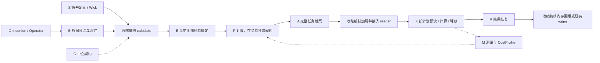

# Correlator L0 / L1 规格

本文是模块 L2 的共同架构基线；完整 cfg 档案已实现，适用边界与平台验收分别列出。
主代理维护本文中的模块目录、依赖及交接契约。
子代理维护 `docs/modules/` 中的 L2，不自行改变这里的跨模块边界。

胶球接入：[胶球零连接顶点](glueball_architecture.md)。S 只补齐空夸克内容
和孤立顶点保留；B 接入已有胶球数据，E 登记无缩并动作的独立 term，P/X/R/A 沿用
既有计划、读取、装配及归档契约。新增 Glueball 与 ArrayGlueball，O 算符体系不扩展。

| 层级 | 回答的问题 | 内容和负责人 |
|---|---|---|
| L0 架构概览 | 哪些模块、放哪里、如何连接 | 本文第一部分；主代理 |
| L1 接口与契约规格 | 交付什么、条件/保证/所有权/错误是什么 | 本文第二部分及 H01—H10；主代理 |
| L2 详细设计规格 | 模块内部怎样实现和验证 | 精确类/函数/状态、算法、异常路径、实现约束；对应子代理，主代理审核 |

## L0：架构概览

### 总流程



以上是当前完整任务档案的数据流；源码依赖以以下矩阵为准。收缩编排负责组合公开接口，不实现下层算法。
每个业务模块只能使用其它模块公开接口或 C 的中立契约，不访问其它模块内部代码/私有状态。
一次跨模块调用仍然必要，隔离要求是无需知道对方内部如何实现。
需要其它模块辅助函数时直接复制到本模块并记录来源；原模块没有需求后清理，不要求主代理逐个裁定。
该规则不复制交接记录的类型定义，不在各模块另建 TensorSpec/Term 目录或优化/调度系统。

### 唯一实现目录及职责

| 模块 | 目标目录（相对于 src/lqcdweave） | 唯一责任 |
|---|---|---|
| S | `operators/correlator/` | 抽象粒子、群投影、时间/dagger、统一 Wick 图 |
| O | `operators/single_hadron/` | 数据无关的两腿/三腿插入与确定算符组合 |
| B | `contraction/binding/` | Operator 与已有数据绑定、无数值描述、注入读取能力 |
| E | `contraction/expansion/` | 全场景网络、点等价关系/采样系数、坐标批次与项映射 |
| P | `contraction/planning/` | 联合状态、路径搜索、计算模板复用及全任务存储/预读规划与可行性 |
| X | `contraction/execution/` | 按给定计划执行、持续预读、真实数组生命周期与异常清理 |
| R | `contraction/results/` | 输出表达式构造、系数回填和嵌套容器/坐标恢复 |
| M | `contraction/performance/` | 执行观测、计算/准备/快照成本模型、拟合/验证/融合与报告 |
| A | `storage/contraction_plans/` | C 完整计划的编码、保存与直接加载；旧格式重绑仅在离线补全路线使用 |
| 收缩编排 | `contraction/correlator.py`（含 `save_calculation_plan`）、`contraction/contraction_task.py`、`contraction/performance/profile.py`、`contraction/contraction_session.py` | 用户 calculate / Calculation / ContractionTask 生命周期、协调计划保存、同步 ContractionSession 及独立计算成本模型命令组装，调用下层公开服务 |
| C | `contracts/correlator/`，既有 execution/measurement 等契约继续复用 | 跨模块的纯记录、轴、身份与协议 |

完整档案的职责增量及实施状态以[目标交接契约](correlator-target-architecture.md#完整规划与直接执行)
和各 L2 为准。E 在保存前描述完整参数化输入要求与兼容条件；P 确定共享、资源事件和预读额度；
R 提供完整输出配方及缓冲需求；A 保存既有 C 记录的扩展；收缩编排分别协调规划和加载
执行。执行完整档案时，A/收缩编排/X 不调用 E/P 做逐坐标重构或规划。

P 的 `optimizers/` 每个算法一个文件；X 的 `operations/` 每类原子操作一个文件；
M 的 `profiles/` 放成本模型文件，另支持用户目录；测量、拟合和调度各有独立文件。
格式 reader 保留在 adapters，生产保留在 production，通用 Dataset 机制保留在 storage，
通用请求调度仍用 runtime/scheduler。它们是既有基础服务，不重复建设。

Correlator 的依赖门禁也扫描 contraction 高层入口与上述模块的公开交接：收缩编排可组合各模块 api，
M 等下层模块不能反向依赖收缩编排，成本模型的 CLI 参数解析不放在 M 的服务实现中。
其他生产/基础测量工作流仍按各自契约和顶层架构检查，不混入 Correlator 类型目录。

Diagram 输入/坐标/轴记录直接由 C.api 交付；图展开、路径选择和输出恢复分别由 E/P/R.api 提供。
旧 contraction/diagram_inputs.py、diagram_expansion.py、path_planning.py、result_structure.py
四个转发入口已删除，内部调用不再借旧路径穿越模块边界；数值与纯记录实现保持唯一。
后续删除 scene_state、scene_paths、scene_storage、joint_planner、measurement、scene_profiling、
profile_fit、scene_cost_report、sampling_expansion 和 direct_contraction 十个纯转发/别名入口。
消费者直接使用 C/P/M/X.api；E 的内部 sampling 记录由模块测试直接核验，不新增公开交接。
S 的 contraction/根级转发、B.single_hadron 转发及 X replay/baryon/sparse 转发随后完成迁移并删除。
已文档化的 operator_transform 在 S.api 提供原函数，真实 getter adapters 保留其行为。

### 源码依赖矩阵（每条箭头都只能走 api/公开协议）

| 调用模块 | 允许依赖 | 禁止依赖的例子 |
|---|---|---|
| S | C、群论/符号基础库 | B/E/P/X，数值 reader |
| O | C、群论/自旋基础库 | B/P/X，文件读取 |
| B | S.api、O.api、C、adapters 和 storage 公开 reader | P 的优化器、X 内部 loader |
| E | S.api、B 的描述协议、R.api 的输出描述构造、C | P 的搜索实现、X 数值核 |
| P | C、M.api 的模型接口、通用张量路径库 | E/B 内部实现、X 数值核或数组读取 |
| X | C、P.api 的计划/状态查询接口、M.api 的测量、注入 loader/后端协议 | P 优化器、R 组装实现 |
| R | C、S.api 的符号表达式识别接口 | P/X/B 实现，读取原始数组 |
| M | C、既有公开报告文件 IO | P 的搜索算法、X 内部执行函数 |
| A | C、P.api 的计划接口、M.api 的模型接口、storage 公开服务 | 收缩编排，自动搜索/执行 |
| 收缩编排 | 各模块 api、adapters 工厂、runtime 公开调度 | 跨模块私有函数或第二套数值算法 |
| C | 标准库及现有纯数组类型/验证基础 | S/O/B/E/P/X/R/M/A/收缩编排的实现 |

资源服务的窄依赖另行明确：`runtime.memory` 只调用 P.api 的纯预算上限解析，
并向其传递已观察的 host/device 数值；P 不调用 runtime 获取资源。
`adapters.hardware_budget` 使用 C.memory 契约与 runtime.memory 的公开观察服务。
X/收缩编排使用同一 runtime 服务执行启动或逐批资源检查，不各自建立设备管理器。
完整档案路线只比较已存资源包络与实际可用资源，不重新计算峰值或改变计划。
该依赖无环；通用 runtime 调度器不因此承担缩并搜索职责。

依赖图须无环。特别是 CostProfile 由 M 定义，P 注入使用；M 不能再导入 P 的状态实现。

三夸克精确交换矩阵由中立 `contracts.quark_exchange.QuarkExchange` 定义，属于纯系数与
符号基础契约；O 的组合投影和 S 的 Wick 约简共同消费，S.api 保留原公开名字。
矩阵契约不导入任何 O/S 行为实现，也不读取数值数据。
复制后的辅助函数归本模块维护，不继续跨模块调用其私有实现。
P 需要的稀疏工作区/成本特征由描述契约提供，不能导入 X 的稀疏数值核以估算成本。
格式 reader 从 B 提供协议给 X；X 不需检查路径后缀、HDF5 布局或 QUDA 类型。

## L1：接口与交接规格

<a id="全-diagram-的整数连接交付目标待迁移"></a>

### 全 Diagram 的整数连接交付

共同格式以[顶层架构](../../ARCHITECTURE.md#diagram-的统一整数连接格式目标待迁移)为准；
为兼容既有文档链接，保留旧标题锚点。受影响 CPU 模块验证通过；GPU/生产规模仍未验收。C 的 `AxisPattern` 使用有序
`tuple[tuple[int, ...], ...]` 输入与 `tuple[int, ...]` 输出；`ContractionTerm.subscripts`
构造后恒为该记录。Factor、Action、Join 和固定矩阵模板也保存整数关系。C 在外部输入
边界一次解析字符串，支持隐式输出和 ASCII 字母，拒绝省略号；直接传给 `ContractionTerm`
的字符串仍要求显式输出。E 根据已知连接直接构造 Pattern，批次轴使用最大现有 ID 加一，
不生成方程字符串。

P 的 Scene、DFS、exact/DP、成本和存储路径，R 的轴解析，以及 X 的 dense/baryon/sparse
数值路线均使用 `AxisPattern`/整数元组。NumPy 走整数
参数，只有要求字符串的实际后端在调用处生成局部标签，不持久化。前端操作、物理支持域
和 GPU 能力保持原状；GPU 与生产规模验证单独进行。

### 共享对象的归属与唯一性

| 交付对象 | 定义归属 | 消费方 | 必须维持的规则 |
|---|---|---|---|
| HadronIrrep / Flavor / Hadron / Diagram | S.api | 用户、B/E/R | 符号身份、粒子槽位、时间、dagger、Wick 系数固定 |
| Insertion / Operator 及项 | O.api；纯项记录可在 C | B | 两腿或三腿有序，逐项系数与端点保留 |
| DiagramBindings、CoordinateSpec、BatchSpec | C | B/E/收缩编排 | bindings 不读数据；坐标顺序与 batch 分离 |
| 项描述、TensorAxisMetadata、物理来源/准备描述 | C | E/P/X | 不含大块数组；真实身份和工作区可核对 |
| TensorSpec、ContractionTerm、Factor、ContractionProblem | C | E/P/X | 唯一数据/结果 ID；Term 持有 `AxisPattern`，Factor 持有整数轴元组；全部 Term 齐全 |
| OutputNode、OutputRecipe、TermContribution | C | E/R | 系数与网络项引用唯一归属，保留原容器/坐标 |
| ExpandedCorrelator 的纯描述 | C；创建由 E | 收缩编排/P/X/R | 网络、来源、输出描述完整；读取能力独立注入，不进入档案 |
| ContractionState 及状态演化 | P.api | P/X/A | 一次 contract 替换所有适用 Term，返回新状态 |
| PlannedContraction / SceneStoragePlan 的交付描述 | C；构建由 P | 收缩编排/X/A | 目标扩展为共享模板、全范围实例绑定、存储/预读事件、输出引用及已审计资源包络 |
| loader、backend、measurement 协议 | C / 已有公开协议 | B/X/M | 显式注入；所有权、stream 与清理职责明确 |
| TermValue、PathExecution、ExecutionRequest | 复用 contracts/execution.py | X/R/收缩编排/runtime | 值的有效期、term_id、坐标、状态明确 |
| CostProfile | M.api | P/A/收缩编排 | 纯预测；来源、硬件与校准覆盖可查询 |
| ActionTiming / PhaseTiming / ReplayReport | 复用 C 中已有测量契约 | X/M/收缩编排 | 包含关系明确、设备计时边界明确，不重复累加 |
| Calculation | 收缩编排 | 用户 | plan、prediction、value、report；run 不重搜 |
| ContractionSession / 兼容结果名称 | 收缩编排 | 用户 | 动态方法组合 B/E/P/X/R；from_plan 检查并准备一次，execute_cfg 不重搜；数值结果统一返回 Calculation，旧 values/stats 经兼容层访问 |

已有记录按字段职责迁入中立契约，或保留公开兼容别名；不得复制一套同名记录。
TensorSpec.description 的 TensorDescription 保留轴、身份、依赖来源和变换；semantics/transform
描述不随组态与坐标值改变的含义，bindings 记录实际组态、基底、端点、点池/坐标和覆盖。
结构与语义可复用不等于实际绑定身份相同；新 bindings 的兼容性与资源审计在
规划/离线补全阶段完成。完整档案执行接入实际来源并核对兼容条件；cfg 或输入身份不同
可以共享兼容模板，结构、布局或资源要求变化须重新规划。
旧 TensorSpec 的 shape/dtype equality 只表示数值 ABI，不能据此判断科学身份或缓存共享。
保留已有数值语义与类型身份；持久档案的版本/白名单升级由 A 提出、主代理审核。
行为对象（State、CostProfile、Operator）由其所属模块实现，C 只定义所需协议/纯字段。

### 模块公开交接入口

下表记录现有公开入口。`CfgPlan` 与 `unified-device-v2` payload 已保存参数化准备、
普通及 special operation、合批和 host/device 资源安排；加载不重新展开或选路径。
缺少可序列化 preparation recipe 的 opaque 输入与 coordinate-batched sparse GPU 仍不支持。
执行期 header 兼容校验是绑定核验，不是重新规划；历史定向 GPU 证据不代表本次修改后全平台验收。
未给出的内部方法与类由 L2 设计，
不将私有辅助函数变成公共 API。

| 模块 | 公开入口 | 输入 → 输出 | 交接要求 |
|---|---|---|---|
| S | gen_correlator、hadron_little_group_projection | 抽象粒子/算符集合 → 符号 correlator | H01；介子/重子共用同味 Wick 配对，投影内部不展开 |
| O | Insertion、Operator、ConservedVectorOperator(Operator) | 插入结构/行/系数 → 确定项组合 | H02；三腿表示耦合由 Insertion 统一提供 |
| B | Meson/Baryon/Current(Meson)、describe_factors、绑定描述协议 | 已有 reader + Operator + 实际范围 → 无数值项描述 | H02；描述/绑定阶段不读取、不隐式生产 |
| B 显式 eager 服务 | read_simple_diagram_inputs、read_baryon_diagram_inputs、Meson/Baryon getter | 已有 reader + 明确数值请求 → 借用值或立即快照 | 执行期显式读取；动态服务每次 getter 后立刻复制，普通 getter 遵守其借用契约；调用期对象 ID 不作持久身份 |
| E | expand_correlator | correlator + bindings + 描述协议 + 坐标/batch → ExpandedCorrelator | H03；系数、采样、网络和输出映射完备 |
| P | find_contraction_path、split_independent_terms | 展开描述 + 模型 + 预算/搜索/存储选项 → 可执行计划 | H04/H05；不接触真实数组 |
| X | execute_contraction_path、BoundContractionExecution.execute | 展开描述 + 给定计划 + loader/后端 → PathExecution | H06/H07；不搜索、不组装用户容器 |
| R | build_output_recipe、assemble_correlator | 原容器/项映射 → recipe；recipe + term_values → value | H03/H07；不做网络缩并 |
| M | load_cost_profile、测量上下文、fit/merge/save 接口 | profile 选择/操作观测/报告 → 模型或报告 | H08；不启动生产计算 |
| A | 既有 save/load/rebind 公共接口 | C `PlannedContraction` + 显式归档元数据 → 档案；当前 C 输入 + 档案 → 固定路径重绑计划 | H09；不接收收缩编排 `Calculation`，不保存回调，不隐式搜索 |
| 收缩编排 | calculate、Calculation.run、save_calculation_plan | 测量定义与已有数据、选项 → Calculation；Calculation + 显式保存选项 → 计划档案 | H10；协调 A 公开接口，prepare/load/reshape 不进入用户脚本 |

完整字段保证、所有权与错误职责以[H01—H10](correlator-target-architecture.md#模块交接契约主要审阅内容)为准。
L2 必须逐条指出本模块如何兑现，不能把未实现项写成通过。
原生图的描述 provider 选择由 E.api 的 NativeDiagramBinding 承担，收缩编排创建并注入；
B 只绑定单顶点和 reader，不负责完整 Diagram 的展开分派。

### 现有四阶段调用契约

```python
expanded = expand_correlator(
    correlator, adapter=binding_provider, bindings=bindings,
    time_axes=None, time_pairs=None, batch="auto",
)
path = find_contraction_path(
    expanded, memory_limit=device_or_cpu_budget, host_memory_limit=host_budget,
    optimize="anytime", storage=None, profile=resolved_profile, search=None,
    reserved_host_bytes=0, reserved_device_bytes=0,
)
executed = execute_contraction_path(expanded, path, backend=backend, measure=False)
value = assemble_correlator(expanded, executed.term_values)
```

该顺序是收缩编排的职责。协议/字段迁入 C 后，公共签名可保留，消费方不得访问 E/P/X 的内部文件。
完整任务档案路线按上面的流程实现：保存前完成 E/P/R，执行时从 A 加载已存
描述直接交 X/R。现有调用示例不表示加载档案必须先执行 E/P，也不新增用户管理
模板、实际绑定或预读的步骤。
`path.expanded` 若含批宽选择后采用的展开描述，收缩编排必须使用该交付描述执行，不能混用初始候选。
空 correlator、常量和空容器走同样结果恢复契约，允许空问题/空计划，不伪造 Term。

### 默认值与可查询选项

| 选项 | 默认行为 | 约束 |
|---|---|---|
| optimize | `"anytime"` | 单一搜索方法选择；给定路径复用/none 路径另明确，不增加 joint |
| storage | `None`，入口解析为适用的有预算策略 | 有预算、保留与重载能力明确；不默认为无约束 |
| batch | `"auto"` | 可多 sink 时间向量化；由完整峰值选择，不默认逐对标量 |
| profile | `None` 加载默认模型 | 显式传入对象/名称/文件优先；来源/未校准状态可查询 |
| execute / measure | `True` / `False` | execute=False 不读数值；measure 不改变数值语义 |
| search | `None` | 算法预算沿用既有默认并在 L2 列出；实际采用值须可查询 |
| degenerate | gen_correlator 中 `True` | 匹配同味后再合并 u/d 数据标签 |
| 时间范围 | 固定时间沿符号请求；扫描采用显式范围 | 默认测量策略为全时间，不能自动稀疏时间；time_axes/time_pairs 互斥 |
| memory_limit / host_memory_limit | 可省略但必须由已有预算解析或明确目标规格获得 | 不能将未知预算静默当无限；目标规格不完整时报告缺项 |

P 接收已解析的纯预算/硬件描述；规划不要求在计算硬件上运行。
运行超规划目标只记录偏差，真实后端失败照常报告。
默认解析复用已有预算服务，不由每个模块分别发现设备或设定不同预算。

### 所有权和错误总规则

- 描述/计划为不可变或只读交付对象；规划不得修改调用方的数据登记。
- 真实数组表属于 X；reader/loader 的借用与清理严格遵守 H06/H07。
- 系数与输出恢复表达式属于 E/R 的交接，不在各算法或执行核重复计权。
- 非法参数/类型：入口或对象验证报 TypeError/ValueError；缺少覆盖/科学身份兼容性：B/E 报具体数据错误。
- 规划未找到可行解与已证明不可行区分；后端未支持与数据错误区分。L2 指明现有错误类型及适配需要。
- X 传播真实数值/OOM 错误并带操作上下文，清理错误不覆盖原错误；不隐式重试、重交或重新优化。
- 只在数值核已支持、输入有效且存储约束可兑现时采用直接 fallback，并在计划/report 记录原因。

## L2 分工与审核顺序

各模块负责人维护对应的 L2 详细设计，记录当前实现、公开签名、C 归属、无环依赖、
H01—H10、旧代码复用位置、异常/所有权和验收证据。主代理审核跨模块交接与验证状态；
L2 的日常更新不另设用户审批步骤。改变 L1 契约时须协调相关调用方，再同步更新本文和受影响 L2。

### 数值输出与执行资源的所有权

收缩编排选择输出模式并组合服务；R 交付字段/结果，P 冻结输出容量，storage 编码、读取并发布。
TS 唯一维护物理时间配对、计数与均值服务；保存便利入口显式调用它，保留各入口 dtype 与缺失策略。
runtime 观察资源并管理进程级生命周期；X 只持有单次执行的有界池、stream、事件、数组与释放同步，
不得自行选设备、探测容量或注册全局设备。B 的描述无 IO 与显式 eager 读取是两种不同协议。

为保持现有显式保存/归约便利入口，允许两条限定的单向服务边：
`storage.correlator_results` 只从 `sampling.temporal.api` 导入
`pair_time_differences`、`count_time_pairs`、`mean_time_pairs`；
`storage._cfg_correlator_output` 只导入 `TimePairAccumulator`。
它们传递调用方已声明的时间坐标及 dtype/missing 政策，不搜索或选择采样方案。
底层 DatasetWriter/Reader 不依赖 TS，TS 不反向依赖 storage。
不放宽其它 storage 模块的依赖；TS 私有路径、选择/搜索函数、整个 API 模块或动态导入均不在此例外内。
此范围由 `tests/test_architecture.py` 的具名服务白名单与负例门禁约束。
