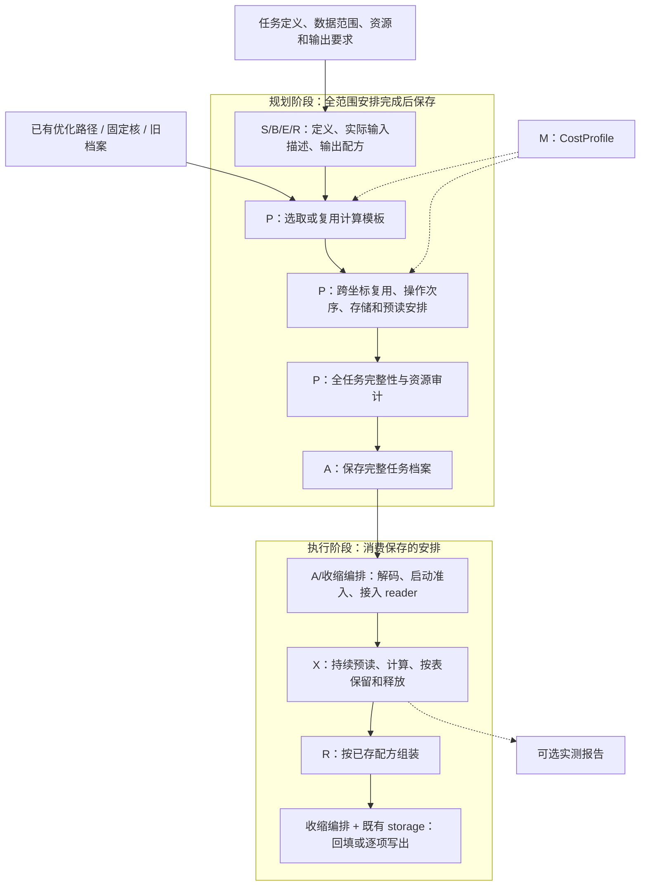

# Correlator 模块交接契约

本文件维护当前的 H01—H10 交付字段、保证、所有权和错误职责；
精确接口、默认值与当前支持限制由对应[模块 L2](../modules/README.md)维护，源码用于核对实际实现。
模块目录、职责和公开依赖由 [L0/L1](correlator-l0-l1.md) 统一维护。
图只展开模块边界，不展开投影算法、Wick 递归和内核内部辅助函数。
图中的 `calculate` 展示收缩编排的便利组装路线；调用方也可组合 E/P/X/R 的公开 API，交接保证相同。

## Diagram 的统一整数连接格式

全 Diagram 的格式要求见[顶层架构](../../ARCHITECTURE.md#diagram-的统一整数连接格式目标待迁移)。
旧链接锚点保留；C 的 Term/Factor/Action/Join/固定矩阵模板、E 的已知连接展开和批次轴、
P 的 Scene/DFS/exact/DP/cost/storage、R 的轴解析及 X 的 dense/baryon/sparse 路线已使用
`AxisPattern`/整数元组。受影响 CPU 模块验证通过；GPU/生产规模仍未验收。

H01/H02 保留符号连接、有序腿槽、具名物理轴和数据 ID；H03 直接交付整数 `AxisPattern`
和有序 ID，不由 E 生成或解析方程。H04/H05 的共享和路径使用计算/结果 ID 及整数关系；
H06 以整数关系调用数值核；H07 按整数输出轴和配方恢复结果；H08 由整数关系计价。
C 的字符串输入只在 `parse_axis_pattern` 边界解析一次，支持显式/隐式输出及 ASCII 字母，
不支持省略号；直接传入 `ContractionTerm` 的字符串仍要求显式输出。X 的 NumPy 使用整数参数，只有实际字符串后端才在调用处生成局部标签，
不存入计划或档案。前端不增加操作；物理域与后端支持保持现状。

## 完整规划与直接执行

以下是普通缩并和专用矩阵核共同遵守的架构要求。当前 `CfgPlan`/`unified-device-v2` 已接通
完整 cfg 计划、直接加载、连续执行、memory 与 Dataset 输出；NumPy/CuPy 共用统一设备路径。
可序列化准备描述的 sparse bridge 与 baryon join 已接入；缺少可保存 preparation recipe 的
opaque 输入与 coordinate-batched sparse GPU 仍不支持。历史 V100 定向验收不是全部 GPU 核、
本次修改后 GPU、真实 MPI 多 worker 或生产规模验收。任务定义、计算路径、
参数化输入要求、全局存储、跨坐标预读和输出安排必须在保存前完成；实际 cfg、数据位置和物理
时间坐标在执行时绑定并按档案条件核对。执行完整任务档案时不再展开表达式、发现共享、重放符号路径、重排存储或重新预测成本。
“无额外规划开销”不包括计划解码、打开句柄、数值准备、必要的队列通知和等待。

规划范围包括算符及输出定义、cfg/实际坐标的允许范围、分区、来源角色、后端、资源预算和写出方式。
采用一份可复用 cfg 计划：档案保存完整的参数化安排与兼容条件，worker 运行时只绑定实际 cfg、
数据位置和时间坐标。结构、轴、维度、精度、拓扑、共享关系、准备布局、核参数和资源上界兼容的 cfg
共享只读模板；数据身份和读取句柄仍按实际来源独立绑定。无需把所有具体 cfg 路径与绑定对象
重复写入档案，也不允许执行时扩展已保存的参数范围或改变模板规格。

生产任务通过现有 `Dispatch` 交给独立 worker；每个 worker 消费同一份只读计划和自己的 cfg
迭代器。`calculate` 完整档案路线由 owner thread 逐项领取配置，不先展开整个迭代器；只有已领取且
计划范围兼容的 cfg 可进入持续读取队列。此代码路径已在 CPU 测试中覆盖；真实 MPI 多 worker
执行仍未验收。

已有路径、固定核和旧档案都可作为规划输入。兼容性绑定、必要的全任务补全及
审计只在规划阶段进行。完整 cfg 档案直接载入；缺少完整 payload 的旧档案明确要求先
离线补全，执行器不静默升级、重新优化或改变预算。旧 `correlator-plan` 低层重绑 API 仍
保留给显式离线调用者；收缩编排的完整 cfg 分支不会先展开再加载该旧格式。

## 总流程图

实线表示阶段交接；虚线表示成本输入和可选测量。执行阶段没有指回规划的边。
即时 calculate 可以在一次调用中连续完成两阶段，保存后另行计算也采用相同交付契约。
矩阵核的具体定义及实现差距见[矩阵计算架构](meson_matrix_architecture.md)。

## 保存前必须完成的工作

1. **描述完整范围。** 收缩编排收集请求，S/B/E/R 给出任务定义、所有实际来源和输出配方。
   元数据可以逐项处理，不读生产张量。相同结构只展开一次；不同 shape、dtype、
   拓扑、准备布局或资源包络形成明确变体，提前分配到对应模板。
2. **取得计算安排。** P 接受已有 Action 路径、固定矩阵核或搜索结果；完整且兼容
   的路径直接复用。确定块宽、原子核路径、共享结果及输入准备顺序。给定路径只
   补充尚未确定的内容，不因接入全任务档案重新搜索。
3. **安排跨坐标复用。** 根据实际输入、变换和操作身份登记公共数据与结果，确定
   生产者和全部消费者。默认存储重排保持已选计算 DAG 的节点、次数、规格和核
   路径，只改变满足依赖的次序，并复核总模型计算成本；实际运行耗时仍需测量。
   相同 shape 不构成共享依据。
4. **确定物理生命周期。** P 联合安排实际块的读取、准备、缓存、最后使用及释放，
   计入借用、传输和所有工作区；空间足够时保留有后续用途的缓存。回收或暂存若
   属于采用的操作域，须有显式动作与支持它的后端、档案和执行器。
5. **确定预读安排。** 保存参数化读取顺序、启动依赖、消费/释放位置和额度变化，覆盖 worker
   连续消费的时间对及 cfg。依赖操作完成事件及数据就绪，不使用预计秒数作为正确性依据。
6. **确定输出安排。** R 给出组装配方、坐标映射和缓冲需求，收缩编排/storage 确定结果
   接收方式。内存返回计入完整结果；逐项写出计入当前结果、累计器和写出缓冲。
   实际物理时间重建、输出字段及归一化在此固定。
7. **联合审计并保存。** 核对计算完整性、所有实例覆盖、生产/消费依赖、资源峰值
   和输出生命周期；可行后由 A 原子保存。未完成规划不能发布为完整执行档案。

计算、存储和预读可在规划阶段内部迭代。普通启发式可先选择计算 DAG，再排存储和
IO；它不因此获得全局最优保证。exact/DP 保留原物理操作域及目标函数的证明，
不把跨坐标后处理或异步总耗时纳入未经证明的最优范围。模型的串行各项成本、
异步耗时估计和实际 wall time 分别报告；默认模型不冒充硬件实测。

## 完整档案的内容与所有权

扩展既有 C 计划描述及 A 的版本化 envelope，不引入第二套执行 IR、缓存或调度系统。
下表是信息职责，不要求逐行增加类或前端参数。

| 内容 | 保存形式与用途 | 生成方 |
|---|---|---|
| 任务定义与适用范围 | cfg/坐标参数范围、算符/分区/约定、后端和版本、预算及支持条件 | 收缩编排汇集 S/B/E/R 的 C 描述 |
| 计算模板 | 既有 Action、核规格、输入/输出角色、dtype/布局、块宽和已选核路径 | P |
| 常量 | 系数、自旋和 PC 表等只读任务常量，保存一次，格式和精度明确 | S/B/E/R |
| 实例与实际输入 | 模板 ID、reader role、selection、准备描述、参数化定位及兼容条件；实际数据身份由 worker 绑定 | E 描述，P 固定引用 |
| 资源事件 | 既有 SceneStoragePlan/StorageEvent 的读取、准备、保留、释放和跨实例引用 | P |
| 预读描述 | 读取 FIFO、启动依赖、消费/释放位置、每块占用上界及各阶段允许的额度 | P，消费 B/reader 的纯描述 |
| 输出描述 | OutputRecipe、轴/容器、实际坐标重建映射、交付位置和缓冲生命周期 | R；收缩编排/storage 确定接收方式 |
| 审计与来源 | 覆盖、资源包络、成本及模型来源、适用限制；不保存搜索历史 | P/M；A 编码 |

生产输入数组、数值中间结果、线程、future、回调和文件句柄不入档。小型只读系数
属于任务定义，可以持久化；A 不借此读入生产数据。完整档案足以恢复执行和输出
配方，不能要求先用 E 重建 expected 才能加载。

计算模板和实例表分别保存，重复的调度片段可用引用或计数循环表示。动作位置可
表示为“实例序号、模板内动作序号”；其展开顺序在保存前确定。执行时只解析索引，
不重新构造 Term、ContractionState 或逐实例完整问题。不能用进程内对象 ID 或
Python hash 作持久身份。不同 cfg 的实际数据分别登记，共享模板不共享数值数组。

设 K 为模板/常量总量，N 为参数化实例/坐标描述数，B 为不同输入身份的绑定规则数，E 为存储和预读事件
描述数，元数据规模按 O(K+N+B+E) 组织。E 的重复片段只有证明可复用后才能压缩；
不宣称所有任务都能消掉 N 与每实例操作数的乘积。规划可以逐项构造和写出临时
片段，完成审计后发布；执行可有界解码已保存片段，不积累全部对象图。

## 跨时间对与 cfg 预读的执行契约

以实际读取块为单位，每个 worker 复用一个持续的 ReadAhead 队列，覆盖时间对和 cfg 边界；
当前 cfg 计算期间可读取该 worker 已领取的后续 cfg。共享块按计划读取并保留到最后消费者，
不因时间对、分窗或 cfg 边界关闭队列。实际来源身份进入数据键，避免不同 cfg 的数组、圈结果
和句柄混用。独立 worker 不共享数值缓存。

读取次序、当前操作的必需空间、输出缓冲和预读额度共同受保存的资源包络约束。正在读取及已读
未消费的数据都计入预读额度，且不得占用必需计算的预留空间。启动时可按实际分配收缩独立预读
额度，不重新排程；无余量时暂停领取和预读。多个 worker 的预读预算由作业层分配，合计不超过
节点资源。已有 Dispatch 领取语义保持不变，不增加 ACK、租约或自动回收；worker 不清理共享队列，
统一收尾在所有 worker 完成后进行。失败后的待重跑范围由原任务清单和已发布完整产物确定。

P 为读取记录提供以下已确定的信息，X 只消费这些记录：

- 物理块与目标驻留位置、后台读取资格、读取/暂存缓冲上界。
- 允许启动的操作完成依赖，以及读取结果被等待、消费和释放的位置。
- 对应阶段的预读额度、借用结束条件和与计算/输出共享的资源约束。

P 必须覆盖读取异步完成的情况：正在读取和已完成但尚未消费的数据都占用预留；
不能因 future 完成就归还全部额度。输入、计算、准备、传输、输出和预读的同时占用
均受约束，主机和设备分别核算。同一 owner 只计一次，拷贝时按真实的源/目标并存
计入峰值。读取若跨越后续计算峰值，整个存活区间都必须容得下。为当前必需读取和
计算保留空间，避免未来预读占满额度后导致当前工作无法推进。

X 维护队列游标、已占字节、完成标志和实际数组；按已保存的依赖及额度提交 FIFO
读取。额度足够就继续向后取数，不固定只能提前一个时间对。当前需要的数据未
就绪时等待，已就绪时直接消费。此处的整数计数和事件通知是执行管理，不触发
需求分析、未来峰值扫描、重排或动态淘汰策略。

未来读取须显式绑定自己的实际来源，不能依赖可变的“当前 batch”。沿用已有
loader/ReadAhead 和线程设施，后台 worker 只做协议允许的 host 读取；准备和设备
传输按已选后端的 owner/stream 约定执行，不把 CPU 预读升级为 GPU 并发验收。
消费者失败或取消时停止提交，等待读取退出并清理未消费值，再关闭自有句柄；
借用句柄按所有者约定处理，清理异常不能覆盖原错误。

## 加载与前端边界

完整任务档案路线由收缩编排先交 A 解码，检查版本、执行后端和声明的资源条件，再将
既有 adapter/reader 能力接到保存的定位描述上。启动准入可比较实际可用资源与
已存包络，不重新计算包络。句柄可按需打开，计划片段可按需解码；每个执行坐标只按已存
参数化安排绑定当前 cfg、数据位置和时间坐标，不调用 `DiagramData.describe`、图/Term 展开、
`MatrixCatalogBinder.bind` 或固定路径重演来重新生成执行安排。reader 可调用
`describe_block` 等只读 header 接口，核对当前 cfg 与已存轴、shape、dtype、layout、坐标和共享关系；
这项兼容检查须发生在数值读取前，不构成图展开或路径规划。

兼容模板范围内的新 cfg 与其实际数据位置可在执行时绑定；同一已登记输入的路径搬迁也可由
storage 重新定位。改变 shape/dtype、轴/布局、拓扑、语义、准备上界、后端或计划资源政策，或
超出已保存坐标/来源范围，属于规划输入变化，须先离线补全或重新生成档案。不在执行途中适配
不兼容计划。源数据缺失或运行条件不足
明确失败；实际数组分配、设备启动和 IO 耗时仍由执行观测记录。

即时入口继续沿用 `calculate`、`execute=False` 和档案加载。显式任务入口使用
`ContractionTask`：构造保存声明，`plan()` 完成全部坐标、所选批宽和尾批的计划，
`run()` 执行已保存的安排。两者复用同一套规划与执行服务。完整档案执行不要求用户
重建算符目录或手动拼接模板、实例及预读对象；任务定义、保存和计算可分进程进行。
具体调用与生命周期见[任务与返回](../modules/correlator/calculation.md)。

目标收缩编排入口允许 `calculate(configuration=cfg_or_iterable)` 接收单个 cfg 或迭代器，包含
现有 `Dispatch`；`output` 省略时返回内存结果，指定时使用既有 `DatasetWriter` 流式保存。
传入 `plan_archive` 时允许省略 correlator，使收缩编排直接进入档案加载与输入绑定。字段、坐标、
累计/打包方式及内存或写出缓冲均在保存前确定；执行期可更换输出根目录，但不能改变已存配方。
完整 cfg 入口已接通 NumPy 与 CuPy；完整任务的 CPU/GPU 坐标批次、尾批和直接档案回放
验收见[任务与返回](../modules/correlator/calculation.md)。这不表示所有专用结构均已支持坐标合批；
稀疏/重子结构、真实生产与 MPI 范围由对应模块及平台证据说明。

## 接入顺序与验收要求

1. **已接通 dense NumPy 离线计划。** C/P 补充完整计划描述，复用已有 Action/SceneStoragePlan、固定核和已选路径；
   E/R 提供完整绑定与输出配方。先形成可审计的全范围元数据计划。
2. **已接通完整保存与直接加载。** A 扩展现有白名单与 envelope，支持常量、矩阵核、重复片段及完整输出描述；
   收缩编排先加载后接 reader。旧计划的补全是显式规划工作，不属于执行加载。
3. **已接通已验收结构的 CPU/GPU 执行与交付。** X 直接消费已存事件和额度，接通跨时间对持续预读；R/收缩编排接入有界结果交付和
   既有 writer，删除对执行期逐坐标重绑/重审计的依赖后再清理退役路线。
4. 验证完整档案的保存/加载等价、全范围覆盖、数值、资源和异常路径；随后进行
    真实单 cfg 与 401 cfg 生产验收，实际输出字段与目的地容量必须明确；新增 GPU 结构与 MPI 需分别验收。

关键验收包括：在独立进程加载后禁止调用 E 展开、P 搜索/固定路径重演/存储规划/
join/retention 和 M 成本重算，仍能完成多时间对执行；覆盖相同物理块共享、单时间
结果复用、窗口边界连续预读、零预读余量、慢 IO/慢消费、写出失败和取消。比较
规划与加载/初始化、读取、计算、组装、写出的时间，分别记录计划字节及运行峰值。
相关模块测试支持实现验收；GPU、RSS/native 工作区和生产规模需相应平台证据。

## 模块交接契约（主要审阅内容）

以下规定模块交接时必须提供的信息和保证；不要求这些信息各自成为一个新类。
可以由现有对象、具名记录或已有档案承载。字段名称用于明确含义，后端适配时核对现有字段。
每次调用均显式传入其依赖，不以全局变量、文件名或对象类型猜测物理约定。

### H01：符号构造 → 数据绑定与展开

**交付：符号 `correlator`。**

| 必须交付 | 下游可以依赖的保证 |
|---|---|
| Diagram 的连接矩阵、顶点列表、夸克槽位与传播子连接 | 每条传播子指定两个具体槽位；重子三槽位的顺序保留；E 直接构造整数指标关系，不再匹配以发现连接 |
| 各顶点的名称、动量、irrep/行、时间标签、dagger | vertex_map 能按符号顶点定位对应 Operator；投影内各粒子的时间未丢失 |
| 传播子的味标签及 degenerate 选择 | 同味配对已完成；合并 u/d 数据标签的约定明确 |
| 投影/味道/Wick 系数及和、积、幂表达式 | 费米符号已计入；下游不重做 Wick 或再次添加该符号 |
| 容器类型、键、形状、顺序及共享 Diagram 身份 | 同名图保持同一对象语义；输出位置不会被当作新的图身份 |

不交付数值数组或文件路径。符号层负责非法量子数、无效时间安排及无法成立的符号构造反馈；
数据层负责缺失绑定。零投影或无合法配对产生的零表达式不是读取错误。

### H02：Operator + reader → 无数值的顶点项描述

**交付：每个展开项的描述记录，即 `describe_factors` 的返回内容。**

| 必须交付 | 下游可以依赖的保证 |
|---|---|
| 项标识、系数、自旋结构/自旋基、腿顺序 | 数值原始块是否已加权明确；目标约定为原始块不含 Operator 系数 |
| 每条腿的 bar/field 属性、V/P 类型、实际时空端点 | 锚点与真实端点分开；跨时间/跨空间流逐项可确定传播子需求 |
| dagger 后的腿对应、共轭及轴变换描述 | 下游按一次明确变换物化，不自行猜测源端约定 |
| 所需空间 component、路径、动量及相位约定 | 逻辑项可定位到实际数据记录；不从形状推断路径或相位 |
| shape、dtype、具名轴、Ne/Np 范围 | 可估计张量大小、推导缩并指标及选择批宽 |
| 组态、实际基底身份/顺序、时间覆盖、边界与适用归一化 | 可核对传播子与顶点的兼容性；未知身份保持未知 |
| 点池身份、实际坐标/坐标登记引用、采样规则及参数依赖 | 可判断哪些点共享取样、哪些参数改变采样系数 |
| 物理块/slab 身份、逻辑视图、物化变换和读取工作区描述 | 逻辑张量与真正读取对象分开，可共享 IO 并估算准备成本 |

记录只含小型系数/自旋信息、元数据及定位描述；不包含已读取的大块 elemental/传播子。
reader 的数值读取入口独立保留到执行阶段。数据绑定负责覆盖、轴、身份和约定检查；
缺少本计算必需信息时在展开/规划前说明缺项，不能补造身份或假定兼容。
介子与重子允许记录不同腿数；下游使用共同的描述语义，不要求相同的记录类。

### H03：展开 → 路径与存储规划

**交付：`ExpandedCorrelator` 的纯描述，完整包含下表五部分。**
全任务可以用共享模板和实例引用表达完整范围，不要求每个坐标复制全部 Term。

| 部分 | 必须包含的信息与保证 |
|---|---|
| `tensor_specs` 唯一目录 | 每个 tensor_id 的具名轴、维度、dtype、语义身份、来源和必要变换；相同身份只登记一次，不能仅凭 shape 合并 |
| 全部 `terms` | term_id、有序因子数据/结果 ID、`subscripts: AxisPattern`（整数输入轴和有序输出轴）；成员共享和特殊核引用明确，不以字符串作为交付格式 |
| 场景/坐标描述 | 全部实际时间/空间坐标、参数点、扇区、点等价关系和采样依赖；内部批次不改变请求顺序 |
| 物理来源描述 | 逻辑张量到物理块/slab 的关系、读取大小、准备/传输工作区、可共享视图条件与可重载能力 |
| 输出恢复表达式 | 每个输出位置如何由 term_id 值乘系数及求和/积/幂恢复，以及原容器和坐标布局 |

所有投影、味道、Wick、Operator 和采样系数均有唯一归属。
Term 的外层 coefficient 保持1。线性算符/分区的系数可属于显式系数因子及映射，
Wick/味道/采样等外层系数属于输出配方；每种系数记录其唯一归属，不能在两处重复应用。
自旋张量内部的数值元素是网络输入，不再作为一个外部系数重复相乘。
完整图的采样关系须在拆分网络前确定；图中的非连通网络作为独立 Term 计算，
其乘积关系仍保留在输出恢复表达式中。

展开阶段负责证明网络定义完整、各指标维度相容和系数无重复归属。
优化器无需理解 irrep 或重新推导采样系数；只操作交付的数值网络与成本/存储描述。

### H04：当前联合状态 → 独立分量搜索

**交付：分量列表 + 原项映射 + 共用物理需求。**

输入是残余 `ContractionState`：唯一张量目录、所有残余 Term、驻留描述、已完成结果和合法操作。
`split_independent_terms` 只能拆开无法再共享缩并操作的分量；若不能确定，则保持联合搜索。
仅检查“当前是否共享同名输入”不足以作为判据。

拆分结果必须保留 tensor_id/term_id、整数指标模板引用、此前中间结果 ID 及动作前缀。
初始共享匹配和后续操作匹配复用已登记的计算/结果 ID；不得为分类重新生成字符串或
以输出位置、同名/同形状代替实际输入和完整连接关系。
各分量交回候选缩并路径；物理块生命周期与主机/设备峰值仍由全局存储规划处理。
分量搜索不能自行假定独占内存预算或将共用原始块复制为不同身份。

### H05：路径搜索 + 存储规划 → 执行

**交付：可执行的 `PlannedContraction`，不能只交一个 einsum 路径。**

| 必须交付 | 执行器可以依赖的保证 |
|---|---|
| 展开问题的签名、目标后端/硬件规格、执行方式 | 路径对应当前问题；规划路径、给定路径或直接核选择明确 |
| 有序操作、计算/结果 ID、输入/输出 tensor_id、整数指标映射与输出项映射 | 每个操作的输入已可用；一次共享 contract 的全部受影响 Term 已记录；不保存派生 einsum 字符串 |
| 实际 batch 与坐标映射 | 每个请求坐标恰好覆盖一次；尾批尺寸真实，无补零替换 |
| 物理加载、物化、传输、保留、释放、淘汰/重载事件 | 共享块只按计划读取；借用期间不会释放其所有者 |
| 全范围参数化输入表、跨坐标共享和模板引用 | 档案保存兼容条件与请求规则；worker 在读取数值前绑定并检查当前 cfg，不逐坐标重建表达式或寻找共享 |
| 预读顺序、启动依赖、消费位置和额度 | 任意允许的异步完成顺序均满足资源包络；当前必需操作不会被预读阻塞空间 |
| 输出配方、任务常量、接收方式及缓冲生命周期 | 无需重新展开就能恢复原结果；消费者完成前保持值有效 |
| 主机/设备预算、各类工作区、输出预留与预测峰值 | 整条可执行计划在目标预算下可行，不遗漏直接路径或复制工作区 |
| 成本预测、profile 来源与搜索时间 | 成本预测只含计算、准备与快照；IO 时间不计价，实际读取/传输观测及物理字节仍保留 |
| 计划使用前必须满足的兼容条件 | 执行器只做启动准入，不重搜、不重演符号路径、不重新安排存储 |

路径搜索和存储规划可以内部迭代，最终仅交付完整可行计划。
直接路径也需交付执行顺序、来源需求和存储估算；无法规划的特殊数值核须明确其支持范围与工作区，
不能用 fallback 绕过预算设计。规划不可行在此报告，不交付伪装成功的计划。
运行实测越过目标只记偏差；真实分配失败和数值核错误由执行层报告。

### H06：调度器 → reader 与原子操作

**交付：具体操作请求 + 所需数组/借用句柄 + 后端/stream + 测量上下文。**

每个请求指定操作类型、输入输出身份、具名轴/指标、实际块范围或坐标，以及约定的工作区。
目标请求携带整数关系；需要 einsum 字符串的后端由 X 在本次数值调用处适配，
不提前生成用于搜索、匹配、计价或持久化的字母指标，也不重新选择缩并路径。
原子操作只完成该请求，返回结果、所有权/借用关系和测量事件；不选择优化算法或隐式读取额外数据。
需要原始读取、准备、传输的复合动作须分别向 measurement 暴露操作边界。

执行器维护真实数组表，规划状态仅维护驻留描述。
借用数组的底层物理块要保留到最后一个使用它的视图结束；异步设备操作完成前不能提前释放。
用户提供的 reader 由用户持有，执行器只关闭自己拥有的句柄和临时块。
操作失败附带 action_id/输入身份与原始错误；异常清理不替换原错误，不自动重交计算。

### H07：执行 → 结果回填

**交付：`term_id × 坐标` 的数值项及执行报告，覆盖完整请求。**

允许按已规划的输出单元逐项交付，不要求同时持有全任务数值映射。跨项消费者
与累计器的生命周期已在 H05 计入；不能为逐项写出偷偷重复计算基础项。

每项携带结果 ID、预期结果轴、shape/dtype、坐标标识及数值有效期。
R 使用整数输出轴和系数/选择映射恢复容器，不解析或生成 einsum 方程。
若值借用可复用设备缓冲，须先复制到稳定存储或交给约定的输出接收方，再归还该缓冲。
已完成、失败和未完成的项不能混同；缺失/重复坐标必须可检测。

`assemble_correlator` 仅按 H03 的输出恢复表达式计算系数和标量/结果数组的和、积、幂，
不补做网络缩并，不读取原始数据，不重新规划。
返回的 `value` 保持原 dict/array/list/tuple 类型、嵌套与请求坐标顺序。
完整结果存储计入主机预算；结果过大使用既有持久输出能力，不能依赖设备分批来声称结果也放得下。

### H08：原子操作 → measurement → profile 拟合

**交付：可关联到操作的测量记录，再交付有适用范围的 `CostProfile`。**

测量记录包含 action_id、操作类别、输入规模/shape/dtype、硬件和后端、计时边界、耗时、
相关 IO/传输字节数及内存记录。父动作总耗时与子阶段耗时有明确包含关系，不能重复求和。
设备耗时使用正确 stream 的完成事件；关闭 measure 不改变计算所需同步和数值含义。

拟合程序只消费报告，交付各操作成本函数、覆盖范围、训练/验证来源及误差。
目标格式的维度、运算量、流量及工作区特征由整数连接和数据规格推导，
不生成或解析派生 einsum 字符串；报告保留计算/结果 ID 以对应计划与实测。
融合程序保留权重与来源。规划器只使用模型预测，不调用测量程序或启动实际计算。
默认 profile 的未校准项须可识别；不把缺少测量视作该操作耗时为零。

### H09：完整规划 → 存档 → 直接加载

**交付：含完整执行描述与任务常量、不含生产数组和运行期对象的档案。**

完整档案保存 H03/H05 的执行必需描述、共享模板、参数化 cfg/坐标安排、物理资源与
预读安排、输出配方和常量，以及版本、硬件/预算限制和成本模型来源。档案包含恢复实际绑定
所需的角色、选择、兼容性和来源索引，不复制每个 cfg 的文件路径或数值数组。A 扩展
现有 envelope 和白名单；不使用任意对象反序列化或建立另一套 IR。
当前新写档案 envelope 使用版本 8，保存 `AxisPattern`/整数元组和计算表引用，不保存派生 einsum 字符串，
新档案拒绝字符串连接记录。普通 `plan-bundle` reader 直接接受版本 5/6/7/8；版本 4 bundle 用
`migrate_plan_bundle` 显式离线转换。`storage-schedule`、`correlator-plan` 和 `complete-cfg-plan` 的直接 reader
仅接受版本 8；`migrate_plan_archive(source, destination)` 显式转换 v4/v5 `correlator-plan` 与
`storage-schedule`，以及 v5 `plan-bundle`。常规加载不转换；旧 complete-cfg/matrix 格式没有迁移器。
迁移只改表示，不改计算语义。

加载仅解码、做启动兼容准入、恢复索引并接入显式的实际 reader 能力；不调用
E 展开、P 的固定路径重演、存储规划、join/retention 或成本重算。读取队列的
事件和额度直接来自档案，不重新扫描全部计划以选择预读策略。

若已有档案只包含一个时间对的路径或缺少输出/预读描述，收缩编排在规划阶段协调
E/P/R 补全后重新保存；不能把它直接标记为全任务可执行。新增兼容 cfg 的运行时绑定由保存的
输入请求与模板兼容条件校验；资源及坐标安排在保存前完成。模板复用不沿用旧 cfg 的数组，相同 shape 不等于
相同数据身份。格式、支持能力或任务条件不匹配时明确拒绝，不在执行中补规划。

### H10：calculate → 用户

**交付：统一的 `Calculation`。**

`plan` 包含可执行计划，`prediction` 包含计算/准备/快照模型成本、峰值与规划耗时；它不预测 IO 时间。`value` 为恢复后的 correlator，
`report` 包含执行状态和可选实测。`execute=False` 时不读取生产张量，`value=None`；
完整任务计划保存前完成所有规划。`run` 直接执行已交付描述及结果回填/写出。
内存返回保持原 value 的容器与轴；流式写出通过既有输出机制报告已完成覆盖，
不会为维持 value 而暗中保留全部数值结果。具体公开接口的支持范围由收缩编排 L2 标注。
默认选项由统一入口集中解析，显式参数、实际采用的默认值和 profile 来源可查询。
用户只提供测量定义、已有数据绑定和计算选项，无需了解上述内部记录类型。

## 模块接口与支持范围的维护位置

下表只导航到接口定义，不重复维护签名、算法或完成状态。H01—H10 规定模块交接应满足的保证；
某个具体 reader、拓扑或后端是否已支持，由对应 L2 明确，不能从流程图推断。

| 阶段 | 对应交接 | 精确接口与实现约束 |
|---|---|---|
| ① 符号定义、投影与 Wick 图 | H01 | [S：符号与 Wick](../modules/symbolic/symbolic.md) |
| ② 插入、算符与已有数据绑定 | H02 | [O：插入与算符](../modules/operators/operators.md)、[B：顶点绑定](../modules/binding/binding.md) |
| ③ 元数据展开与输出表达式 | H03 | [E：展开](../modules/expansion/expansion.md)、[C：中立契约](../modules/contracts/contracts.md) |
| ④ 缩并搜索、独立分量与存储规划 | H04/H05 | [P：规划](../modules/planning/planning.md) |
| ⑤ 便利入口与已选计划执行 | H05/H06/H10 | [收缩编排：流程组装](../modules/correlator/correlator.md)、[X：执行](../modules/execution/execution.md) |
| ⑥ 结果回填 | H07 | [R：结果恢复](../modules/results/results.md) |
| ⑦ 操作测量与成本模型 | H08 | [M：测量与 profile](../modules/performance/performance.md) |
| ⑧ 完整计划保存、离线补全与直接加载 | H09 | [A：计划档案](../modules/plan_archive/plan_archive.md) |

统一两腿/三腿插入的构造与选择接口见 O；B 对实际 elemental、时间端点和扇区的支持限制另见 B。
算符能描述某种三腿项，不意味着相应 reader 或执行核已支持该项。

## 文件职责约定

目录和公开依赖唯一维护在 [L0/L1](correlator-l0-l1.md)。
详细实现约束、迁移映射及兼容入口见[各模块 L2](../modules/README.md)。
旧实现有对应能力时直接复用并适配；模块名称不构成重写数值算法的理由。
