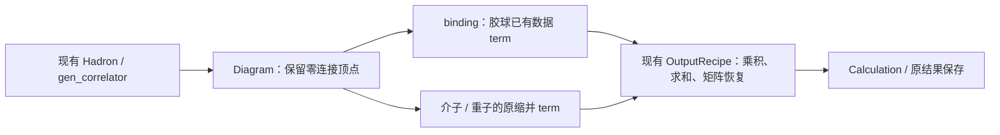

# 胶球接入：零连接顶点与已有数据 term

状态：2026-10-20，符号构造、数组/NPY/Dataset 绑定、固定坐标、时间扫描、
结果发布和计划回放已实现。验收范围见文末。依赖及职责沿用 [Correlator L0/L1](correlator-l0-l1.md)。

## 设计决定

沿用现有算符构造、Wick、Diagram 和 `calculate`。胶球是没有任何夸克传播子边的
vertex；binding 接入已计算好的胶球值，它独立成为一个 term。其它 term 完成缩并后，
由现有结果装配执行乘法与求和。胶球 term 自身没有缩并计算。

这里“无连接”指缩并图没有夸克传播子边。产生胶球观测量的规范链、颜色迹和空间求和
已经包含在输入数据内，不在关联函数阶段重新计算。



不增加胶球专用 correlator、算符生成器、优化器、执行器或结果装配器；不将介子和
重子重构成新的通用类层次。O 模块的 `Insertion/Operator/OperatorTerm` 保持现状。
胶球的固定线性组合可以作为已完成的输入，也可以沿现有符号行的线性组合表达；
后者的系数仍由现有结果配方处理，不新增一套胶球 OperatorTerm。

## 同一张图中的三种顶点

| 顶点 | 夸克边的出入度 | 固定组态、分量、动量、时间后的输入 | 后续操作 |
|---|---|---|---|
| 介子 / Current | `(1,1)` | 两腿系数，保留原自旋和空间轴 | 与传播子缩并 |
| 重子 / 反重子 | `(3,0)` / `(0,3)` | 三腿系数，保留原自旋和空间轴 | 与传播子缩并 |
| 胶球 | `(0,0)` | 一个实数或复数，张量 shape 为 `()` | 作为独立 term 供结果装配 |

零连接顶点是有数据、有物理时间的插入，不是空表达式，也不是数值常量 `1`。
两个胶球对应两个数据因子的乘积；同一个胶球重复出现可以共享读取，但必须保留
乘法次数。同一行在不同组态或时间上的值不能因形状相同而合并。

## S：保留现有构造，只补齐零夸克情况

用户仍通过 `Hadron/Flavor → gen_correlator` 声明算符，不手写内部图。为了在
binding 之前知道哪些插入没有夸克，现有 `Flavor` 最小扩展为接受空味道 `Flavor("")`：
它仍是保留时间和插入次数的符号对象，quark / antiquark 列表均为空，伴随仍为空味道。
不另加 `GlueballHadron`，也不让 binding 根据数值数据修改已经生成的 Wick 配对。

这是现有语法的边界补齐：空字符串表示零夸克，不能仅在 binding 换一个 reader 就使
`Flavor("ss")` 自动成为胶球。已有介子/重子的声明与味道语义不变。

S 的具体变更限于：

1. `quark_contract` 对空味道记录顶点位置与时间，不产生夸克字段；费米子符号和
   配对仍只来自真实夸克。不能仅按 `baryon_num == 0` 判定一定是介子。
2. 邻接矩阵允许 `(0,0)` 度数。胶球行、列全部为零，不制造自环或虚假传播子；
   纯胶球图的传播子表仅保留已有空标签约定。
3. `Diagram.simplify` 将孤立顶点保留为单顶点连通分量。原先删除无连接顶点的分支
   已移除。分量分解后继续使用
   原 `Diagram`、乘积及幂，不增加新的图叶子类型。
4. 延续原行名、表示、动量、Tag、时间与 dagger 身份及群投影规则。混合算符中的
   位置词与味道词必须保留一致的插入顺序，空味道不能被当作数值系数消去。

普通符号入口是首个交付范围。`structured=True` 仍限线性单强子插入；其胶球行
也应消费同一零腿绑定，不能另建算法。胶球与双介子的矩阵继续用普通入口，不借此
任务扩展 structured 的多强子乘积能力。

## B 与 adapters：胶球只绑定已有数据

B 增加与 `Meson/Baryon` 并列的薄绑定 `Glueball`，通过原 `vertex_map` 交付。
它保存 reader、数据分量/动量选择和源端 dagger；`load/with_reader` 沿已有
逐 cfg 绑定与独立视图规则。无需新增 `calculate` 参数或独立的 `glueball_map`。

数据读取继续归 adapters：胶球 reader 使用原 `describe_block/block` 分离协议，
提供固定分量、动量、时间的零阶块。数组/NPY 的逻辑布局采用
`(component, momentum, time)`，不添加长度为 1 的 mode、spin、color 轴。
历史 `(momentum,time,component)` 文件由 reader 视图映射，不要求重写整份数据。
已投影的表示行可直接登记为 component；真实动量表、行序及其定义必须显式保留。

复用 `TensorAxisMetadata` 和 `TensorSpec`：固定坐标下 `axes=()`、`shape=()`。
复用 `SourceReadRequest` 的 elemental 读取家族，把数据视为零腿空间观测量；
它没有 V/D/P 扇区和 Laplace 基底，不伪装成 `v2v`。沿原 Dataset 存储服务增加必要的
胶球产品解释与 reader 分派，不增加另一套文件格式或数据台账。

绑定检查只覆盖实际需要的契约：

- cfg、物理时间覆盖、component/动量/行序、相位与归一化，以及稳定的输入身份；
  规范场处理和预投影定义由已有来源 metadata 保存。
- 图中零度顶点必须绑定胶球数据，胶球数据也不能绑定有夸克边的顶点。
  放宽图的度数校验不等于允许缺边介子蒙混通过。
- 普通数据值不读入规划阶段；没有传播子边的整个请求允许省略 `propagator_map`，
  内部解析为空映射，存在夸克边时仍严格检查所需传播子。
- `usedNe/usedNp`、随机基底权重只作用于相应夸克顶点，不裁剪或重新计权胶球值。

Source dagger 对胶球值只做复共轭，线性组合系数由符号层按原规则共轭一次。
没有 gamma4/gamma5 或腿转置，也不默认取实部；不在共轭之外再隐式翻转动量索引。
若输入已经包含固定优化系数，绑定不重复施加该系数。

## E / P / X：独立数据 term，无缩并动作

E 在原 `NativeDiagramBinding` 路径识别零连接分量，将它登记为普通输入和一个
单输入恒等 term：

```text
胶球块 g(cfg, component, momentum, t)
    → TensorSpec(shape=(), dtype=实际类型)
    → ContractionTerm(inputs=(g,), subscripts=AxisPattern(((),), ()))
    → 原 TermValue / OutputRecipe 引用
```

沿用既有 `ContractionTerm` 和整数轴契约，不引入 `GlueballTerm`。恒等 term 表示
“输入就是该 term 的结果”；P/X 可以直接引用输入或按结果所有权需要复制，不执行
einsum/GEMM。源端必要的共轭、精度转换和设备传输仍计入普通输入准备，不属于缩并。

胶球值随 cfg 和时间变化，不能塞入 `ArrayConstant`、符号 coefficient 或计划中的
常量节点。纯胶球请求有真实输入与读取依赖，不能落入“常量/空 correlator”快速返回。

E 的零腿登记逻辑由原介子和重子 provider 共用；胶球不触发额外 provider，也不先
单独调用一次 `calculate`。介子矩阵专用快路不符合条件时回到原通用路线。
同一次完整请求继续共用输入目录、结果配方和资源计划。

P/X 复用已有读取、驻留、预读、释放和 term 结果引用机制。所谓“等其它项算完带入”
是结果依赖，不要求一开始就加载并常驻全部胶球数据：按原生命周期安排读取，保持到
最后一次装配引用。胶球数值大小虽小，仍保留实际读取与输出内存记账。
若现有单输入零阶项或时间合批存在边界假设，只修复该通用边界，不增加胶球专用核。

`TensorPreparation(kind="identity")` 已允许 `conjugate=True`，并同步 X 与档案读回；
带共轭的输入不能走跳过准备的上传块借用快路。不借用要求 4×4 自旋矩阵的
`spin_spatial` 准备。无需共轭时保持原恒等路径。

时间扫描的轴属于请求坐标，不是胶球腿。批次可以将多份零阶值打包成一维时间批，
但每个值依旧按其实际时间读取。胶球仅依赖一个端点时，可复用该端点的数据，
不能把源/汇时间混同，也不能把压缩槽直接当物理时间。

## R：沿用乘积和求和，不做第二次缩并

以固定规范组态 U、`W_U` 表示在该组态上的夸克 Wick 期望，原结果配方表达：

| 关联函数 | 每组态的装配 |
|---|---|
| 胶球两点 | `G_U(t) * conjugate(G_U(t0))` |
| 胶球与介子 | `G_U(t) * W_U(M†(t0))` |
| 胶球与双介子 | `G_U(t) * W_U((M1 M2)†(t0))` |
| 胶球插入介子/重子多点 | 胶球数据 term × 原有夸克缩并 term 的和 |

上式由 S 的分量乘积和原 `OutputRecipe` 自然产生，不让用户手工回填矩阵块。
R 不调用 reader。最终结果仍是 `Calculation.value`，保留完整矩阵、行分量和
时间坐标，继续使用原保存与显式源平均接口。

夸克图不连通不代表系综统计独立：必须在同一 cfg 内先相乘，再跨 cfg 统计，
不能用各自系综均值相乘替代交叉关联。真空减除、jackknife、GEVP 和胶球优化向量
的求解不进入这次绑定扩展。

## 档案与恢复

复用原 reader-role、`SourceReadRequest`、准备配方和 term/result 引用；档案保存
数据定位与兼容条件，不保存某次 cfg 的胶球值或 callback。新 cfg 复用计划时重新
绑定其胶球 reader，恢复不重新生成符号图或搜索路径。

恒等准备共轭等新增语义必须通过原 A/C 的版本与白名单边界显式交付，旧版本不得
静默忽略共轭。是否需要升级具体 payload 版本由实现时的编码变化决定，不预建
胶球专用档案格式。

## 实施顺序与验收

| 阶段 | 最小修改 | 验收依据 |
|---|---|---|
| 1. 符号保留 | 空味道、零度校验、孤立分量保留 | 胶球一/两点、重复插入、混合位置顺序、dagger；介子/重子原 Wick 不变 |
| 2. 数据接入 | 薄 Glueball 绑定、reader、E 恒等 term、共轭准备 | 规划零数值读取；纯胶球无需传播子；实际缩并动作数为零；缺边/错类型绑定拒绝 |
| 3. 统一交付 | 原 R 装配、固定回放、时间扫描、Dataset/档案 | 更换 cfg 和胶球值确实改变结果；跨进程读回；全时间覆盖；输入生命周期正确 |

数值验收以独立 NumPy 标量乘积和逐 Wick 排列为参考，至少覆盖复数胶球、复系数、
非零动量、重复与同时间插入，以及胶球乘介子/重子关联函数。
归档任务另按 E 的 2 行、T2 的 3 行核对完整 4×4 矩阵及 0/2/4 跨线贡献；
同行投影、源 dagger、Bose 归一化和端点期望值均沿原定义。

先完成 CPU 小规模完整链，再分别报告真实数据和 GPU 验收；既有夸克缩并对照通过
不替代胶球原生接口验收。新增常态检查限上述低成本绑定条件，不增加全量扫描校验。
实施同步相应 S/B/E/X/A L2、correlator skill 与测试。

## 已有数据的入口

新增类型只有 `binding.api.Glueball` 和 `adapters.glueball.ArrayGlueball`。
前者选择 reader、component、momentum 和 source；后者直接读取数组或 NPY，
`Dataset(directory).load(cfg)` 对 `kind="glueball"` 同样返回 `ArrayGlueball`。

Dataset 沿用 schema 1：轴是 component、momentum、time 的任意排列；
component 坐标为字符串或整数标签，momentum 坐标为真实三维整数动量，
time 为完整物理时间或带 `time_coordinates` 的压缩槽，`bases={}`。
`definition` 记录实际规范回路、投影与归一化，`conventions.phase_convention`
明确数据相位，`parents` 记录实际规范场等来源。已有 NPY/HDF5 用原
`register_npy/register_hdf5` 登记，原服务负责读取及关闭文件。
计划回放会检查 definition、相位、有序动量和时间选择；不因同形状就接受不同观测量。
具名绑定与普通数组示例见 [binding skill](../../.agents/skills/lqcdweave-correlator/references/binding.md#胶球已有数据)。

回归入口为 `tests/correlator/test_glueball.py`（22 项通过）：规划不读数值、独立复数乘积、
更新输入与结果所有权、普通/structured、具名时间扫描、源汇同时间模板、
纯胶球及介子/重子混合、复系数与重复插入、四种实复精度、压缩时间、NPY 轴重排、
NPY/HDF5 Dataset、跨进程档案及错误定义拒绝。相关 S/B/E/C/档案及前端回归
383 项通过、1 项跳过；最终 preparation/精度回归 98 项通过、6 项按环境跳过。
CPU 检查不代表真实 GPU 或物理组态验收。

外部参考验收（CPU，Ne=2，随机复数输入，seed=20261020）：用户归档中的
`validate.literal_matrix` 逐 Wick 实现与原生完整请求比较，E 两行和 T2 三行共
80 个矩阵元素、240 个 0/2/4 跨线分项全部一致。最大完整矩阵尺度化误差
6.34e-16，最大分项尺度化误差 6.01e-16；尺度为参考绝对项之和。
此次没有真实物理组态或 GPU。更广执行回归 793 项通过、132 项按环境跳过；
另有一个预读监视断言在改动前版本同样失败，3 个强制 CUDA 检查因未安装 CuPy 未运行。

## 最小数组示例

下面的数值只是两个时间点的示例数据，实际任务替换为已测量的同一 cfg 胶球数组。
符号构造仍是 HadronIrrepRow 配合 Flavor，不新增 Hadron 子类。

```python
import numpy as np
from lqcdweave.adapters.glueball import ArrayGlueball
from lqcdweave.contraction.binding.api import Glueball
from lqcdweave.contraction.correlator import calculate
from lqcdweave.operators.correlator.api import (
    HadronIrrep, Hadron, Flavor, Tag, gen_correlator,
)

def main():
    row = HadronIrrep("G", (0, 0, 0), "A_1", 1, Tag(0, 0))[0]
    G = Hadron(row, Flavor(""))
    correlator = gen_correlator([[G], [G]], ["sink", "source"], [False, True])
    reader = ArrayGlueball(
        np.array([[[2+3j, 5-7j]]]), components=("G",),
        momentum_list=((0, 0, 0),), phase_convention="site", cfg="example",
    )
    result = calculate(
        correlator, configuration="example",
        vertex_map=lambda row: Glueball(reader, "G", source=row.dagger),
        time_axes={"sink": 1, "source": 0}, optimize="none",
    )
    print(result.value)  # [[-11.-29.j]]，即 (5-7j)*(2-3j)

if __name__ == "__main__":
    main()
```
