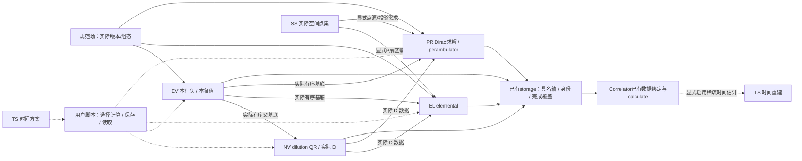

# 基础计算与稀疏化 L0 / L1

日期：2026-10-11。基础计算与稀疏化划分六个独立模块，NV 单独负责实际 dilution 向量生产。
L0/L1 维护共同契约与交接；各模块 L2 记录实现、算法、所有权及验证范围。

## L0：六个模块及唯一目录

| 模块 | 唯一实现目录（src/lqcdweave 下） | 职责 | L2 |
|---|---|---|---|
| TS 时间稀疏化 | `sampling/temporal/` | 时间方案选择、判据/评分、实际时间与两点时间重建 | `docs/modules/temporal_sampling/temporal_sampling.md` |
| SS 空间稀疏化 | `sampling/spatial/` | 空间取样规则、实际点集/顺序、点池登记描述与采样概率 | `docs/modules/spatial_sampling/spatial_sampling-api.md` |
| EV 本征矢计算 | `production/eigenvector/` | 规范协变空间 Laplace 算子、本征求解、残差/基底约定及已有相位归一化 | `docs/modules/eigenvector/eigenvector.md` |
| NV noisevector 计算 | `production/noisevector/` | 从实际父基底按显式分组生成 QR dilution 向量；旧 phase 规则显式兼容 | `docs/modules/noisevector/noisevector.md` |
| EL elemental 计算 | `production/elemental/` | 介子/重子、local/路径/有向流的空间张量；规范场工作区与分块输出 | `docs/modules/elemental/elemental_production.md` |
| PR perambulator 计算 | `production/perambulator/` | V/P/D 九类直接生产、Gamma5 反向转换、六类物理时间对保存与九类读取；输入模态/向量仍可按块读取 | `docs/modules/perambulator/perambulator.md` |

每个目录的 `api.py` 定义公开接口。旧路径保留必要薄转发或同名包级导出，不能同时维护两套实现。
空间点集由脚本显式调用 `sample_spatial_points` 后使用所选保存接口写入；runtime 不内置点集计算与保存的组合生产器。
EL 内部继续区分介子/重子/有向流文件；不再将每个物理配方拆成一个粗模块。
规范场处理 `production/gauge.py` 和外部格式/QUDA 适配器是已有基础服务，不新增另一套设备/存储/提交框架。
EV 构造器的必填 `backend` 通过 `adapters.laplace.resolve_laplace_backend` 解析显式名称或保留用户对象；
此精确服务边只做后端接线，不解析文件、不初始化设备，不授权其它 production→adapters 依赖。

图中 EV→NV/EL/PR 与 NV→EL/PR 是数据交付，不是导入 EV generator 或使用其私有工作区。
各数值模块通过契约输入已有基底/点集和注入后端工作；流程组装与范围选择由用户脚本完成，保存/恢复按所选格式复用公共 storage/runtime 服务。

## L1：交接契约

### 共用规则

- `contracts/time_selection.py`、`spatial_sampling.py`、`laplace.py`、`elemental.py`、`propagator.py` 继续是共同契约的唯一来源。
- 时间稀疏化必须显式启用；默认完整时间范围。空间取样不隐式截取时间片。
- 生成参数与实际本征基底、取样规则与实际坐标分别记录。seed、Ne/Np、shape 不能替代实际身份和顺序。
- Laplace、Dirac、elemental 采用的规范场版本分别记录，不能因为源文件相同而默认变换后相同。
- 必要辅助函数按用户要求直接复制到本模块维护、记录来源，原模块不再需要时清理。交接记录/科学身份不复制为平行类型。
- 核心不识别文件后缀/QUDA 原生类型，不初始化设备、不提交作业；适配由已有 adapters 负责。
- 模块独立测试由本模块代理自行寻找维护；跨模块、真实生产链和 weak_field 的现有测试留原 `tests/` 位置。

### TS：时间方案与重建

| 边界 | 输入 | 输出与保证 |
|---|---|---|
| 方案选择 | Lt/Nt/loop、显式判据与评分、搜索限制；生产时提供 cfg | 不传 cfg 返回规范升序模板 TimeSelection；传 cfg 返回保留随机平移后槽序的 TimeSelectionRecord；不丢弃不同平移的合法候选，合法性与是否穷尽明确 |
| 时间差重建 | 默认已计算源槽×绝对汇槽数组与读回的 TimeSelectionRecord；旧循环差槽须显式 `time_layout="cyclic_difference"`，周期 TimeSelection 和旧显式坐标调用兼容 | 内部映射真实dt并返回配对平均及计数；复数/其它轴保留，计权不重复 |
| 下游消费 | TimeSelectionRecord/TimeSelection/实际时间序列 | 只确定计算覆盖，不改变算符时间重写语义，不自行读取/生产数据 |

异常：非法范围/重复坐标/轴报参数错误；搜索达上限明确不完整；缺少dt默认报错，显式NaN策略不冒充已测值。
所有权：描述不可变，重建不修改原数组。现有专用研究资料仍为参考，不自动迁入未验证论文优化器。
普通脚本调用 `reconstruct_two_point_from_coordinates(data, selection)`，收缩按 `selection.Nt` 个时间槽组织，默认源槽轴 0、绝对汇槽轴 1；旧循环差槽需显式 time_layout="cyclic_difference"，映射与平均在 TS 内部完成；物理规范场/Dirac 的 Lt 不改变。
TimeSelection 是周期方案，不登记额外平移/任意执行顺序；默认入口要求数据保持 `selection.times` 顺序。
生产用 `select_t(..., cfg=cfg)` 在选出模板后作 cfg 决定的随机周期平移，得到唯一共享契约中的 `TimeSelectionRecord`，不重新排序。`storage.time_selection.save_time_selection` 保存实际有序整数 NPY，`load_time_selection(path, Lt=...)` 读回记录；生产、续算和重建使用同一保存顺序，不再次抽平移。已搜索模板可用 realize_time_selection 按 cfg 直接生成实际记录；模板搜索仍由 TS 负责，文件读写属于 storage，不新建产物台账。已有平移/重排 NPY 可直接读回并传给 selection 重建入口，旧显式坐标入口保持兼容。
旧 `contraction/two_point.py` 时间重建移入 TS，原公开调用保持可用；不是通用网络缩并的重写。

### SS：规则与实际点集

| 边界 | 输入 | 输出与保证 |
|---|---|---|
| 点集生成 | `sample_spatial_points(SpatialSamplingDesign(...), seed=..., selection=...)` | 返回 `SpatialPointSet`，`coordinates` 为 `(time,point,xyz)` 只读 `int64`。`SpatialPointHandle` 适配 PR，`.load(cfg)` 返回 `(Nt,Np,3)` 的只读 `int64`；实际坐标、顺序、生成规则与身份分开 |
| 格式/索引交付 | 实际点集和规范布局 | 统一采用 `(time,point,xyz)`；不重排基底、避免重复或越界点 |
| 采样描述 | 点池身份、实际集合/登记引用、取样设计与参数依赖 | EL/PR/E可核对同池、不同池与前缀，不依据相同seed推断共享 |

点集使用局部 RNG，无放回策略保留；实际坐标只读且与调用者数组独立。
复杂整图权重仍由 Correlator E 按全图点等价关系展开，SS不提前做图局部计权。
已有模态 dilution 权重是采样估计辅助，与实际空间坐标分开说明；必要消费者可直接复制辅助实现，避免反向耦合生产器。
持久身份/登记调用已有 contracts/storage，不另建点集台账。

### EV：规范场 → 实际有序基底

| 输入必须声明 | 交付必须包含 |
|---|---|
| cfg/lattice、规范场版本、smear/project等实际变换、Ne、tol、后端、显式时间 | 各时间本征矢/本征值，轴顺序、mode顺序、复精度、相位约定及求解诊断 |
| 已有 GaugeHandle/LaplaceBackend | generator只依公开协议；不导入EL/PR实现或读取它们私有工作区 |
| 输出保存范围 | 用户脚本按既有文件格式保存基底和本征值；实际 cfg、时间顺序与完成槽须明确保留，`describe()` 不等价于持久基底身份 |

已有数值API沿用 `LaplaceEigenvectorGenerator` 的 load/calc/describe、stout_smear/project_SU3。
保留既有数值法与近简并/相位约定；不能擅自改变排序、归一化或丢弃基底顺序。
load/规范场变换/solve失败的失效状态和输出所有权由L2核实并明确。诊断不得把未收敛结果当完成基底。

### NV：实际父基底 + 显式分组 → 实际 dilution 向量

独立 NoisevectorGenerator 位于 `production/noisevector/`，消费 load(key) 向量输入与
每组 n/m，默认 QR，可显式指定 medium 起点或非连续父模式分组。输出为
`(Nt, Nd, Lz, Ly, Lx, 3)`，携带有序 block/vector 标签和 raw 归一化来源。
NV 不求 Dirac 解、不选择重要性评分或估计量权重、不以低秩 D 定义 high；
EL/PR 只消费实际数组/向量句柄，不导入 NV generator。生成的实际向量可通过公共 storage 服务保存和读回。
默认 QR（含 m=1）的协方差为 (m/n) V V†；旧 m=1 phase 行为仅显式兼容。
精确接口、随机状态、所有权与 CPU 验证见 [NV L2](../modules/noisevector/noisevector.md)。

### EL：已有基底/点集 → 空间张量

| 输入必须声明 | 交付必须包含 |
|---|---|
| 实际左/右或三腿基底、点集、gauge版本、cfg、路径/距离/动量、相位/边界、Ne/Np | elemental的具名轴、component与动量顺序、真实端点、扇区、精度/归一化与父身份 |
| 明确已有vector/point handle与工作区所有权 | 不借用EV/PR generator私有状态，不隐式求Dirac解或生产缺基底 |
| 块大小、输出数组或写回调 | 块坐标与完成覆盖；原始输入、gather、workspace、scratch与最终输出分开计内存 |

沿用 ElementalGenerator、BaryonElementalGenerator 和现有有向流 raw 核。
介子/重子可以使用各自局部工作区/辅助副本；禁止实例化另一生产器只取其私有字段。
load或变换失败后不可继续计算。借用输出必须在下一次复用前完成复制/写出/异步消费。
实际产物发布、原子写入和恢复继续走既有 storage/runtime。

点端 elemental 使用 `ElementalGenerator.calc_path_blocks`，只读 `plan_indexed_point_elementals`可消费登记的实际 gauge/basis/points。V/P、P/V、P/P 两端实际坐标及有序标签分别记录；P/P 的稀疏支持按真实点坐标及路径确定，不从数值零推断。脚本选择所需扇区、时间与保存方式，公开生成器的实际支持范围见 [EL L2](../modules/elemental/elemental_production.md)。

EV 用法见 [EV skill](../../.agents/skills/lqcdweave-eigenvector/SKILL.md)，PR 的 load/calc/后端与缓冲保存用法见 [PR skill](../../.agents/skills/lqcdweave-perambulator/SKILL.md)。时间稀疏化使用同 cfg 的已保存选择记录与 Nt 槽；物理规范场/Dirac 保持 Lt。独立端点身份、总内存与未验平台不因删掉固定包装获得新保证。

### PR：已有 V/D 向量、点集 + Dirac 后端 → 扇区传播子

| 输入必须声明 | 交付必须包含 |
|---|---|
| gauge 实际版本、作用量/质量/边界、tol/maxiter、spin basis、实际源汇 V/D 向量或点集 | 九类产品及实际 sink/source/spin/mode/dilution-vector/point/color 轴；默认完整物理时间，显式 selection 时保留有序源汇记录 |
| `PropagatorBackend` 与向量/点读取协议 | V/D 共用 `load(key)`、`Ne` 计数及可选 `read_modes(key,time,start,stop)`；不使用 EV/NV 私有工作区，不自动初始化 QUDA/MPI；原生转换留 adapters |
| 每次 `calc` 的实际源、sink 有序列表、Ne/Np、RHS/输入块、缓存/输出策略 | 生成器只消费实际 D，不生成系数、分组或权重；端点由 V/D/P basis 显式携带；结果拥有自身数组，write 回调接收借用块；详见 L2 |

构造器只配置格点、规范场、Dirac 参数、后端、资源参数及可选时间记录；`VectorBasis(handle,count,endpoint)` 表示 V/D，识别时优先显式或句柄实际 endpoint，其次 `dilution_source` 或 `vector_kind`，普通 Laplace handle 默认 V。已登记为 D 但缺少来源的句柄仍是 D、来源未知，不补造；自定义 D 须提供真实 endpoint。`PointBasis(handle,count,highmode_basis,endpoint)` 表示 P。调用 `calc(t_src, src=..., sink=[...])` 时显式传源和有序汇列表；多汇共享同次源求解，返回列表顺序与汇一致，列表可混合 V/D/P 和 `None`。`None` 保留未缩并解场，结果端点记录实际身份；sink/source 表示决定九类产品。已 `load` 后，`generator.endpoint(basis, source=False)` 可解析实际 endpoint 供存储规划，不求解。

结果的 `.reverse(t_sink=None)` 内置 Gamma5 反向并交换物理时间与实际端点；省略时间时按原汇时间返回各自的反向 block 列表。QudaBackend / DenseWilsonBackend 提供 Gamma5 声明，普通自定义后端可在生成器构造器传入 `gamma5` 和 `gamma5_hermitian=True`。底层 `gamma5_reverse` 与 `reverse_propagator` 仍是需显式传 Gamma5 信息的数组/block 辅助函数。`propagator_pair_spec` 创建 `kind='perambulator_pairs'`、`encoding='pr-six-pairs-v1'` 的 DatasetSpec；首轴是具名物理 `(sink_time, source_time)` 时间对。`PropagatorWriter` 和 `PropagatorReader` 包装调用方注入的通用 writer/readers，分别规范化写出六种代表和提供九类读取视图。调用方仍负责 reader/writer 生命周期、发布与恢复。

默认结果数组由 `PropagatorResult` 持有；`stream_eigenvectors` 限制输入/投影 scratch。`calc(..., write=callback)` 可同步接收借用投影块，回调失败时不得发布部分结果；只有成功返回后才可登记完成。`PropagatorSolution.project` 在同 cfg 且未 smearing 时复用原解投影到新汇。`source_time_blocks` 仍只将已有 dense 源时间行拆成借用时间对视图。`production.perambulator.pair_planning.plan_indexed_perambulator_pairs` 面向六类物理 `time_pair`，只核对 metadata 中的实际父覆盖、兼容分片和 Gamma5 覆盖。脚本显式调用 `calc` 后通过 `PropagatorWriter.write` 保存已有块，pair 保存不自动补缺求解。原 `plan_indexed_perambulators` 仍只理解四种 V/P 产品和 `source_time` 行布局，两类服务不互换。

`ModePartition` 与 `HighmodeBasis` 从完整 low+medium 父空间定义高模投影；PR 在实际 `PointBasis(..., highmode_basis=...)` 上可直接生产五类 P 高模块（包括 PSD、DSP），`project_highmode_block` 可由已有完整父传播子派生五类高模块。NV 实际向量保存/读回、九扇区 elemental 和普通 Meson Diagram 整图消费已通过 CPU SU(3) Wilson 完整空间迹闭环，包含 medium 三取二、高模点二取一及二者联合 36 方案的 raw/preweighted 对照；详见[三分区闭环](../modules/perambulator/three_sector_production.md)。块生产的 GPU/QUDA 与生产规模、自动重要性分组、D 重子/专用矩阵，以及 MPI 仍未验收；V/D 计权约定见[V/D 交接](../../.agents/skills/lqcdweave-elemental/references/dilution.md)。

完整投影数组归结果对象持有；`write` 回调收到的块仅在回调期间有效，须同步消费或复制。失败状态、输入协议、轴布局和资源边界见 [PR L2](../modules/perambulator/perambulator.md)。已有 CPU 独立复矩阵参考覆盖九类直接结果、Gamma5 交换和六类保存/九类读取；GPU、QUDA、MPI 和生产规模未验收。

投影点统一称为 H，沿用 P 产品编码及投影元数据。直接构造 Q eta 或在完整解场上做 H 汇
投影只需要父向量；紧凑块事后派生才要求对应完整父传播子，见[路线选择](../modules/perambulator/point_highmode.md#h-contract)。
支持 `read_modes` 的 high 父基底随 `stream_eigenvectors=True` 按物理时间片读取，独立于
普通 V/D 汇缓存预算。完整产品/估计量闭环与生产规模须按实际环境独立验收。

## 允许依赖与整理边界

各模块只通过中立契约、公开数据输入/后端协议和已声明基础服务工作；不导入其它五块内部生产代码。
TS/SS不运行生产器；EV不操作NV/EL/PR；NV消费实际父基底，EL/PR消费实际数据并各自维护必要辅助实现。
框架服务与发布流程在旧位置保留，用户脚本组合六个公开 api 与通用 storage/runtime 服务，不创建第二套发布/恢复机制。

每位代理只修改其目录、对应旧源兼容路径、模块单元测试和L2。共享contracts若确需改字段先明确交接，
由主代理统一维护，不复制契约；辅助函数无需逐个请示。所有dirty改动与先前Correlator模块必须保留。
旧源码有能力时复制/迁移，随后做接口适配；未支持数值/平台功能只记录，不以整理启动新集群计算。

## L2 和验证交付

每块文档必须含精确类/函数/方法/default、字段/轴、状态变化、算法步骤、异常路径、缓冲所有权、
内存覆盖、原实现位置、CPU/GPU证据、测试归属及未支持范围。L2无需另审批，与实现一起交付。
各代理先跑本模块与必要原位集成测试并报告；主代理审核后固定源码运行完整CPU回归、
检查公共导入/无私有跨访/包文件/文档链接，再清理无调用副本，必要公开兼容入口保留。

## 已登记重子生产交接

EL 公开生成器生产三种 VVV recipe，`planning.baryon` 的纯记录和只读 planner 保留实际三腿基底、规范场用途与具名轴。脚本选择计算及保存，生产核不负责文件身份或 reader 关闭；storage/runtime 管理登记、覆盖与生命周期。消费由既有 B/E/收缩编排公开接口完成。见[重子用法](../modules/elemental/baryon_production.md)与[EL L2](../modules/elemental/elemental_production.md)。
