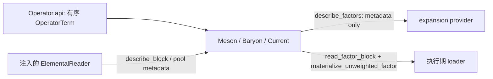

# B 数据顶点绑定：L2

本文实现 H02 的 B→E 交接。B 将统一 `Operator` 的有序项绑定到已登记的 elemental reader，提供不含大数组的 `describe_factors` 描述，以及执行阶段使用的块读取/物化能力。B 不生成缺失产物、不推导 Wick 图、不规划缩并，也不读取 reader 的私有状态。

零夸克插入使用薄绑定 `Glueball(elemental, component, momentum=0, source=False)`，
不需要 Operator 或 describe_factors。reader 的 `describe_block(component,momentum,time)`
返回零阶 TensorAxisMetadata，`block` 延迟到执行。`with_reader/load` 保留原 cfg 绑定方式，
源端仅共轭一次，不翻转动量、不施加 gamma。完整职责及用法见[胶球接入](../../architecture/glueball_architecture.md)。

<a id="全-diagram-整数连接格式目标待迁移"></a>

## 全 Diagram 整数连接格式（实现完成）

权威约定见[ARCHITECTURE](../../../ARCHITECTURE.md#diagram-的统一整数连接格式目标待迁移)。B 保留 Operator 项顺序、已声明的腿槽、
具名物理轴、实际数据 ID 和成员 ID；E 用这些已知关系直接构造整数 `AxisPattern`。
B 不生成方程字符串或连接 ID。物理绑定入口不变；GPU/生产规模仍未验收。

## 责任与依赖

唯一实现位于 `src/lqcdweave/contraction/binding/`，公开入口为 `binding.api`。B 依赖 `operators.single_hadron.api`、`contracts.correlator.api`、既有 `contracts.elemental` reader/component 契约、标准库与 NumPy/CuPy 数组 API。B 不依赖 E、P、X、R、流程 或具体文件格式 adapter。

`contraction/single_hadron.py` 转发入口已删除，调用方使用 B.api。`VertexFactorMetadata` 和 `BaryonFactorMetadata` 的唯一类型定义位于 `contracts.correlator.vertices`，由 C 的公共 API 导出；没有复制共享类型。



## 输入、身份和系数

结构化矩阵的公开交接为 `structured_vertex_components(vertex, *, registry)`，
独立实现在 `binding/structured.py`。它返回 `(vertex, coefficient)` 对：介子
成分保留 gamma、component、动量、时间偏移、profile、dagger、模式选择和同一
reader 身份，Operator 系数移到输出配方，源系数共轭一次。registry 区分顶点
已经选择的 `usedNe/usedNp`，避免不同前缀误合并；仅在一次展开内复用，
不缓存数组或跨组态重载保存。要求注入 metadata reader；Current
及带 directed-current 项的结构化绑定明确拒绝。重子直接保留原 Baryon，后续
仍由 B 的核心登记和 E 的 `baryon_join` 描述处理复杂 Operator，不拆成 dense
六轴顶点。此函数不查询数值数据。

### Operator 项

介子项来自 `Operator.terms`，保留原始顺序。`gamma`、`component`、`momentum`、`coefficient`、`anchor_time_offset`、`profile` 和可选 `current_term` 均由 O 定义；Current 仍是同一 `Operator` 的子类/配方，不由 B 重建系数。

重子同样接收 `Operator`，其项必须有 `component: BaryonComponent`、rank-3 `spin: SparseSpinTensor`、`momentum` 与 `coefficient`。B 按 component 类型分派，不要求 `BaryonComponent` 携带 flavor。物理味道和夸克配对属于 S 的符号图及实际传播子绑定。项的三腿顺序、spin basis、逐腿 `endpoint_time_offsets` 均保持原样。

新执行链将 Operator 系数保留在元数据/输出 recipe 中，`materialize_unweighted_factor` 不乘该系数；`BaryonFactorMetadata.coefficient` 是供 E 生成输出表达式的标量元数据，也不已乘入 vertex 数组。旧 `factors`/`get*` 便利入口会显式返回已乘系数的数组，不能与无权重执行链混用。

### Reader 与描述记录

介子 reader 至少须提供 `block`、`describe_block`、`Lt`、`phase_convention`；采样展开另须提供 `point_pool_id` 与 `sampling_group`。点对稀疏记录另需 `describe_sparse_record`，执行生命周期可选 `close_sparse_record`。重子 reader 对 `vvv` 提供对应 `describe_block`/`block` 和相位约定。所有这些能力从构造参数显式注入；B 不按路径后缀、类型名或文件布局选择 reader。

`TensorAxisMetadata` 由 reader 声明具名轴、shape、dtype、实际数据与 selection identity、稀疏布局和点池身份。相同 shape 不足以证明同一数据；B/E 必须同时按 reader 给出的科学身份与选择身份核对共享。`describe_factors` 允许查询 header/采样元数据，但不调用 `block`、`load`、生产器或数值 materializer。

Dataset readers 通过 `TensorAxisMetadata.axis_bindings` 交付每个 mode/point 轴的实际父产物 ID 和选中有序标签。Dataset P/P 逻辑视图分别携带左右点轴绑定，稀疏描述的 `point_shape=(left_count, right_count)` 与这两组选择同序；左右 extent 可不同。旧 same-point-set 定义可复用左端实际 reader，但只有声明的右 ID 与左 ID 相同且右端有序标签被该 reader 覆盖时才成立；双点集定义须注入独立右端 reader/view，adapter 不从数组 shape 推定点对应。`usedNp=None` 保留两个已选 view 的各自 extent，单个 `usedNp` 仍请求两端同一大小的共同前缀；任意独立 extent 选择要用明确的左右标签/索引。普通空间 Meson 的共同 Diagram 路径沿传播子边核对 graph source→logical field、sink→logical bar；双方均声明时要求 actual ID 与带类型的有序标签一致，在数值读取前拒绝冲突。source dagger 按 B 实际空间槽位交换端点。V/V 仍使用原始第 0/1 空间槽映射 logical field/bar，不从轴名中的 source/sink 推断物理时间角色。

对于 `CurrentTerm.temporal_point_split` 或普通 `GaugePath` 的非零净时间位移，B 描述记录保留配方和每个 descriptor 的物理 field_time/bar_time；E 将 graph source/row 映射到 physical bar endpoint，将 graph sink/column 映射到 physical field endpoint。P 池、D 来源的物理时间和 compact 采样表使用同一端点映射；源 dagger 的原始轴与物理时间一起对换。此规则不按 reader 类型或 schema 分派，也不转置 Diagram 的自然 source-row/sink-column 轴；普通空间路径保持原映射。双方缺少声明时仍记录 unknown，保留旧内存 reader 兼容性，但不称为科学身份已验证。采样池身份与 point dataset ID 分开；只有显式登记的 pool/group 元数据进入采样展开，独立池的笛卡尔分组沿用 E 的声明契约。

另有独立于 CurrentTerm 的登记 temporal point-path 能力：符合 `lattice.elemental.temporal-point-path/v1` 的 V/P 或 P/V reader 可绑定有 temporal step 的有序 `GaugePath`。普通 `Meson` 仍默认只展开 V/V；调用方必须通过 `requested_sectors` 显式选择逻辑 V/P 或 P/V，source dagger 仅将该 logical sector 映射到相反 raw sector。B 的 `available_sectors()` 只验证已声明的 reader 能力；缺少声明的旧 reader 保持 `None` 默认兼容，显式请求缺失扇区则在 getter 前拒绝。能力集合不会补零，也不从 reader 类型或数组 shape 推断。登记的全链范围和 CPU/边界证据见[持久化 Diagram 测量](../measurements/diagram_measurement.md#registered-temporal-vp-point-path-diagrams)。

`DatasetElemental` 的复合 reader 将 point-ended 产品 schema 作为各自的存储契约：同一复合 reader 的 point-ended 扇区必须全部采用相同的 current schema 或相同的 temporal-path schema，不能混搭。已显式标记且经过 6/7 component-view 验证的 directed V/V 产物是独立的 V/V product schema；它可与兼容的 point-ended 扇区共用 reader，而无需伪称持有点端 schema。此组合仍要求共同路径、边界、相位、配置、动量和完整时间覆盖一致，并通过原有 gauge、mode/point 实际身份与有序标签检查；未标记的普通 V/V 不获得该例外。

## 对外类与精确签名

`Meson.with_mode_indices(logical_selections)` 返回共享原 reader 或数据源声明/operator 的无数组
V/V 绑定视图。输入是两个有序模式位置元组，按 dagger 后的逻辑槽排列；source
绑定将其反转后交给 reader 的 `mode_left/mode_right`。`VertexFactorMetadata.mode_indices`
保留原始槽选择；describe/read 使用相同选择，不能混用共同前缀与显式选择。
已选视图不再二次选择，也不接受 spectral profile；Ne 覆盖在读取前检查。
这只支持明确的 V/V 模式分块，不代表任意逐腿/点端选择已全部接通。

公共导出：`Meson`、`Baryon`、`Current`、`VertexFactor`、`BaryonVertexFactor` 及两个 C 描述记录。数组默认后端为 `numpy`。

### meson55 目录符号绑定

`binding.api` 额外导出冻结 meson55 目录的可调用预制绑定：

```text
RecipeVertex(elemental, *, version="v2", momenta=momentum_recipe("mom4").momenta, array_module=np)
RecipeVertex.symbol(name, momentum=(0,0,0), *, tag, irrep=None, copy_index=0) -> HadronIrrep
RecipeVertex(row: HadronIrrepRow) -> Meson
```

`.symbol` 按目录名称产生符号算符；静止系 irrep 默认取 recipe 定义，非零动量必须显式给出 irrep，
需要时指定 `copy_index`。`__call__` 接收符号 Wick 图中的一行，按同名冻结 recipe 构造耦合后的
`Operator` 和 `Meson`，因此该绑定可直接作为 `calculate(vertex_map=...)`。`row.dagger` 会被映射
到 `Meson(source=True)`。

重复绑定相同目录行时，`RecipeVertex` 在自身有序动量轴和版本内自动复用不可变
`OperatorTerm` 定义，按行、动量和 dagger 区分。每次仍返回独立的 `Operator` 与
`Meson`；reader、cfg、模式选择及数值数组不进入该缓存，修改一个返回视图不会影响后续绑定。

预制绑定默认使用 v2 目录；不兼容或未知版本不会静默回退。
消费四个修正 G 行时，elemental 必须含有对应版本的 component；v2 需要重新生产或补充这些行。
其余 51 行的完整 component 身份不变，可跨版本消费。绑定按完整身份匹配，不依据行号猜测兼容性。
预制绑定默认动量表为有序 33 项 `momentum_recipe("mom4").momenta`，consumer 的顺序必须与 elemental momentum 轴相同；
自定义表按同一字典值顺序生产并传入。`elemental` 遵循 `Meson` 的已登记 reader/显式数据源契约；
`array_module` 默认 NumPy。预制绑定采用 midpoint 相位和 Meson 的默认周期时间端点约定；
空间路径按周期边界生产，绑定消费已保存的路径定义，不更改生产边界。
`c_factor` 是 recipe 的空间×Dirac C 因子，`reflection` 是线性时间反射符号；实际物理 C 还由 Flavor 决定，不会作为
额外数值系数乘进 contraction。完整目录、移动动量边界及 CPU 核验见[meson55 使用页](../operators/meson55.md)。

### `Meson`

```text
Meson(elemental, operator, source=False, *,
      phase_convention="midpoint", boundary="periodic", array_module=np,
      requested_sectors=None)
Meson.load(key, usedNe=None, usedNp=None)
Meson.with_reader(reader, *, configuration=None)
Meson.term_time_offsets(index)
Meson.available_sectors()
Meson.describe_factors(t, sector="v2v", indices=None, *, usedNe=None, usedNp=None)
Meson.read_factor_block(description)
Meson.release_factor_block(description, raw_block)
Meson.describe_sparse_record(description)
Meson.materialize_unweighted_factor(description, raw_block)
Meson.materialize_sparse_bridge_part(description, raw_record)
Meson.is_point_split()
Meson.factors(t, sector="v2v", indices=None)
Meson.get_terms(sector, t, indices)
Meson.get(t)
Meson.get_v2p(t)
Meson.get_p2v(t)
Meson.get_p2p(t)
```

- `elemental` 是已构造 reader，或显式 `load(key)` 的 reader 工厂；`operator` 是统一 O `Operator`。`source` 默认 `False`。`boundary` 限于 `periodic`/`open`，`phase_convention` 默认 `midpoint`，必须匹配 reader，不作静默修补。
- `requested_sectors` 是可选的非空、唯一、已知逻辑 sector tuple；`None` 保持历史默认选择。它供 Diagram E 显式选择普通算符的 sector 分解，不改变 Operator 配方。`available_sectors()` 只查询 reader 明确声明的 raw 能力并映射成逻辑 sector；旧 reader 没有声明方法时返回 `None`，B/E 沿用旧默认。Source dagger 会交换 V/P 与 P/V 的 raw 读取方向，但不会反转调用方请求的逻辑 sector。
- 含 CurrentTerm 的 vertex 仍要求原四种逻辑 sector 全部可用；不能借 `requested_sectors` 缩成子集，也不会把 reader 缺少的扇区当作零贡献。
- `load` 是显式绑定调用：若输入对象提供公开 `load(key)`，只调用它并保存返回的 reader（或保留原 reader）；否则核对 reader 上已有 cfg。`usedNe`/`usedNp` 为正整数或 `None`。它不生产数据。
- `with_reader(reader, *, configuration=None)` 返回保留运行时类、operator、dagger、boundary、phase、后端、截断和模式选择的独立浅视图；不调用 `load` 或数值 getter。显式 configuration 必须与已知 reader.cfg 一致，省略时采用 reader.cfg；同一 reader 的 cfg 未知时保留原显式 load key，不修改 reader 的科学身份。相位不符仍报错。原顶点不变，视图的 elemental/reader 都指向明确 reader，后续原顶点 `.load` 不影响它。`Current` 保持其类；`with_mode_indices` 同样保留未加载的数据源声明和既有截断。
- `describe_factors` 的 `sector` 只接受 `v2v`、`v2p`、`p2v`、`p2p`；未指定 `indices` 时按 Operator 原顺序描述全部项。时间必须在 reader 覆盖内。返回按项排序的 `tuple[VertexFactorMetadata, ...]`。
- 每条记录分别包含 logical/raw sector、锚点与 bar/field 已包裹及 unwrapped 时间、两端四维 offset、dagger、CurrentTerm、link 原点、TensorAxisMetadata、两端显式池身份/元数据和实际 Ne/Np。Source dagger 交换混合 V/P raw sector及两端角色；边界为 open 时越界报 `ValueError`。不得从锚点代替真实流端点。
- `describe_factors` 会调用 reader 的描述方法，不加载 elemental 数值；稀疏 provider 可读取显式点坐标以确定真实配对支持。reader 未绑定、相位不符、覆盖不足、未知 sector、无效项索引或返回类型不符时分别报 `ValueError`、`IndexError` 或 `TypeError`；reader 缺少必须的稀疏元数据接口时，`describe_sparse_record` 报 `NotImplementedError`。
- `read_factor_block` 是执行期 loader 调用，读取描述中同一 component/momentum/anchor/raw sector/Ne/Np；`release_factor_block` 仅在 P2P 且 reader 暴露公开 close 方法时释放借用记录。B 不拥有 reader 本身。
- `describe_sparse_record` 在明确 `usedNp` 且 reader 提供公开 `describe_selected_sparse_record(component,momentum,t,*,usedNp)` 时，查询对应前缀的精确 COO 记录；其 point_shape、nnz、字节数和选择身份必须与实际 `block(...,usedNp=...)` 一致。未提供此可选能力的旧 reader 沿用完整 raw record 描述，前缀裁剪仍由原稀疏核负责。B 不读取点坐标或数值来猜测结构。
- Dense `materialize_unweighted_factor` 构造 `spin × spatial` 网络输入。Source 使用 B 所属的 gamma 共轭变换并按 raw sector 置换轴；profile 仅允许 V2V，profile 按原始端点时间应用一次。传入稀疏记录时明确报 `NotImplementedError`，不会偷偷稠密化。
- `materialize_sparse_bridge_part` 仅处理 P2P 的 identity/COO 映射，输出 `(spin, 1.0, record)`；source dagger 交换 COO 两点索引并共轭/转置 3×3 color 值。Operator 系数由 E 输出 recipe 另乘一次。
- 旧 `factors`/`get*` 接口为显式立即读取便利路径；跨不同端点的项不能由 `get_terms` 求和，会报 `ValueError`。新 流程 走 `describe_factors` 与 loader capability，不调用这些便利入口。

### `Baryon`

```text
Baryon(elemental, operator, source=False, *,
       phase_convention="anchor", spin_basis="degrand_rossi",
       array_module=np, boundary="periodic")
Baryon.load(key, usedNe=None)
Baryon.with_reader(reader, *, configuration=None)
Baryon.describe_factors(t, sector="vvv", indices=None, *, usedNe=None)
Baryon.read_factor_block(description)
Baryon.describe_spin_entries(description)
Baryon.materialize_spin_factor(description, *, entries=None)
Baryon.materialize_unweighted_elemental(description, raw_block)
Baryon.materialize_unweighted_factor(description, raw_block)
Baryon.factors(t, sector="vvv", indices=None)
Baryon.get_terms(sector, t, indices)
Baryon.get(t)
```

- `operator.terms` 必须非空；每项 component 为 `BaryonComponent`、spin 提供 O 公共 spin 转换接口、且无 spectral profile。`spin_basis` 经 `spin_basis_matrix` 核验，默认 `degrand_rossi`；reader phase 默认为 `anchor`。`boundary` 默认 `periodic`，也可 `open`。
- 当前实现只描述存储的等时 rank-3 `vvv` elemental。项的 `anchor_time_offset` 应用到实际 reader 时间；逐腿 `endpoint_time_offsets` 必须为三个零，否则 `describe_factors` 和立即读取入口都报 `NotImplementedError`。这明确保留了当前 reader 能力，没有宣称非等时重子或重子全空间 Current 支持。
- `describe_factors` 只调用 `describe_block(component, momentum, physical_anchor, "vvv", usedNe=...)`，验证三具名 mode axes 与非空 shape，不调用数值 `block`。返回 `tuple[BaryonFactorMetadata, ...]`；其中 `time` 和 `endpoint_times` 是实际物理时间，`endpoint_time_offsets` 为有序三腿偏移，`field_order` 是 `(0,1,2)` 或 source dagger 下的 `(2,1,0)`，`coefficient` 为原系数或其共轭。`owner_id` 与 term identity 防止将描述交给其它/已改变的绑定。
- `usedNe` 可为一个整数（复制到三腿）或三个正整数。reader 描述的 axes 必须严格为 `("mode0", "mode1", "mode2")`；缺失 reader、覆盖、错 sector/轴或无效索引用明确异常失败。
- `read_factor_block` 只按已描述时间、component、momentum、Ne 读取。`materialize_unweighted_factor` 先检查数组 shape/dtype，再复制到 B 的 array module；source 复共轭空间块并通过 O spin 对象生成 adjoint，然后构造 `spin × mode` rank-6 张量，不乘 Operator coefficient。
- 统一 Diagram 供数使用分解接口：`describe_spin_entries` 在不读取 elemental/propagator 的情况下，先由 O 转到绑定 `spin_basis`，source 再应用 O 的三腿 adjoint，返回精确、排序、不可变 `(a,b,c,complex)` 非零 tuple。槽位不重排、不加入 Wick 符号、不乘 Operator coefficient，也不按阈值删小系数；空 tuple 是全零结构。`materialize_spin_factor(..., entries=已描述tuple)` 只生成 `(4,4,4)` complex128 fallback，不在执行期重复自旋变换。`materialize_unweighted_elemental` 核对同一 header 的 shape/dtype，返回拥有的 rank-3 空间副本，source 仅复共轭空间值；后续三腿标签仍由 E 的 `field_order` 对应。原 rank-6 和立即读取便利接口保持可用。
- `factors` 与 `get` 是旧式立即读取接口，返回拥有空间副本的 factor；在 `source=True` 时 `BaryonVertexFactor.field_order` 反转、spin 取 source adjoint、系数共轭。`BaryonVertexFactor.flavors` 仅兼容旧调用且默认空 tuple，不作为 component 或算符项的必需身份。

`Baryon.with_reader` 保留三腿截断、自旋基、dagger、边界与后端，校验 reader 的
cfg/phase，给每个视图建立独立的空 `cores` 登记表。已有核心不能跨 reader 继承；
此操作不读数组，不增加 `vvv` 以外的 reader 或重子时间扫描能力。

`Baryon.with_mode_indices` 为 Baryon 绑定建立原始空间槽 0、1、2 的模式选择视图。选择顺序在 source dagger 后仍保持原样；`field_order=(2,1,0)` 单独负责源夸克到传播子字段的映射。VVV elemental 与 VSV propagator 的真实读取都使用对应的 `mode_indices`。适用范围与径向投影见[重子模式分块说明](../operators/baryon_mode_blocks.md)。

### `Current` 与立即读取记录

```text
class Current(Meson): ...
VertexFactor(coefficient, spin, spatial, endpoint_times, sector)
VertexFactor.dense(*, array_module=np)
BaryonVertexFactor(coefficient, spin, spatial, endpoint_times,
                   field_order, flavors=(), sector="vvv")
BaryonVertexFactor.dense(*, array_module=np)
```

`Current` 没有第二套实现，继承 Meson 的完整 API 和 reader 生命周期。`VertexFactor`/`BaryonVertexFactor` 是显式 eager compatibility 记录，`dense` 将已取数组与 spin 组合；它们不是 H02 metadata。

## C 描述记录

`VertexFactorMetadata` 是 frozen record：`term_index`、`operator_term`、logical/raw sector、锚点/两端 wrapped 与 unwrapped time、两端四维 offsets、`dagger`、`current_term` 与索引、`link_origin_time`、`tensor`、`point_pool_ids`、`point_pool_metadata`、`usedNe`、`usedNp`、`coefficient_state`。两个池映射在构造时复制并包成只读映射。

`BaryonFactorMetadata` 是 frozen record：`owner_id`、`term_index`、`operator_term`、实际 `time`、`tensor`、三腿 `usedNe`、`dagger`、三腿 `field_order`、外部 `coefficient`、`endpoint_time_offsets=(0,0,0)` 和 `endpoint_times`。它只保存小型数据/元数据引用，不保存空间数组。

这两种记录由 C 唯一定义。它们可携带 operator term 与 CurrentTerm 的小型逻辑身份；loader 回调和 reader 句柄不进入这两个记录。

`operator_term_semantics(term) -> Mapping` 是 `binding.api` 的纯序列化辅助接口，供 E 构造 TensorDescription 使用。它展开 rank-2 component/key/相对 time offsets、gamma、momentum、profile 的有限稳定摘要，或 rank-3 有序 BaryonComponent 路径与 SparseSpinTensor basis/entries；CurrentTerm 的 link、gamma、方向、relative endpoint/link-origin offsets、boundary 和 dagger 配方以纯值保留。Operator/Current coefficient 不放在 tensor semantics 中，唯一由 OutputRecipe 应用。helper 不含 reader/array callbacks；profile 数组只用于生成稳定 digest，不复制到 C description。

### Dense 顶点准备描述（阶段一）

`Meson.describe_factor_preparation(description, block_id) -> TensorPreparation` 为 dense
Meson 输入生成纯准备记录，不读取 elemental 数值，也不把 Meson、reader 或 materializer
闭包放进记录。非 profile 路径保存 gamma 自旋矩阵；source dagger 另外记录共轭和轴置换。
支持的 V2V profile 路径还将当前端点时间选出的左右 profile 行、系数和 cfg 保存为只读
`ArrayConstant`。Operator 系数仍属于 E 的 `OutputRecipe`。该方法当前只描述 dense
Meson 准备；不扩展稀疏桥接或 Baryon 准备。

C 在 `contracts.correlator.api` 导出 `ArrayConstant(shape, dtype, data)` 与
`TensorPreparation(kind, inputs, constants, conjugate, permutation, configuration)`。
常量以数值 dtype、shape 和不可变字节编码；准备种类当前包括 identity、spin_spatial、
stack 和 constant。C 的 `SourcePreparation.recipe` 可选引用该记录，未带 recipe 的旧
source 继续使用既有运行期 materializer。A 的 tagged whitelist 已支持这些记录，recipe 可随
既有 schedule 编解码；这不表示完整读取表、隐藏 stack 成员或完整 cfg 档案入口已经接通。
完整模板兼容性和实际 reader 绑定仍由后续阶段接通。

## 所有权、异常与流程保证

- 构造只保存注入的 reader/operator/backend 及本对象 Ne/Np/配置状态，不创建 reader、不生产 elemental、不进行文件 IO。
- Header description 只依赖 reader 公开元数据接口；大数组读取只发生在显式 `read_factor_block` 或旧 eager 方法。
- 原 reader 由调用方持有；B 负责关闭的只有 reader 在 P2P 描述上明示可释放的借用记录。Dense materializer 生成的新 NumPy/CuPy 张量由执行期 loader/X 管理。reader 借用缓冲何时失效按 reader/SourceLoader 合约，由 X 在最后使用后关闭。
- 系数有唯一归属：B 给出项描述，E 建立输出表达式，X 的数值网络只使用未加权 tensor。缺数据、相位/配置不兼容、shape/dtype 不符不补零或猜基底。
- 主要参数类型/范围错误报 `TypeError`/`ValueError`；缺少 reader 的数据错误由 reader 的明确异常传播；当前未实现的 sparse dense materialization、非零 baryon leg-time shifts 报 `NotImplementedError`。

## 源复用、兼容路径和测试证据

源文件 `contraction/single_hadron.py` 被复制到 `contraction/binding/single_hadron.py` 后按公开边界适配；旧路径的 re-export 已删除，不存在第二份 factor 算法。旧库中相应物理入口为 `lattice/propagators.py::{Meson, Current}` 与 `lattice/contraction/baryon_adapter.py` 的 ordered baryon topology；保留当前 reader/elemental 语义和 sparse 生命周期，而未将旧的 `Particle` 或 contraction classes 作为运行时依赖。重子生成继续复用 `contracts.elemental.BaryonComponent` 与 O 唯一 `OperatorTerm`/`SparseSpinTensor`。

独立 B 用例位于 `tests/correlator/binding/test_single_hadron.py`、`test_baryon_vertex.py`
和 `test_current_metadata.py`，覆盖复系数、source dagger、端点、借用缓冲及 header-only 描述。
以下根级文件保留实际 reader/生产/图执行交接；共享夹具基类不包含测试方法，供拆分后的用例复用。

| 测试 | Fixture / 被检查的行为 | 范围边界 |
|---|---|---|
| `test_single_hadron.py` | NPY 轴顺序、缺失覆盖与 Meson 相位拒绝 | adapter→B 消费边界；其余用例已拆到 O/B |
| `test_baryon_vertex.py` | owned NPY factors 与算符、reader 的混合非法输入拒绝 | O/adapter→B 消费边界；spin 与 header-only 用例已拆到 O/B |
| `test_diagram_expansion.py` | 独立 NumPy 图数值与 source 复系数参考 | B/E/X 图交接；独立 metadata 用例已拆到 adapter/O/B/E |
| `test_baryon_diagram_frontend.py` | synthetic baryon elemental/perambulator + 独立source/sink slot contraction oracle | B/E provider + X replay CPU integration；明确目前dense-V支持范围 |
| `test_sparse_diagram_binding.py`、`test_sparse_cycle_partitions.py` | identity/COO reader records，dense sum oracle，所有RGS partition并核对borrow release | adapter sparse reader + E/P/X bridge CPU链，不代表GPU COO |
| `test_batch_diagram_binding.py` | 两source、多个sink、logical-to-physical slab记录及real tail | E batch metadata + P storage path + X replay integration；另测有/无预算auto width与IO前失败 |
| `test_dense_current_frontend.py`、`test_legacy_readers.py` | 共享前端或格式 reader case | 按W/adapter边界留在原目录，非本模块单元独占 |

`test_unified_operator_metadata_is_header_only_and_keeps_endpoint_order` 核对 canonical Operator 重子项、无数值 getter 的描述、真实端点与明确拒绝异时项。

NumPy CPU 小规模数组验证不能证明 GPU、QUDA、MPI、真实系综或生产规模通过。适配器提供的非 CPU reader/backend 是否满足相同借用/相位身份仍需在目标平台独立验证。

## Registered Baryon reader boundary

`Baryon.describe_core_factors(t, *, usedNe=None)` groups header-only operator components with the same ordered endpoint times, field order, mode-axis bindings and declared leg flavour metadata. Different bindings remain separate. `register_core(descriptions, spin_keys, elemental_keys, *, weighted=True)` owns/interns a neutral `TensorCoreSpec` using the supplied registered leaf identities. Its logical axes are spin0/1/2 and laplace_vector0/1/2; components carry spin/elemental references, transformed sparse spin coefficients and operator weights. No rank-six array is allocated. E binds the actual propagators; P consumes this definition without arranging an operator sum. The existing individual `describe_factors` and numerical getters remain available. CPU tests cover header-only grouping, differing endpoints, source adjoint and a multi-component graph against an independent reference.

`adapters.baryon_dataset.DatasetBaryonElemental(dataset)` supplies the existing VVV Baryon reader protocol from a borrowed registered Reader/View. Its header binds mode0/1/2 to independent actual basis IDs and ordered labels; product-tagged raw/projected/distance components cannot be interchanged. B keeps its original field_order, source adjoint, coefficients and spin_basis conversion; it does not create or publish missing data. Graph/runtime owns reopened execution views, while caller-owned readers remain open. See [public usage](../elemental/baryon_production.md).

`adapters.OnDemandBaryonElemental` implements the same reader protocol for selected, runtime-produced VVV blocks. `describe_block` is metadata-only; `block` delegates the requested component, momentum, time and ordered mode selections to `BaryonElementalGenerator`. B retains its existing source conjugation and spin behavior. This adapter has no registered dataset identity or persistence path; see [usage and limits](../elemental/baryon_on_demand.md).


## Persisted Meson getter binding

`binding.api.bind_meson_getters(cfg, *, vertices, propagators) -> loader` returns the loader accepted by `Session.execute_cfg`: `loader(request_cfg, key, source)`. Binding performs no read and does not close a handle. The supplied sequences must already contain getter objects for the requested cfg; the caller keeps those objects alive for the execution.

The loader rejects a cfg mismatch before reading, accepts only the saved `get` method and `vertex`/`propagator` kinds, and routes the declared non-negative handle index and integer time labels. Missing handles raise `IndexError`; unsupported routes and malformed declarations raise `ValueError`; getter exceptions propagate. X immediately copies each returned array before it asks the next getter, so a reader may reuse one mutable buffer. B does not authenticate the physical identity behind the caller's saved `source` metadata and does not infer identity from shape or getter attributes.

## Dynamic diagram getter routing

`binding.api` also exports `read_simple_diagram_inputs(diagrams, time_list, vertex_list, propagator_list, *, backend) -> (specs, bindings, keys_by_occurrence)` and `read_baryon_diagram_inputs(topologies, time_list, vertex_list, propagator_list, *, backend) -> (specs, bindings, term_input_keys)`. The implementation is in `binding/dynamic_diagrams.py`; its getter routes and immediate-snapshot rules were migrated from the now-retired `contraction/diagram_adapter.py` and `contraction/baryon_adapter.py`. Callers use B.api; those old paths are unavailable. These are dynamic call services; they do not replace the persisted `bind_meson_getters` contract.

Simple diagrams read each contraction group in the existing order: propagators first, then vertices. `VSV`/`VSP`/`PSV`/`PSP` call `get`/`get_v2p`/`get_p2v`/`get_p2p`; vertices call `get`. Time arguments must be Python or NumPy integer scalars. Identical object/method/requested-sector/time requests are reused within one call, and every distinct result is copied before the next getter can reuse its buffer. `keys_by_occurrence` is nested by diagram and group, with input keys in einsum operand order; `specs` records only the copied array shape and dtype. Neither field authenticates a reader, physical dataset, or scientific identity. The simple path retains the existing zip traversal of groups and subscripts; E passes caller equations through C `parse_axis_pattern` once while constructing each `ContractionTerm`. Propagator `AttributeError` and `ValueError` failures retain the old `RuntimeError` message with handle index and requested type; vertex exceptions propagate unchanged.

Baryon input reads accept only E-produced C `BaryonTopology` records. Before the first numerical getter, B checks all referenced vertex and propagator handles and their getter methods. It then snapshots `get_components(time) -> (spin, elemental)` and `get(source_time, sink_time)` arrays immediately; NumPy/CuPy array types and the current CuPy device are checked against the explicit backend. Each `term_input_keys` entry is `(source_vertex_keys, sink_vertex_keys, propagator_keys)`, preserving line order and source-slot meaning. Empty topology input returns empty mappings and keys without inspecting handles; both empty time/vertex lists and the standard two-element pair are accepted. Dynamic getter keys use handle object identity only for in-call reuse and cannot stand in for dataset identity. Both entry points require an explicit NumPy/CuPy module or its name; they do not consult a global backend or compile/execute a contraction. The simple route first calls B to obtain keys and snapshots, then E constructs terms and invokes C `parse_axis_pattern` for each external equation. A getter failure later in B can therefore be reported before an earlier malformed equation reaches C; callers retain this service order.

## 紧凑时间消费

默认全时间物理坐标不变。显式紧凑 reader 的 `.Lt/.Nt` 是执行槽范围，`time_selection` 保留唯一有序物理记录，数值读取只消费 slots。同时间 Meson/Baryon 按实际每条传播子源/汇角色核对完整记录；源顶点与汇顶点可有不同顺序/长度，正反传播子必须分别匹配。只有图中非零邻接标签实际引用的传播子参与上下文；映射中未使用的 reader 不决定坐标域或配置兼容性。相同 Nt 不证明兼容，未知域与槽域不得混用。

`bind_slot_vertices(vertices, propagators)` 为原生 Meson/Current 建立独立的 metadata-only 绑定，读取数字前核对实际 endpoint records。非零物理时间偏移在这里变成 anchor/bar/field 槽查表；普通同时间仍纯槽。Native 扫描在拆成坐标批次前绑定一次，MatrixCatalogBinder 在构造期绑定。混合重子图可复用同一上下文处理 Meson/Current 的物理时间偏移；三个同时间重子腿保留自身锚点槽，各边在读取前映射到实际传播子端点槽。缺失实际端点在该坐标的描述期报 KeyError，不将物理 +1 误当槽 +1，也不从相同 shape 推断覆盖。E 将表组合为每条实际边自己的源汇槽，完整计划保存并直接重放这些表。

`ArrayElemental/DatasetElemental(..., sampling_selection=record)` 可显式指定 sampling_pool_ids 的端点槽顺序；省略时沿用锚点选择。时间偏移下 P/P 支持读取左右实际点产物各自不同的有序映射，并在 adapter 边界生成原有 COO 描述，不稠密化。

限制：compact SpectralProfile 术语缺少独立时间域记录，绑定明确拒绝，不能从 profile 行数猜测时间含义；普通无 profile 的模式分区不受此限制。compact Baryon 当前为同时间三腿，不支持非零 temporal offsets；旧 eager Meson.factors/get 路径无绑定上下文时拒绝 compact 时间偏移。专用 `load_registered_directed_current`/旧 directed-current 工作流仍要求完整物理时间并显式拒绝 compact 输入；原生 Current 使用上述端点表。P/P COO 和当前原生 Baryon provider 缺少可保存 preparation recipe 的路线会在 complete_calculation 之前拒绝，不能由 dense V/V 档案验证推断支持。GPU/生产规模另行验收。
