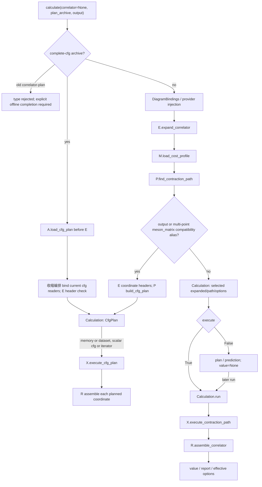

# 关联函数编排 L2

关联函数数值入口统一返回 `Calculation`；共同约定与兼容边界见[Calculation](calculation.md)。

显式任务的 `correlator_task_plan` 在规划阶段完成代表模板、全坐标提升和 cfg 闭包。
P 的 `build_coordinate_cfg_plan` 将已选批次交付到原 CfgTemplate/CfgInstance 中；新增
`output_axes`、`point_indices` 和原始坐标记录只描述结果如何拆 lane，不创建第二份操作图。
X 继续执行原 cfg 游标，W/R 使用原单点装配器恢复原坐标，Dataset writer 消费相同字段。
内存与 Dataset 统一保存/加载完整计划；原 calculate、固定档案及窗口入口保留兼容。

## 自动 elemental 准备

常规空间介子/流使用 `contraction.correlator.Elemental` 声明已登记输入。收缩编排在执行前将真实
SourceReadRequest 交给 `contraction.elemental_preparation`：只按请求分量、动量、扇区和物理时间调用既有
Dataset 请求图服务，复用覆盖、生产缺项、发布后再缩并。`execute=False` 不生产。
合批 E 的 loader 保留只读 preparation_inputs（物理请求及 reader 绑定），不保留 lane 图；
完整 cfg 工厂消费已经替换为实际坐标的 plan.requests，普通和档案回放共享同一准备服务。
Elemental 的 ArrayElemental 兼容头只含 shape/dtype，禁止将其当成可读数组；block/slab 只读取
已发布的标准产物。权重由 native binding 从 calculate 的 elemental_weighted 绑定到独立视图。
准备阶段单独检查逻辑内存预算，耗时尚未计入缩并成本预测；支持范围及验收见[使用页](managed_elemental.md)。

## 固定已选任务的 Dataset 回放

### 内存内坐标输出

不传 output 的显式坐标扫描由 `correlator_coordinates` 声明完整最终字段额度，
`correlator_batch_output` 组合 X 的同步 batch consumer 与 R 的固定单点程序；每个批次
仍包含全部通道，只消费已选 DAG。原始 term 仅存活当前批次，装配后复制最终字段，
不让 select/identity 的视图持有整个 raw owner。全局坐标位置决定最终堆叠顺序，
包括非连续分组、重复坐标和对象容器；与完整 cfg 内存输出共用堆叠服务。
P 不把单点装配 reserve 乘以全扫描；收缩编排声明 caller reserve 一次、两份全扫描最终字段
（逐点结果与最终堆叠重叠）和单点 R 工作区，P 另加当前设备批下载额度。
可选 raw measured reports 仍完整保留；对已选紧凑结果请求 measure 时先以 with_reserves
核验额外主存，操作/分组/路径不变，不足时读取前拒绝。保存的 coordinate_batching
统计标明 output_retention 和测量额度，固定档案恢复沿用该契约。

`Calculation.run(output=..., configuration=..., propagator_map=..., vertex_map=...,
time_axes/time_pairs=..., physical_times=..., physical_lt=..., time_roles=...)`
由 `correlator_replay` 解析保存的角色并绑定当前 reader，然后组合下述既有窗口入口。
该方法没有 correlator/optimize/search/profile/partitions 参数，不能通过回放改变规划任务；
不传 output 时仍沿用固定绑定 `.run()`。每次窗口流核验代表模板和当前 cfg 的各坐标抽样池关系、
包含概率，结构和来源继续由恢复输入的原生服务校验，不兼容时报错，不触发 E/P 重新选路。
多通道共享来自首次传入的完整嵌套请求，不能自动发现调用者另一次调用中遗漏的通道；
这一调用层约束见 correlator skill。坐标窗口排程仍需构造，不能把固定路径复用描述成零规划开销。

## 单 cfg 窗口输出执行

`contraction.correlator_window_run.run_cfg_window_calculation(selected, *, coordinates,
output, configuration=None, source_factory=None, readers=None, backend=None, physical_lt=None,
output_definition=None, time_roles=('0','1'), dt_fields=('two_point','connected','disconnected'),
output_layout='pairs_and_dt', dt_coordinates=None, postprocess_backend='cpu',
window_size=None, debug=None, progress=None)`
复用单坐标的已选 Calculation，按全部给定坐标增量执行一个 cfg；`output` 是 Dataset 根目录。
返回 `Calculation`，value 沿用 cfg 到已发布目录/产物 ID 的映射，并保留完整窗口请求供 `.run()` 重跑。
它不作为完整 `save_calculation_plan` 输入；旧 `CfgWindowResult` 构造由兼容层转接。已有完整档案继续使用原 `run()`。

收缩编排的 `CfgWindowOutput` 只保存完整轻量坐标、原有 CfgOutputField 布局及输出定义，公式直接
承接 complete_calculation/configure_packed_dt。在启动 P 前，将完整累加、HDF5 字段准备、一次输出的
额度加入模板保留主存，并应用实际 worker 额度。规划子进程据此检查每个窗口；不把全部
输出累加器误当作单窗口缓冲。R 输出组装只绑定一次；公开 storage `CfgOutputWriter`/
`PackedDtOutputWriter` 消费完整轻量坐标表并跨窗口复用，物理 dt 计数、单点时间槽、字段精度与科学身份保持。
各字段写入当前 cfg 的 HDF5，完成后由共享根登记 cfg；reader factory 对该 cfg 打开一次，各窗口只重绑局部输入 ID。

窗口回放与内存坐标回放复用 C 的 allocator 经验余量政策，保持pool硬上限，CPU余量为零。
重绑定时先去除旧自动余量再登记当前额度，调用方设备reserve不变；完整报告保留政策来源。
普通 `.run(output=...)` 通过公共logger记录窗口、已完成坐标和发布事件，不新增前端参数。

`debug=None` 继承 selected；`progress(kind, details)` 是可选的窗口/坐标/发布进度回调。
窗口事件含 offset、数量、资源预测和该窗口规划时间；点事件含已完成数量。中途异常清理
writer、输入与子进程，不将该 cfg 登记为完成。当前只接收一个 cfg，不支持 cfg iterator，
不增加调用方缩并路径参数，不重新搜索；完整窗口流的持久化和多 cfg 连续流仍待接入。
本次 meson55 全量测试使用任务外包装连接此入口，原前端脚本和默认 calculate 行为保持不变。

`postprocess_backend="gpu"` 只显式选择 Dataset 输出的 GPU 后处理；默认 CPU。收缩编排在启动
规划子进程前保留全 cfg 的设备与主机输出预算，编排 X 对 R 固定配方的字段程序、
TS 设备时间归约与 HDF5 字段写入。CPU 保持坐标映射、counts/seen 与登记元数据；
数值组装、原 dtype 累加/均值和尾轴布局在 GPU 完成，传输阶段可临时打包。
`dt_packed` 完成后才下载最终记录，`pairs_and_dt` 仍逐对下载和保存。
只有完整 cfg 完成后才写入共享数据集登记；不把完整源×汇输出保留在设备。
支持边界与同设备验证见[GPU 后处理](../results/gpu_output_postprocessing.md)。

## 有界 CPU 规划生产者

`contraction.correlator_stream.plan_cfg_windows(plan, output, points, requests, preparations,
specs, **options)` 接受与 P `iter_cfg_plan_windows` 相同的纯描述输入，返回必须关闭或通过
`with` 使用的窗口迭代器。它以独立 Python 模块进程调用 P，避免从已初始化的 CUDA 进程 fork，
也不重新执行调用方前端脚本。数值线程默认限制为 1；reader、数组和设备句柄不传入子进程。
父进程最多请求一个未来窗口，接收线程只负责私有管道与描述恢复，绑定在 CPU 子进程进行。
`next_ready()` 未就绪返回 `None`，结束抛出 `StopIteration`，子进程错误转为
`PlanningWorkerError`；关闭或取消会终止并回收本生产者。首批计算仍须等待首窗口完成。

私有交接复用上一响应中完整匹配的模板和准备描述；匹配模板内的固定 TensorSpec
按模板位置及准备键引用，不再随全局规格表重复编码嵌套描述。规格匹配显式比较科学
description；形状、精度或身份描述变化时传递当前记录。引用只指向上一响应的冻结
描述，结束和关闭沿用原有释放，不保留历史窗口、reader 或数组，也不改变档案格式。
同一描述在当前响应重复出现时，使用 pickle 的对象 memo，只解析一次引用；恢复函数
以当前接收调用的上下文查上一响应，线程之间隔离，正常完成及异常都释放此上下文。
嵌套接收恢复外层上下文；它不提供进程全局描述缓存，也不改变当前输入的绑定。

内部 pickle 仅连接父进程创建的可信子进程私有管道，不接受外部档案；用户档案继续走 A 的
白名单解码。将该迭代器交给 `X.api.execute_cfg_windows` 可持续交付计算与读取要求，沿用共同
`CfgPlan`/Action/StorageEvent，不建立第二套任务图。全 cfg 的输出累加与发布仍由调用者消费
回调负责。当前为显式组合接口，未改变 `calculate` 的默认行为，也未提供窗口序列持久档案。

已有选定路径及纯输入描述时，可按以下方式组合；`loader_factory(window, cfg)` 和
`consume(cfg, index, values)` 的契约见 [X](../execution/execution.md#增量窗口交接)。调用者须把跨窗口
输出累加器的驻留内存计入任务保留额度，不能仅凭窗口化宣称输出也已受控。
`selected_plan` 必须已经针对执行设备规划；自行组合模块时，沿用 P 的
`retarget_expanded(expanded, backend_name)` 完成输入/准备的主机与设备放置再选路，不能只替换
problem 的 backend 字段而沿用 CPU 块额度。普通 calculate 已负责这一步。

```python
from lqcdweave.contraction.correlator_stream import plan_cfg_windows
from lqcdweave.contraction.execution.api import execute_cfg_windows

with plan_cfg_windows(selected_plan, output_recipe, points,
                      requests, preparations, specs) as windows:
    report = execute_cfg_windows(windows, cfg, loader_factory, consume,
                                 backend=backend)
```

上层基线：[L0/L1](../../architecture/correlator-l0-l1.md)。即时 calculate 实现在 `contraction/correlator.py`；显式任务生命周期由 `contraction/contraction_task.py` 包装相同服务，公开入口为 `contraction.correlator.ContractionTask`。它只管理声明、规划安装、运行互斥和关闭；不持有另一份数值 IR，惰性 cfg 流结束前保留执行所有权。完整合同见[任务与返回](calculation.md)。已登记数据的固定 Diagram 持久执行见 `contraction/diagram_measurement.py`。
W调用S/O/B/E/P/X/R/M公开接口及既有budget/runtime服务，不实现Wick、数值核、搜索或缓存系统。

<a id="全-diagram-整数连接格式目标待迁移"></a>

## 全 Diagram 整数连接格式（实现完成）

权威格式见[ARCHITECTURE](../../../ARCHITECTURE.md#diagram-的统一整数连接格式目标待迁移)。收缩编排组合 S/O/B/E/P/X/R/M 的公开流程，
由 C 贯通 `AxisPattern`/整数元组；流程 保持数据 ID、输出 recipe 和坐标映射，不生成
方程字符串。用户继续声明连接矩阵、算符、数据源和输出，不书写 einsum 方程、不分配整数
ID，也不处理转换对象。前端不增加操作。统一 device 执行接口覆盖
`contract`、`baryon_join`、`sparse_bridge` 的实现路径；全部 GPU 核、DCU/HIP 与生产规模仍待验收。

## 完整 cfg 档案入口（统一执行路径）

目标见[完整规划与直接执行](../../architecture/correlator-target-architecture.md#完整规划与直接执行)。完整 cfg 档案支持迭代 cfg、连续预读和 DatasetWriter 输出。
`calculate(plan_archive=...)` 在 E 展开前加载 `complete-cfg-plan`，因此可省略 correlator。
执行时收缩编排按保存角色绑定当前 reader，E 在数值读取前核对 cfg、布局、坐标和端点共享关系；X
直接重放已保存的计划，不重新展开或搜索。NumPy 和 CuPy 都进入同一 cfg 执行接口；CuPy
通过通用 device scope 绑定准备后的输入、上传读取块、执行已保存 Action 并在输出点回传结果，
不再单独选择矩阵设备路线。执行前仍检查目标兼容性和当前资源是否满足保存的峰值预算。
收缩编排在每次执行开始时通过 R.api 的 `bind_output_assembly` 绑定每个已保存的单点输出模板，
普通逐点组装只交付按冻结 term 顺序的数值，不重新遍历配方或构造 TermValue 覆盖集合。
`source_loader_factory(calculation)` 的返回绑定支持 `(cfg)` 与显式窗口的 `(window, cfg)`，
自动在同次执行内共享弱引用的 reader 约定检查缓存；所有选择/布局/身份 header 仍逐请求检查。
CuPy 回调路线在额度允许时由 X 的有界 CPU 结果队列调用组装/累加/写出，坐标次序与完成发布
依赖保持不变；收缩编排不另建线程或调度层。惰性多 cfg memory iterator 保持同步交付。
`debug=True` 保留逐点深度核验；普通 `assemble_correlator` 外部入口仍执行完整边界检查。
显式设备输出的离线保留量由 X 一次描述字段、输出/工作区字节和元数据字节；收缩编排组合
同一描述，不重复遍历三次或绑定不用的 CPU 求值器。此步骤只计算主机元数据。

该离线 CPU 路径的进一步拆分如下；它不读取数值或初始化设备。

| 步骤 | 操作 | 必要性及处理 |
|---|---|---|
| 1 | 取得当前 selected 的问题和已冻结输出配方 | 保留；它们决定真实 term 与字段 |
| 2 | 为核验配方绑定一个随后丢弃的 CPU 求值器 | 删除；它不参与该预算的任何结果 |
| 3 | 第一次构造字段描述 | 保留一次；得到实际 shape、dtype 和字段路径 |
| 4 | 为输出/工作区字节再次构造相同描述 | 删除；消费步骤 3 的同一描述 |
| 5 | 为元数据字节第三次构造相同描述 | 删除；消费步骤 3 的同一描述 |
| 6 | 以小型主机 probe 推导类型提升和广播 | 保留；不能从输入 dtype 猜输出 dtype |
| 7 | 按既有规则分段并确定可复用 scratch | 保留；这些是实际执行所需的保留量 |
| 8 | 与保存的 CPU 字段布局比较 | 保留；受支持的配方也可能有不同的设备类型提升，不能写成错误字段 |
| 9 | 从当前结果 spec 累加 term 字节 | 保留；输出表达式执行期间输入仍存活 |
| 10 | 按请求布局选 dt 与 one-point 字段 | 保留；两种布局的保存范围和累加器不同 |
| 11 | 累加输出、常量、scratch、pointer 表及打包缓冲 | 保留；不能漏算实际同时存活的 payload |
| 12 | 纳入当前与前一次在途快照的保留量 | 保留；异步完成前不能释放旧 owner |
| 13 | 交付 host/device 字节并释放本次描述 | 保留；不跨 cfg 持有配方或数值 owner |

收缩编排输出接收器对已冻结的内部字段仅在 `debug=True` 时逐点检查 shape/dtype 和有限值；
正常路径仍保留输出覆盖、时间坐标、额度、写入与发布失败处理。
完整 cfg 入口只加载当前格式的 `complete-cfg-plan`。旧版本 correlator/矩阵档案不兼容，
需重新规划；不提供旧矩阵档案迁移器，也不删除用户文件。
全部 GPU 操作覆盖、DCU/HIP 和生产规模仍未验收。

显式 `target_hardware`（ExecutionTarget 或登记名称）使用声明的资源做离线规划，不探测规划主机的设备预算；
`backend` 在该模式下选择执行模块并须与目标 backend/runtime 兼容。未声明 target 时，`backend`
也用于指定本机观测和规划所用的 backend。接口行为以实际代码为准，签名见下文。

## 接口流程



## 精确签名与字段

```python
def execute_contraction_path(expanded, path, *, backend=np, measure=False, debug=False):
    ...
```

### Calculation

`contraction.calculation.Calculation` 是共同返回类，由 `contraction.correlator` 重导出。
固定工作持有 expanded/path，完整工作持有 CfgPlan，窗口工作保留完整运行请求；
只规划 `.value=None`、`.report["status"]="planned"`。`.run()` 返回新的 Calculation，
不改写旧结果，缓存由原 handle 继续复用。`.report` 始终是映射，保留原有诊断，
普通测量报告在 `report["execution"]`，完整 cfg 统计仍为平铺键。
属性保留 inputs、plan、search、execution_mode、prediction、planning_seconds；
新增共同 output_mode，旧 values/stats 由兼容层转接。详见[共同约定](calculation.md)。

```python
def calc_diagram_eval(correlator=None, *, propagator_map=None, vertex_map=None, configuration=None, usedNe=None, usedNp=None, groups_independent=None, time_axes=None, time_pairs=None, batch='auto', partitions=None, partition_mode='radial', optimize='anytime', storage=None, execute=True, profile=None, search=None, host_memory_limit=None, memory_limit=None, reserved_host_bytes=0, reserved_device_bytes=0, backend=None, measure=False, plan_archive=None, diagram_adapter: DiagramData | None=None, data: DiagramData | None=None, target_hardware=None, output=None, debug=False):
    ...
```

`calculate` 是 `calc_diagram_eval` 的同一个函数别名，保留旧用户调用名称。
`target_hardware` 可传 `ExecutionTarget`、`TargetHardwareMemory` 或 M 已登记的名称；登记名称会解析成目标档案，
明确的目标资源用于 offline 规划，不会被本机设备探测值替换。提供目标时，目标 backend/runtime 决定计划，
`backend` 用于运行并通过目标兼容性检查；未提供目标时，`backend` 也决定本机资源观察所针对的模块。
`debug=False` 是 流程 默认值；`Calculation.run(debug=None)` 从计划选项继承 debug 设置，显式布尔值可覆盖它。

给出 partitions 时，收缩编排将 `partition_mode` 交给 S：默认 `"radial"` 保留 PC pair
输出；`"memory"` 只用真实块恢复原关联函数，保持原算符/时间轴。memory 模式
必须同时给出 partitions；预先分块的请求自行携带声明，调用 calculate 时无需
重复传参。未知模式在绑定与读取前报 ValueError。完整 cfg 的代表坐标规划和
Dataset 输出入口均传递该选项；已有完整档案固定输出配方，禁止在加载时以
partition_mode 改写结果。限制与小规模 CPU 交接验证见[模式分块](../operators/meson_mode_blocks.md)。

### 计划档案协调

```python
def save_calculation_plan(
    path: str | PathLike,
    calculation: Calculation,
    *,
    hardware=None,
    profile_source=None,
    metadata=None,
) -> Path: ...
```

普通 `Calculation` 仍须提供 `PlannedContraction` 类型的 `path` 与 `ExpandedCorrelator` 类型的 `expanded`；收缩编排从其 options 取硬件、profile 来源、reserve、storage 和 optimize 元数据，再调用 A `save_contraction_plan`。若 Calculation 持有 CfgPlan，收缩编排则调用 A `save_cfg_plan` 保存完整 cfg payload。两种保存各自保留原格式，不自动把普通 Calculation 升级为完整计划。当前 value、report、loader、adapter 和搜索结果不进入档案。

旧 `correlator-plan` 不再由当前 `calculate(plan_archive=...)` 导入；完整 cfg loader 会因 payload 类型不同而明确拒绝。A 的 `load_contraction_plan` 仍可供显式离线调用者使用，但它要求调用者先提供 `ExpandedCorrelator`。若要执行旧计划，调用者须显式恢复/完成为 `CompleteCalculation`，再用 `save_calculation_plan` 保存为完整 cfg 档案。

### 完整 cfg Calculation 与离线补全

`contraction.correlator_cfg.complete_calculation` 是显式离线补全入口：

```python
def complete_calculation(
    calculation: Calculation,
    *,
    coordinates=None,
    output_mode="memory",
    output=None,
    configuration=None,
    source_factory=None,
    readers=None,
    physical_lt=None,
    output_definition=None,
    time_roles=("0", "1"),
    dt_fields=("two_point", "connected", "disconnected"),
    output_layout="pairs_and_dt",
    dt_coordinates=None,
    postprocess_backend="cpu",
) -> Calculation: ...
```

```text
CompleteCalculation.run(
    *, backend=None, measure=False, device_memory_limit=None, debug=None
)
```

它要求已有一条固定坐标、已选择的 contraction path，然后由 E 冻结读取/准备描述并由 P
`build_cfg_plan` 形成一个 cfg 的全坐标安排；它不为每个坐标重新构图或搜索。E 的
`describe_coordinate_reads(inputs, points)` 对每种唯一 `(reader_role, arguments, selection)`
只查一次当前实际 header，保留随坐标变化的 basis/data ID 以及端点共享关系；P 使用该纯
`read_metadata` 表生成实例读取描述，不把代表点的 basis ID 套到所有坐标。后续档案加载只将
这些保存关系映射到当前 cfg 的 header，不生成新路径。

`CompleteCalculation` 是 `Calculation` 的兼容别名。`calculate(..., execute=False)`
在完整 cfg 分支返回持有 CfgPlan 的 Calculation；之后可显式调用 `save_calculation_plan(path, complete)`。NumPy 与 CuPy
均通过相同的完整 cfg 执行入口，支持单 cfg 或 cfg iterator 的 memory 执行，也支持 iterator 到
DatasetWriter 的流式输出。CuPy 使用 X 的通用 device scope；输入上传、已保存 Action 执行和输出回传
不改变计划或另选矩阵执行器。实际 operation coverage 由目标声明与当前实现交集检查，见
[目标登记与校准](../performance/performance.md#执行目标登记与局部自动校准)。规划时用
`output` 选择并预算 memory/dataset 布局；档案保存模式、字段、坐标映射和缓冲额度，不保存输出根目录。
加载 dataset 模式档案时必须重新传入 `output` 目录。

`postprocess_backend="gpu"` 仅支持兼容 GPU 目标的 Dataset 输出，memory 模式明确拒绝。
选择与两域输出保留量写入计划 `statistics`（`postprocess_backend`、
`postprocess_device_bytes`、`postprocess_host_bytes`），不放进科学 `output_definition`。
未保存此选择的计划保持 CPU；加载执行不更改选择，比较两路线须从同一 selected 模板
分别补全并保存。该选择不引入新 Dataset schema 或改变数值身份，详见
[高级用法](../results/gpu_output_postprocessing.md)。

memory iterator 返回惰性 `(cfg, value)` 结果，当前 cfg 的值在交给消费者后释放。dataset 模式在
`output/` 共享目录保存每 cfg 的完整 HDF5 文件，公共 metadata 和各 cfg 登记写入根 `dataset.json`；
所有字段完成后才登记 cfg 完成，异常时不发布未完成 cfg。返回的 `value` 是 cfg 到数据集目录及 ID 的映射。R 的保存字段与按 physical dt
重建配方在计划中固定，物理时间坐标则从每个 cfg 的 `CfgSources` 绑定。

完整档案执行时，`data`/`diagram_adapter` 可提供 `factory(cfg)` 上下文管理器，yield 按保存
reader role 映射的当前 reader。单 cfg 也可传 `propagator_map` 与 `vertex_map`：propagator map
按保存角色/符号匹配；vertex map 可按角色映射 reader，或在只有一个 elemental role 时传原始
elemental reader。此分支不构造算符基底或新的 operator binding；E 只用 `describe_block` header
在数值读取前检查保存的 cfg/轴/布局/坐标及共享关系。

`optimize="meson_matrix"` 是兼容规划别名，按 `anytime` 的通用路径规划处理；它不选择旧固定矩阵设备
路线。`output` 非空时会选择完整 cfg 路线，因此 `execute=False` 可交付 dataset 缓冲安排。
保存的 CPU/GPU cfg 计划都由通用 replay 直接恢复；CuPy 执行只接受目标 coverage 声明且实现的操作。
旧矩阵 payload 和旧 `correlator-plan` 不会自动迁移；需显式恢复、补全并另存。

## 参数与默认解析

- propagator_map/vertex_map组装为C.DiagramBindings；data与diagram_adapter互斥，data仅兼容别名。
- 未注入provider且有原生map时创建E.NativeDiagramBinding；该选择只消费元数据。
- memory_limit/host_memory_limit省略时用既有hardware_budget服务；CPU主预算是host，GPU主预算是device，host另计。
- `target_hardware` 可传 `ExecutionTarget`、`TargetHardwareMemory` 或 M 登记的目标名称。显式目标使用 offline 模式，不探测规划主机的设备预算；目标声明决定规划 backend 和预算。
- `backend` 默认 `None`。给定 `target_hardware` 时它只指定运行模块并须通过目标兼容性检查；没有目标时它也指定本机资源观察所针对的 backend。
- profile=None交M默认档案；profile对象/名称/路径交M解析。空问题不加载无用模型。
- `debug=False` 为 calculate 默认值；`Calculation.run(debug=None)` 和 `CompleteCalculation.run(debug=None)` 从计划选项继承，传入布尔值可覆盖。
- time_axes/time_pairs、batch、search等合法性由相应契约或P公开入口验证，W不重复重写。
- options是浅只读的请求/有效预算记录，包含后端、模型来源/版本/硬件；search复制原字典，不持有原用户字典。

## 状态变化与交接保证

1. 验证 `execute`/`measure`/`debug` 和 adapter 别名；只有 complete-cfg 档案允许省略 correlator。
2. 指定 `complete-cfg-plan` 时先由 A 解码，再由收缩编排绑定当前 readers；E 在数值读取前查 header 兼容性，跳过展开、M 成本和 P 重新规划。X 直接执行保存的坐标与 Action 安排，并检查目标兼容性及当前资源是否满足计划峰值。否则构造 bindings 并照常展开。
3. 普通路线无 `plan_archive` 时解析模型并搜索；旧 `correlator-plan` 不由当前 `calculate` 档案入口加载，须由调用者显式恢复后离线补全。完整 cfg 的离线补全由 `complete_calculation` 对已选路径完成。
4. 各数值路线均返回 `Calculation`。`execute=False` 时 value 为空、report 标明 planned，但完整路线的 output 可先选定 dataset 缓冲模式。
5. 普通 `run()` 交 X 执行已选路径并由 R 组装；完整路线将已保存的坐标实例交给 `execute_cfg_plan`，不在执行时重新搜索。`debug=None` 继承 plan 的 debug 配置。
6. cfg iterator 的 `next()` 仅由 owner thread 调用，持续 ReadAhead 队列可跨时间对和已领取 cfg 读取。任务分配和循环前共同准备统一见 [Dispatch skill](../../../.agents/skills/lqcdweave-dispatch/SKILL.md)；直接将 Dispatch 交给完整 cfg 入口保留跨 cfg 预读，逐 cfg 的独立调用不共享该队列。普通旧 Calculation 的保存仍不会自动升级成完整 cfg 档案。

## 所有权与异常

W不拥有调用者reader、backend或输入数组，清理责任通过H06注入X。
Calculation保持expanded/path引用；run结果按R协议独立持有或使用约定的持久结果。
预算与初始参数先验证；preset 加载可能读取文件头或共享数据集登记，身份/布局错误在数值读取前传播。真实执行异常由X清理后传播，W不静默fallback、重搜或重交。
output存储预留由E/P交付，不在W临时reshape或隐藏分配。

## 验证与范围

新进程档案测试只用档案和原始 Array reader，不构造 correlator/算符闭包；禁用收缩编排/E 展开、P 搜索/路径重演/资源重算及 M 成本入口后，完成两个时间对并与独立 ordinary 参考一致。阶段 gate 134 项通过、0 失败，耗时 13.544 s；`pairs_and_dt` 布局更新后，31 项模块测试和 17 项外部 meson55 CLI 测试通过，覆盖四段分区、只保存恒等块真空单圈、档案加载及 dt128。该记录不构成数值生产验收；全操作覆盖和生产规模仍待验收。当前生产布局为 `dt_packed`，具体规划记录见下文。
calculate/coordinate/batch/directed/sparse相关测试验证各阶段。
`test_correlator_module_boundaries.py`检查模块依赖和共享类型。本阶段只运行了列明的相关模块测试，没有运行全仓 CPU 回归。

## 原生组态绑定

收缩编排内部 `bind_native_configuration(correlator, bindings: DiagramBindings) -> DiagramBindings`
先用 E.api `contains_structured` 查询容器结构；结构化请求在算符拆分前绑定 reader，
普通请求用 R.api 收集图以跳过空表达式，不在收缩编排展开 Wick 或构造普通图替代品。然后
通过 adapters.preset 的公开 `resolve_correlator_source(source, configuration)` 解析
`PerambulatorNpy/ElementalNpy/CurrentElementalV2V/Dataset` 的已支持测量类型。
其它对象原样交接，不按任意 `load` 属性猜测数据源。preset 声明缺少 configuration
时报 ValueError；实际加载的 cfg、shape、phase、基底和覆盖沿用 adapters/B/E 的检查。

此调用只用于自动注入 NativeDiagramBinding 的路线；显式 `diagram_adapter/data`
收到原始 bindings。空表达式不打开无用数据源。传播子 map 整体解析，顶点按实际
Diagram 行解析；同一 source 的强引用和 reader 在本次调用内按对象身份共享，
顶点工厂对每个行标签调用一次。B 的 `with_reader` 对 Meson/Current/Baryon 生成独立
视图，保留模板约定，重子核心登记表清空；已经加载的顶点采用其当前 reader，不重载。

模板不被修改，映射复制仍由 C.DiagramBindings 保证；Calculation 的 loader 保留独立
视图与 reader 引用，下一次 cfg 调用不会改变旧计划。调用者显式关闭 reader 或改写输入
文件仍会破坏其有效期；收缩编排不提前关闭旧 reader，也不冻结任意可变自定义 reader 的内部数据。
只规划允许读取文件头/数据集登记但不调用数值读取。组态切换失败不改变模板，读者缓存属于既有 preset。
此操作不改变时间坐标或结果布局，不是跨 cfg 缓存、搜索复用或恢复机制。

`tests/test_correlator_configurations.py` 覆盖两 cfg 独立复数全时间矩阵参考、共享加载、
延迟旧计划、工厂调用、失败绑定、自定义 adapter 和空表达式；`test_preset_frontend.py`
增加已发布产物的乱序物理时间参考，B 的 reader snapshot 专项检查 Current 模式选择和
重子核心隔离。

## 独立成本模型命令

`contraction.performance.profile.main(argv=None)` 解析 `fit/merge` 命令并组合 M.api 的模型服务；
`lqcdweave-profile` 及 `python -m lqcdweave.contraction.performance.profile` 使用同一入口。
参数字典、正权重来源筛选、输出与输入别名检查在命令处理阶段执行，之后交 M 拟合、
验证、融合与保存。复用原 parser 和 guard，不执行关联函数或生产器，不定义模型公式、
报告格式或新存储。命令参数与 M 服务接口见[M L2](../performance/performance.md)。

流程 只公开 `main`；Python 模型调用方使用 `contraction.performance.api`。
命令异常传播，argparse 的非法参数仍按原行为退出；CLI 检查输出目录/输入别名，
不改变 M 的单独 Python 保存接口。根测试与 M 专项的 subprocess 用例核对拟合/融合、
分组/权重、拒绝输入覆盖和参数互斥；CPU 结果不形成目标硬件校准。

### 按用户选择组合测量与保存

使用 `contraction.correlator.calculate` 计算已有数据的 Diagram；脚本选择图、时间范围、算符、后端、规划和执行参数，再按产品约定保存结果。库不提供固定持久测量执行包装。`plan_indexed_diagram_measurement` 保留登记输入的只读预检，`prepare_meson_stage` 与行写出服务保留其已声明范围；它们不能代替通用前端或改变原数值契约。用法见 [correlator skill](../../../.agents/skills/lqcdweave-correlator/SKILL.md)。

可选的 DatasetRequest、DatasetWriter/Reader、DatasetIndex 和 runtime 提供实际身份、具名轴、完整覆盖与依赖规划。新写入默认是每 cfg 整块 NPY 或 HDF5 并由共享根 `dataset.json` 登记；脚本确定数据字段与科学轴，不把计算 slice 变成文件协议。借用缓冲在下一次复用前写完；不另建存储或恢复系统。详见[数据保存说明](../storage/data_storage.md)。

## 外部来源策略与项目回执

`runtime.datasets.apply_source_policy` 检查显式请求图的实际父项、基底、input roles 和嵌入 input views。`require_known` 拒绝缺失或未知来源，不从路径或 shape 推断身份，且不认证物理正确性。通用 receipt writer/reader 负责可选项目标签、依赖和来源重验证；回执是引用，不是输出完成标记。所有格式与执行服务接口见 [产物生命周期](../storage/dataset_lifecycle.md)及[产物规划](../dataset_planning/dataset_planning.md)。

## Producer-attempt execution parameters

`run_dataset_requests(..., *, execution_parameters=None)` forwards optional
request-name-to-JSON-object parameters to the existing
`runtime.dataset_stage.run_dataset_graph` interface. The shared pure
`contracts.execution.normalize_execution_parameters` detaches and validates
JSON values. Runtime rejects unknown request names and non-object stage values
before any dataset observations or output admission. Storage alone validates,
writes and recovers the existing execution envelope; frontend does not create attempts,
locks, journals or a second schema implementation.

After coverage copying, runtime passes a configured node's parameters to
`writer.bind_producer_attempt(..., execution_parameters=...)` only if a real
producer must fill missing rows. Unconfigured nodes retain the original binder
call. Completed reuse and materialization do not bind or append producer history.
Execution schema 4 records explicit stage parameters with the producer attempt;
these parameters remain outside the scientific definition and actual dataset ID.

调用脚本可用 `execution_parameters` 记录所选批策略等执行参数；参数属于尝试设置，不是科学身份、实际自动批宽或物理验证结果。格式与兼容范围见[产物生命周期](../storage/dataset_lifecycle.md)。


## 项目回执覆盖查询（收缩编排公共入口）

`runtime.project_datasets.plan_project_dataset_requests(requests, index,
receipts, *, expected_project_id)` 接收显式新需求图、公共 DatasetIndex 和回执路径序列。
预期项目标签必填。返回标准 planner graph，并附加项目标签和回执重验证状态。

收缩编排只组合公共批量回执 reader、DatasetRequest、plan_requirement、plan_dataset_graph
和 DatasetIndex；不读取存储私有字段，不生成第二份科学 IR、完成台账或 DAG 验证器。
逻辑父绑定沿纯规划图逐次解析，不从 receipt 的旧节点名推断新请求名。

批量 reader 在一次调用中复用同一实际产物的打开结果，返回前关闭所有 reader，
并只返回独立 metadata。后续调用会重新读取回执并核对当前索引中的 dataset ID、
请求定义和项目标签；错误沿公开组件传播，不会被转成空候选。验收覆盖新图、缺行与
依赖阻塞、多个项目、共享 ID 和重复读取。范围为本地 CPU 只读查询，不含共享文件系统、
GPU/MPI、自动发现和通用 campaign。

## 显式项目图序列（收缩编排公共入口）

`runtime.project_datasets.run_project_dataset_sequence(index, step_builders, *,
expected_project_id, initial_receipts=(),
source_policy="allow_unknown", resume=False)` 按调用方给定顺序运行多个现有
project-scoped graph。每个零参数 builder 返回单图参数，必含 `requests`、
`outputs`、`provenance`、`producers`、`receipt_directory`，可选字段沿用
`run_project_dataset_requests`。调用方先提供初始回执；runner
先读取初始回执、调用并预检所有 builder，再逐图执行。成功图的现有 schema-4
receipt 经公共 reader 重读后才成为后续图的候选。失败停止后续图；resume 从首图
重新检查既有产物并继续，不另建完成台账。返回每图的 actual ID mapping 和 receipt
路径。

序列只对 `receipt_directory` 的开头 `~` 做 home 展开，并在预检、写入和回读中
使用同一规范路径；普通 graph 的 `outputs` 路径继续遵循原有 `Path` 语义。
此入口只组合现有收缩编排/A/storage/runtime 接口，不引入新 receipt 格式或执行引擎。

## 显式稀疏的旧固定两轴 Diagram 预检

`plan_indexed_diagram_measurement` 仍然只读，不执行计算或发布。默认物理全时间契约保持。
所有实际输入使用同一显式有序 TimeSelectionRecord 时，返回 source_times/sink_times 为
range(Nt)，并返回 time_selection；measurement_spec 保留 physical lattice，以
conventions.time_coordinates 记录两个时间轴的槽映射，time_coverage 为 selected_physical。
E 的实际模式/点端点身份核验不变。调用方通过原生 calculate 与通用 DatasetWriter
计算/补缺/发布，没有新增固定 runner 或恢复框架。

该旧两轴 helper 对混合物理/槽域、不同源汇记录或不一致顺序在预检前明确拒绝。
需要角色独立选择或跨时间额外端点时使用原生 calculate/完整计划路径；不能把较大的
reader.Lt 或相同 Nt 当作共同科学时间域。实测交接见 test_sparse_persisted_pipeline.py。

## Diagram 预检的可选依赖

`contraction.diagram_measurement` 和 `contraction.vsv_graph` 先消费 S.api 的
真实 Diagram，再导入 SymPy 符号，令缺少 `correlator` extra 的失败统一由
S 的公开导入边界报告。仅改变导入次序，不改变请求规划、来源策略、
只读预检及其科学契约。基础 datasets/production 服务
保持可独立导入，真实 Diagram 使用仍要求可选依赖及原科学契约。

## 重子与高模已有数据交接

公开 binding/expansion/calculator 保留 Baryon/Meson 的自旋、source dagger、相位、边界与实际端点契约；脚本按公开数值入口计算并选择保存方式。登记 Diagram 的只读预检可检查实际传播子/elemental 视图；`validate_registered_highmode` 可重验高模的嵌入视图与实际父项。它们不执行固定持久生产链。使用与范围见[重子生产](../elemental/baryon_production.md)及[高模用法](../perambulator/point_highmode.md)。

## Persisted scalar Meson plan orchestration

`contraction.correlator` exposes four helpers that coordinate existing public APIs:

```text
plan_persisted_meson(
    diagrams, times, *, vertex_specs, propagator_specs,
    vertex_sources, propagator_sources, budget=None,
    max_candidates=4, backend=None,
) -> PlanBundle

save_persisted_meson_plan(bundle, path) -> Path
open_persisted_meson_session(path, *, backend=None, expected_workload=None) -> ContractionSession
execute_persisted_meson_cfg(session, cfg, *, vertices, propagators) -> Calculation
```

Planning calls E.api, then P.api `plan_workload` with `optimize="greedy"`,
keeping the workload's output groups intact. With no backend, planning consumes
only the declared budget and metadata. With an explicit backend, frontend validates
the budget and candidate count, asks `runtime.memory.resolve_memory_limits`
for startup limits, rejects exhausted limits, and passes the resolved caps and
CPU/GPU target to P. P does not import or query the numerical backend.
Saving and opening reuse A's `save_plan`, `load_plan`, and `validate_bundle`.
frontend verifies the `meson-simple-v1` marker, frontend recipe metadata, route
declarations, and equality between non-empty recipes and saved output groups
before execution. Session prepares the opened bundle once; each cfg gets a
fresh B loader and calls `execute_cfg`, which uses the saved batches without
planning again. X owns immediate input snapshots and R assembles the saved
ordered products. Runtime observations and declaration caps remain separate;
startup planning does not replace X's fresh execution-time checks.

The preparation helpers return `PlanBundle`, `Path` and `ContractionSession`; numerical execution returns `Calculation`. They add no IR, archive format, scheduler, or numerical cache. Use one open session for repeated cfgs. The saved workload preserves its `output_groups`, `output_recipes`, execution budget, and assembly reserve. A structural signature and `expected_workload` comparison protect plan structure and declarations; neither proves the physical identity of data returned by a getter. The helpers use the canonical `lqcdweave.contraction.contraction_session.ContractionSession` below.

## Synchronous contraction session

The public module is `lqcdweave.contraction.contraction_session`. It defines `ContractionSession`; `CfgExecutionResult(values: tuple, stats: dict)` is a compatibility constructor returning the common `Calculation`. The former root Session path is retired, without a forwarding module.

```text
ContractionSession(*, optimize="greedy", backend=None, cache_entries=8)
ContractionSession.from_plan(plan, *, backend=None, load_plan=None, validate_bundle=None)
session.tensors(bindings, terms)
session.baryon_terms(bindings, terms)
session.diagrams(diagrams, times, vertices, propagators, *, return_stats=False)
session.baryon_diagrams(diagrams, times, vertices, propagators, *, coefficients=None, return_stats=False)
session.execute_cfg(cfg, loader)
session.clear()
```

The constructor accepts the actual NumPy/CuPy module or its name, and defaults to NumPy. The retired `optimize="joint"` policy raises before backend import or cache initialization. The session owns the existing P structural cache and forwards one explicit backend to B/X/R; it keeps no process-wide backend setting, input arrays or getter objects between calls. Use separate sessions for concurrent evaluations.

All numeric methods return frontend `Calculation`. `tensors` and `baryon_terms` retain their term tuples in `.value`; the diagram methods retain the assembled backend array. The compatibility layer preserves `.values`, original `.stats`, array access and `(array, ExecutionStats)` unpacking for `return_stats=True`. The new API uses `.value` and mapping `.report`. X retains its internal C `ExecutionResult`. Simple diagrams use B's eager getter snapshots, E's ordered terms/recipes, P's structural cache, X execution and R product/stack assembly. They preserve scalar integer getter times, VSV/VSP/PSV/PSP routing, empty groups, and scalar or non-scalar outputs. Baryon diagrams first validate every topology, coefficient and supported metadata in E, then every handle in B before any numerical getter; P compiles the three-line terms and R stacks the outputs. Eager dynamic snapshots are not a claim of whole-workload bounded memory.

`from_plan` requires the injected archive validator; archive paths also require the injected loader. It checks C frontend metadata and any saved runtime fingerprint, then prepares the already compiled bundle through X. `execute_cfg` loads fresh cfg inputs through the supplied loader, executes that prepared bundle, and assembles R outputs without planning again. It returns `Calculation`, including assembly/session timings in `.report` and the original dictionary through `.stats`. A persisted session rejects all dynamic methods before input reads; a dynamic session rejects `execute_cfg`. `clear` resets only the structural cache and its counters.

Class import relocation does not change the PlanBundle archive schema and does not offer migration of pickled Session instances. CPU numerical coverage and simulated device checks must be reported separately from real GPU validation.

## `meson_matrix` 兼容规划别名

`optimize="meson_matrix"` 保留为兼容参数，规划时归一为 `anytime`；它不会选择旧固定矩阵
计划或专用矩阵设备执行器。结构化 dense 介子输入可按 `anytime` 路径展开为通用张量因子，
再由 P 搜索并交给 X 执行。此参数不改变 `backend`、执行设备、存档格式或结果布局。
多时间对扫描沿用一次代表坐标选择路径，再由 `complete_calculation` 建立完整坐标计划。
旧矩阵/`correlator-plan` payload 不会自动迁移；调用者须显式恢复、补全后另存为完整 cfg 档案。
详见[展开 L2](../expansion/expansion.md#通用-anytime-的紧凑矩阵展开)。

离线入口 `complete_calculation` 可在保存计划中声明保留逐对结果，或只保留按物理 dt 累计的结果；`dt_coordinates` 与 `physical_lt` 明确其科学坐标和覆盖。`pairs_and_dt`、`dt_packed` 是结果内容/累计策略，不代表磁盘目录或编码格式。存储均为每 cfg HDF5 具名字段，由共享 `dataset.json` 登记；档案加载不改变所选结果策略。
`load_correlator_output(dt=True)` 返回档案记录的物理 dt 坐标；meson55 生产配置选择 `physical_dt=1..127`，所以该配置末轴长度为 127 且不含 dt=0。

meson55 生产结果写入 `DATA_ROOT/correlator`。数值配方只保留 I=0/I=1 `two_point` 的 dt=1..127 结果和
10×10 分区组合；计算仍由原 1560 个非零时间对累计，但不保留逐时间对矩阵。I=0 `two_point` 不做
ensemble VEV 扣除。仅 I=0 恒等表示 `A1_Pp_Cp_Rp` 保留 `vacuum_sink/source`，按 40 个实际时间槽
保存为单圈辅助量，不累计 dt；不另存 connected/disconnected，也不为其它表示保存真空字段。总计 162 个具名字段：160 个 two_point 和两项单圈字段。每 cfg 的字段保留实际 shape/dtype，共用 `dataset.json` 登记公共 metadata、cfg 身份及字段坐标。

另见[矩阵架构](../../architecture/meson_matrix_architecture.md)。


## 完整 cfg 的通用 GPU 执行

`CompleteCalculation.run(*, backend=None, measure=False, device_memory_limit=None, debug=None)`
对 NumPy/CuPy 计划使用同一保存安排和 X replay；CuPy 通过统一 device scope 绑定 loader、上传已声明
输入、执行保存的操作，并在输出点将结果回传到 host。memory 与 Dataset 输出共用该路径，不会因
`optimize="meson_matrix"` 切换执行器。显式 `device_memory_limit` 必须为正整数并且至少覆盖保存的
`peak_device_bytes`；省略时由既有 hardware-budget 服务解析本地资源。其它 GPU 操作/精度、DCU/HIP 和生产规模仍待验收；`measure=True`
不适用于完整 cfg replay。协议替身测试不能代替真实设备验证。


## 数值结果与配对加载前端

`load_calculation_plan(path, *, expected=None, hardware=None, configuration=None,
propagator_map=None, vertex_map=None, source_factory=None, readers=None, output=None,
host_memory_limit=None, memory_limit=None, debug=False)` 与 `save_calculation_plan` 配对。
`expected` 为当前 Calculation/ExpandedCorrelator 时调用 A 的普通固定路径 reader；
ExpandedCorrelator 须另给 hardware。否则调用既有完整 cfg reader。完整计划保留输出模式，
加载时只重新提供输入角色、目标预算上限和输出目录，不搜索或执行。三种输入绑定方式互斥。
统一返回 Calculation（CompleteCalculation 仅为兼容别名），执行用 `.run()`。

`save_correlator(path, result, **options)`/`load_correlator(path)` 接线既有 DatasetWriter/Reader
上的数值结果格式。收缩编排只从已执行 Calculation 的坐标契约提取扫描轴/实际坐标及 cfg，
S/A 内不做来源猜测。完整计划在 output_definition 保存 `frontend_coordinates`；
旧档案无此元数据时必须给原始 value 和显式坐标，不能反推。
Dataset 输出已发布、未执行结果和 cfg iterator 的直接保存明确拒绝。
字段、容器与可选源时间平均的精确存储契约见[数值结果](../storage/correlator_results.md)。
前端交接测试 `tests/test_correlator_frontend_roundtrip.py` 覆盖两种配对计划及结果坐标保留。

## 显式重子编译并执行便利服务

`contraction.contraction_session.execute_baryon_terms(bindings, terms, *, backend=None, plan_cache=None, optimize="greedy")`
观察数组 shape/dtype，调用 P.compile_baryon_terms_cached，再调用 X.execute_plan。原 contraction 包级入口保持不变；
X 不再重导出编译器或该便利入口。缓存只保存结构，输入仅在同步调用中借用，不改变 source_slots、错误检查或默认 greedy。
getter 路由及首次读取后的立即快照仍归 B；此便利函数不替调用方快照借用输入。

### 完整 cfg 的采样兼容性

`complete_calculation` 在只读阶段检查各坐标的 P/D 池关系及包含概率规则，输出定义保存纯 `input_sampling_signature`；重放恢复 reader 后、数值准备前再次核对。签名描述等价关系与统计规则，不用池名称或 shape 替代实际来源，D 的完整身份检查仍执行。带抽样的完整回放当前只接受空间等时 elemental。比较驱动按兼容关系分组选路，见[有限抽样比较](../measurements/blending_comparison.md)。
