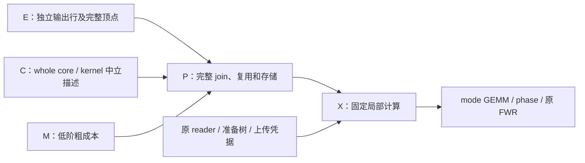

# 介子整体顶点的准备与计算

普通 Diagram 整体源路线的完整和物化将一个实际端点绑定的
`sum_r coefficient_r Gamma_r Phi_r` 交给 P 作为一个输入；分量保持原算符顺序，不合并不同输出算符。
B 的 MesonCoreMetadata 保留原始分量/读取描述，E 注册现有 spin_spatial 成员及一个
linear_combination 准备树，隐藏成员不进入全局缩并图。

| 阶段 | 操作与依赖 | 所有者 |
|---|---|---|
| 元数据描述 | 读头、实际端点/轴绑定分组、纯准备配方和粗成本 | B/E/C；不读生产数组 |
| 原始读取 | 每个成员原有 raw block，复用实际数据身份 | 既有 reader/ReadAhead |
| 成员准备 | 已有 profile、精度转换、空间共轭/转轴、自旋外积 | PreparedSourceLoader；CPU 或 GPU |
| 顶点准备 | 按原顺序乘系数并求和；最多一个复用成员缓冲区 | 当前调用；不缓存历史数组 |
| 计算 | 完整顶点与实际传播子/上游中间量缩并 | 原密集执行器 |

source 每个成员复用原 gamma5 Gamma.conj().T gamma5 与空间共轭/转轴；成员系数恰好共轭一次，
输出 recipe 不重复乘它。成员先执行统一任务精度，再按配方顺序累加；不丢弃微小非零元。
与旧的缩并后外部求和相比，浮点舍入位置改变，必须同精度对照。

准备依赖声明 raw blocks 可用；GPU 还需原上传完成凭据。IO/CPU/GPU 生成器沿用既有服务，
不宣称所有准备已自动重叠；compute 不能把提交当成设备完成。两条逻辑端点可连到同一个
传播子或中间量，包括自迹，使用实际 Einstein 标签，不要求两份独立腿数组。
一般 4×4 spin、复系数、profile/源伴随复用既有成员实现，不要求 Gamma 为单项置换矩阵。
原生传播子 complex64/complex128，elemental 可为 float32/float64/complex64/complex128。

P 只见完整 shape/dtype、raw 依赖、粗 FLOPs/traffic 和工作区，不搜索 Gamma/Phi 内部路径。
单分量复用原叶快路，标量系数沿原输出配方施加，不为它额外物化一次全张量乘法；
仍是一个顶点，不增加全局分量项。多分量全和结果驻留由原 SourceSpec 计费，额外暂存为一个成员缓冲加
成员原工作区。这不是可信峰值证明；原预算和 allocator 余量约束实际执行，不静默改变物理截断。

稳定回归 test_whole_vertex_integration.py 使用三个复系数分量（含1e-16非零）、独立显式自旋/空间参考、
source dagger、两次改变当前输入及固定存档回放核对四种 elemental 精度。混合重子—介子/流保留六种腿次序。
固定坐标、cfg 闭包与坐标批量已接。批量准备递归读取原配方的多个 raw slab 依赖，
每个 lane 内完成整体顶点，再使用既有 stack 形成批次；静态子项不被强加批次轴。
原始 slab 按身份共享，多个 Gamma 共用同一空间分量时只读取一次。
批宽、尾批次、源端共轭与共享叶由固定计划表达；前端调用不增加参数。
完整 Dataset 交付保存同一准备树；保存时组合成员保持与整体顶点相同 shape，stack 才增加批次轴。
混合稀疏桥仍保留原 record 来源，不将 record 误当成介子逻辑输入请求。
外部抽样系数在构造输出配方时转为数值复标量；顶点权重进入内部后仍保持原数值输出类型，
避免精确 Fraction 常量把完整 Dataset 的结果描述变成 object。该路线中，同一 Operator 的 diagonal、point_diagonal、general 空间分量按实际有序端点语义组成整体，
结构标签本身不再拆全局项。成员的完整逻辑 shape 必须相同；端点时间、源伴随、实际基底/标签、
点池、选择和边界仍由原 B 描述保留。不同绑定、不同输出算符不会被合并。
混合组取所有成员共同保证的支持：含 general 则整体为 general；P/P 的完整 diagonal 与
point_diagonal 组合仍保留共同的 point_diagonal 证明。全 diagonal、纯 general 和单分量维持原快路。
COO 与随机 D 统计分区仍走旧专门降低路线，尚未整体顶点迁移；原矩阵专门路线与旧档案不重写。

## 混合结构的支持嵌入

准备配方新增默认空的 `spatial_support`，记录空间轴对及实际标签相等的本地位置对；
旧档案缺少字段时保持原行为。普通 Diagram 的混合组及矩阵兼容路线的结构成员使用支持嵌入，不能用
`compact_structure=False` 把声明外的原始数组垃圾当成物理非零元。

| 成员证明 | 准备时保留的条目 | 完整逻辑输出 |
|---|---|---|
| V/V diagonal | 左右实际 mode 标签相同；选择顺序可以不同 | 两条完整 mode 轴 |
| P/P diagonal | 实际点标签和 color 都相同 | 两条 point/color 端点 |
| P/P point_diagonal | 实际点标签相同，保留完整 color 块 | 两条 point/color 端点 |
| general | 所有原有条目 | 原完整轴 |

这些索引只由元数据产生，源端转轴会同步映射支持轴；源空间伴随、profile、任务精度和原算符顺序
仍沿已有成员准备。全和系数在内部按原顺序乘一次，源端恰好共轭一次。不同实际点池不会因等大
shape 合并；有实际端点标签时按标签匹配，不能假定本地位置相同就是同一个点。

CPU 回退为清零当前完整输出、只提取受支持条目再乘 spin；普通 V/V 对角匹配直接写入
当前输出的对角 view，避免每次重建索引数组与 gather/scatter。GPU 将同一索引条件放入既有
FusedSpinPreparation 的准备核；声明外直接写零，不读这些生产条目，不上传索引数组。
它复用已有浮点舍入步骤、profile 和源伴随代码，不引入另一个 IO/上传缓存或内核路径搜索。
批量配方仍逐 lane 绑定当前 raw 依赖；新支持配方的 raw_index 先取当前数组 view，再使用原融合核，
不缓存 lane 数组或地址。其它旧 raw_index 路径维持原选择。支持表跟随原配方保存，隐藏成员仍不进入 P。
全和结果和一个成员工作缓冲按原准备树计入粗存储，GPU 支持谓词没有额外生产数组；
这不构成可信峰值上界，仍受原执行 allocator/额度和余量限制。

普通介子和 dense-v 重子图中的 Meson 使用同一支持配方。重子图的纯传播子和单成员 Meson
也交付等价的 identity/spin_spatial 配方，使完整档案可以保存准备闭包；原固定 V loader
没有 background slab 能力时明确记录不可预读，未在此添加重子坐标合批。

通用 structured 编译器也保留原 Meson 的整体 choice，不能先拆成单项再做外层笛卡尔积。
完全相同的完整定义可以复用同一结果，仍保留各输出行；部分重叠的不同 Operator 不会在此合并。
精确零系数在 B 的 core 描述前剔除，仍保留原 term 索引供时间 slot/profile 绑定；非零小系数不设阈值。
structured 全零 Operator 沿原常量零输出分支，不构造空的整体和、不读取其 raw 分量。
原 Current/directed-current/缺失 reader 的能力限制保留；Baryon、Glueball 在原 structured helper 中已经是整体。

整体矩阵核使用完整顶点与 closed connected/trace 操作；
旧档案继续回放原已选 Action/FWR 算术。
准确 unit-spin 的支持继续随 spatial_only 空间准备保留，component/FWR 分解留在局部核，
未为统一表示物化 16 倍普通空间输入。不同输出行及实际端点绑定保持独立。

## 整体矩阵核

C 声明 `MesonWholeCore` / `MesonWholeKernel`。外层 Term 只引用传播子及
带独立输出行的完整顶点，逻辑 shape 为 `[row,spin,spin,mode,mode]`；这些 virtual core
不伪造 SourceSpec 或数值 owner。原空间/phase 准备仍是实际数据依赖，但不成为外层可搜索因子。
编排层从 X 取得纯 `whole-matrix-v1` 声明并通过 C 交给 P；E/P 不导入数值核。
P 对 closed connected/trace 只粗价完整 join、完整结果复用和原存储安排，未先搜索内部图再包装。

X 固定内部方案复用原两个 mode GEMM：complex64 接原 FWR 宽收尾，complex128 接两个 phase map
和 dot；trace 可由同一传播子同时连接两个逻辑端点。非 unit-spin 的 dense 表示复用原 K/H 算术。
私有分量和贡献 multiplicity 留在该实现中，不预先合并抵消系数，不为普通 unit-spin 物化 16 倍空间输入。
C 不保存第二张操作图或历史数组地址。准备、常量、上传、当前数据 owner 继续沿现有服务。
成本/工作区是粗估；FWR 使用原有有界 tile 与 allocator/预算服务，不提供可信峰值证明。

### 公共入口与完整坐标

默认 anytime 与 meson_matrix 已使用同一 whole-core 交付，不再把私有因子交给通用 P。
坐标绑定只为真实 source 生成准备/stack；完整顶点仍是无数值 owner 的 virtual spec。
whole 的 lane 动态性由自己的实际空间/phase 依赖决定，传播子可另有 lane；内核接收两者的明确映射。
private contribution 标签不占用外层标签空间，与全局 lane 整数碰撞时只重命名局部 dummy。
完整固定计划保存同一 core、当前数据角色与尾批安排，执行不重新展开、重规划或搜索核内部。

外层与局部数据边界如下。准备叶仍由现有 reader/preparation/device owner 管理；箭头表示
描述或本次数据依赖，不保存另一张执行操作图。

| 交接 | 实际含义 |
|---|---|
| `MesonWholeCore` | 独立输出行、完整逻辑 shape 及两项真实准备依赖；无虚构数组 owner |
| `MesonWholeKernel` | connected 或同 operand trace 的实际输入和私有布局；无路径搜索结果或历史指针 |
| 外层 `ContractionTerm` | 只引用传播子和完整顶点；私有 component/phase 只在准备闭包和局部实现中 |
| `estimate_meson_whole` | M 的公开粗价服务；不读数组，不枚举或试跑核内部路径 |
| 固定档案 | 保存同一中立 core、原准备树及坐标映射；旧普通/FWR Action 不转换为新核 |

正常绑定不重复 M 计价；独立校准可记录结构估计，估计的固定阶段数明确标为 estimate，
不能用作实测 CUDA launch 数。低精度内部 FWR 与末端转换仍沿已有策略。

### 固定局部算法与版本

complex128 connected 的两侧空间 component 轴均为 singleton 时，先由 K0/K1 闭合 mode 形成小 spin-Gram，再分别乘两侧 phase。其它 geometry 使用两项 mode 乘积后先计算 H0=phase0*K0、再由 K1*H0 闭合 mode、最后施加 phase1 的固定链；complex64 沿用 FWR。选择依赖声明结构，不扫描生产数组猜测结构。

保存的 v1/v2 内核按各自版本的原顺序回放，不能因实现升级静默改写档案数值顺序。局部临时量沿用执行 allocator 和预算服务；粗成本不保证覆盖池外 CUDA 上下文或外部库分配。COO/D 路线的能力不能从整体 dense 路线推断。
