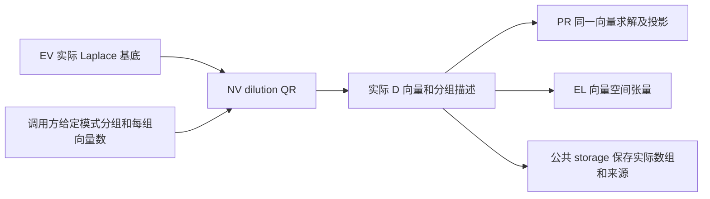

# NV：独立 NoisevectorGenerator 模块

日期：2026-10-11。状态：NumPy dilution 数值实现与 CPU 参考验证、通用数组保存/读取已完成；
CuPy 接口和真实生产规模尚未验收。PR 已支持实际 D 输入、九类 V/P/D 直接产品、六类 pair 保存及九类读取；
EL 已区分九个 V/D/P 扇区，普通 Meson Diagram 的 QR 混合列包含估计量按实际 group/pool 接通；PR 端点来源仍显式绑定。

NV 的唯一实现目录为 `src/lqcdweave/production/noisevector/`，公开入口为
`lqcdweave.production.noisevector.api.NoisevectorGenerator`，包级
`lqcdweave.production.NoisevectorGenerator` 导出同一个类。
NV 负责从实际 Laplace 向量生成实际 dilution 向量 D；它与 EV、EL、PR 并列。
PR 和 EL 接收已经生成的实际向量，不实例化 NV、不访问其私有状态。

生产脚本用法见 [NV skill](../../../.agents/skills/lqcdweave-noisevector/SKILL.md)。
保存约定见[数据保存格式](../storage/data_storage.md)；实际 D 身份的持久化 CPU 回归见
[test_dilution_readers.py](../../../tests/adapters/test_dilution_readers.py)。



图中的连线是数据交付。PR 可直接消费实际 D，并提供九类产品与六类 pair 存储；
EL 通过 vector_bases 绑定实际 D 与 DilutionSource；普通 Meson Diagram 按实际混合列标签的 H_r 包含系数及相等分区消费同池 QR 数据，重子及矩阵专用 D 路线未扩展。NV 与 PR 的 reader 可复用已有 DatasetFieldHandle
向量读取协议，调用方仍须提供端点的实际来源身份。

## 精确接口与输入

```text
NoisevectorGenerator(eigenvector, dilution, *, array_module=np,
                     mode_offset=0, mode_groups=None, mixing="qr")
load(key) -> self
calc(seed=None) -> owned complex128 array
describe() -> independent provenance dictionary
```

`eigenvector` 必须提供 `load(key)`，交付复数数组
`(Nt, Ne, Lz, Ly, Lx, 3)` 或支持切片读取的等价对象。NV 在 load 时保存自己的
complex128 快照，后续输入 reader 的复用不影响计算。时间槽顺序保持原输入；
有 `time_selection` 时使用共享 `TimeSelection`/`TimeSelectionRecord` 契约，复制并核对其 `Nt` 与输入首轴一致；不匹配在输入快照分配及 QR 前拒绝，加载失败后旧输入与完成状态失效。不推断物理时间、不随机重排时间槽。
首版按完整输入加载，不提供 streamed 或分块 reader。

`dilution=(parent_counts, vector_counts)` 定义各组的 n 和 m，要求 `1 <= m <= n`。
vector_counts 可以是重复到所有组的单个整数。默认按父模态顺序连续分组；
`mode_offset` 可跳过 low 段。显式 `mode_groups` 接受每组有序父模式索引，支持
非连续的重要性分组；长度必须对应 n，组内和组间均不重复，不能同时使用非零 offset。
NV 消费已经确定的分组，不自动计算谱轮廓、重要性评分或论文的平衡分组。

输入参数索引是存储位置；已有 handle.mode_labels 时，输出 describe.mode_groups 保留实际科学标签，
与 high 的 ModePartition.projection_modes 对齐。缺标签的旧句柄沿用位置标签。

NV 只在 `load(key)` 时从实际 `parent_handle.basis_orthogonal is True` 继承正交证明；缺失/false
意味着未知且保持 false。load 开始先将状态重置为 false，因此即使 parent 读取失败，也不会
留下上次输入的正交标记。`describe()` 返回 `basis_orthogonal`，且该值表示互相正交的支持，
不表示单位范数。QR 和 legacy 单向量分支的范数可不同，但都不改变是否能从已证明父基底
继承正交性；NV 不重复检查整数组的 Gram 矩阵。裸 D 数组没有这个证明，按一般结构处理。

输出轴为 `(Nt, Nd, Lz, Ly, Lx, 3)`，`Nd=sum(vector_counts)`；
向量轴按 `(dilution_block, vector_in_block)` 顺序展平，不补零。
每个时间槽独立抽取混合系数；一次 calc 产生一个 realization，不平均多个实现。
每次 calc 为各实际时间生成新的、彼此不同的 time_pools UUID；同 seed 的重新生成也代表新 pool。不同 cfg、两端是否复用同一已保存实现由调用方绑定。高级导入的实际数据若跨时间共用同一混合列子集，time_pools 须保留共享 UUID；图展开以父基底实际 ID、UUID 和有序父分组匹配列选择池，不用物理时间拆分。各时间的实际向量仍分别读取，默认生成器不提供跨时间共同子集选项。

## QR 数值及旧实现兼容

默认 `mixing="qr"`。对一组实际父向量 V，n 为父模式数，m 为输出向量数：

| 情况 | 数值行为 | 正交父基底下的原始协方差 |
|---|---|---|
| m=n | 直接复制实际父向量，不抽随机数 | D D† = P_block |
| 1<=m<n | 复高斯 n×n 矩阵的 QR，取 Q 的前 m 列；D=VQ | E[D D†] = (m/n) P_block |
| mixing="legacy" 且 m=1<n | 独立单位模 U(1) 相位；D=Vη | E[D D†] = P_block |

这里 V 的列是空间颜色向量；输出数组以向量为前轴，数值上仍是线性组合 VQ，
不对混合系数作共轭。QR 混合不额外乘 sqrt(n/m)，也不施加估计量补偿。
当输入父向量正交归一时，QR 输出组内正交归一；U(1) 单向量的范数平方为 n。
对任意固定父向量，协方差同样为相应因子乘 V V†，但不将其称为正交投影器。

`mixing="legacy"` 保留旧实现的三条分支：m=n 复制、m=1 相位、1<m<n QR。
复高斯 QR 的随机抽取顺序和原始振幅均保持。NumPy 使用独立 RandomState(seed)，
与旧全局 np.random.seed(seed) 的数字流相容，同时不改动进程全局随机状态。
默认 QR 在 m=1<n 时与旧相位分支有意不同，来源描述必须保留该区别。
seed 只记录重现参数；跨 NumPy/CuPy 或库版本不承诺逐位一致。

旧文件 `localized_blending/source/lattice/generator/noisevector.py` 是数值来源。
本次按 dilution QR 范围迁移，旧 `highmode` 和 `full_noisev` 参数不在新签名中。
high 继续由现有 point 路线及其完整 Laplace 补空间定义；不能用低秩 D D† 定义 high。
完整父分区、PR high 点端生产和九扇区消费见[三分区闭环](../perambulator/three_sector_production.md)。
本模块没有 Dirac 后端、Gamma5 变换、传播子产品规则或 estimator 权重。

## 状态、来源与保存边界

未 load 时 calc 报 RuntimeError；load 开始即使旧输入失效，失败后必须重新 load。
calc 开始即清除上次完成标记，只有完整数组成功生成才标记 complete。
计算异常不污染已加载基底；允许用同一输入和显式 seed 重试。
每次返回独立拥有的数组，后续 calc 不覆盖它；describe 返回独立描述副本。

describe 包含 key、输入可提供的 parent_basis_id/time_selection、实际有序父模式分组、
n/m、输出向量标签、算法、各组分支、raw 归一化、协方差因子、seed 与本次完成状态。
它也包含可继承的 `basis_orthogonal` 声明及本次实际时间的 `time_pools`。pool UUID 表示 draw，实际 dataset ID 仍由 DatasetWriter 发布；seed 和完成标记不是发布凭据。
实际数组及其来源绑定由调用方复用公共 storage/adapters；PR 读取实际 D，
不依靠 seed 或系数重新生成向量。重要性分组设计仍由调用方确定；同池混合列的包含系数及相等分区余权由独立 expansion 服务按 group/pool 处理，见[接线契约](../../../.agents/skills/lqcdweave-elemental/references/dilution.md)。

示例复用通用 explicit_basis 契约，以 conventions.representation="dilution"、raw
归一化及 definition 中的父模式分组、n/m、向量标签、算法/分支描述实际 D；
parents/input_roles 关联已保存父基底，provenance 记录 seed 和来源描述。
发布所得实际 data_id 绑定 D，provenance.generator 保留 NV 描述和实际 time_pools；DatasetFieldHandle 以实际发布 ID 创建 dilution_source，避免在自身 spec 中嵌入尚未得到的 ID。缺失的旧 pool 来源保持未知。若需后续消费者沿用正交证明，
发布 D 时将 `describe()["basis_orthogonal"]` 写入该 explicit_basis 的
`conventions.basis_orthogonal`；`DatasetFieldHandle` 读回时只在其值为 true 时声明正交。
缺少该字段的旧 D 保持未知，即使 identity record 或数值偶然呈现正交形状，也不升级。
该示例是通用数组保存/读取，
不新增 D 专用 schema。EL 保存的 conventions.dilution_endpoints 可以引用已发布 D 的 source.document；它与传播子的实际端点来源共同用于完整身份核对。

内存包括输入基底快照、完整输出、非连续分组的 gather、相位或 QR 的工作区。
QR 保留旧 n×n 抽样规模；不保证降低大组内存或提升性能。
常规校验限于参数、数组布局、dtype 和索引边界，不重复检查整个输入的正交性或有限性。

## 验证

`tests/production/noisevector/test_generator.py` 核对旧三条分支的固定种子数字流、
默认单向量 QR、组内 Gram 矩阵与父空间支持、phase/QR 的重复抽样协方差、
非连续分组与 medium offset、全局 RNG 隔离、所有权、失败状态及非法输入。
模块边界测试将 NV 与 TS/SS/EV/EL/PR 一同检查，禁止跨模块生产器导入。
另以实际旧类作 NumPy 固定种子对照：9 组对照通过，最大绝对误差
`4.97e-16`。其中默认单向量 QR 对照旧多向量 QR 的首列，旧相位分支在 legacy
选项下对照。GPU/MPI、性能和生产规模保持未验收。
文档示例的 CPU 验证保存并重新读取实际数组、分组来源与两组协方差因子，
检查 QR 组内 Gram、父模式支持、low 排除及向量 reader 协议；入口位于
tests/test_documentation.py，全部输出保存在测试临时目录。
