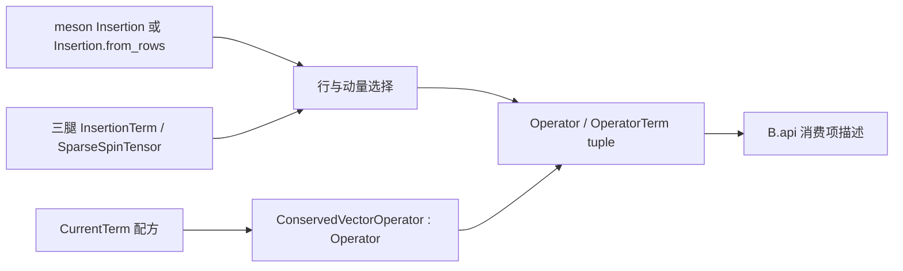

# O：插入与算符 L2

日期：2026-09-29。上层边界以 [L0/L1](../../architecture/correlator-l0-l1.md) 的 O.api 与 H02 为准。

O 定义不读数据的单强子插入行与系数项。`Insertion` 统一承载二腿 meson 与有序三腿
baryon 行；`Operator` 将选定行收敛为确定的有序 `OperatorTerm`。Baryon 物理 flavor
由 S 的 Wick 场和 B 的传播子绑定决定；O 不从空间 component 推断。静止系局域行由
`Insertion.local_spin` 构造，一般自旋/空间表示耦合由 `Insertion.from_irreps` 构造。

<a id="全-diagram-整数连接格式目标待迁移"></a>

## 全 Diagram 整数连接格式（实现完成）

权威约定见[ARCHITECTURE](../../../ARCHITECTURE.md#diagram-的统一整数连接格式目标待迁移)。O 保留用户的算符、腿顺序和系数语义，
供 B/E 构造整数 `AxisPattern`；O 不分配连接 ID，用户无需生成 einsum 字母或执行转换。
符号前端和算符调用方式保持不变；受影响 oPU 模块验证通过；GPU/生产规模仍未验收。



## 模块公开 API

业务调用和跨模块消费统一从 `lqcdweave.operators.single_hadron.api` 导入；
`operators/single_hadron/__init__.py` 只重导出 `api.__all__`。当前公开接口包括：

```text
Insertion(gamma, derivative, projection, momentum_dict, profile=None, *, momentum_identity=False)
Insertion.from_rows(rows, momentum_dict, profile=None)
Insertion.local_spin(irrep, parity, momentum_dict, component=None)
Insertion.from_irreps(spin, spatial_rows, spatial_irrep, projection,
                      momentum_dict, *, copy_index=0, spatial_matrices=None)
Insertion.__getitem__(self, index) -> InsertionRow
Insertion.little_group_projection(self, momentum, irrep_name, idx=0)
meson55_preset(*, version="v2") -> list[dict]
meson55_operators(*, version="v2") -> tuple[GaugeOperator, ...]
GaugeOperator.insertion(momentum_dict=None)

InsertionTerm(
    component: ElementalComponent | BaryonComponent,
    gamma: int | None = None,
    coefficient: complex = 1,
    anchor_time_offset: int = 0,
    profile: object = None,
    *, spin: SparseSpinTensor | None = None,
    endpoint_time_offsets: tuple[int, ...] | None = None,
    current_term: CurrentTerm | None = None,
)
OperatorTerm(
    gamma: int | None,
    component: ElementalComponent | BaryonComponent,
    momentum: int,
    coefficient: complex = 1,
    anchor_time_offset: int = 0,
    profile: object = None,
    *, spin: SparseSpinTensor | None = None,
    endpoint_time_offsets: tuple[int, ...] | None = None,
    current_term: CurrentTerm | None = None,
)
OperatorTerm.from_baryon(
    component: BaryonComponent, spin: SparseSpinTensor,
    momentum: int = 0, coefficient: complex = 1, *,
    anchor_time_offset: int = 0, endpoint_time_offsets=(0, 0, 0),
)

Operator(name, insertion_rows, coefficients)
Operator.from_terms(name, terms)
Operator.set_gamma(self, i_row, gamma_idx)
Operator.set_derivative(self, i_row, i_term, deriv_idx)
```

最小三腿用法直接给出有序 spatial component 和 rank-3 spin tensor：

```python
from math import sqrt
from lqcdweave.operators.single_hadron.api import (
    BaryonComponent, Insertion, InsertionTerm, Operator, SparseSpinTensor,
)

component = BaryonComponent.paths(((0,), (1,), (2,)))
spin = SparseSpinTensor(
    ((0, 1, 0, 1 / sqrt(2)), (1, 0, 0, -1 / sqrt(2))),
    basis="dirac_pauli",
)
insertion = Insertion.from_rows(
    [[InsertionTerm(component, spin=spin)]],
    {0: (0, 0, 0)},
)
operator = Operator("n", [insertion[0](0, 0, 0)], [-sqrt(2)])
```

`ConservedVectorOperator(3, momentum_index=1, wilson_r=1.0)` 可直接交给 B；若调用方要显式
手写项，`Operator.from_terms("manual", current.terms)` 保留同样的逐项 CurrentTerm 端点描述。

`Operator.name` 必须是显式非空字符串；构造器和 `from_terms` 均拒绝空白名称。
原生收缩编排具名 `vertex_map` 使用 `HadronIrrep.hadron_name -> Meson/Baryon/Current`，
映射键必须等于该顶点的 `Operator.name`，名称不能重复。该名字只用于前端查找，
不证明数据、基底、动量或物理约定兼容；B/E 继续核对实际元数据。源端 dagger 必须
在顶点定义中显式声明，名字不推断共轭；高级逐行/回调绑定仍可表达更细粒度选择。

### 自动重子表示耦合

`SpinName.G1G/G1U/HG/HU` 选择实际 DR 三自旋行；
完整自旋目录还可通过 `baryon_spin_operators(version="v1")` 选择任意
`BaryonSpinOperator`，其 24 个多重态共 64 行已按双立方群、宇称和 S3 联合投影。
`baryon_spin_preset` 提供与介子相同的版本化编号表；格式与验证见
[自旋目录](baryon_spin_catalog.md)。运行期只读 `presets/baryon_spin_v1.json`；
`tools/build_baryon_spin64.py` 离线复用现有群投影服务生成，旧局域配方不变。
`baryon_diquark_operators(version="v1")` 另给 24 个"双夸克 × 自由夸克"的低秩配方
（16 个 CΓ；标量双夸克给 G1、矢量双夸克给 G1 与 H，各 g/u；64 行完备正交），
是目录同表示多重态的精确组合，读 `presets/baryon_diquark_v1.json`。
`ProjectionName.G1/G2/H` 选择目标双立方表示。
`Insertion.from_irreps` 的空间行项为 `(coefficient, BaryonComponent)`，按
`A1/A2/E/T1/T2` 的标准行基排序，表示名必须携带 g/u 宇称。
若采用其他正交行基，`spatial_matrices` 显式给出该基下的 48 个具名正旋转双群矩阵。
默认不从 component 标签推断或验证实际波函数。调用方保证矩阵与空间配方一致；
输入检查覆盖矩阵维数、幺正性、群乘法、特征标及矩阵单位的一致性。

`irrep_coupling.py` 从 DR gamma 矩阵构造物理自旋生成元
`J_i = -i gamma_j gamma_k / 2`，用标准 G1 矩阵提供的 SU(2) lift 计算实际 DR 旋转，
再限制到现有稀疏三自旋行。系数空间每腿作用为 `S*`；空间行使用其显式表示矩阵。
产品表示交给包内置的 `lqcdweave.symmetry.row_subduction`，不另建群表或 CG 表。
`copy_index=0` 默认选择第一份；重复目标表示支持其他份数，不存在或越界报 `ValueError`。
行间及份数之间的 CG 系数正交归一，用户空间配方的系数、归一化和腿顺序保持。
仅去除数值投影产生的 `1e-12` 以下舍入零，不阈值化用户的自旋或空间项。

输出仍是普通 rank-3 `InsertionTerm` 行；`charge_conjugation/hermiticity=None`，
`parity` 是自旋和空间的宇称乘积。`coupling_coefficients` 为只读 CPU 数组，布局
`(n_spin*n_spatial, n_target)`，空间行指标变化最快；`multiplicity/copy_index` 记录份数。
它不做 flavor、三夸克置换/Pauli 投影、数据读取或生产。
此立方耦合之后可调用 `Insertion.project_exchange(target, *, operator_table=None,
copy_index=0, slots=None)`，对 spin×epsilon-spatial 组合做实际 S3 或 S2 投影，
返回普通 Insertion 及配套 `operator_table`；flavor 仍在 S 层后组合。
独立份数、MS/MA 伙伴和数值验收见[交换投影](baryon_exchange_projection.md)。
`InsertionGaugeLink` 接受相同的 `SpinName` 或 `BaryonSpinOperator` 并走此入口；新增关键字参数
`copy_index=0, spatial_matrices=None`，介子参数和原耦合系数保持。

自动重子行的 `little_group_projection(momentum, irrep_name, idx=0)` 使用公开
`restrict_irrep`，返回新的普通 Insertion，保留原静止行；它不支持在已投影的小群行上
再作静止表示限制。零动量仅可保留原目标表示。任意显式行及局域配方没有标准目标行基
标签，仍要求调用方显式投影。需要 Python 3.11+ 与 `[correlator]` extra；缺依赖明确报错。
完整乘积分解和可执行的空间路径示例见[重子表示耦合](baryon_irrep_coupling.md)。

### 项的 rank、字段与系数

`Insertion.from_rows(rows, momentum_dict, profile=None)` 的 `rows` 是按行排列的 term 序列；
行成员为 `InsertionTerm`。每个项不含动量，调用 `insertion[row](../px, py, pz)` 后，
`Operator(name, insertion_rows, coefficients)` 使用该行的零基动量索引生成 `OperatorTerm`。
`momentum_dict` 与 elemental 介子/重子前端的同名参数共用；二者通过
`contracts.elemental.normalize_momenta` 统一解释。其迭代值是整数三动量或三整数字符串；所选动量索引是这些值的顺序位置，
不是原 dict key。至少需要一个非空动量字典、至少一行且每行非空。generic rows 的空间/自旋
投影由调用方预先提供。`from_irreps` 自动构造标准目标行基的重子行，随后可用
`little_group_projection` 投影；任意 `from_rows` 行没有标准行基标签，不能自动投影。

| 字段 | 二腿项 | 三腿项 |
|---|---|---|
| `gamma` | 必填整数 bitmask `0..15` | 必须是 `None`，自旋信息放 `spin` |
| `component` | `ElementalComponent`，空间路径/投影项 | `BaryonComponent`，三条有序空间槽 |
| `spin` | `None` | `SparseSpinTensor`，shape `(4,4,4)`，索引依次对应槽 0/1/2 |
| `momentum` | `OperatorTerm` 的非负存储索引 | 同左 |
| `coefficient` | 一次性应用的有限复系数 | 一次性应用的有限复系数 |
| `anchor_time_offset` | 相对顶点锚点的时间偏移 | 同左 |
| `endpoint_time_offsets` | `None`；真实端点由 Component 路径/anchor 或 CurrentTerm 提供 | 默认 `(0,0,0)`，长度必须为 3 |
| `profile` | 可选 meson spectral profile | 不支持，非 `None` 报 `ValueError` |
| `current_term` | 可选完整守恒流端点配方 | 不适用 |

- `BaryonComponent` 的 leg/path 顺序就是 `spin[a,b,c]` 的三个 slot 顺序；其空间路径键独立于
  `flavors` 兼容元数据。rank-3 term 本身不含 `flavors` 字段；物理味由 Wick 场定义并在传播子绑定时解析。三腿非零时间偏移可在 O 中描述；若当前 B reader/backend 只支持
  等时间 vvv，应由 B 明确拒绝，不得静默忽略。
- 三腿 `endpoint_time_offsets` 是相对顶点锚点的有序时间偏移；rank-2 term 若显式传此字段
  报 `ValueError`，以免与 `ElementalComponent` 的路径端点和 `CurrentTerm` 重复或冲突。
  二腿路径的空间/路径端点来自 `ElementalComponent`；守恒流 `current_term` 保留完整 4D
  displacement、bar/field/link-origin offsets、link dagger 和边界策略，包含空间偏移而不只时间分量。
- `OperatorTerm.coefficient` 是该网络项唯一的 O 外系数。meson 老式 `Insertion` 的 gamma
  名称沿用 cyclic 约定，在转成 bitmask 时 `5/13` 的符号仅转换一次；`from_terms` 和
  `InsertionTerm` 中的 gamma 已是 bitmask，不再重复换号。
- `InsertionTerm` 与 `OperatorTerm` 都冻结；`Operator.terms` 是不可变 tuple。一个 Operator
  不可混合 rank 2 和 rank 3 项；一个 rank-3 Operator/Insertion 的 `SparseSpinTensor.basis`
  必须一致。显式 terms 不能通过 `set_gamma` 或 `set_derivative` 修改。
- `Insertion.from_rows` 不做 Wick、reader 发现、数据加载或生产；Operator 构造也不会隐式访问
  `adapters`、`production` 或 `contraction`。

### 三腿自旋张量

```text
SparseSpinTensor(entries, basis="degrand_rossi")
SparseSpinTensor.dense(self, *, array_module=numpy) -> array  # 4×4×4
SparseSpinTensor.from_dense(value, basis="degrand_rossi")
SparseSpinTensor.to_basis(self, basis) -> SparseSpinTensor
SparseSpinTensor.source(self) -> SparseSpinTensor
spin_basis_matrix(name) -> ndarray  # 4×4
gamma(index, *, array_module=numpy) -> ndarray  # 4×4
```

`entries` 是 `(alpha,beta,gamma,value)` 四元组，spin index 从 0 开始且限定为 `0..3`；
重复坐标合并、精确零项移除，非有限系数或越界 index 报 `ValueError`。目前可选基底为
`degrand_rossi` 和 `dirac_pauli`，未知名字报 `ValueError`。`dense` 返回新数组；张量自身
保存不可变稀疏 tuples，不共享调用方 dense buffer。

`source()` 对三条腿分别做系数复共轭和 `gamma4` 变换，保留 slot 标签；伴随场按
`bar(q2) bar(q1) bar(q0)` 排列的语义由 B 消费，O 不添加 Wick 置换符号。basis 变换按
`q_target = U q_input` 对三指标系数作逆变换。`gamma` 与 `spin_basis_matrix` 都返回小型
CPU 矩阵定义，不创建设备或隐式转换 reader 输入。

`Insertion.local_spin` 直接给出归一化的 DR 宇称配对行：G1 的两行各 4 个
非零元，H 四行依次为 2、6、6、2。g/u 对应三腿 `gamma4` 的 +1/-1 本征值；
行号从 0 开始，G1/H 分别按总自旋 z 分量从高到低排列。精确系数见
[重子使用说明](baryon.md#自旋与行)。该配方替换原 DP 选块配方，属于具体算符
定义改变；显式自定义张量、已保存的旧算符及计划不自动转换为新配方。

### 守恒流预制项

```text
CurrentTerm(
    coefficient: complex, direction: int, displacement: tuple[int, int, int, int],
    gamma_index: int, link: str = "none", wilson_r: float | None = None,
    spin_structure: str = "gamma", normalization: complex = 1,
    bar_offset=(0,0,0,0), field_offset=(0,0,0,0),
    link_origin_offset=(0,0,0,0), link_dagger: bool = False,
    boundary_policy="caller-supplied", temporal_point_split: bool = False,
)
CurrentTerm.term_time_offsets(self) -> tuple[int, int]
CurrentTerm.as_dict(self) -> dict
coerce_current_term(term: CurrentTerm | Mapping) -> CurrentTerm
ConservedVectorOperator(direction: int, momentum_index: int = 0, *, wilson_r: float = 1.0)
ConservedVectorInsertion(direction: int, momentum_index: int = 0, wilson_r: float = 1.0)
ConservedVectorInsertion.operator(self) -> ConservedVectorOperator
ConservedVectorCurrent(wilson_r=1.0)
ConservedVectorCurrent.operator(self, direction, momentum_index=0) -> ConservedVectorOperator
```

`direction` 是 `0,1,2,3` 的 x/y/z/t 方向，`momentum_index` 非负。Wilson 配方为每个方向
一前一后两个 `CurrentTerm`。forward 项在 bar anchor `x` 连接到 `x+mu`，组合矩阵为
`-1/2 (r I - gamma_mu)`；backward 项在相反真实端点上使用 link dagger，组合矩阵为
`+1/2 (r I + gamma_mu)`。空间/时间方向、位移、端点、link origin、dagger 与归一化由每项
自己的 `CurrentTerm` 保留。O 不自动乘重整化常数 `Z_V` 或格距因子 `a`；周期/开边界端点
解析由调用方/B 提供的边界策略执行。

`ConservedVectorOperator` 继承 `Operator`，其 `terms` 是普通 `OperatorTerm`，每个拆分项带
完整 `current_term`；可用 `Operator.from_terms(name, conserved.terms)` 构成系数和端点等价的
普通 Operator。为旧 adapters 保留的 `current_terms` / `current_term_ranges` 是从每项
`current_term` 派生出的读视图，不另存第二套物理配方。兼容的
`ConservedVectorInsertion(direction, momentum_index=0, wilson_r=1.0)` 可调用 `.operator()`；
新前端无需先构造 insertion 包装。

## 辅助和兼容接口

| 名称 | 签名 / 作用 |
|---|---|
| `InsertionRow(row, momentum_dict, profile=None)` | 可调用 `(npx,npy,npz)` 返回 `InsertionRowMom` |
| `InsertionRowMom(row, momentum, profile=None)` | 选定的 term 行、零基 momentum index 与可选 profile |
| `OperatorPath(name, terms, *, current_terms=(), current_term_ranges=())` | `terms` 项为 `(gamma,path,momentum,coefficient[,anchor_time_offset])`；每行成为 path Component |
| `OperatorPath.from_operator(operator, paths)` | 将无 profile/identity meson terms 展为显式 path terms，路径系数与 current metadata 同步 |
| `OperatorPath.from_current(current, direction, momentum_index=0)` | 将显式 `CurrentTerm` 配方展开为 path 项及可查询端点 |
| `OperatorDisplacement(name, insertion_rows, coefficients, distances)` | identity derivative 行的距离替换；一行一个 distance |
| `InsertionGaugeLink(gamma, gauge_link_irrep_name, gauge_link_idx, projection, momentum_dict, insertion_dict, profile=None, *, copy_index=0, spatial_matrices=None, momentum_identity=True)` | GammaName 的介子或 SpinName 的重子空间规范核表示耦合 |
| `LocalVectorCurrent()` / `LocalAxialCurrent()` / `PseudoScalarDensity()` | 旧局域流/密度配方；各自 `.terms` 返回 CurrentTerm tuple，`LocalVectorCurrent.operator(direction,momentum_index=0)` 生成路径 Operator |
| `BaryonOperatorTerm(spin, component, coefficient=1, flavors=("q","q","q"), momentum=0, *, endpoint_time_offsets=(0,0,0))` | 旧显式三腿 OperatorTerm 适配输入 |
| `BaryonOperator(name,insertion_rows,coefficients)` / `.from_terms(name,terms)` | 旧工厂入口，返回规范的普通 `Operator`；不实现第二套 term 收集算法 |
| `SpectralProfile(left,right=None,coefficients=None,*,cfg,name="profile")` | 既有 meson profile；`gaussian(eigenvalues,sigma,*,cfg,name="gaussian")` 由特征值造 profile，`apply_block(elemental,*,times,cfg,array_module=numpy)` 按给定 block/time 应用 |

## 验证、依赖与迁移

- 非法 component、spin/rank 组合、gamma 越界、非法 endpoint 长度、负动量、非有限系数、
  baryon profile、混合 rank/basis 均在 O 对象构造时报 `TypeError` 或 `ValueError`。点拆当前流
  方向超出 `0..3` 或 momentum 为负时报 `TypeError`/`ValueError`；非法 Wilson 参数必须是有限实数。
- sparse spin tensor 与 term record 不使用异步操作或借用工作区；dense 自旋小阵列由调用方拥有。
  `SpectralProfile` 自己复制并持有只读权重数组；OperatorTerm 保留 profile 引用，不执行文件 I/O、
  生产或数组写入。
- 允许依赖 `contracts.elemental` 的 `ElementalComponent`、有序 `BaryonComponent`、SymPy/NumPy
  与既有群论/自旋基础库。O 不导入 B/P/X 的实现，也不读 reader 或规划状态；B/E 从
  O.api 消费 term。
- 交换矩阵的纯表示定义位于 `contracts.quark_exchange.QuarkExchange`，O 的系数投影与
  S 的 Wick 约简共用同一类；S 原导入路径继续作为同一对象的公开别名，兼容已有 pickle。
  C 不包含 Hadron、Wick 或数值 reader，O 不反向导入 S 的图约简实现。

### 当前交接与兼容清理状态

- 三个 baryon-current、neutron-semileptonic、rho-pipi 示例均从 S.api/O.api 构造；
  baryon 示例和相关测试使用通用 `Insertion` 与普通 `Operator`，守恒流使用
  `ConservedVectorOperator`。`BaryonOperator` 只保留显式 terms 的旧工厂兼容入口。
- B 绑定的主路径使用 `OperatorTerm.current_term`；`current_terms`/
  `current_term_ranges` 仍被 `contraction/binding/single_hadron.py` 用作旧数据 fallback，
  `contraction/expansion/legacy_diagram.py` 还用它识别 current vertex。因此目前不能删除读视图。
- 代码导入核对：`contraction/meson_measurement.py`、`contraction/directed_current.py`、
  `contraction/binding/single_hadron.py` 和 `contraction/binding/operator_description.py`
  当前走 O.api。`production/wilson_reference.py` 使用 `operators.single_hadron` 包级公开重导出；
  `adapters/dense_wilson.py` 为 adapter 本地持有一份 gamma 小矩阵构造副本，这是获准的
  helper 局部副本，O 的 term/contract record 没有副本。没有发现 contraction 从 O 的
  `operator.py/current.py/baryon.py/gamma.py` 内部实现取符号的导入。
- `_basis` 私有别名已删除；当前自旋基入口为 `spin_basis_matrix`。
- `Insertion.from_rows` 产出的行、`OperatorTerm` rank 与系数链无字段遗漏：rank-3
  `BaryonComponent` 槽顺序和 `spin[a,b,c]` 一一对应；`endpoint_time_offsets` 保留三条相对锚点
  的有序时间偏移，source dagger 的 spin/field-order 由 B 做一次变换。守恒流 term 的
  `current_term` 仍保留 displacement、bar/field/link-origin 完整 4D offsets、link dagger 和
  boundary policy；扁平 operator 项的 coefficient 由 E/R 应用一次。非零三腿 endpoint 当前若
  超出 B backend 能力，应在 B 明确拒绝，O 不会丢弃该字段。

| 目标实现 | 旧来源 / 处理 |
|---|---|
| `operator.py` 的 meson term/Operator | 保留已有项目实现与 gamma sign 一次转换；显式 term 增加三腿变体、endpoint 和 CurrentTerm 引用 |
| `insertion.py` | 保留 meson cubic coupling；`from_rows` 提供两腿/三腿统一行输入，`from_irreps` 与规范核字典入口接通重子自动耦合 |
| `irrep_coupling.py` | 实际 DR 自旋表示 × 显式空间表示，复用公开 row_subduction，保存标准目标行与份数 |
| `baryon.py` | 保留唯一 `SparseSpinTensor`/spin basis 变换、静止系自旋行配方与 `BaryonOperator` 兼容工厂 |
| `current.py` | `CurrentTerm` 数值配方来源为 `lattice/insertion/current.py`；ConservedVectorOperator 将其逐项端点映射为普通 OperatorTerm |
| `gamma.py`, `mom_dict.py`, `profile.py` | 保留各自基础定义与现有入口，不另建自旋/动量表实现；dense_wilson adapter 的小 gamma copy 仅归 adapter 本地维护 |

| CPU 测试 | 输入与断言 | 保证 / 未覆盖 |
|---|---|---|
| `tests/correlator/operators/test_operator_definitions.py::test_legacy_meson_insertion_call_sequence` | 旧 PI/A1 meson Insertion 行及 momentum selection | 检查旧 gamma→bitmask 和插入行流程；不验证数值读取 |
| `tests/correlator/operators/test_operator_definitions.py::test_generic_insertion_builds_ordered_three_leg_operator` | 三个有序 GaugePath slots、稀疏 rank-3 spin、系数 2j 和 outer 系数 -3 | 检查 generic row→OperatorTerm 的 slot 顺序、momentum、spin、系数与默认端点；不做 Wick 或数值 baryon 收缩 |
| `tests/correlator/operators/test_operator_definitions.py::test_conserved_vector_operator_matches_manual_operator` | temporal conserved vector、momentum 2、Wilson r=1.25 | 检查继承关系、两 physical CurrentTerm 各自的拆项 range/端点、手写 `Operator.from_terms` 等价与兼容 insertion 工厂；不覆盖每种边界下的数值 Ward identity |
| `tests/correlator/operators/test_operator_definitions.py::test_spin_math_helpers_and_mesonic_term_rank` | Degrand-Rossi basis、gamma0 和一个 meson term | 检查公开 O.api 基础矩阵与 rank 识别；不覆盖所有 gamma Clifford pairs |
| `tests/correlator/operators/test_operator_definitions.py::test_rank_and_profile_errors_are_reported_at_construction` | rank-2 gamma/component 冲突、rank-3 profile、混合 Operator terms | 检查坏输入早期报错；不覆盖所有类型错误组合 |

独立 Gamma/insertion/current 配方测试在 `tests/correlator/operators/test_single_hadron.py`，
H 行、宇称和 spin basis 测试在同目录的 `test_baryon_spin.py`，有向电流与路径配方在
`test_directed_current.py`、`test_current_path.py`。独立 vertex 用例已归 B；
根目录的 `tests/test_single_hadron.py` 与 `tests/test_baryon_vertex.py` 保留 NPY 消费和混合非法输入交接。主流程
`tests/test_baryon_diagram_frontend.py` 和 directed-current/完整前端测试另验证绑定与展开。
以上 CPU 检查不构成 GPU 或系综生产验证。

可清理候选：先把 binding fallback 与 expansion 的 current 检测迁至 `OperatorTerm.current_term`，
再评估删除 `current_terms/current_term_ranges`。`BaryonOperator`、`ConservedVectorInsertion`
仍有兼容调用，暂保留薄转发。

## 集成清理补充

主代理已删除无仓库外部引用的 `_basis` 私有别名和继承分支中不可达的 BaryonOperatorTerm else；
当前公开自旋基入口为 spin_basis_matrix。必要 Baryon 旧公开工厂和 current 读视图仍由实际调用者使用，保留薄兼容。


## 八方向 raw 的单链配方校验

O.api 新增 `validate_one_link_current_term(term) -> CurrentTerm`；仍返回唯一已有
CurrentTerm 类型，不引入第二套配方/IR。输入可为 CurrentTerm 或现有 v1 mapping，
由已有 coerce 入口校验标量、方向、gamma、偏移类型与有限系数。
随后要求 direction 为 0..3、link 为 forward/backward、wilson_r 已显式给出；
displacement 及 field_offset-bar_offset 须为对应的正/负单位链。
forward 的 origin 等于 bar_offset 且 dagger=False，backward 的 origin 等于
field_offset 且 dagger=True。共同端点偏移保留；不允许把双链或不一致端点配方标为单链 raw。
局部无链配方仍是合法一般 CurrentTerm，但不能用于八方向 raw 解析。

`contraction.directed_current.resolve_directed_current_raw` 消费这一公开校验，并核对
实际绝对端点在已存时间范围内、与单链时间方向及 origin 一致；periodic 按 Lt 取模，
open 越界拒绝。新 `contraction.directed_current_measurement` 同样在输出创建前核验配方与所有请求
anchors；复 coefficient/normalization、gamma、r、offsets、origin/dagger 原样进入定义。
这不检查 Dirac action/gauge 的守恒条件，也不认证 Ward identity。
跨模块反伪造端点、非法两跳/方向、复权重及持久测量行为见
`tests/test_directed_current_measurement.py`；详见[测量 L2](../measurements/directed_current_measurement-api.md)。


## 非零动量小群操作的可选依赖

`Insertion.little_group_projection(momentum, irrep_name, idx=0)` 继续在原方法
中先拒绝不适用的 generic rows，再对零动量返回原对象。只有非零动量分支
局部加载内置实现的 `restrict_irrep`；缺少 SymPy 或 lazy-object-proxy 时保留
ModuleNotFoundError.name 与 cause，并点名缺库及指向
[现有 extra 安装步骤](../correlator/correlator_frontend.md#符号构造)。其它传递依赖或
库内部错误原样传播。O 不经 S 导入扩大依赖，不创建替代 reduction。
实际多重度、idx 检查、行系数和矩阵算法沿用旧实现；缺库早退测试和安装
依赖的代表性 projection 分开验证，不据此宣称所有群或 GPU 验收。

## 配套预制表与物理动量检查

O.api 保留 `momDict_mom1/momDict_mom2/momDict_mom3/momDict_mom9/momDict_test` 和
`mom_dict_to_list`；固定 key `1/2/3/9/0` 分别对应 `1/19/27/123/23` 项。`momDict_mom2`
按 `momDict_mom3` 前 19 项的原顺序保留 `p²<=2` 动量。
`gauge_link_preset(max_length=1)` 返回独立的固定 `0/1/2/3` 阶空间路径系数表；
`gauge_link_tables(insertion_dict)` 返回现有生产 `operator_table` 和配套调用字典。
`meson55_preset(*, version="v2")` 返回独立的 55 行生产表，保留普通 25、磁型 27、电型候选 3 的
路径、系数、原始行元数据及版本化目录引用。
`momentum_recipe("mom4").momenta` 是单独的 CSNS 33 动量固定表，按 `(p², px, py, pz)` 排序；
`mom_dict_to_list(momentum_recipe("mom4").momenta)` 可转换，数字 key 集合保持不变。
`meson55_operators(*, version="v2")` 返回 368 个冻结的不可变 `GaugeOperator` multiplet（共 880 行）；
两项都接受 `version="csns"` 显式读取未修改的历史表，未知版本报错且不会回退。
v2 的 901 条唯一路径最长 5 步，历史 CSNS 表为 175 条、最长 3 步；两版动量顺序相同。
字段保留 `name/irrep/parity/c_factor/reflection/gamma_name/masks/phases/kernel_ids/kernel_label/kernel_origin/coefficients/version`；
`kernel_origin[0]` 可区分空间核来源类型；`kernel_ids` 是原始空间目录编号，不是 reader 数组槽号，
实际存储槽根据完整 component 身份和生产表顺序确定。调用方可按 parity、irrep、gamma_name 或
kernel_origin 筛选。`GaugeOperator.insertion(momentum_dict=None)` 从冻结系数构造耦合后的插入行；
常用符号绑定由 B.api 的 `RecipeVertex` 预制绑定完成，见[绑定模块](../binding/binding.md#meson55-目录符号绑定)。
目录名称和科学边界见[meson55](meson55.md)。
默认 v2 的普通 25 行通过逐半径低分波检查；原历史 CSNS 表的 G 波 A1g 行 16 含 S、T2g 行 22–24 含 D。消费这四个修正 G 行时，elemental 必须含有对应版本的 component；其余 51 行身份相同，可跨版本使用。`version` 决定 `insertion()` 选取的组件表。完整修正定义见[meson55 低分波投影检查](meson55.md#低分波投影检查)。
完整有序路径及复系数保存在共同 `ElementalCatalog` 中，分量以目录、版本和编号引用，
生产端不隐式生成缺项。自定义目录之外的配方可用 `Insertion.from_rows` 手工组合；
未知整数路径 ID 仍拒绝转换。

`InsertionGaugeLink(..., momentum_identity=True)` 默认保留所选 XYZ；
`Insertion(..., momentum_identity=False)` 保留旧位置默认，可显式启用。
`OperatorTerm.momentum_vector` 为可选 keyword-only 三整数，B 负责核对读者实际有序
动量轴；缺少元数据或不同顺序报错。`InsertionRowMom` 保留该选择，不改变 Gamma 约定。
生产、NPY 显式声明和 Dataset 元数据读取的渐进示例见[配套预制表](../elemental/elemental_presets.md)。
