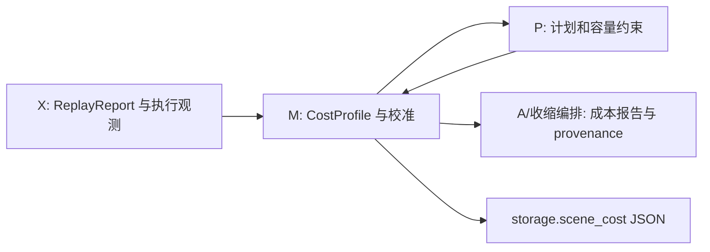

# M：测量与计算成本模型

整体矩阵介子的`estimate_meson_whole`经M公开api交付给P/X校准；只按当前spec的shape/dtype、
外部输出和固定拓扑粗估FLOPs、流量、工作区，不读数组或搜索私有路径。工作区不是可信峰值上界，
真实执行继续受原预算和allocator限制。该候选的实测/估计区分及CPU/GPU证据见
[介子整体顶点](../execution/meson-whole-vertex.md)。
v3验收分别保留自然完整任务墙钟、私有池reserved高水位与同步phase诊断；后者不解释资源排队，
也不替代正式ABBA。保存计划的workspace与实际六项依赖核对记录在同页，粗价不升级为可信内存证明。

本模块负责收集执行观测、预测计划中的计算成本、拟合和融合 `CostProfile`，并读写模型档案。
公开边界是 `lqcdweave.contraction.performance.api`。本模块使用
`contracts.measurement` 的 `ActionTiming`、`PhaseTiming`、`FileIOEvent`、`ReplayReport`，
使用 `contracts.correlator.api` 的存储计划记录和 `StateDescriptor`，并复用
`storage.scene_cost` 的成本 profile JSON 服务、`storage.dataset` 的目标档案 JSON 服务及
`runtime.measurement` 的报告文件服务。M 不导入路径搜索器、
P 状态类或 X 数值执行函数，也不发起生产、关联函数或设备工作。

## 成本模型边界

`CostProfile` 唯一实现在 `performance/model.py`。模型预测输入快照复制、显式源准备计算、
稠密/稀疏缩并与重子计算。文件读取、预读、主机到设备或设备到主机传输、暂存读写、spill、
restore 和 discard 都不参与预测计价。它们的实际执行能力、队列、生命周期、字节数、容量约束
及测量观测继续保留。

因此，`SceneStoragePlan.seconds` 与 `predict_plan_cost` 表示模型覆盖的计算、输入准备和快照成本，
不表示包含异步 IO 的端到端墙钟时间。exact/DP 在完整物理存储域和容量约束内，最小化这个保留的
模型成本；这不证明异步执行的全局墙钟时间最优。anytime 搜索的目标范围相同，但不提供最优性证明。



```python
@dataclass(frozen=True)
class CostProfile:
    snapshot_call_seconds: float = 1e-6
    snapshot_seconds_per_byte: float = 1e-10
    kernel_call_seconds: float = 2e-5
    kernel_call_seconds_float32: float = 1e-5
    kernel_call_seconds_float64: float = 1.5e-5
    kernel_call_seconds_complex64: float = 2e-5
    kernel_call_seconds_complex128: float = 2.5e-5
    flop_seconds: float = 1e-12
    traffic_seconds_per_byte: float = 5e-12
    contract_scale: float = 1.0
    sparse_bridge_scale: float = 1.0
    sparse_kernel_call_scale: float = 1.0
    sparse_flop_seconds: float = 1e-12
    sparse_cycle_flop_seconds: float = 1e-12
    sparse_traffic_seconds_per_byte: float = 5e-12
    baryon_join_scale: float = 1.0
    version: str = "compute-only-v1"
    hardware_fingerprint: str = "unmeasured"
    sample_count: int = 0
    preparation_call_seconds: float = 0.0
    preparation_kernel_call_seconds: float | None = None
    preparation_flop_seconds: float | None = None
    preparation_traffic_seconds_per_byte: float | None = None
```

所有系数必须有限且非负。准备工作的后三个可选系数为 `None` 时，按 `contract_scale` 乘通用
kernel/flop/traffic 系数；显式值独立应用。版本、硬件指纹和样本数是来源声明，不证明目标规模
或目标机器已经验收。档案中的 profile 字段按当前 `CostProfile` 结构校验；未知字段会明确报错。

```text
snapshot_seconds(nbytes: int) -> float
preparation_seconds(flops, traffic_bytes, *, kernel_calls=0, dtype=None) -> float
kernel_call_for_dtype(dtype=None) -> float
contract_seconds(flops: int, traffic_bytes: int, *, kind="contract", dtype=None,
                 kernel_calls=1, sparse_records=1) -> float
```

- `snapshot_seconds` 对正字节数计一次快照调用和逐字节复制成本，零字节返回零。
- `preparation_seconds` 计调用、kernel、flop 和数据流量；它不计文件读取和设备传输。
- 普通稠密/重子操作成本为 `kind_scale × (kernel_calls × dtype_kernel + flops × flop_seconds + traffic_bytes × traffic_seconds_per_byte)`。
- 稀疏桥接使用 `sparse_kernel_call_scale × dtype_kernel` 与稀疏 flop/traffic 系数；`sparse_records=2` 使用 cycle flop 系数。支持 `contract`、`sparse_bridge`、`baryon_join`。
- `kernel_call_for_dtype` 用 `numpy.dtype(dtype).name` 选择具名系数；未提供或未匹配时使用通用系数。

非法快照字节、负/非整数 kernel 调用数、未知操作类型或非法稀疏记录数会报 `ValueError`。
这些方法只预测，不运行数组核或采集计时。

模型校准摘要由 `cost_profile_calibration_status(profile, provenance=None)` 给出。摘要优先使用
档案记录，其次识别 fit/weighted-merge 来源，再用样本数和硬件指纹区分状态；它描述的是记录，
不等价于模型准确或生产验收。

## 执行目标登记与局部自动校准

C 的 `contracts.correlator.target.ExecutionTarget` 是目标的纯记录，包含名称、backend/runtime、
host/device 内存、可选 profile、硬件指纹和声明的操作范围。当前允许 `numpy/cpu`、`cupy/cuda`
和 `cupy/hip`。M.api 提供 `register_execution_target(target, directory=None)`、
`load_execution_target(name, directories=None)` 与 `resolve_target_profile(target, profile=None)`；
register/load 操作目标 JSON，不探测或初始化数值运行库。收缩编排的 `target_hardware` 可传已登记名称或
`ExecutionTarget`，用于规划预算和 profile 解析；目标名称本身不要求加载其 runtime。实际执行时仍由
`backend` 参数和适配器核对所需的 NumPy/CuPy runtime。

`load_target_calibration(target, *, cache_key, directory=None)` 与
`calibrate_target_profile(target, document, report, *, cache_key, directory=None)` 管理用户本地的
目标校准缓存，并按缓存键、实现版本和硬件指纹拒绝不兼容条目。自动短测调用
`probe_compute_profile(..., max_seconds=10.0, max_bytes=64 << 20)`，只覆盖合成 dense `contract`
和 `snapshot`，并以独立 NumPy 结果核对 dense contraction。它是部分校准，不是完整 CostProfile 验收。
source preparation、文件读取、预读/传输、sparse bridge、baryon join、批核、输出组装及资源移动等
操作目前没有对应的自动 10 秒/64 MiB 短测实现；这些覆盖缺口会保留在报告中，不从已测类别外推。

## 执行观测

测量记录唯一维护在
[contracts/measurement.py](../../../src/lqcdweave/contracts/measurement.py)：

```text
PhaseTiming(name, observed_seconds, device_seconds=None, bytes=None, ...)
ActionTiming(kind, estimated_seconds, observed_seconds, action_index=-1, ...)
FileIOEvent(action_index, tensor, path, operation, bytes, observed_seconds)
ReplayReport(values, timings, peak_device_bytes, peak_host_rss_bytes,
             output_timings=(), io_events=(), execution_profile=None)
```

实际 `FileIOEvent` 和 read/spill/restore `ActionTiming` 继续记录执行耗时与字节。计划动作的
预测耗时对物理读取和资源移动为零；这不会取消读取或资源操作本身。`ReplayReport` 的观测时间
不能反向混入 `CostProfile` 的缩并成本。

`PhaseCollector` 只使用调用方传入的 backend。CPU 阶段记录 perf-counter 墙钟。CuPy 阶段在进入时
捕获当前 stream；`device=True` 用同一 stream 的 CUDA event 计设备时间，其余阶段同步该 stream
后结束墙钟测量。显式传入的 stream 必须就是当前 stream，否则在 operation 前报错。设备计时是
同步校准边界，会改变自然异步重叠。

`ExecutionMeasurement` 是 opt-in 上下文，记录主机/设备指纹、主机 RSS、CuPy 池状态及周期采样值。
周期采样可能漏掉短暂分配。计划 `peak_*` 是模型峰值，`ReplayReport.peak_*` 是动作边界观测，
`sampled_peak_bytes` 是周期采样；三者含义不同，都不声称提供经过认证的全程真实高水位。
Direct 执行报告标记 `calibration_eligible=False`。汇总 `ActionTiming` 和子 phase 时只能选一层，
避免重复计时。

`measure=False` 不创建测量上下文、采样线程或计时事件，也不探测设备；执行结果不变。异常清理
会同步选中 stream、停止并 join 采样线程；主执行异常不会被采样/清理异常替换。

## 拟合和融合

公开拟合 API：

```text
execution_cost_samples(report) -> tuple[dict, ...]
evaluate_cost_profile(profile, samples) -> dict
calibrate_cost_profile(profile, reports, *, verified, hardware_fingerprint,
                       source_weights=None, source_ids=None)
fit_cost_profile_sources(base_profile, training_sources, validation_sources, *,
                          verified, hardware_fingerprint, validation_by="run")
fit_cost_profile(base_profile, training_report, validation_report, *, verified,
                 hardware_fingerprint, training_run_id, validation_run_id)
update_cost_profile(profile, report, *, verified, hardware_fingerprint, alpha=0.2)
```

`execution_cost_samples` 只提取明确可识别的输入准备 `materialize`、逻辑快照及 dense/sparse/baryon
数值计算阶段。IO 事件不会成为校准样本；`view_or_read` 混合阶段也不用于拟合，因为它包含源读取
等待。读取、预读、传输、暂存恢复的真实观测仍保留在执行报告中。有界 COO join 标为未校准，
不会训练旧 sparse 单/双 cycle 系数。`calibration_eligible=False` 会拒绝 direct 报告。缺失 predictor、
非有限观测或不支持的预测类别会报错。

多源拟合只取正权训练源；一个 source ID 下的 reports 共用来源权重，权重均分给该源样本后做非负
加权拟合。拟合诊断记录 `base-unobserved`、`base-insufficient`、`unsupported` 与 `fitted` 覆盖状态，
并保存训练和 held-out 误差。baryon join 类别暂时标为 unsupported，不由校准覆盖。

`fit_cost_profile_sources` 要求独立验证声明、有效硬件指纹、至少一个训练与验证报告，并要求按
`run` 或 `shape_family` 选择互斥分组。报告签名重复、没有支持的训练样本或验证报告为空时会报错。
运行 ID/family 是用户声明；`ReplayReport` 不认证其身份。`calibrate_cost_profile` 是没有 held-out
接口的等权/显式权重调用；新拟合工作流宜使用 source-fit API。

`update_cost_profile` 是逐报告反馈入口：只依据带 predictor 的计算阶段和逻辑快照阶段更新后续模型，
拒绝未验证报告、硬件不符和显式标记为未测量的稀疏 join。它不会改变正在执行的计划，也不会从
读取或传输阶段估算计算成本。

`weighted_profile_merge` 可按操作覆盖对有效计算系数加权。无兼容表示的模型融合报错，不返回近似
模型。不同硬件默认拒绝；显式允许跨硬件时指纹标为 `expected-mix:…`、样本数为零，表示期望模型。
文件拟合/融合由 `performance.profile_io` 提供；CLI 由 `contraction/performance/profile.py` 组装，不运行关联函数。

## 成本报告与档案

```text
predict_plan_cost(plans, profile: CostProfile, *, workload, provenance) -> dict
```

成本报告要求输入计划已联合物理生命周期，并核对每个计划使用的 profile 与实参一致。它汇总输入
准备、逻辑快照和数值操作模型成本；同时保留实际块读取次数/字节、传输字节、资源动作计数、
temporary 字节与磁盘容量、保留生命周期信息及 host/device 峰值。它不为这些读取/移动输出时间成本。
对 NumPy 或 CuPy 的 `DenseKernelBatch` 计划，`dense_contraction` 按已保存批核成本替换相应逻辑二元费用，
`dense_kernel_batches` 报告批数，汇总与 `SceneStoragePlan.seconds` 一致。逻辑 `state.seconds`
保留原路线费用；CuPy 批核的 `packing_dtype` 和 `prepared_sides` 确定结果 dtype 输入缓冲及可复用 producer 布局，
批成本包含实际需要的 pack 与 contraction。host/device 轨迹分别包含 packing workspace 和完整输出 owner。
批阶段测量仍标为 `calibration_eligible=False`，不作为普通单核模型拟合样本；这不增加 `CostProfile` 系数。

profile 格式为 `easy-distillation.scene-compute-cost-profile`，报告格式为
`easy-distillation.scene-compute-cost-prediction`。读取器校验 envelope 与 profile 字段；不支持的格式和
未知字段会明确报错。存储计划档案按其支持的 payload 版本和记录 schema 校验，详见
[档案 L2](../plan_archive/plan_archive.md)。保存通过 `storage.scene_cost` 的原子 JSON 写入，sidecar provenance 位于 profile 外。

`runtime.measurement` 继续提供报告汇总、保存和加载。报告文件不保存计算张量；加载后 `values=()`，
并重建唯一 contracts timing records。

模型 profile 默认文件位于 `contraction/performance/profiles/`。节点档案只覆盖其 provenance 中声明
的 dense contraction 和 CuPy snapshot 证据；它不覆盖批核观测、真实 IO 或生产规模承诺。既有 V100
批核记录属于先前实现，不代表当前统一设备路径验收，也不会自动更新 profile。

## 模块验证与限制

专项测试位于 `tests/correlator/performance/`；跨模块测试覆盖 P storage plans、X replay 和档案接口。
既有 CuPy/V100 合成批核数据是先前实现的历史诊断。所有 GPU 核、DCU/HIP 或生产规模仍待验收，也不能单凭一个样本校准通用 GPU 成本模型。Fake-CUDA
用例只核对 event/stream 协议，不构成真实设备验证。

| 原入口 | 当前处理 |
|---|---|
| `contraction/scene_state.py:CostProfile` | 当前计算/准备/快照模型位于 `performance/model.py`；执行 IO 观测由 replay report 保留 |
| `contraction/profile_fit.py` 与 scene runtime 校准 helpers | 校准/融合位于 `performance/profile_fit.py`；只拟合独立准备、快照和计算样本 |
| `contraction/scene_cost_report.py` | 元数据报告位于 `performance/scene_cost_report.py`，通过 C records 读取计划 |
| `contraction/profiles/*.json` | 包内 profile 位于 `contraction/performance/profiles/`，使用 compute-only 格式 |
| `runtime/measurement.py`、`storage/scene_cost.py` | 继续复用执行观测和 JSON 基础服务 |
