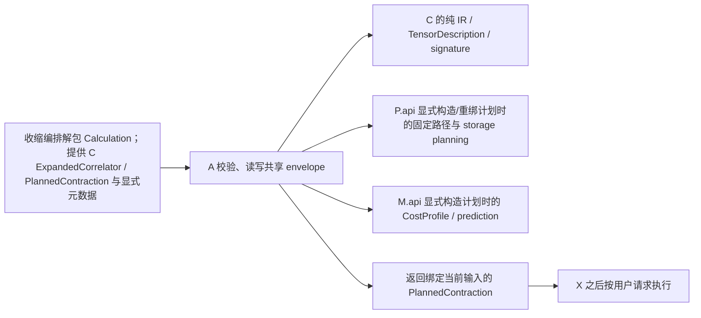

# A：计划档案与复用

带当前 `expected` 的普通路径和存储计划加载，除旧语义摘要外，还直接比较解码后的
完整 C `ContractionTerm.sum_barriers`。轴重新编号时同步重编号约束；当前任务不能
静默替换保存的精度/合法收缩边界。旧摘要/hash 格式保持不变；真正旧 C 记录缺该字段
时明确恢复无约束，只与当前无约束任务兼容。旧 phase 记录已有约束、仅摘要没有字段
时仍可正常加载。

固定 `storage-schedule` 与普通 `correlator-plan` 的存储计划采用 `archive.compact-v2`
值编码：每个根记录只保存一次白名单类型/字段表与字符串表，记录按字段顺序保存值，
不逐条重复字段名、类型名或字符串文本。相同 `AxisPattern`、无 description 的
`TensorSpec` 与 `Factor` 按完整值复用不可变描述；其它不可变记录只按本次对象身份共享。
不同科学来源的描述不按 shape/dtype 合并，也不合并计算的数据身份或可变容器。
这是档案表示，恢复后仍是原来的 C 记录，并保留全部操作、事件、内存点、成本与输入元数据。

公开调用及 v8 envelope 不变；新 reader 同时接受原有具名字段编码与新的显式值编码标签，
旧 reader 遇到新标签会明确拒绝。`encode_plan_value` 保留原具名字段表示。
小型完整 cfg 仍使用 `unified-device-v2` 外层 JSON，其 plan 值自动使用 compact v2，
按原对象身份共享全部冻结记录，不合并等值但独立的对象，与大 cfg stream 的引用规则一致。
旧具名共享记录原样可读；新保存无需选项，不在加载时重写或重排旧计划。
不改压缩等级、原子发布、外部输入兼容性检查或记录构造约束；
字段表在单次解码时检查一次，每条记录检查值数量、引用、整数轴及原构造约束。
局部字符串、共享与描述表只存活于一次根值编解码，不跨文件缓存计划内容。

完整 cfg 流式档案新写 `unified-device-stream-v5`，继续读取原 v4/v3。每个块为
`[字段名, offset, 新增类型/字段表, 新增字符串表, 记录值]`，只发布字典增量；整个文件
使用同一引用表，保留跨块、模板与全局目录之间的对象共享。流式模式只按原对象身份
共享全部冻结记录（包含 Action 和 MemoryPoint），不合并数值相等但原本不同的对象。
仍按原字段/offset/count 顺序逐块处理、逐块检查完整性，保留终止标记和原子发布；
不先建立整棵 cfg JSON 树。字典与引用索引随本文件不同名称/冻结记录数增长，块内临时
编码与解析仍按 chunk 有界；读完文件后不跨打开操作保留任何表。

通用编解码按白名单记录类型复用字段顺序、必填字段及已有兼容缺省规则，
不逐记录重建相同元数据。缓存有界且只含类与字段描述，不保存档案内容、
解码对象或数值数组；每个新记录仍检查字段、类型、整数轴及构造约束。
共享引用表仍属于单次加载，独立打开重新读取并校验，不复用旧计划值。

解码的普通 Python 标量直接交回原值，标准 JSON dict 不再逐条进入通用 Mapping
协议判别；其它 Mapping 仍使用原兼容路径。白名单已经确定 dataclass 身份，
共享定义已经在解码前确定不可变记录类型，因此不在构造后重新发现同一身份。
具名字段编码的父容器和记录字段直接交付其中的 None、原生字符串、整数和布尔值。
紧凑编码的父节点只直接交付 None、布尔值与非负整数；负整数仍表示字符串表引用，
带 `_INT` 标签的负整数仍还原为数值。浮点数继续走有限性检查，其它值仍走类型分派。
接近既有 128 层嵌套边界时仍递归核对，不能因叶子是基本值而放宽格式深度限制。
紧凑容器的标签到构造器映射只登记一次，不逐容器重建同一字典；list/set 等实际可变
容器仍逐项新建，记录仍执行原构造器和整数轴约束。字符串引用的边界检查保留；
只有调用位置已确定的整数类型和负号判断不再重复，dtype/NumPy 标签仍检查自己的输入。

紧凑值解码的进一步细拆如下；它不改变编码、格式版本或记录构造边界。

| 步骤 | 处理 | 依据 |
|---|---|---|
| 1. 核对字段表、记录类别和字段数量 | 保留 | 不能按未知 schema 解释值的位置 |
| 2. 读取当前字段、元素或键值对 | 保留 | 每次加载消费的是本次档案的实际内容 |
| 3. 为 None、布尔值、非负原生整数再次递归分派 | 删除 | 已确定无需转换，父节点原样交付 |
| 4. 负整数解析字符串表并核对边界 | 保留 | 它与带标签的负数值含义不同，越界引用没有可交付文本；字典键解析后仍核对唯一性 |
| 5. 已确定整数类型及负号后再次调用通用字符串引用判别 | 删除重复判断 | 保留实际范围检查；dtype/NumPy 字段仍独立核对类型和负号 |
| 6. 浮点有限性、标量字节数及 dtype 判别 | 保留 | JSON 数值仍可能溢出为无穷；原生 NumPy 标量按其字节约定恢复 |
| 7. 每个容器重建同一标签到构造器字典 | 删除 | 不变的格式映射只登记一次 |
| 8. 创建当前 tuple/list/set/frozenset | 保留 | 特别是可变容器不能与其它位置共享同一新对象 |
| 9. 字典键唯一性与可哈希性 | 保留 | True 与 1 等键即使无需转换，也可能发生真实冲突 |
| 10. 记录构造、整数轴和共享引用检查 | 保留 | 叶子直接交付不能替代下游实际契约 |
| 11. 深度边界逐叶递归核对 | 保留 | 128 层的最后一层不使用快捷交付，不能放宽原限制 |
| 12. 文件版本、块顺序、终止标记及独立打开 | 保留 | 不跨文件缓存值，不返回截断或部分计划 |

记录构造继续细分为以下步骤。紧凑格式已经按白名单字段顺序保存值；按 schema 证明
字段与实际构造器的位置参数及关键字专用尾部一一对应后，直接传递位置字段，
只为关键字专用尾部组装字典，省去逐记录的完整字段名字典。

| 步骤 | 处理 | 依据 |
|---|---|---|
| 1. 解析当前类型及完整字段顺序 | 保留 | 在本次 schema 登记时完成，后续值的位置才能确定 |
| 2. 每条记录判断是否具有档案专用整数轴约束 | 删除重复发现 | 按类型和字段元数据绑定一次；不缓存字段值 |
| 3. 执行实际整数轴约束 | 保留 | Factor/PendingTerm 的布尔值、负轴或错误容器，Action/ContractionTerm 的旧字符串连接不能借便利构造器升级 |
| 4. 核对参数名、参数种类及被省略参数的默认值 | 按 schema 保留一次 | 字段顺序必须对应连续位置参数及关键字专用尾部，才与原关键字调用等价 |
| 5. 为已证明等价的类型逐记录 zip 全部字段名并建字典 | 删除完整字段重组 | 位置值按原顺序交付，只为实际关键字专用字段建小字典 |
| 6. 中间 InitVar、位置专用参数或无法识别签名 | 保留原关键字路径 | 未证明等价时不改变 Python 参数绑定行为；尾部可省略 InitVar 仍使用原默认值 |
| 7. 调用类型的实际 __init__/__post_init__ | 保留 | 不绕过构造约束、默认处理或派生字段 |
| 8. 将构造失败转换为原有 PlanArchiveError | 保留 | 两条路径交付同一档案错误边界 |
| 9. 再次遍历整份解码计划进行独立资源审计 | debug | 不参与读入已保存安排；验收时显式运行，不放入正常加载循环 |
| 10. 跨加载保留记录或解码值 | 不引入 | 有界缓存只含类型的约束描述，每次打开仍创建本次计划 |

### CPU 加载与固定输出的逐步审查

以下按实际数据流区分不可省略的数据操作、debug 审计和可删除的重复工作。
固定输出入口消费正确的冻结配方；普通外部装配仍负责完整覆盖核验。
这里的删除不改变档案版本、科学绑定、算术顺序或结果所有权。

| 步骤 | 操作及不能省略时的原因 | 当前处理 |
|---|---|---|
| 1 | 打开指定档案，取得实际字节 | 保留 |
| 2 | 根据 magic 选择 gzip 或原始流，避免把压缩数据交给 JSON | 保留 |
| 3 | 解压并由 gzip 核对数据完整性 | 保留 |
| 4 | 识别 stream 或普通 JSON，选择对应字段读取方式 | 保留 |
| 5 | 将 JSON 文本恢复为 Python 值 | 保留 |
| 6 | 识别 envelope 版本、payload 与 encoding，确定所读格式的含义 | 保留 |
| 7 | 按 stream 字段、offset、count 组装完整计划；拒绝截断、重复和乱序块 | 保留 |
| 8 | 根据 type 标签选择纯记录类型；拒绝不在白名单中的类型 | 保留；不按档案名称导入对象 |
| 9 | 原样交回字符串、整数、布尔值等基本值 | 保留交付；父节点删除无需转换的叶子递归和逐次重建类型元组 |
| 10 | 检查浮点元数据是否有限，避免无穷资源或预测值进入计划 | 保留；使用标量有限性判别 |
| 11 | 对标准 JSON dict 再查询通用 Mapping 协议 | 删除；非 dict 的 Mapping 才走兼容判别 |
| 12 | 每条记录重建 dataclass 字段顺序、必填集合和兼容规则 | 删除重复构造；按白名单类有界绑定一次 |
| 13 | 将当前字段与支持格式对应，恢复已有兼容缺省值 | 保留；不把未知格式当成当前记录 |
| 14 | 递归解码当前字段的实际值 | 保留；不缓存历史计划值 |
| 15 | 按共享 ID 查找当前加载中已构造的对象 | 保留；否则丢失共享关系 |
| 16 | 拒绝前向、循环或未知共享引用 | 保留；它们没有可交付的已完成对象 |
| 17 | 在共享定义处识别不可变白名单记录 | 保留；共享可变容器会改变所有权语义 |
| 18 | 白名单已确定 dataclass 后再次发现 dataclass 身份 | 删除 |
| 19 | 已知不可变记录构造完成后再次检查同一类型身份 | 删除 |
| 20 | 构造记录，执行实际 dtype、整数轴和只读容器转换 | 保留；转换后的对象是下游需要的数据 |
| 21 | 冻结 TensorDescription 的嵌套映射、序列和来源语义 | 保留；不能让输入容器随后改变计划 |
| 22 | 恢复 ArrayConstant 的 dtype、shape 与只读数值表 | 保留；执行绑定依赖这些表 |
| 23 | 核对实例表与模板及合批成员的对应关系 | 保留；防止将实例绑定到错误动作 |
| 24 | 独立重放全部资源生命周期、重新审核已选路径 | 仅 debug；加载不搜索或重算 prediction |
| 25 | 收缩编排连接本次 cfg 的 reader，E 核对实际来源、时间、基底及轴约定 | 保留；shape 相同不能证明物理数据相同 |
| 26 | 固定输出绑定再次深度遍历整个配方、term ID 与坐标一致性 | 仅 debug |
| 27 | 固定输出绑定重复断言单点且没有扫描轴 | 移到 debug；正常调用已要求正确冻结的单点配方 |
| 28 | 将 term ID 绑定为有序索引，固定数值系数及节点调用 | 保留一次；否则不能读取对应输入或施加系数 |
| 29 | 正常路径每点重新核对已固定的值数量 | 移到 debug |
| 30 | 正常路径包装 TermValue、建立覆盖集合并递归解释配方 | 删除正常路径的重复交接；debug 保留完整参考 |
| 31 | 按保存顺序执行加、乘、幂、reshape、transpose、选择与组装 | 保留；不重新结合浮点运算 |
| 32 | 数组运算创建独立 owner，常量数组按原语义复制 | 保留；否则修改一个结果会影响其它结果 |
| 33 | 同次调用复用不可变标量，随后释放临时值 | 保留；绑定整数槽，删除每节点的 ID 字典查询，不跨点保留数值 |
| 34 | 保存时读取当前字段、按同一次遍历分配共享 ID | 保留；否则不能无损恢复记录和引用 |
| 35 | 保存时逐记录重新发现白名单字段结构 | 删除重复构造；复用同一纯字段描述 |
| 36 | 完整写入、flush/fsync、原子替换 | 保留；失败时必须保住上一份已发布档案 |

结果入口的正常/debug 契约与数值参考见 [R 的固定输出接口](../results/results.md#bind_output_assembly)。
上述检查不把合成 CPU 测试、profile 时间或内存采样外推成 GPU/生产规模性能结论。

大规模 complete-cfg 档案使用分块记录编码：仍保存同一个 `CfgPlan`，复用本模块的
类型白名单、不可变记录引用和版本 envelope。A 按字段顺序分块编码/解码坐标实例和
全局映射，避免同时保留完整计划、整棵 JSON 树和整个压缩缓冲；内存仍包含计划自身、
共享引用索引及一个块（单个模板不再拆分）。小档案沿用 v8 JSON 编码，新 reader 同时
接受两种表示。公开保存/加载入口不变，不重新规划或改变任何事件；临时文件完整写入、
flush/fsync 后原子替换，加载检查字段、记录数量及终止标志，截断或重复记录报错。
此项实现状态。

持久 Meson 的单次 save/open 各只执行一轮完整 PlanBundle DAG/term 校验；Meson
前端配方、输出组与来源约定另检查一次。加载刚接受的不可变对象只在该次打开操作内按
对象身份交接给会话；保存经 A 的公共入口审核通用 DAG，不先在收缩编排重复审核，不建立跨调用缓存。公共
`save_plan` 和直接 `ContractionSession.from_plan` 仍校验调用方的 Python 对象；下一次独立
加载重新检查档案。会话的运行时 profile 和准备检查以及每 cfg 的实际输入检查保持不变。

`CfgPlan` 构造和档案解码仍检查实例表的 shape/dtype、模板索引与 batch 成员；没有 batch
的实例不解码未使用的 reused 表。统计或输出布局替换可复用完全相同、已接受的不可变
模板/实例绑定，输出布局和资源标量仍独立验证。绑定对象改变或来自可变外部容器时重新
检查；私有身份凭据不保存到档案，也不是用户接口。

日期：2026-10-07。本文描述 `storage/contraction_plans/api.py` 的 L2 接口；跨模块边界遵守 [L0/L1](../../architecture/correlator-l0-l1.md) 及其模块依赖矩阵。

## 全 Diagram 整数连接格式（当前工作区整合验证进行中）

权威格式见[ARCHITECTURE](../../../ARCHITECTURE.md#diagram-的统一整数连接格式目标待迁移)。当前新写档案版本为 8，保存 C 的
`AxisPattern`/整数元组，不保存派生方程；新格式拒绝字符串连接记录。普通 `plan-bundle` reader
直接接受版本 5/6/7/8（均为整数轴格式）；版本 4 generic `plan-bundle` 由显式离线
`migrate_plan_bundle` 转换。`migrate_plan_archive(source, destination)` 显式转换 v4/v5
`correlator-plan` 与 `storage-schedule`，以及 v5 `plan-bundle`；迁移只转换表示，不升级成本或存储契约，
同一显式入口也接受采用旧 `StorageBlock.artifact` 字段的 v8 通用 `storage-schedule`，
另存为当前 `dataset` 字段；身份值、操作、存储事件、资源额度、成本和预测保持不变。
转换只接受完整已知字段集，并检查转换后的通用计划；未知字段、重复新旧字段和其它
契约差异仍报错。普通加载不接受旧字段，也不触发转换。此分支不适用于旧矩阵或完整 cfg。
其它不符合当前契约的档案须重新规划。普通 `storage-schedule`、`correlator-plan` 和
`complete-cfg-plan` reader 仅接受版本 8。旧 complete-cfg/matrix 格式没有迁移器，须按当前任务重建。
常规 `load` 不触发迁移；离线迁移不改变计算语义。完整 CPU unittest 1683 项、26 跳过、0 失败。所有 GPU 档案/操作组合、DCU/MPI 与生产规模仍待验收。

## 完整 cfg 档案（阶段五；Ne64 V100 三组同输入完整 cfg 对照及冻结数组只读复核完成；更广覆盖待验收）


A 的 `save_cfg_plan(path, plan, *, debug=False)` 持久化 C `CfgPlan`，包括模板、坐标实例、完整读取/准备表、资源事件、只读常量、输出配方和分离的 host/device 峰值及预读额度。`debug=True` 才调用 P 的独立 `audit_cfg_plan`；debug 只影响本次调用，不写入档案。新写入仍使用版本 8 envelope；小档案 complete-cfg payload 编码为 `unified-device-v2`，大档案 complete-cfg 使用 `unified-device-stream-v5` 分块编码，reader 继续接受原 stream-v4/v3。显式离线迁移支持 v4/v5 `correlator-plan` 与 `storage-schedule`、v5 `plan-bundle`，以及上述 v8 通用 schedule 的字段改名；不升级成本或存储契约，也不适用于 complete-cfg/matrix payload。`plan-bundle` reader 直接接受 v5/v6/v7/v8 整数轴格式。常规加载不触发迁移；旧 complete-cfg/matrix 格式没有迁移器，须按当前任务重建并重新保存。加载只解码已保存安排，不审计、不展开、不搜索、不重演路径、不合批或预测成本。执行时收缩编排连接当前 cfg 的 reader，E 按档案中的关系检查当前 header，并在数值读取前拒绝不兼容输入。档案不保存原 reader、文件句柄、回调或生产数据数组。

合批记录保存 `stacked_sides` 及结果 `squeeze_axes`，恢复时直接执行相同打包和
去轴选择。当前格式的较早合批记录缺少这两项时，分别按 `(False, False)` 和 `()`
恢复；不重新合批，也不改变原有科学轴或工作区。

完整 cfg payload 保存参数化模板、实例、输入绑定描述、生命周期事件、读取额度和输出布局；执行时 reader 和输出根目录由调用方提供。`CompleteCalculation` 支持单 cfg 或 cfg iterator 的 memory 执行，也支持 DatasetWriter 输出。旧 `correlator-plan` 仍是独立 payload；`calculate(plan_archive=...)` 的完整档案入口不会隐式升级或执行它，须先显式离线补全并另存为 `complete-cfg-plan`。

### 阶段一输入描述（已实现；不等于完整档案）

C 已定义 `ArrayConstant`、`TensorPreparation`、可选 recipe 的 `SourcePreparation` 和
`SourceReadRequest`；`DiagramInputs.read_requests` 登记普通 dense propagator/vertex 与矩阵
输入的纯读取请求。B 的 `Meson.describe_factor_preparation` 描述 spin、profile、共轭和轴置换；
E 的 `describe_input_reads(inputs)` 在完整计划交付时冻结可选后台读取的 host 字节上界，
`restore_input_loader(requests, readers, preparations, specs, *, configuration=None,
constants=None, reader_aliases=(), debug=False, convention_cache=None)` 则从已打开 reader 恢复执行期 loader，并在读取数值前核对 reader 约定、cfg、轴、
shape、dtype、layout、有序 endpoint labels、端点共享、source sharing 和别名关系。若 reader 明确
提供 `momenta` 或 `momentum_list`，按保存 tuple 顺序逐项核对；没有显式字段时不推断动量身份。
cfg 的数据身份可变化，但保存的共享/别名关系须保持兼容。矩阵常量与 stack 也使用
`PreparedSourceLoader`。

A 的 tagged whitelist 已支持 `ArrayConstant`、`TensorPreparation`、`SourceReadRequest` 及其
`ElementalComponent`/`GaugePath` 参数；`encode_plan_value`/`decode_plan_value` 和
`SourcePreparation.recipe` 可随既有 schedule 编解码。`SourceReadRequest.coordinate_arguments`
在旧 v4 记录缺少该字段时默认 `()`；其它缺字段和未知字段仍拒绝。

阶段一当时尚未补齐完整 cfg payload。阶段四起由 `complete-cfg-plan` 保存完整请求表、block、
preparation/spec 表、模板/实例、事件、输出配方及常量；收缩编排的新入口可在不提供 `ExpandedCorrelator`
的情况下加载。`restore_input_loader` 继续在 reader 绑定时检查当前 cfg、轴、shape、dtype、布局、
有序坐标与端点共享关系，并在数值读取前拒绝不兼容输入。跨多个不同路径模板的兼容复用仍未实现；
provider 自身的扫描/批处理边界及 opaque preparation 限制见 E L2。

### 阶段四档案 API 与边界

`save_cfg_plan(path, plan, *, debug=False)` 接受 C `CfgPlan`，`debug=True` 时调用 P `audit_cfg_plan` 独立核对资源事件，随后
以 `payload_type="complete-cfg-plan"` 写入版本 8 envelope；小档案 payload 使用
`encoding="unified-device-v2"`，大档案使用 `unified-device-stream-v5` 分块记录编码同一 C `CfgPlan`、模板/实例、资源和输出描述。
`load_cfg_plan(source)` 只验证 envelope/payload 并解码 `CfgPlan`；不会调用资源审计、E 展开、P 搜索、
路径重演、存储规划、重新合批或 M 成本预测。它返回档案中的只读安排，不连接 reader；收缩编排稍后绑定当前 cfg，
并通过 E 的输入描述/兼容边界核验当前 header。

tagged whitelist 已支持 C `CfgPlan`、`CfgTemplate`、`CfgInstance` 和低层矩阵核描述。完整 payload
保存 `CfgPlan` 的模板和实例、读取请求、blocks、preparations/specs、独立 host/device 资源峰值与预读额度、
输出模式/缓冲额度及统计描述；不保存实际输出根目录。小档案 `unified-device-v2` loader 与大档案
stream v5/v4/v3 reader 都不迁移旧 complete-cfg
编码；缺少 encoding 或旧 `shared-contracts-v1` 的 payload 仍报错并要求按当前任务重建和另存。
旧 `correlator-plan` 或普通 Calculation 保存也不会自动转成此 payload，补全须显式执行。

## 责任与依赖

A 只保存、校验、读取和重绑纯计划描述。它不读取计算数组；保存 backend 名称等兼容标识，
不保存 backend 对象、loader、adapter、回调、`Calculation.value` 或实测报告，也不自动搜索、执行或发现生产数据。

`CoreComponent` / `TensorCoreSpec` 使用现有 tagged 记录白名单编码，保存逻辑核心的轴、规格、全部输入、系数及稀疏自旋。`Action.core` / `BaryonJoinSpec.core` 的旧档案缺省为 `None`；未知字段仍拒绝。核心记录不保存数值数组或 Baryon owner。CPU 用例覆盖多成分核心的完整 schedule 保存、加载和数值回放；不改变资源动作的档案范围。

`Action` 与 `BaryonJoinSpec` 的 `sparse_spin` 保存不可变自旋坐标及复系数，并参与计划的语义校验。旧档案缺少此字段时采用 `None`，继续走稠密路径；未知字段和缺少其他必填字段仍拒绝。与早期 `used_np_right` 缺省兼容可同时成立。重绑时自旋结构或系数改变会拒绝复用。
这是字段解码兼容，不会自动把旧六阶重子顶点的计划转换为新图；展开拓扑改变时需重新规划。
C 新增的 `ResourceTransition`、`ResourceAllocation`、`ResourceSnapshot` 在 C 中唯一源定义并由 `contracts.correlator.api` 重导出。A 仅把 `ResourceTransition` 纳入白名单，供唯一已支持的单路径 NumPy CPU `spill_disk` / `restore_host` 计划编码；`ResourceAllocation` 和 `ResourceSnapshot` 仍是 C 的内存审计记录，不进入档案。`Action.resource` 是可省略的 keyword-only 字段：一般计划仍为 `None`，符合该窄路径约束的资源动作会保存对应转移描述。C 与 A 都检查完整、可行计划及显式正 `disk_limit_bytes`；暂存/恢复仍不支持 task-batch join、logical retention、CuPy 或设备迁移。这与普通 `SceneStoragePlan` 中的 NumPy/CuPy `DenseKernelBatch` 计算注解是不同的档案能力。

档案只保存计划动作、资源转移、payload disk 预算及其它既有纯描述，不包含 `TemporaryArrayStore`、scope、路径、receipt 或运行期文件。加载的 schedule 不会仅因档案记录了 spill/restore 就自行执行；调用方仍须向 X 注入明确的 runtime store capability。P 的 disk 字节仍指数组 payload；X 会在任何输入 IO 前按 store 声明的 scratch-file byte 上界（包括 NPY 文件头）重新核对同一 disk cap。该上界表示文件字节长度，不包含文件系统簇、目录或其它文件系统 metadata。

唯一实现位于 `src/lqcdweave/storage/contraction_plans/`。A 使用 `contracts.correlator.api` 和 `contracts.correlator.signatures` 的公开纯记录/签名，并在解码需要时恢复 P.api 的 `ContractionState` 与 M.api 的 `CostProfile`。固定物理块重绑由 A 的 `rebind_storage_schedule` 完成；加载恢复保存的 trajectory/prediction，不调用路径重演、`plan_scene_storage`、`join_storage_batches`、`retain_storage_tensors` 或 `predict_plan_cost`。A 不导入收缩编排、P/M 私有文件或私有状态。
其中 complete-cfg 编解码只在 `debug=True` 时调用 `P.api.audit_cfg_plan`；普通加载直接恢复档案安排，不调用 P 重算路径或资源轨迹。新计划构造及其 P/M 服务由规划调用方组合，不由 A load 触发。

固定 `storage-schedule` 的 `expected=ExpandedCorrelator` 显式交付当前输入绑定，沿用 correlator 档案的身份重绑定规则：科学轴、角色、变换、语义、shape/dtype、缩并关系及来源共享结构须一致，再核对物理块容量和完整准备配方。时间绑定或选择身份变化不要求重新规划。直接提供 `ContractionProblem` 时仍要求身份不变；加载不增加搜索、合批、预测或数值读取。



## 公共 API

函数实际定义于 `lqcdweave.storage.contraction_plans.api`，参数顺序、默认值和返回类型如下。

```text
save_plan(bundle: PlanBundle, path: str | os.PathLike[str]) -> Path

load_plan(
    path: str | os.PathLike[str] | bytes,
    *,
    expected_signature: str | None = None,
    expected_workload: WorkloadSpec | None = None,
) -> PlanBundle

structural_signature(bundle: PlanBundle) -> str
validate_bundle(bundle: PlanBundle) -> None

save_storage_schedule(
    path: str | os.PathLike[str],
    plans: Sequence[contract_api.SceneStoragePlan],
    *,
    shapes: Mapping[str, Any],
    hardware: Mapping[str, Any] | TargetHardwareMemory,
    metadata: Mapping[str, Any] | None = None,
    profile_source: Any = None,
) -> Path

load_storage_schedule(
    path: str | os.PathLike[str] | bytes,
    *,
    shapes: Mapping[str, Any] | None = None,
    hardware: Mapping[str, Any] | TargetHardwareMemory,
    expected: (contract_api.ContractionProblem | contract_api.ExpandedCorrelator
               | Sequence[contract_api.ContractionProblem]),
    blocks: Mapping[str, contract_api.StorageBlock] | None = None,
    preparations: Mapping[str, contract_api.SourcePreparation]
        | Sequence[Mapping[str, contract_api.SourcePreparation]] | None = None,
    profile: CostProfile | None = None,
    profile_source: Any = None,
) -> tuple[tuple[contract_api.SceneStoragePlan, ...], Mapping[str, Any]]

rebind_storage_schedule(
    plans: Sequence[contract_api.SceneStoragePlan],
    *,
    blocks: Mapping[str, contract_api.StorageBlock],
    preparations: (Mapping[str, contract_api.SourcePreparation]
                   | Sequence[Mapping[str, contract_api.SourcePreparation]]),
) -> tuple[contract_api.SceneStoragePlan, ...]

save_contraction_plan(
    path: str | os.PathLike[str],
    plan: PlannedContraction,
    *,
    hardware: Mapping[str, Any] | TargetHardwareMemory | None = None,
    profile_source: Any = None,
    metadata: Mapping[str, Any] | None = None,
    storage_policy: Any = None,
    optimize: Any = None,
    reserved_host_bytes: int | None = None,
    reserved_device_bytes: int | None = None,
) -> Path

load_contraction_plan(
    source: str | os.PathLike[str] | bytes,
    *,
    expected: contract_api.ExpandedCorrelator,
    hardware: Mapping[str, Any] | TargetHardwareMemory,
    profile: CostProfile | None = None,
    profile_source: Any = None,
    memory_limit: int | None = None,
    host_memory_limit: int | None = None,
    reserved_host_bytes: int | None = None,
    reserved_device_bytes: int | None = None,
) -> PlannedContraction

save_cfg_plan(path, plan) -> Path
load_cfg_plan(source) -> contract_api.CfgPlan

encode_plan_value(value: Any) -> Any
decode_plan_value(value: Any) -> Any
```

使用 `rebind_storage_schedule(plans, blocks=..., preparations=...)` 按关键字参数重绑固定 storage schedule；这是唯一公开的重绑入口。

`shapes` 映射中的值是只含非负整数的序列。`hardware` 是非空、有限 JSON 映射或 `TargetHardwareMemory`；load 与 save 的硬件描述须相同。`metadata` 和 `profile_source` 在运行时只接受严格 JSON 值。`load_contraction_plan` 恢复档案中保存的 prediction 与 storage trajectory；加载不重算成本、重排动作或重新核算资源峰值。显式的 `memory_limit`/`host_memory_limit` 覆盖只与已保存峰值比较，容量足够时直接复用，低于峰值则拒绝；不改写计划 reserves。当前输入坐标、CostProfile、计划 reserves 或输出布局改变时须重新规划并保存新档案。`profile_source=None` 明确表示调用方未提供来源标注；profile 数值和硬件指纹仍写入计划。

`save_contraction_plan` 只接受 C `PlannedContraction` 与显式归档参数；A 不探测或读取收缩编排对象字段。流程 用户应调用 `contraction.correlator.save_calculation_plan(path, calculation, ...)`，由收缩编排解读 `Calculation.options` 并调用此 API。此前直接将 `Calculation` 传给 A 的调用形式已迁移到该收缩编排入口；它不属于 A 的兼容输入。load 返回绑定到传入 `expected` 的 `PlannedContraction`；调用方可再由收缩编排包装为 `Calculation(expected, path)`。当前 loader、adapter、输出 recipe 和结果由当前 `expected` 提供。

收缩编排保存入口保留原 `Calculation` 的 `target_hardware`、`profile_source`、`reserved_host_bytes`、`reserved_device_bytes`、`storage`、`optimize` 提取规则，并保留显式 `hardware` / `profile_source` 对 options 的覆盖优先级。A 的直接调用方将这些值作为独立关键字参数传入；`metadata` 仍由调用方显式提供。新写入的档案 envelope 使用版本 8；complete-cfg 的 `unified-device-v2` 小档案与 `unified-device-stream-v5` 大档案编码均独立于 envelope 版本，reader 继续接受原 `stream-v4/v3`。执行 `run(debug=None)` 使用本次 Calculation 的临时 debug 选项，debug 不进入保存的 payload。v4/v5 `correlator-plan` 与 `storage-schedule` 可显式离线迁移，v5 `plan-bundle` 也可显式转换到当前版本；迁移不升级成本或存储契约，不符合当前契约者须重新规划，旧 complete-cfg/matrix 格式没有迁移器。

A `load_contraction_plan` 是需要 `expected: ExpandedCorrelator` 的普通固定路径档案 API。加载直接恢复保存的 prediction 与 storage trajectory；显式 memory/host limit 只与保存峰值比较，足够时可复用，不足时拒绝。坐标、CostProfile、计划 reserves 或布局改变时需重建计划。当前收缩编排 `calculate(plan_archive=...)` 只加载 `complete-cfg-plan`，并在 E 展开前调用 `load_cfg_plan`；它不要求提供 correlator，也不调用成本预测或规划服务。当前 reader 的 header 兼容检查由 E 在恢复 loader 时完成。两种 payload 不互相升级，完整 cfg 入口遇到旧 `correlator-plan` 会因 payload 类型不符而拒绝；要执行旧档案，调用者须显式走离线补全并另存为完整 cfg 档案。

## 格式、签名与版本

所有新写计划共用 `easy-distillation.contraction-plan` 版本 8 envelope：

```json
{"format":"easy-distillation.contraction-plan","version":8,"payload_type":"plan-bundle|storage-schedule|correlator-plan|complete-cfg-plan","payload":{}}
```

reader 按 payload 类型接受版本：`plan-bundle` 可直接读取版本 5/6/7/8；版本 4 generic
`plan-bundle` 须显式调用 `migrate_plan_bundle(source, destination)` 离线转换。
`storage-schedule`、`correlator-plan` 和 `complete-cfg-plan` 的直接 reader 仅接受版本 8。
`migrate_plan_archive(source, destination)` 还可另存 v8 通用 `storage-schedule` 的
`StorageBlock.artifact` 字段为 `dataset`，其余纯描述保持不变；普通加载仍拒绝旧字段。
该入口可显式转换 v4/v5 `correlator-plan` 与
`storage-schedule`，以及 v5 `plan-bundle`；它不升级成本或存储契约，不符合者须重新规划。
这些 payload 的 v6/v7 不由普通 reader 接受，也没有此迁移路径；旧 complete-cfg/matrix 格式无迁移。
常规加载不触发迁移。离线步骤只转换已保存计划的表示，不重新搜索或规划。

单一 JSON payload（其它 payload 及小档案 `complete-cfg-plan`）使用 UTF-8、排序 key、紧凑分隔符和 `allow_nan=False`；大档案 `complete-cfg-plan` 新写 `unified-device-stream-v5` 分块 JSON 记录，继续读取原 `stream-v4/v3`。`PlanBundle.signature` 是计划结构签名；storage schedule 和 correlator plan 通过显式的语义、shape、dtype、硬件及路径兼容检查恢复。`.gz` 后缀写入 `mtime=0` 的 gzip；JSON 与分块流读取均按 gzip magic bytes 判断格式。写入用同目录临时文件、flush/fsync 和原子 replace；父目录必须已存在。单一 JSON reader 接受路径、UTF-8 JSON 文本或 JSON bytes；大档案流式 reader 接受路径或 stream bytes。

同一 envelope 有四种互不混淆的 payload：

- `plan-bundle`：`PlanBundle`/编译 DAG。v5 保存整数 `AxisPattern` Workload 和整数 `Operation` / `CompiledTerm` 节点，并保存完整 `TensorDescription`；`PlanBundle.signature` 沿用 C 结构签名规则（形状、dtype、项和 DAG），不把新 description 注入既有签名。需要核对当前完整来源/description 时传 `expected_workload`。v4 plan-bundle 须显式离线迁移。
- `storage-schedule`：已完成、可行的固定 `SceneStoragePlan` 序列，带完整 `SourceSpec.metadata`、形状、目标硬件、成本模型来源、blocks、preparations 和 metadata。`SceneStoragePlan.kernel_batches` 可保存 C `DenseKernelBatch` 批注，批注引用既有 Action 索引、输入轴排列、结果切片、packing dtype、prepared-side 标记及所选核成本；它不增加计算 IR。NumPy/CuPy 直接计划均可保存，执行时要求 backend 与计划一致。
- `correlator-plan`：`PlannedContraction` 的已选动作/存储计划、TensorDescription、任务上下文、目标内存、硬件、CostProfile 和 profile 来源。它排除 `ExpandedCorrelator.adapter/inputs.loader`、收缩编排 Calculation 的 value/report 和搜索结果。
- `complete-cfg-plan`：单个参数化 `CfgPlan`。小档案的 `unified-device-v2` 单一 JSON payload 顶层字段为 `plan`；大档案新写 `unified-device-stream-v5`，按字段布局 header、增量字典及分块记录保存同一计划，并继续读取原 `stream-v4/v3`。计划包含 `CfgTemplate` 中已选 `SceneStoragePlan`、局部 key 顺序和 `OutputRecipe`，以及 `CfgInstance` 的坐标、节点映射、reused 位表、读取/释放事件和动作偏移；同时保存全 cfg 的 `SourceReadRequest`、blocks、preparations/specs、只读常量、资源/预读上界及输出模式/缓冲额度。运行时 reader、输出根目录、线程、文件句柄与生产数值数组不入档。

`OutputRecipe.intermediate_dtype` 保存输出表达式的内部精度；最终字段布局仍由 `dtype`
决定。新窄任务在完整规划时保存宽中间精度和对应临时额度；旧记录缺少该字段时只补 None，
继续原有逐节点 dtype 语义，加载不会自动升级或补做资源规划。

旧 Scene/cfg reader 保留其格式专属兼容规则：稀疏 bridge schema 新增 `used_np_right` 后，reader 对白名单中的 `Action` 和 `SparseBridgeSpec` 只在该字段缺失、其它字段集合完全匹配时应用缺省；旧 square `Action` 将右 extent 按 `used_np` 解释，旧 `SparseBridgeSpec` 通过构造器归一为 `(used_np, used_np)`。旧 `SourceReadRequest` 记录若只缺 `coordinate_arguments`，会以空 tuple 兼容。Diagram 整数表示升级使用显式离线迁移，不由常规加载转换。未知字段、其它缺字段、未知版本/载荷组合、未知白名单类型、非有限数或 `PlanBundle` 结构签名不匹配均报错。
### Payload 字段

| Payload | 顶层字段 | 字段用途/所属对象 |
|---|---|---|
| `plan-bundle` | `signature`, `workload`, `batches`, `budget`, `metadata` | WorkloadSpec 的 tensor specs、terms、完整 `input_sources`、约定、output groups 和 metadata；PlanBatch 的 term index、memory estimate、compiled DAG；ExecutionBudget；PlanBundle metadata。tensor spec 还含 C `TensorDescription`。 |
| `storage-schedule` | `shapes`, `semantics`, `hardware`, `profile_source`, `blocks`, `plans`, `metadata` | shapes 覆盖全部 tensor keys；semantics 保存每批 ContractionProblem；blocks 是物理 `StorageBlock`；plans 是 `SceneStoragePlan`，包含其 `ContractionState`、`SourcePreparation`、read/release `StorageEvent`、`MemoryPoint`（含 `temporary_disk_bytes`）、预算/预留峰值、`peak_disk_bytes`、`disk_limit_bytes`、`explicit_resources`、`kernel_batches`、CostProfile 和 retention fields。计划秒数只计计算、准备和所选批核成本调整；读、传输及资源移动仍由事件、字节和容量字段描述，不提供预测耗时。`kernel_batches` 中的 `DenseKernelBatch` 保存 `packing_dtype` 与 `prepared_sides`，引用原 Action 索引和轴/切片规则，不另建计算 IR。一般 `Action.resource` 为 `None`；受支持的单路径 CPU spill/restore actions 保存 C `ResourceTransition`。运行期 store 与 receipt 不入档。 |
| `correlator-plan` | `path_signature`, `task`, `execution_mode`, `memory_limit`, `host_memory_limit`, `reserved_host_bytes`, `reserved_device_bytes`, `batch_shape_keys`, `profile`, `profile_source`, `hardware`, `retention_planned`, `storage_policy`, `optimize`, `plans`, `metadata` | `path_signature` 表示路径语义身份；`plans` 保存每个已选 batch 的 SceneStoragePlan；task 保存 path 输入语义、坐标与 batch 描述。`search`、adapter、loader、实时 bindings 对象、Calculation value/report 不在 payload。 |
| `complete-cfg-plan` | `plan` | C `CfgPlan` 的完整序列化：模板、实例绑定与生命周期事件、纯读取/准备/规格描述、只读常量、输出配方和已审计资源/缓冲安排；无 reader 句柄或数值输入数组。 |

`TensorDescription` 的白名单字段为 `axes`、`data_identity`、`selection_identity`、`role`、`source_bindings`、`transform`、`semantics`、`bindings`。`semantics`/`transform` 和 named axes 描述逻辑物理约定；`bindings` 记录实际 cfg、绝对坐标、basis/point-pool 等当前输入绑定。所有字段都写入档案，兼容判断只允许前述显式重绑规则变化。版本 5 `plan-bundle` 已把 Workload 方程解析为整数 `AxisPattern` 并保存，版本 6 延续此格式；版本 7 是历史格式；当前所有新写档案使用版本 8。输入顺序、系数、dtype、shape、路径节点索引和 output term 映射均保留。旧 Scene/cfg/storage 的整数表示升级由显式离线迁移处理。

## 语义兼容与重绑

### 泛型 PlanBundle

load 会校验类型、完整 DAG、结构签名和可选 `expected_signature`/`expected_workload`。不提供当前 workload 时，load 返回档案内存储的 workload；它本身不为新 cfg 猜测 input source。跨 cfg 的 correlator path 复用应使用 `load_contraction_plan`，不要把文件中的旧 source metadata 当作当前数据加载委托。

### 固定 storage schedule

save 的 `shapes` 必须精确覆盖所有 scheduled tensor 输入。load 必须提供 `expected` 和当前 `blocks`/`preparations`；若 `expected` 是带 task batches 的 `ExpandedCorrelator` 且未单独提供后二者，则从当前 task inputs 取每批描述。shape/dtype、term 输入/方程/系数、TensorDescription 语义、SourceSpec identity metadata、sparse bridge/baryon topology、硬件描述均核对。仅 shape 相同不作为身份依据。

固定 schedule 的 `rebind_storage_schedule` 允许显式更换 `StorageBlock.dataset`/`selection`，要求 read/host/device/staging 容量和 read kind 相同、每个 SourcePreparation 的转换/工作区相同、dependency sharing 布局相同。它只替换 block identity 和 event 引用，不重新 join、不搜索也不重新做 storage plan。稀疏 bridge 的有序 `(used_np, used_np_right)` 也参与动作与问题兼容性；旧方形 schedule 在缺少右 extent 时按方形解释，矩形 schedule 则逐端点核对其两项 extent。profile 或预算与档案不兼容时应重新规划并保存，不在 load 阶段重算。

固定 schedule 可保存并恢复 `kernel_batches`，完整 cfg 的每个实例也保存适用的批注或因部分结果复用而退回逐 Action 的选择，外层档案使用版本 8。解码时若 `SceneStoragePlan` 缺少可选的 `kernel_batches` 字段，会将其作为空 tuple 读取；这只是字段兼容，不代表外层 v7 `storage-schedule` 可直接加载（直接 reader 仅接受 v8）。较早 NumPy 批注若缺少 `packing_dtype` 或 `prepared_sides`，分别按 `None` 和 `(False, False)` 读取。其它字段仍须符合当前档案 schema 与存储契约。字段存在时，加载会验证 backend、批成员、producer 布局、轴关系、结果切片和 owner/workspace 内存轨迹。`load_storage_schedule` 只做档案与当前输入兼容性检查以及物理 block/preparation 重绑，不重新搜索、合批或重排。加载后的 storage replay 执行保存的批注；CPU 计划不能作为 CuPy 计划执行，CuPy 计划也不能交给 NumPy。完整 cfg 保留并执行已选 DenseKernelBatch，不在加载时重新合批。

### 已选 correlator path

path compatibility 签名覆盖 backend、每个 TensorSpec 的 shape/dtype 和 TensorDescription 不变量、全部 ContractionTerm、logical source key/snapshot、稀疏桥与重子 join topology。TensorDescription 的 axes、role、transform、semantics、identity 是否已知状态、source binding alias topology 必须兼容。坐标集合、CostProfile、保存的目标硬件规格与计划 reserves 必须与档案安排兼容；改变其中任一项须重新规划。显式 `memory_limit`/`host_memory_limit` 是执行准入上限，满足已保存峰值时可复用计划。`data_identity`、`selection_identity`、绝对 `source_bindings` 和 `bindings` 只可按已有来源兼容规则替换，不能借此改变已保存的坐标或准备安排。SourceSpec metadata 在档案中完整保留；metadata 变化只有对应 TensorDescription 明确记录身份/绑定变化、且不变量和 alias topology 通过后才允许。

档案保存的 batch 选择与宽度属于执行安排。加载只核对当前输入与保存的 batch 形状键和路径签名；不重新选择宽度、计算路径或存储顺序，不测量硬件或读取数据。当前任务不兼容时拒绝加载。

load 直接恢复档案中的 path prediction 和 storage trajectory，绑定通过兼容检查的当前 `expected` 与物理 blocks/preparations/loader。它不重放路径、不重排动作、不重算 prediction、memory points 或资源峰值；新提供的 memory/host limit 只要覆盖保存峰值即可复用。coordinate、CostProfile、计划 reserves、布局、shape、dtype、alias-sharing、bridge pattern、semantics 或资源动作不兼容时拒绝，调用方须重新规划并保存新档案。该过程不调用路径搜索函数，不读数组、不执行缩并，也不会把 spill/restore 轨迹静默降成普通 storage plan。

加载后的 `prediction` 与固定动作/storage trajectory 均来自档案。除只比较已保存峰值的 `memory_limit`/`host_memory_limit` 覆盖外，新的坐标、CostProfile、目标硬件规格、计划 reserves 或其它会改变可行性和 prediction 的输入要求都须独立重新规划；load 不基于当前 profile 更新预测，也不对保存安排重新 join、retention 或审计。

一条档案记录可服务其已保存范围内的多个兼容时间对批次。每次载入只解码该记录一次，共享不可变的路径模板；批次使用保存的 coordinate/batch 描述和执行顺序。扩展或改变时间坐标范围时须重新规划。模板缓存仅在本次载入期间存在，不保留旧 loader 或数值数据。

## 状态、所有权与错误

- C `WorkloadSpec`、PlanBundle、TensorDescription、IR 和存储描述符是唯一记录类型。A 的 dataclass whitelist 只按 C.api/P.api/M.api 的类型身份创建对象，archive 数据不能导入命名类或 pickle 对象。
- 数值数组和实际 reader/loader 留在 X/适配器。档案中的 blocks/preparations 只有 JSON identity/size/transform 描述；load 不读取文件。
- A 只对完整解码并通过结构和兼容检查的对象返回结果。任务不兼容、硬件/profile 不兼容会先报错，不返回部分可执行对象。
- 错类型报 `TypeError`；调用字段/形状/预算不合法报 `ValueError`；格式、版本、结构签名或计划兼容失败报 `PlanArchiveError(ValueError)`；目录不存在报 `FileNotFoundError`。当前内存目标不足会以 `PlanArchiveError` 携带 batch 上下文报告；输入源数值/OOM 执行错误不由 A 捕获。
- A 不维护锁、checkpoint、完成台账或运行数据扫描。

## 旧实现复用与兼容入口

| 旧路径/符号 | 迁移结果 |
|---|---|
| `contraction/plan_archive.py`：`save_plan/load_plan/structural_signature/validate_bundle` 及 DAG/Workload codec | 文件原实现迁至 A；签名纯算法闭包迁至 `contracts/correlator/signatures.py`；旧 import facade 已删除 |
| `contraction/scene_plan_snapshot.py`：whitelist codec 与 `bind_plan_blocks` | codec 与严格 dataclass whitelist 归 A；旧 facade 和仅转发的 `bind_plan_blocks` 已删除，调用方使用 A 的 `encode_plan_value`、`decode_plan_value` 与 `rebind_storage_schedule`。storage public API 不再导出同名兼容转发 |
| `storage/contraction_plans/api.py`：`save_storage_schedule/load_storage_schedule` | 固定 schedule payload 与 PlanBundle 共用 envelope/atomic writer；调用方直接使用 A.api |
| 旧 `contraction/batch_runner.py`、`contraction/session.py` | A 迁移时仅用作 PlanBundle API/运行时调用的核对来源，不在 A 复制调度或执行。两个旧文件现已删除；保存批次执行归 X.api，Session 编排归 `contraction.contraction_session`，不新增台账 |

## 测试范围

- `tests/correlator/plan_archive/test_api.py`：PlanBundle path/bytes/text 读取、格式拒绝、TensorDescription codec whitelist；只用 CPU/纯 metadata。
- `tests/correlator/planning/test_resource_trajectory.py`：检查 C 对资源轨迹、默认 metadata-only 门禁和 archive 字段解码的验证。
- `tests/correlator/execution/test_temporary_array_replay.py`：用真实 NPY 输入、实际 scratch 文件及 public fixed-plan replay 验证单路径 CPU spill/restore、文件字节上界、cleanup、capability preflight、正 cap schedule roundtrip 和执行报告中的读取/准备/资源观测；成本预测只汇总计算、快照与准备成本。该专项不构成大规模内存或文件系统分配验收。
- `tests/correlator/plan_archive/test_storage_schedule_archive.py`：检查计划字段默认值、当前 blocks 重绑与 replay。
- `tests/correlator/plan_archive/test_cfg_archive.py`：检查完整 cfg payload roundtrip、只解码加载（禁止审计/搜索/重演/成本和展开入口）及旧 payload 的显式升级边界。
- `tests/correlator/plan_archive/test_complete_frontend.py`：检查展开前完整档案入口、reader 角色绑定、两时间对结果及离线补全。真正的新进程只凭档案和原始 Array reader（不构造 correlator/算符闭包），在禁止展开、搜索、路径重演、资源重算及成本预测时完成两个时间对，并与独立 ordinary 参考一致。
- `tests/correlator/plan_archive/test_decode_reuse.py`：四个坐标保存在一个完整 cfg 档案中；加载只解码一份共享 `SceneStoragePlan`，结果与独立 ordinary 参考一致，不为每个坐标生成单独的 storage plan。
- 阶段五限定 CPU 检查：相关模块 gate 共 134 项通过、0 失败，耗时 13.544 s；外部 meson55 CLI 15 项通过。未运行全仓回归；未验收 GPU 或生产规模。
- `tests/test_storage_schedule_archive.py`：检查 schedule shape/hardware/source identity、显式新 dataset block 回绑并执行；`tests/test_rectangular_sparse_bridge.py` 检查矩形计划 roundtrip/rebind/replay；这是 A/P/X 集成测试，保留在 tests 根目录。
- `tests/test_contraction_plan_rebind.py`：profile/hardware 兼容、TensorDescription identity/bindings 显式变化、当前 loader 注入、保存轨迹/prediction 的原样恢复及禁止重新搜索/重排/预测；这是 A/P/X/收缩编排集成测试。
- `tests/test_logical_retention.py`、`tests/test_sparse_cycle_partitions.py`：原测试路径不变，覆盖 retention roundtrip 与 A 的规范 codec/rebind API。

CPU 测试证明固定路径档案重绑与元数据行为，不构成目标设备性能或生产规模验收。此前完整 cfg 的 V100 Ne64 档案加载/回放仅覆盖一个具体任务；不能推广为 GPU 档案兼容矩阵、生产数据或稳定性能验收。更广设备与档案组合仍待验证。

## 清理候选

计划档案统一通过 `storage.contraction_plans.api` 访问；档案格式与算法仍由 storage/contracts canonical API 提供。调用方直接使用 `storage.contraction_plans.api`，现有 schedule roundtrip 与显式 block 回绑测试保留。`batch_runner.py` 和 `session.py` 负责运行时行为，不属于 A。

## 完整 cfg 的打包输出字段

大 cfg 的新 stream 编码为 `unified-device-stream-v5`；其 compact v2 schema 将可省略的
不可变字面量默认值保存在档案中一次。每条适用记录以整数位图标明实际保存的字段，
只省去与这些存值类型和值均相同的字段；读取先补回完整字段，再执行原白名单校验和 C 构造器。数值类型及浮点负零
按原值保存；读取不取代为当前库的默认值，也不省去必需字段、深度限制或非法轴检查。
默认快照仅支持 None、原生 bool/int/str、有限 float 和由它们组成的 tuple，不接纳可变容器、数组或 record
引用。此为同一 C 计划的表示优化，不改变操作、批注、资源轨迹、科学身份或前端入口。
该 stream 的 `.gz` 写出固定使用 gzip 级别3，减少大绑定表的保存 CPU 时间；仍保持
空文件名、`mtime=0`、原子发布及原 stream 字节契约。压缩级别不是档案版本或规划参数，
reader 继续按 gzip magic 解压，旧级别9档案原样可读；普通小 JSON 档案的压缩路径不变。
每个 schema 至多缓存 64 种位图的字段位置与默认深度；超出后沿同样规则临时解释，
不累计历史布局或数值数据。
位图首次出现时检查其非负值、范围和必需字段，并记录实际字段数；后续相同原生整数
位图复用该结论。每条记录仍独立检查存入字段数和当前位置的嵌套深度，再调用原构造器。
已绑定构造器的记录将存入字段直接解码到本条记录的默认值副本，省去临时值列表及
第二遍回填；字段解码次序、默认值深度核对和实际构造器保持不变。

compact v1 和 stream v4/v3 仍按原有完整字段路径读取；其 schema 不能声明 v2 默认快照。
外层 envelope 仍为 v8，小完整 cfg 的外层 JSON 编码不变，plan 值采用保留原共享身份的 compact v2。
旧具名共享记录继续可读。显式 shared record 的跨 chunk
身份继续保留，默认值表不会合并不同的等值 record。旧文件原样可读；需要新表示时由
现有 save 接口另存，不在 load 时改写文件。

完整 cfg payload 同时保存 `output_layout`、`dt_coordinates`、两个整块存储shape、
单圈槽数与字段 `time_role`。默认值维持旧 `pairs_and_dt` 档案含义；新 `dt_packed`
档案直接按所存布局执行，不能在加载时转换旧输出定义。不存在逐时间对数值数组或
输出根目录的持久化。字段契约拒绝dt0/重复坐标、容量不足和无明确时间角色的单圈。

显式 GPU 输出后处理沿用现有 `statistics` 编码，保存 `postprocess_backend="gpu"` 和
`postprocess_device_bytes/postprocess_host_bytes` 两域输出保留量；没有该选择的兼容计划
维持 CPU 语义。不改变科学 `output_definition` 或 Dataset ABI/schema，不保存设备数组、
编译核和 runtime 对象。加载保留选择与预算，运行时检查 GPU 目标和资源；不自动改 CPU
或重新推导布局。改变选择应从原 selected 模板另行补全计划，见
[使用说明](../results/gpu_output_postprocessing.md)。
## 胶球输入与准备兼容

胶球复用 SourceReadRequest 的 elemental 家族，参数为 `(component,momentum,time)`，
没有 sector。固定块 axes/shape 为空；恒等 TensorPreparation 的 conjugate 字段可为真，
两个执行绑定路径均执行该语义。原字段编码未变化，旧实现通过原构造校验拒绝这一新组合，
不会静默忽略共轭，因此未新增档案格式版本。Dataset 的 `glueball_definition` 加入
读取约定白名单，回放须匹配投影和归一化。档案不存胶球数值。
见[胶球接入与验收](../../architecture/glueball_architecture.md)。

传播子的可选 `read_context_axes` 声明进入既有 `SourceReadRequest.conventions`；其当前
坐标值追加在原 arguments 中，由 coordinate_arguments 保存参数化关系。没有新增档案
字段或格式版本，旧三参数读取不变。相同端点但不同主源上下文是不同的固定读入定位；
当前 reader 声明不兼容时沿普通 convention/metadata/alias 校验拒绝，不在加载时补 E/P。


## 固定内核与批次兼容

规划器与读取器使用相同批次键，包含拓扑、实际批宽、backend、有序张量形状/精度、
有序 term 与源快照。term 保留 `(inputs, normalized_equation, coefficient, kernel)`。
历史三项键仅与当前全部 term 的 kernel 为 `None` 的情形兼容；仍逐批比较形状、系数、
精度、顺序和批尾。缺失显式内核声明时拒绝，要求生成新计划。

单点路径与通用存储档案也直接比较保存与当前 term 的完整 kernel，不能只凭摘要/hash
接受。旧记录缺少 kernel 时恢复为 `None`，仅与当前同样无内核的 term 兼容。
检查消费已解析的描述，不重新展开、搜索、合批或安排资源。

## 编解码身份与解析内存

流编码器在本次档案生命周期内持有已登记记录的强引用，避免地址复用造成错误引用。
除既有明确的按值共享描述外，保留对象身份分区，不把等值但独立的记录合并。
编码继续区分正负零，保留 NumPy dtype 和原始字节；引用、字段、深度及构造约束仍检查。

普通 JSON 路径通过文件/解压/文本包装交给 `json.load`，仍构造完整 JSON 树。
完整 cfg 加载独占该树时，内部消费解码可释放已消费容器；共享表继续持有恢复对象。
公开 `decode` 默认不修改输入。这不等于 stream-v5 的逐块解析，也不改变其启用条件。
