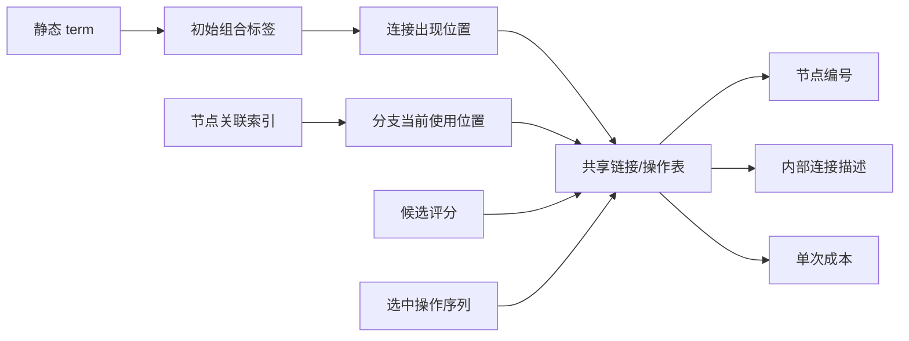

# 规划器的分层链接表示与共享操作更新方案

本文细化[统一流程](../../architecture/correlator-workflow.md)的计算规划阶段，模块职责沿用[规划 L2](planning.md)。此前轻量搜索实验的验证记录仍有效，但不是要求取消原 DFS 或并行流程的架构决定。文中的类型名是概念名称，不是新增公开 API。

## 1. 核心约定

1. term 构建阶段统一分配节点编号：不同节点不撞号，相同计算输入使用同一身份；共轭、切片、精度和准备方式等影响计算身份的差异在构建边界表达。搜索不重新比较节点的数据与操作身份。
2. 搜索层只看节点编号、连接编号及必要的状态计数。节点形状、连接轴和内核描述放在下层，按需读取。
3. 全部连接统一分类，完整描述和成本只登记在公共共享链接表。term 不拥有重复的连接描述或成本。
4. term 通过一个标签引用初始链接组合；搜索不改写 term。当前连接的使用位置、引用变化、输出完成状态由公共搜索工作区维护。
5. 同一操作在固定目标与成本模型下只估价一次。改变使用次数只更新评分；连接含义改变则查找或登记新操作，不能沿用原操作成本。
6. 必须保留连接使用范围，才能正确处理部分共享。范围是公共链接表中的位置标识，不要求搜索回到 term 对象查找或修改。
7. 不把所有可共享子图枚举、全量节点身份复核或详细内核规划加入初始化。共享分类只做连接枚举、按端点分桶、桶内描述分类。

## 2. 数据结构与所有权

| 对象 | 最小信息 | 所有权与变化 |
| --- | --- | --- |
| 静态 term | 初始链接组合标签、结果装配引用 | 构建后不变；物理系数留在装配配方 |
| 初始链接组合 | 节点编号列表、链接出现位置列表 | 相同组合可共用；包含无连接的标量节点，不复制操作描述 |
| 节点表 | 节点编号 → 下层描述引用 | 定义不可变；新中间节点追加登记 |
| 节点下层描述 | 形状、dtype、数据/内核引用、有序轴信息 | 不包含规划时读取的生产数组 |
| 连接描述表 | 描述编号 → 端点轴对应及处理规则 | 不可变、规范化、可复用 |
| 共享链接/操作表 | 操作编号 → 端点编号、描述编号、单次成本、结果节点引用 | 定义与成本不可变；结果几何可在需要时一次生成并缓存 |
| 当前使用位置表 | 操作编号 → 当前有效使用位置 | 分支内可变；范围细分在此进行 |
| 张量关联索引 | 节点编号 → 关联操作/出现位置 | 分支内局部更新 |
| 候选评分表 | 操作编号 → 使用次数、评分、有效版本 | 分支内可变，不复制成本 |
| 结果与计划 | 使用范围 → 已完成结果；有序的选中操作编号 | 分支内可回退；完整方案再交付既有计划格式 |

初始位置可使用 `(scope_id, connect_slot)`；`scope_id` 对应构建阶段的 term/组合实例。相同组合的多个实例可以用分组引用及重数表达，不强制复制位置对象。它保留数学贡献的归属，不是物理系数，也不要求逐 term 更新对象。

“term 只有一个链接标签”指它不持有可变的当前图。初始标签用于描述请求和回放来源；当前图由公共使用位置表及关联索引表示。完成状态使用独立结果映射，不能根据原始静态列表判断某分支是否已经完成。



## 3. 连接内部格式

普通二元连接使用不可变整数元组。两端按节点编号固定顺序，轴编号是各节点的本地轴，不是全任务的 einsum 字符：

```python
description = (
    ((2, 0), (3, 1)),  # 求和轴对：左端轴 -> 右端轴
    (),                # 相连但本步保留的轴对
)
```

例如 `A[a,b,c,d] * B[c,d,e]` 的求和连接就是上述两个轴对。若有共同批轴，将相应轴对放入第二个元组，不能把批轴求和。

构建时固定端点顺序、交换时同步交换轴对、对轴对规范排序；这些工作做一次。分类时直接使用已规范化的描述或描述编号，不重新解析指标、检查节点身份、比较形状或读取数值。

节点形状与连接描述分别保存。同一连接描述可以被不同节点组合引用，但数值操作共享仍以端点编号组合为外层键。形状相同不产生额外的数值共享。

二元元组是常见格式，不得为适配它损失现有数学语义：

| 情形 | 下层表达方式，搜索层的处理 |
| --- | --- |
| 多个节点共享一个指标 | 保留该连接的其他使用者/边界角色；合并其中两个节点时先保留轴，最后满足条件才求和 |
| 对角、迹或单节点归约 | 使用单节点操作描述；沿用相同分类、成本和更新接口 |
| 整体介子/重子或稀疏桥 | 一个操作可以声明多个参与节点，描述保存完整核的轴绑定；不展开核内部 gamma、空间分量或非零元 |
| 零连接胶球或标量 | 节点和输出归属仍在初始组合中，不能因没有边而遗漏；必要乘法/归约沿现有规则登记 |
| 求和屏障、保留轴、合法外积 | 描述保留现有处理规则；不能用“有边就立刻消去”或“没有边就永远不能操作”替代原操作域 |

非二元情形沿同一“参与节点组合 → 内部描述”的两级分类；描述类型及必要的输出边界语义属于内部描述键。轴的名字、term 编号不进入数值操作身份。结果保留轴确实不同的操作不能误分到同一类。边界随缩并改变时登记新描述，不修改原描述。

## 4. 先分类共享连接

执行次序固定为：

```text
枚举内部连接出现位置 (scope_id, connect_slot)
  → 根据连接涉及的节点编号组合分桶
  → 只在桶内按内部描述进一步分类
  → 形成共享操作及其使用位置列表
```

例如：

```text
(term1, connect1)：A—B，描述 d0
(term2, connect1)：A—B，描述 d0
(term3, connect2)：A—B，描述 d1

节点桶 (A,B)：
  L0 = d0，使用位置 [(term1,connect1), (term2,connect1)]
  L1 = d1，使用位置 [(term3,connect2)]
```

这里不做 term 两两比较、不搜索任意共同子图，也不为每个出现位置创建完整 Action/Problem。节点关联索引和反向引用在这一次遍历中建立。哈希分组的通常成本随连接出现次数增长；桶内直接按规范描述键分类，不需要对桶内元素两两比较。

初始分类完成后再按唯一操作估价、评分。后续新连接只增量走上述分类，不重建全任务索引。初始不存在共享操作不证明将来不会产生共享，不据此把联合任务拆成互不交流的计划。

## 5. 成本、评分和路径累计值

### 5.1 成本只登记一次

对一个新的操作编号，成本服务按需读取端点形状、dtype、连接描述、目标硬件及固定内核方案，返回粗略单次预计时间 `C`。可采用调用开销加运算量/有效吞吐的简单模型；不试跑生产数据，不搜索整体核的内部路径，不提前生成完整执行动作。

同一规划会话固定硬件、成本模型、精度与相关几何。已有操作直接读 `C`；同形状数据不是免除不同操作身份的理由，但模型内部可以进一步复用几何估价。目标、批宽或内核方案导致估价条件改变时必须使用相应描述/模型命名空间，不能覆盖旧操作的成本。

成本只存于公共操作表。分支、term、候选排序记录和计划步骤只引用操作编号。缓存可跨 DFS 回退保留，操作当前是否可用由分支状态决定，注册过定义不表示已经算出结果。

### 5.2 评分只决定访问顺序

本方案的简单评分为 `score = C / r`，分数越小越优先；`r` 是本次操作能够同时服务的有效使用位置数。相同位置不重复计数，分组存储时使用重数。物理正负系数不作为共享次数，不在这里做代数消项。

示例：单次成本 6 ms、共享 3 次，评分为 2 ms；另一操作成本 3 ms、共享 1 次，评分为 3 ms。前者优先，但实际路径成本仍增加 6 ms。评分是启发式，不是下界，不替代完整路径成本，也不据此作不正确的最优性剪枝。

`r` 改变时只重新计算分数；`r=0` 时取消该分支中的活动候选。已算出的结果被新位置复用时不重复增加计算成本，其引用接入沿已有复用语义处理。旧 scorer 接口、并列和搜索宽度策略保留；C/r 的实现与旧评分的选择属于候选排序层，不要求改 DFS。本文不宣称现有默认评分已经切换。

### 5.3 选中操作后的记录

计划只追加选中操作编号及必要的结果/依赖引用，累计值增加本分支实际新增的单次计算成本。共享三个位置不乘三，也不把评分 C/r 累加。IO、存储与执行实测继续由各自阶段报告，不混作这一计算成本。

回退保存并恢复先前的累计值，不遍历整条路径重新求和。不同 DFS 分支产生同一操作时使用相同成本记录，但分别判断该分支是否已有其结果。

## 6. 缩并后的局部更新

此处“执行操作”指搜索状态转移，不是数值执行。设选中 `L0: A,B → X`。

1. **保存回退点。** 记录当前路径长度、累计成本、受影响位置及索引条目的旧值。
2. **登记结果。** 创建或复用 X 的节点定义，按需生成一次结果形状及 `A/B 保留轴 → X 轴` 的映射；追加选中操作引用，记录本分支结果可用。
3. **直接取关联链接。** 用 A、B 的关联索引取出相关位置，与 L0 的本次使用范围相交；不查找或遍历 term 对象。
4. **移除旧出现位置。** 删除本次消去的连接；其他受影响连接从原共享类移除对应位置。只有部分位置受影响时分离这些位置，其余位置继续引用原操作。
5. **更新边界。** 将保留连接的 A/B 端改接 X，并转换轴映射。同一使用范围内通往同一外部节点的连接合并；不能把不同范围的 A—C 和 B—C 无条件合并。多个节点共用的轴仍按剩余使用者及输出要求保留。
6. **重新分类局部新连接。** 按端点编号分桶、内部描述分类；已有操作复用其描述和成本，新操作估价一次。相同结果用于多个位置时不重复登记数值计算。
7. **刷新局部索引与评分。** 更新涉及的节点关联、使用位置数与候选版本，失活候选从排序结构中移除或标记过期；未受影响的操作不动。
8. **登记完成结果。** 某使用范围已经产生要求的输出时，更新独立结果映射/剩余需求计数。无连接并不自动意味着完成，标量乘法、单节点归约及输出顺序按原要求处理。

更新量取决于 A、B 的关联位置和实际受影响范围，不应随全任务 term 数量扫描。使用范围列表可采用分组、集合或紧凑整数数组；具体容器依测量选择，不改变上述职责。

### 6.1 完整例子及部分共享

构建阶段的 term 静态指向初始组合；以下只是公共表中连接的当前使用位置：

```text
L0：A—B，范围 {1,2}
L1：A—C，范围 {1}
L2：B—C，范围 {1}
L3：A—D，范围 {2,3}
L4：B—D，范围 {2}

范围1的初始表达式：ABC
范围2的初始表达式：ABD
范围3的初始表达式：AD
```

假设所有这些连接的轴语义允许相应缩并。选中 L0 产生 X 后：

| 旧位置 | 处理结果 |
| --- | --- |
| L0 的范围1、2 | 记录已执行，共用 X |
| L1、L2 的范围1 | 合并成 X—C 的一个新连接位置 |
| L3、L4 的范围2 | 合并成 X—D 的一个新连接位置 |
| L3 的范围3 | 保留 A—D，不受影响；旧操作成本不变 |

这一更新不修改三个 term 的静态对象。L3 只减少一个使用位置并调整评分。新 X—C/X—D 分类后各自复用或登记操作成本；不能拿 A—C/A—D 的旧成本覆盖新操作。

公共操作定义不可就地改写成另一种操作，否则尚未更新的引用、其他 DFS 分支和回退都会读到错误含义。“更新链接表”指更新当前位置所属的操作及活动索引；不可变定义通过追加/复用处理。

## 7. DFS、回退与并行继续复用

这次变化位于搜索工作区之内，不引入另一套搜索调度器。对现有 DFS 保持等价的后端接口：

```text
候选：从共享操作评分表取当前允许的操作
apply：更新局部链接位置，返回 undo token
undo：恢复局部位置、索引、可用结果和累计成本
complete：检查全部需求已获得结果
deliver：将选中操作序列交给原完整计划构造与存储排期
```

| 原流程 | 本方案处理 |
| --- | --- |
| DFS 栈、根/分支宽度、并列、预算、最优可行方案 | 保留；只替换候选来源与状态转移内部实现 |
| 状态去重、共享前缀、剪枝 | 保留合法语义；适配键读取当前连接状态及可用结果，不能只读静态 term 标签 |
| 并行工作分配与结果汇总 | 保留现有进程/分支分配，不增加前端并行入口 |
| 最终完整性与固定 DAG 存储排期 | 保留；不以计算候选存在代替完整可执行计划 |
| 计划保存、加载和 IO/CPU/GPU 执行生成器 | 继续消费原交付契约，不直接消费搜索中的可变链接索引 |

分支私有状态包括当前使用位置、活动链接、评分、可用结果、路径和 undo 栈。静态 term、节点/描述及已登记操作成本可以共享。回退不删除公共定义，只恢复分支内的引用和可用性；计算定义缓存不能泄漏成另一个分支的已完成结果。

并行 worker 使用统一的节点/操作身份规则，保持现有分支分配和结果归并。当前成本缓存属于各自的 IntegerRegistry 会话，在会话内跨状态、回退及交付复用；不同进程的独立 registry 尚不共享动态新增的估价缓存。因此当前“只估价一次”的实测范围是单 registry，不宣称跨进程也只有一次。若后续要求跨进程唯一估价，应通过公共不可变定义/成本槽发布，不能共享活动分支的使用位置；此扩展不属于已通过测试的能力。

根分支可以保留不同探索顺序；每个分支只更新自己的位置状态。原来要求数学等价的状态键、输出边界和可用结果信息仍必须完整，不能为了紧凑而错误合并状态。详细一致性重建留给 debug/测试，不加到每个正常操作中。

## 8. 交付、必要展开与范围

任务构建只展开必须区分的连接结构及贡献归属，并登记规范节点/连接。不同时间实例和重复结构继续共用模板。整体顶点内部的分量和稀疏支持由内核描述/准备管理，不成为公共链接表里的独立全局 term。

搜索只有首次估价、新中间节点边界更新和特殊操作适用性处理才读取必要的下层描述。只有选定完整路径，才生成其详细 Action、轴排列、内核调用及执行依赖。einsum/AxisPattern 可保留为输入适配和最终普通张量调用格式，不再作为反复扫描候选的主要工作表示。

随后沿现有单向流程：计算路径 → 批宽选择 → 固定路径存储安排 → 完整档案 → 原执行生成器。批宽选定后执行，不因此重新搜索缩并顺序。若某个内核暂不能适配，保留已验证的原路径并明确支持范围，不向用户暴露额外底层组织选项。

## 当前实现

- `ScopeLabels` 只修改工作区的整数引用，静态 ContractionTerm 不变；它按需提供原 DFS/评分器需要的 TermRecord 兼容视图。
- `SharedLinks` 保存当前位置、局部连接快照和受影响绑定；普通连接保留未消费的连接，只描述新结果节点相连的操作。回退直接恢复已登记连接，成本缓存不会变成当前结果的可用性。
- IntegerRegistry 保存普通、整体重子、桥接/屏障、宽归约以及终端布局的操作/估价缓存；不再按固定条目上限淘汰导致重复估价，缓存计入现有搜索内存观察。
- 桥接和求和屏障继续由原几何服务绑定合法轴关系，再按完整操作身份查缓存；它们尚不使用普通二元连接的“仅新节点邻接”捷径，避免破坏保护腿和求和次序。
- 连接的内部表示复用已规范化的整数轴关系/描述编号；未增加公开类型或强制更改已保存档案。最终详细动作继续通过原计划交付接口产生。

## 固定存储安排： 固定缩并的简化存储安排

存储阶段以已选定的缩并为执行元素，连同它前面的必要读取和后面的释放一起安排。
它读取计算 DAG，不再搜索缩并方式；时间合批只改变该 DAG 的输入、输出尺寸和局部内核临时空间。
后续 IO、CPU、GPU 生成器读取同一计划，满足依赖后提交动作，不保存另一套计算流程。

最少状态是张量的大小、驻留状态、剩余消费者计数，操作的前驱计数与输出大小，以及全局主机/设备驻留字节数。
源数据块有独立身份：多个逻辑输入共享一次物理读取，借用块的值在最后一个使用者完成前不能释放。
结果在交付前保留。一个候选缩并的预计峰值只需当前驻留量加缺失输入、结果和内核临时空间；
完成后减去最后一次使用的输入。只更新该操作的输入、输出和直接后继，不扫描全部 term。
运行期仍按预算与预留空间准入；估计不声称覆盖任意外部库的所有分配。

现有固定 DAG 排序及其计算范围保持不变，
`storage_lifetimes.py` 接管普通稠密、整体介子、整体重子和 factorized reduction 的驻留核算。
它一次登记张量大小，顺序消费已有读取/缩并/释放动作；每步只增减字节计数。
局部内核继续提供原临时空间模型，重子只读取已选局部路径，不搜索也不重新估价。
物理块驻留量同样增量更新，避免每个内存点都累加全部活动块。
动作和档案接口不变，前端不增加参数。完整符号回放及成本一致性核对放在 `debug=True`。

当前固定 DAG 排序器内部的释放目标排名；带点稀疏桥的 opaque owner 临时空间也仍由原描述回放处理。
普通坐标合批直接调用同一个存储接口，无另一个整体核回放分支。


### 已选路径的详细动作交付

IntegerSpace 在搜索中已登记结果规格、工作空间、成本及内核选择。交付时仅把选中操作的
局部指标绑定回对应 occurrence 的完整指标，并保留该 scene 的 join 名称与内核描述；
不再为每个引用调用 `describe` 重新计算同一份规格和成本。普通、重子、桥接和屏障共用这项原则。
每个缩并结果的数值计算仍只出现一次，后续引用继续标记为 reused；每个 term 的结果归属不变。
动作历史在外部列表累积一次，状态更新不反复复制不断增长的历史元组。
独立符号回放、成本及轴关系的完整重建保留在 debug 分支。
