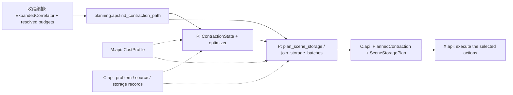

# P：路径与存储规划

分层链接设计见[分层链接与共享操作更新](planning-shared-links.md)：
静态 term 只引用初始组合，公共链接表统一保存操作描述、成本与使用位置；按端点分桶、
桶内描述分类，估价一次，apply/undo 仅更新受影响位置。总体 DFS 和并行流程保留。
工作区的适用分支与缓存范围见该文的当前实现。

启发式规划的快速完整初解、局部改进及最小状态约束见
[计算路径与存储边界](../../architecture/correlator-workflow.md#计算路径存储与坐标)。
设计约束不代替目标环境的数值与性能验证。

选定路径的 `canonical_operations.describe` 可消费一次建立的 `scene_joins` 静态映射
和当前 scene 的 `scoped_bridges`；每步只过滤该行已完成的 join/已消费的桥，保留
原顺序、未消费 core 的保留轴和保护腿。`apply_description` 使用同一映射判断该行
是否完成。缺省参数保持全问题匹配，用于独立对照和旧调用；不是新的用户选项。
重子 `_join_from_layout` 保留已有分块行表，只替换发生变化的行，不在每次成本
描述中展开完整 pending/results。描述和回放都不缓存数值输入。

整体矩阵介子候选的closed connected/trace由中立whole core交付；P决定完整结果复用、
操作顺序和原存储排程，只通过M公开api粗价，不导入X或搜索component/phase/FWR内部路径。
坐标提升保留virtual core与真实source的区别，旧普通/FWR档案按原Action回放；局部算法版本、
独立输出及验收见[介子整体顶点](../execution/meson-whole-vertex.md)。

普通整数搜索仅提前排除单个输出分配与其已声明 workspace 已超过目标剩余额度的
候选；串行和并行 worker 使用同一硬上界，并报告 `rejected_allocation_bounds`。
这是与执行次序无关的必要条件，不把输入、raw 或保留量视作免费，也不替代后续
固定 DAG 存储排程与完整审计。这样直接宽归约可以在准入前参与选择，避免先选中
数百 GB 的 component 展开再在存储阶段失败。余下驻留与排程仍在搜索后统一核验。

收缩编排/E 在规划前按任务显式声明的 dtype 统一输入与准备精度；未声明时保留按全部
输入最低浮点分量精度推导的兼容行为，复数输入保留复数。惰性块在进入正常准备前转换，
规划不预读生产数组；核的已有宽累加规则独立记录，不改变最终声明精度。
P 按统一的 TensorSpec 计算中间量、成本和内存，不生成混合 dtype 的 Cartesian 合批。
历史混合精度元数据仍可用于检查，X 不接受其数值回放；必须重新生成统一精度的计划。
终端三输入 tiled `FactorizedWideReduction` 的输入仍沿统一 complex64，内部结果显式为
complex128，避免共享 one-point 叶子在断开项乘法前提前舍入。其结果 TensorSpec、值身份、
坐标提升和资源模型均使用 `result_dtype`；最终字段沿原输出合同转换。旧缺省字段保留原精度，
固定回放和显式重绑定不会用新规划策略替换已保存的结果类型。

### 已选路线的预算内 tile 选择

`factorized_tiles.retile_factorized_reductions` 在 W 交付新 CUDA 路线时工作，位于其它
独立 kernel grouping 之前；关闭 `kernel_batching` 也可使用这一单计算的物理优化。
它保持 E、选中的 Term/operand 顺序、方程、精度、结果共享及原 load/release 次序，
只对已有 tiled FWR 比较原宽、8192、16384及至多65536元素的完整 epilogue 候选。
候选先按声明成本和当前驻留准入；partial 的全部 shared/retained lane 与 K blocks
总额须不超过8MiB。新名字沿 `factorized_result_name` 包含 tile/输出精度，独立重描述
每个 Action 后，沿原 `plan_scene_storage` 重新核算输入、准备、临时、allocator rounding、
预留和输出。完整物理安排不可行或成本不降则返回原 plan；不捕获合同错误冒充预算回退。
输出状态恢复 tuple 行，不能把私有 `_RowTable` 发布进档案。

`calculate(..., factorized_retile=None)` 对新计划解释为默认启用；高级 False 关闭。
None 在完整档案入口表示沿用 saved core；显式 True/False 均拒绝，因为固定回放不能
重新择宽。该选项不改变 reader/basis/selection 或未知来源的绑定限制，不缓存数值。
未 tiled 的旧 core 保留原4096 epilogue域；旧 tile4096档案也不会在 X 自动升级。

普通 dense CuPy 物理计划另在每个 `MemoryPoint` 记录
`allocation_rounding_device_bytes`：按共享契约 `device_allocation_bytes` 将每个已知
allocation owner 的请求向上取到 512 字节。数值 payload、路径成本和 Action 顺序
不变；该增量参与峰值和可行性判断，CPU 为零，旧档案缺省为零。
原始输入跨批保留时沿用同一 owner；reused 结果不重复计费；Cartesian 合批结果
按整块输出 owner 计一次；输出快照按不同结果 key、shape/dtype 分组后的整块计费，
不按 Term 数重复。普通 dense 缩并的左右布局副本和额外输出分别取整，不能只对
workspace 总和取整。准备配方声明的 aggregate workspace 仍是调用方给定的字节包络，
此处不会推测 opaque 临时数组的数量。

完整 cfg 资源重建使用同一 512 字节请求粒度，但不能把普通计划的
`allocation_rounding_device_bytes` 当作只在 non-reused Action 上执行的 workspace。
P 保留逻辑 `sizes`，另按实际全局 ID 的首次生成和最后使用核算独立 source/contract
owner；实际选中的 dense/GEMM cube（含已有指针表）只收费一个 owner，直到其最后一个
跨坐标复用的结果释放。read 阶段使用 action 之前仍驻留的数值 owner，并加当时的 dense
raw owner 与声明 staging 上界（dense staging 只补一个 request 的 padding，不把未知
内部 staging 分配当作已逐 owner 证明）。未描述为独立 dense 数组的 sparse/p2p 容器继续遵守原声明的聚合
分配上界，不从其逻辑总量推测 owner 数。窗口缩减重新核算这些全局区间，不搜索缩并路径。

独立准备常量仍按完整 `ArrayConstant` 值去重，每个 GPU allocation 单独取整；不能将
全部常量总量只取整一次。X 每个窗口重新绑定 prepared loader，常量池不跨窗口累积。
普通 dense 缩并的 operand layout 副本与额外输出、实际批的各非 prepared packing side
分别补齐 padding。scalar/Cartesian 既有 early-output/partial 桶完整保留；原输出 birth
之前由该已取整桶收费，之后由全局 base owner 接手，不能提前随 reused Action 删除。
准备配方的声明 aggregate workspace 保留；原生 spin/profile/stack fallback 另外按有限
显式分配操作总数乘最多 511 字节给出保守 padding 上界，包含可能的转换、共轭、reshape
复制和逐 profile row 临时数组。此处可以重复覆盖最终 source 的少量 padding，避免猜测
临时数组是否同时存活；opaque/core/sparse 内部 workspace 仍使用其声明分配界限，
不把未知库内部 allocation、pool 碎片或外部扩展算成已证明的逐 owner 模型。

当前坐标的 GPU 输出快照在独立 `len(actions)` 末槽收费，早于最终 source/result release。
固定路径按唯一结果 key 的 shape/dtype 分组分配，measure/debug fallback 则逐结果复制；
cfg 取后者的逐 occurrence 取整上界，重复结果也能覆盖。统计分别保存
`native_output_snapshot_device_bytes` 和 `output_snapshot_device_bytes`，audit 从真实输出
描述重算核验。尚未完成的下载 owner 由 X 输出队列另从剩余预读额度保留两个真实
allocation slots，P 不另加全程 previous-download 槽；两处对当前份可保守多计。
设备预读仍消费 X 已逐 block 取整的 `prefetch_device_bytes`，不把逻辑 raw bytes 当作可用
队列额度。CPU 不新增 GPU 粒度收费。

新 cfg 记录 `cfg_allocation_rounding_version=1`。独立 `audit_cfg_plan` 重新走全局生灭、
read/compute/output 阶段，且重算常量与 snapshot，不依赖保存的 peak 或常量统计自证。
缺版本的旧 CuPy 档案在加载及直接回放资源边界调用 `validate_cfg_allocation_envelope`：
旧保存额度仍覆盖新模型时原样接受，不修改档案；低估时拒绝并提示沿既有 selected path
重新做资源规划，无需重新搜索缩并路径。新版本常路只作固定版本判断，CPU 旧档案保持兼容。

这个字段只表示已知请求粒度，不包含内存池 split block、stream bin、碎片、CUDA
库或外部数组的额外占用；因此物理计划不是对 allocator `total_bytes()` 的数学上界。
预读必须使用同一 allocation 粒度，不能以 payload 余量代替真实设备申请额度。
坐标批规划统计同时记录 `device_allocation_alignment` 和该增量的全路径最大值；
最大增量所在位置不一定是总峰值所在位置，不能将其直接解释为峰值增加量。
上述自动逐点修正的范围是普通 dense `SceneStoragePlan`；独立 `CfgPlan` 的资源汇总、
opaque/core/sparse 轨迹仍有各自的预算契约，不能声称所有 planner 已具备 allocator
峰值上界。2026-10-18 的 DD* B16 失败中，冻结逻辑路径的逐 owner 取整只使逻辑
总峰值增加 196,608 字节，尚不足以完整解释当次 OOM；还须结合 GPU 失败位置的
pool used/total/free、raw/logical owner 和预读队列统计诊断，不能据此声称已修复碎片。

`plan_coordinate_batches(..., allocator_reserve_bytes=0)` 可在坐标批选择前声明
经验性的设备池余量。P 将它与模板已有 caller `reserved_device_bytes` 相加一次，
写入每批物理计划的相同 reserve；逻辑提升也先扣除这两项，尽早拒绝超额批宽。
`SceneStoragePlan.memory_limit` 仍为原硬 cap，余量不对应实际分配、不能用于预读，
也不改变 Action、路径成本或数值 dtype。非零设备池余量对 CPU 无效并明确拒绝；
默认零保持 P 的 metadata-only 调用约定。

收缩编排使用共享 `device_allocator_headroom` 政策传入数值：V100 实测约 0.55 GiB
空闲碎片无法满足约 28 MiB 申请后，采用保守 1 GiB 经验额度；小预算额度受既有
`DEFAULT_PLANNING_FRACTION=0.8` 所留空间限制，不将固定 1 GiB 强加给 128 MiB
门禁。未知设备明确标为未测的经验 fallback，不能视为数学碎片上界。
P 统计单列 `allocator_reserve_bytes`、`caller_reserved_device_bytes`、
`hard_device_limit_bytes`、`numerical_device_limit_bytes` 和不含该经验额度的
`peak_modeled_device_bytes`；收缩编排另保存政策来源。读取前自动选更小宽度，执行时不靠
捕获 OOM 后缩宽重试。当前接口只将调用方新声明的额度加入一次；对已带同一额度的
模板再次绑定时，收缩编排须先恢复 caller reserve，避免把原有经验额度再次累加。

`rebind_scene_path` 重新描述给定顺序时复用已有的持久 Term 行和有界操作历史缓冲，
结束时恢复普通 tuple 并交付完整 Action 表。由本入口刚生成的 canonical 描述直接应用，
外部 Action 仍由 canonical replay 独立核验；重命名、代数关系及主机/设备预算检查保留。

`lift_coordinate_path` 对已选普通 dense DAG 做坐标批轴提升，不重新 E 展开或搜索。
批内相同轴模式只构造一次提升方程；reused Action 沿用已提升生产者的名称并核对驻留、
shape/dtype，`debug=True` 仍独立重算规范名称并回放原 pending 表达式。Action 顺序与结果
引用不变。只有一个实际坐标批时，直接使用已完成 raw 生命周期、分配取整和预算审计的
storage plan；多批仍由 `join_storage_batches` 核对跨批共享生命周期。
坐标排程需要的结果字段布局和输出保留字节通过 R 的 `describe_output_layout` 一次遍历
取得；原有两个独立查询仍兼容。保留原预算计数，包括嵌套算术与字段所有者。
E 显式提供新 problem 和完整 source_map；除一部分输入新增同一个正长度前导轴、
对应 term 方程保留该轴外，shape、dtype、代数与输出顺序必须不变。静态输入及其
中间量继续共享，动态依赖按原 paid Action 顺序传播，双动态输入的共同批轴始终保留，
不作为缩并轴，也不生成不同坐标间的 Cartesian 积。真实尾批可以使用较小长度。
单坐标或全部重复坐标的输入也可全部静态；此时只快速重命名原 DAG，输出不新增批轴，
坐标覆盖仍由 E/R 的已声明输出轴记录交付。
P 一次扫描构造新的 Action、catalog、结果 ID、成本及逻辑驻留/工作区界限；
`debug=True` 额外按原 pending 表独立重演。支持 NumPy/CuPy 元数据，不初始化设备；
稀疏、baryon、matrix core、opaque source 及显式资源操作暂时拒绝。
返回状态使用 logical_source_problem，仍须把实际批次 blocks/preparations 交给
plan_scene_storage，再按原 kernel_batching 选择做 lowering 和完整 owner/packing
预算审计。此阶段只保留现有 descriptor 能表达的 Cartesian 批：单侧动态可将坐标轴
作为普通 free axis；双侧动态则沿普通 batched matmul/精确 reduction，不能假称保留
全部原合批分组。此 P 服务不替代 E 的科学身份/抽样拓扑核验、收缩编排的坐标覆盖和批宽选择。

坐标重绑定与普通新选路径共用内部 `lower_independent_kernel_groups`：依次考虑独立
GEMM、终端 scalar 和 Cartesian 宽归约组，不重复执行 `lower_dense_batches`。
坐标路径先 `join_storage_batches` 确定共享 raw 生命周期，再在当前候选宽度的预算检查
内调用共同服务；每批统计、合批后的 host/device 峰值与 caller/output/allocator reserve
一起交付。join 不设置逻辑 tensor retention，也不能据此跳过所有归约组；动态 lane
结果仍由原几何资格判断，只有可表达的静态/标量子图才能进入相应组。
收缩编排从已有 execution target 传入 runtime；未知、CPU、HIP 不猜测 CUDA，也不探测设备，
保持原 dense lowering。`kernel_batching=False` 跳过整个物理合批流水线。
预算不足先保留原可行操作或更小组；若坐标候选本身超额则仍由原宽度循环降低批宽，
不会在执行期捕获 OOM 重试。档案和重复 `.run()` 只消费冻结的选择。

联合 raw 驻留字节数随首次读入和最终释放事件增减，不在每个 MemoryPoint 上
重新扫描全部驻留块。此核算保持原读入/释放边界、动作、成本、完整内存轨迹及
allocator rounding 后的可行性判断；无需新增前端参数。

已选普通 dense Action 路径的 `plan_scene_storage` 默认直接核算驻留、原始块寿命、
准备工作区、缩并工作区及输出快照；不重建全部 pending Term 或重新推导相同代数。
`debug=True` 沿原独立代数重演并核对动作/成本。普通路径仍拒绝缺少驻留操作数、
无效释放、缺少输出及不合法物理资源；CPU/GPU 的完整 MemoryPoint 轨迹与 debug 对照。
稀疏、baryon、固定矩阵 core 和显式迁移目前保留原资源/代数联合核算，未套用 dense 捷径。

不可变准备常量按 `ArrayConstant` 的 shape、dtype 和精确内容去重计费；重复坐标或驻留窗口不会重复增加常量额度。此规则与 X 在单个 loader/backend 生命周期内的常量共享一致，不合并输入数据的科学身份。

P 位于 `contraction/planning/`，只维护缩并状态演化、路径选择、独立项证明和物理存储计划。P 消费 C 的纯描述、M.api 的唯一 `CostProfile` 与 opt_einsum 的元数据路径能力；不读取数组、不加载文件、不执行 X 数值核，也不导入 B/E 实现。公开边界是 `lqcdweave.contraction.planning.api`。

完整 cfg 的准备记录在 C 构造或 A 解码时已校验。P 默认按完整固定定义绑定一次 ID
替换器，仅复制 `TensorPreparation.inputs` 和 `SourcePreparation.blocks/recipe`，保留
常量、变换、工作区和成本字段。新块 ID 仍须唯一，依赖解析、科学身份及最终资源核算
保持原逻辑；`debug=True` 和扩展记录类型使用原构造校验。替换器限于当前模板绑定，
不保留数组、历史窗口或新持久字段。
准备依赖顺序及输入的原始块/准备结果角色在坐标循环前解析一次，依原有深度优先的
首次发现顺序建立绑定表。坐标循环只从已绑定取值位置取得当前 ID；不重复创建递归函数
或遍历固定依赖。stack 始终消费准备结果，其它配方保留原始块优先的规则；同名原始块
与准备项不混淆。缺失依赖、环依赖和 load 来源检查仍执行，默认/debug 的共享、
全局 ID、事件、所有权与资源结论相同；绑定表不进入档案或全局缓存。

窗口生成器在首个非空窗口接受固定描述并一次绑定模板：复制请求、规格和读取元数据表，
整理依赖、轴身份、固定取值函数、所选合批与工作区。后续窗口及资源额度重试复用同一
私有绑定，不重复这些固定解析；每个窗口仍独立构造实际读取、ID、共享、释放和资源
包络，debug 独立审计照常执行。输入模板在接受后保持不变；新的生成器或单次构造重新
绑定，关闭、结束或异常释放绑定，不缓存历史窗口、reader 或数值输入。统计分别记录
本窗口的 `template_binding_count` 和 `template_binding_seconds`；首窗口为一次，后续为零。

同一窗口内的物理读取共享仍按完整身份核对。合并标准读取请求的 aliases 时，各基准
描述只去除一次备选记录，保留原先的去重、首见顺序和主读取；备选内容不变时复用
已接受的冻结请求。debug 和扩展读取类型继续沿原构造路径，不跨窗口保留读取记录。

实际绑定按递增的绝对 Action 位置访问各坐标，因此普通输入、结果及原始块的最后使用
位置直接写入当前位置，避免同一循环内重复 `dict.get` 和 `max`。合批所有者会跨多个
结果延长生命周期，该阶段继续按原规则取最大值。保留最后使用表的首次插入次序，
以及完全相同的事件、释放顺序、共享与资源核算；debug 独立回放继续检查这些区间。
模板入口保留消费者必须晚于生产者的检查，因此已产生节点恰好是最后使用表中的
节点；坐标绑定复用此表判断首次产生，不复制另一张生产者字典。实际首次 load 的
准备记录按原次序进入成本汇总，避免扫描所有计算节点并反复转换 ID；未 load 的
准备项仍不计成本，窗口、资源重试、特殊操作及 debug 审计行为不变。

本 L2 说明 P 对 H04 的共享状态/无未来共享拆分，以及 H05 的路径、direct 固定路径、批宽与完整物理存储审计的实现。

CUDA 独立 GEMM 分组的候选上限来自 C 的固定指针表容量（21个子批），而非固定的8个。
P 仍只组合首位置依赖完成且输入已驻留的同 dtype/MKN 批，按目标模型与 owner 资源
轨迹选择宽度；额度不足尝试更小组。不增加读取或改变 Action/物理表达式，加载档案不分组。
X 将较宽打包拆为最多32个输入的复制核，全部写既有最终缓冲，模型仍明确为 dense 估计。

混合图的局部 lowering 不移动任何 Action：以特殊操作、load/release 等边界分开连续
ordinary contract 区域，分别选择兼容 Cartesian 批，并在原有轨迹上加入完整 owner 与
packing 工作区后审计。重子 join、稀疏 bridge 的数值路径、工作区与顺序保留。
CUDA 独立 GEMM 分组可以在这些区域内继续组合已有批，但不能跨特殊操作边界；DAG
也登记特殊操作的生产依赖。task `batch_paths` 包装逐子计划处理，保持联合原始块事件并
更新总体 prediction，不因存在包装而整体跳过。跨批 logical retention、显式资源迁移仍
不在合批支持域；CPU/HIP 的独立 GEMM 分组和专门成本校准保持待办。档案保存已选批，
加载不重新分组。NumPy 独立数值参考及档案测试不代表当前改动的真实 CUDA 性能验收。

CfgPlan 首次构造和档案解码核对完整实例绑定；后续仅更新统计或输出布局时，完全相同的
不可变模板/实例可按对象身份复用已接受的绑定。模板或实例替换使结论失效，外部可变
描述不使用该复用路径。没有 kernel batch 的实例不解码未使用的 reused 表；输出布局和
资源标量的检查保留。此优化不增加公开参数或新档案字段。

`CfgTemplate` 另保存可选的 `preparation_closure` 与 `preparation_specs`：P 从已合并的
完整输入准备表冻结所有配方记录，并按 `specs.get(key, state.catalog.get(key))` 保存每个
可描述准备项的既有 TensorSpec。该快照只描述模板已用的准备闭包，不改 `SceneStoragePlan`
的 Action、成本、事件或资源安排；它不增加数值操作或科学身份。旧档案中的模板缺少这两个
字段时仍解码为 `None`，保留原有读取路径；新档案通过通用记录 codec 保存闭包、spec 与
共享的不可变配方记录，加载仍只解码，不搜索或读取数值数组。

输出缓冲包络按字段实际 shape/dtype 核算数值缓冲与时间归约暂存；浮点/复数字段若执行有限性检查，
相应布尔暂存单独计入。HDF5 持久字段保留原始 dtype；如 GPU 为传输临时打包，其设备/主机暂存
按实现使用的真实 dtype 与生命周期计入。独立审计使用相同资源定义。

完整 cfg 的最终资源核算直接消费绑定阶段生成的全局分配/最后使用区间，以整数增量表计算主存、显存和工作区峰值；合批视图按共同分配计费，输入 staging 同时计入仍存活的合批所有者。默认保留最终额度、资源守恒与模板依赖构造检查，不再逐坐标重放同一份状态；`debug=True` 额外运行独立逐操作审计。此优化不改变选定路径、释放时间或复用范围。

### 合批结果生命周期的逐步审查

同批结果共用一个数值 owner。普通路径已证明模板中同名结果不发生值变化，且只选择
全部成员均新产生的 batch，因此不同已选 owner 的全局结果 ID 不交叠。各结果的原始
最后使用位置保留到全部坐标绑定结束，再统一延长到同 owner 的最晚位置；坐标循环
不提前传播这个位置。debug 或未证明同名结果不变时仍保留原逐坐标传播。

| 步骤 | 处理 | 依据 |
|---|---|---|
| 1. 按 batch 结果顺序读取当前全局 ID | 保留 | 当前坐标的实际绑定决定哪个数值 owner 被使用 |
| 2. 核对同批结果没有重复全局 ID | 保留 | 否则保存的多结果分配与实际别名关系不兼容 |
| 3. 坐标内提前求同批结果的最晚位置并传播 | 普通路径删除；debug/未证明的同名改写保留 | 不交叠的 owner 只需在全部使用登记完成后汇总，坐标循环只读取节点是否已产生 |
| 4. 再逐结果查询旧位置并与这个最大值比较 | 删除 | 旧值必然不超过刚求出的最大值，循环没有其它写入 |
| 5. 坐标循环保存 batch 和有序结果 ID | 保留 | 最终汇总及资源计费仍需要这些固定描述 |
| 6. 全部坐标结束后求 owner 的全局最晚位置并更新每个视图 | 保留一次 | 结果可能被窗口内的后续坐标继续使用，所有视图共享最终存活区间 |
| 7. 遍历前复制整份 batch owner 字典条目 | 删除 | 最终遍历不再写入这个字典 |
| 8. 将 owner 的最晚位置再次写入描述元组 | 删除 | 资源核算只读取 batch 和结果 ID，最终释放表已从更新后的 last 产生 |
| 9. 独立逐操作重放同一资源轨迹 | 仅 debug 或显式 audit | 正常绑定沿用已经产生的完整区间和预算核算 |

跨坐标驻留复用按有界窗口选择：P 默认将一轮身份绑定限制在 4,000,000 个模板 Action 槽内，这是规划元数据的内部额度，与目标主存/显存额度分开。窗口内共享读取、准备与计算；窗口之间分配新的生命周期 ID，前一窗口的数值结果和原始输入不留驻到后续窗口。最终目标预算检查失败时，P 减半窗口并重新绑定；单坐标仍不可行则明确报错，不加大预算、不删坐标或重新搜索缩并路径。`statistics` 保存 `reuse_window`、`residency_windows` 和 `resource_attempts`。此选择是有界复用策略，不承诺跨全 cfg 的计算成本最优；可能增加重复准备和计算，其成本按实际保存的安排报告。X 和 A 沿用既有事件、全局 ID 与连续预读队列，执行时不重新选窗口。

## 全 Diagram 整数连接格式（当前工作区整合验证进行中）

权威格式见[ARCHITECTURE](../../../ARCHITECTURE.md#diagram-的统一整数连接格式目标待迁移)。P 的 Scene、DFS、exact/DP、成本、尺寸、
存储规划与独立回放均使用 C 的 `AxisPattern`/整数元组；路径和 Action 保留整数关系，
不生成派生方程。DFS 与通用编译器复用唯一记录，不另建指标类型。改造保留各搜索的



## 完整任务档案的当前边界（阶段五已接入）

目标见[完整规划与直接执行](../../architecture/correlator-target-architecture.md#完整规划与直接执行)。P 已能从一份已选 `SceneStoragePlan` 生成 cfg 的全坐标模板与实例，并由 A/收缩编排/X 接入完整档案加载、连续执行和输出；支持的通用 Action（包括已描述的重子 join、稀疏 bridge）与 DenseKernelBatch 保存在同一计划中。跨多个不同路径模板的兼容复用仍未实现。coordinate-batched sparse GPU 与缺少可序列化 preparation recipe 的输入不支持；所有 GPU 核、DCU/HIP 与生产规模仍待验收。

C 的 `ExecutionTarget` 是纯目标记录；M.api 提供 `register_execution_target`、`load_execution_target`、profile 解析和本地校准缓存。收缩编排的 `target_hardware` 可以是已登记名称，不会因此加载或初始化目标运行库；实际执行由 backend 与 loader 分别绑定和检查。

完整 cfg 路线复用 C 的 `Action` 与 `SceneStoragePlan`，对当前支持的完整输入范围绑定已选路径，审计跨坐标保留/释放、预读启动条件与预算，以及输出预留，并在保存档案前完成独立审计。现有 exact 路径证明范围保持不变；完整任务档案不代表对异步 wall time 的全局最优保证。

P 将一份已选择的 `SceneStoragePlan` 实例化到一个 cfg 的坐标集合，去重该 cfg 内
各坐标共享的读取、准备和计算，并直接生成资源事件与释放点。此路径已由收缩编排的离线补全和完整档案
入口接入 X 连续执行与流式 Dataset 输出；它复用一份已选模板，不合并不同候选路径或异构模板。

## 首次完整规划的提速要求（已接通；早期性能报告基于 dense NumPy）

本节要求减少从零构造并保存完整方案的耗时，不是只加快档案加载。早期阶段二至五的性能记录使用
dense NumPy 路径；当前完整 cfg 档案也保存支持的通用 Action、准备描述、特殊操作和批注。
跨多个不同路径模板的兼容性与复用仍待实现。所有当前支持路径的构造、绑定和审计均在保存前完成。

1. **兼容模板只编译一次，实际输入统一登记。** 每类兼容结构只选择路径/编译模板一次；每个实例只保存模板引用和输入索引，不逐坐标重演完整路径。兼容性须同时比较轴与维度、dtype、拓扑、输入别名/共享关系、变换与准备布局、核参数及资源包络。不能仅按 shape 合并。实际来源描述按数据身份及有序选择登记一次；不同实际数据 ID 保留独立绑定，在上述条件兼容时仍可引用同一模板。结构或资源条件有差异时才拆成模板变体。
2. **直接从全局表构造生命周期。** 从已知坐标表、全局实际数据 ID 和模板依赖直接生成生产者/消费者关系、读取需求、最后使用点及资源事件。避免先为 N 个坐标建立完整 Problem/SceneStoragePlan，再合并、去重或重做释放安排。沿用 C 的描述，不增加 IR，并覆盖全部任务实例。
3. **分层复用审计结论。** 分别检查模板合法性、实例兼容性/资源差异和全任务事件；相同模板的结论可复用，最终仍须进行独立的全局资源审计，覆盖跨实例缓存、预读、工作区及输出重叠。不能简单相加各实例局部峰值，也不能跳过实际输入兼容检查；出现模板变体时，使不适用的复用结论失效。

优先顺序是：先完成模板与全局输入登记，再直接构造生命周期，最后分层复用审计。矩阵低层 K/H 核不构成免搜索的规划路线；`optimize="meson_matrix"` 仅是统一 `anytime` 搜索的兼容别名。普通 DFS/exact 搜索本身的复杂度不会因此自动改善；搜索算法改动另行处理，不在本节改变算法。重复编译应从随实例数增长降为随兼容模板数增长；实际输入、绑定和事件处理仍随任务规模增长，不宣称 O(1) 或按实例数获得同倍提速。

验收须分别记录首次端到端规划中的定义/输入描述、模板选择、实例与生命周期构建、审计及序列化耗时，并记录模板编译次数、不同实际输入数、实例数、峰值元数据内存和档案字节。比较时使用相同任务、硬件和配置，并保持数值语义、共享、固定计算成本、资源结论及完整覆盖相同；只加快加载或省略审计不算首次规划提速证据。

## Canonical files and legacy reuse

`find_dense_batches(state, profile)` 与 `describe_dense_batch(actions, action_indices,
catalog, profile)` 是纯元数据接口：从已审计普通稠密 Action 描述完整 Cartesian
配对，要求每个输入侧仅一个自由轴可变、无保留对齐轴或对角。核与拼接采用现有
成本规则。完整网格若有多个自由轴尺寸变化，finder 固定每侧最后一个变化轴之外的
自由尺寸，将原边分成互不重叠子网格，分别交给同一描述器；不补边，不拆分其它拒绝条件。
CuPy 的原集合和扩展集合分别按最终 producer eligibility 重算准备侧与打包成本，
比较全部所替代 paid Action 的成本差，稳定择优；成本相同保留原集合。
只有选中的集合进入固定 DAG 调度和末端资源审计。
费用未降低时返回空。结果为 C `DenseKernelBatch`，引用原动作索引和
输出切片；该描述器本身不代替完整 `SceneStoragePlan`。普通 `anytime` 在必需的固定 DAG
存储排程和资源审计后，默认由 `lower_dense_batches(plan, profile=...)` 尝试 lowering，
细节和限制见下文。它为合格的 NumPy 或 CuPy ordinary dense 单计划添加 `kernel_batches` 注解；
所选逻辑 Action 保持可审计；独立 DAG 组可能重排，资源或总模型成本不合格时保留原计划。

| Canonical file | Responsibility | Reused implementation |
|---|---|---|
| `state.py` | Immutable `ContractionState` and metadata-only load/contract/release transitions | Residual methods from `contraction/scene_state.py`; `SourceSpec`, `Action`, `Factor`, `PendingTerm`, `ContractionProblem`, bridge and join records now come only from C |
| `paths.py` | Rebinding, legal successor generation, bounded path graph/count | `contraction/scene_paths.py` |
| `logical_index.py` | Factor occurrences, bounded pure layouts and local index updates | Shared by search, direct planning and fixed replay; public atomic transitions retain the scan reference |
| `contraction_index.py` | Hash complete ordered subexpression descriptors to Term/position groups | Full equality resolves collisions; direct paths update only affected Terms |
| `dense_batches.py` | Describe profitable complete Cartesian dense kernels from existing paid Actions; preserve identities and output slices | Pure metadata descriptors used by the physical lowerer |
| `dense_batch_schedule.py` | Attach profitable dense kernel groups after ordinary anytime's fixed-DAG storage schedule; rebuild and audit the selected physical plan | Keeps selected logical computations, may reorder independent groups, adds C `DenseKernelBatch` annotations and accounts host/device packing buffers and full output owners |
| `actions.py` | Live-input discovery, diagnostic release pruning and action replay | `contraction/scene_optimizer_actions.py` |
| `storage.py` | Logical/physical source split, storage lifetime audit, batch joins and retained tensor schedules | `contraction/scene_storage.py`; `StorageBlock`, `SourcePreparation`, `StorageEvent`, `MemoryPoint`, and `SceneStoragePlan` are only C records |
| `optimizers/search.py` | Operation-independent Dijkstra and layered DP, plus their search-space protocols | Recurrences extracted from `exact.py` and `dynamic_programming.py`; both enforce feasibility before state merging |
| `optimizers/storage_space.py` | Complete physical storage state and exact planning for compute/preparation model cost | Incremental accounting adapted from `storage_anytime.py`; adds exhaustive raw retention and logical eviction/rematerialization choices |
| `optimizers/integer_space.py`, `integer_ranking.py`, `graph_dfs.py`, `graph_session.py`, `integer_scoring.py`, `shared_components.py`, `parallel_components.py`, `shared_states.py` | Default logical fingerprint DFS, shared IntegerRegistry, incremental current-candidate ranking, shared-operation classes, independent scorers and optional process workers | Compute search followed by fixed-DAG storage scheduling and independent audit; roots have a strict quota; only nonroot widths admit boundary ties |
| `optimizers/macro_space.py`, `candidate_catalog.py`, `delivery.py` | Complete-step preparation helpers and executable delivery | Reused for final metadata materialization; not the default search engine |
| `optimizers/storage_schedule.py` | Required final step for ordinary anytime: reorders only the selected computation DAG and independently audits complete candidates | Resident-consumption release heuristic with original-order completion, original-plan fallback, and unified delivery check; incremental ready bit mask intersects release prerequisites, preserving ascending candidate order without scanning the entire ready set |
| `matrix_kernel.py` | Low-level dense meson matrix metadata and reusable K/H kernels | No separate optimizer route; `optimize="meson_matrix"` is a compatibility alias for unified `anytime` search |
| `batch.py` | Conservative raw storage reservation, fixed template reuse and complete batch audit | Calls the unified physical search when research is allowed |
| `basis_batch.py` | Combine explicitly compatible prefix/source problems | Migrated from `contraction/scene_basis_batch.py`; the old forwarding facade is removed |
| `compiler.py` | 通用 metadata DAG 编译 | opt_einsum 路径降低及精确 CSE；旧 joint 扩展已归档 |
| `cache.py` | 有界 generic plan LRU，只缓存 C `ContractionPlan` 和结构签名 | 原 `contraction/plan_cache.py` 转发入口已删除；公开 `planning.api` 直接提供类型/函数，执行绑定仍由调用方持有 |
| `path_planning.py` | Public path selection, direct plan construction, budget audit and batch selection; canonical cross-batch replay keeps the selected computation order and applies final-use releases | Existing `contraction/path_planning.py`, adapted to C and M APIs |
| `api.py` | 公开导出，包括统一存储搜索与通用 compiler | 唯一公共 facade |

The forwarding-only `contraction/scene_state.py`, `scene_storage.py`, `scene_paths.py`, and module-identity alias `joint_planner.py` have been removed. State/path/storage behavior is exposed through P.api, pure records through C.api, and CostProfile through M.api. The forwarding-only `contraction/path_planning.py` has been removed; path-selection callers use `planning.api`, while `PlannedContraction` remains uniquely defined in C. Tests that prohibit search patch the globals in the actual `planning/path_planning.py` implementation. The unreferenced `scene_basis_batch.py` and `compiler.py` facades, optimizer/search facades (`scene_search.py`, `scene_optimizer*.py`, `scene_candidate_paths.py`, `scene_redstar_weight.py`), and forwarding-only `contraction/optimizers/` package have been removed. New callers use `planning.api`; modules under `planning/optimizers/` are internal implementations. The old `CostProfile` and `PlannedContraction` names resolve to the same classes in M and C respectively. No optimizer implementation is maintained twice.

P imports C records through `contracts.correlator.api`; it never copies `TensorSpec`, `ContractionTerm`, `SourceSpec`, `Action`, `Factor`, `ContractionProblem`, `StorageBlock`, `SourcePreparation`, `SceneStoragePlan`, or `PlannedContraction`. `CostProfile` is the object in `performance.api`; P defines no second profile type. Pure sparse point-label/equality helpers and their conservative workspace constants come from `contracts.correlator.api`, not `operations.sparse_join` or `sparse_bridge`.

## 通用搜索中的介子矩阵与兼容别名

`optimize="meson_matrix"` 仅作为统一 `anytime` 搜索入口的兼容别名；它使用同一候选搜索、
评分预算、固定 DAG 存储排程和独立资源审计，不锁定 K/H 逐行次序，也不绕过搜索。
推荐新调用使用默认的 `optimize="anytime"`。`exact`、`dynamic_programming` 和 `none`
保留各自原有搜索/固定路径语义。

结构化 dense 介子任务可由 E 提供紧凑的普通整数方程，以参与同一搜索。矩形模态选择、
常量广播和不同时间绑定仍依完整来源身份区分。低层 K/H 数值核及 `MatrixKernelSpec`
描述继续保留供已有 Action 使用；旧固定逐行 planner 和 `matrix_device_execution` 专用 scope

## 持久 workload 的有限候选与纯内存计算

`memory.py` 从原 root budget 实现迁入纯内存估算与上限合成，P.api 公开
`estimate_plan_memory(plan, specs=None, *, budget=None, output_bytes=None,
assembly_extra_bytes=0, snapshot_inputs=True)`、
`resolve_budget_limits(budget, *, target, host_available, device_info=None)`、
`user_memory_cap(budget, *, kind)` 与 `workspace_reserve(budget)`。
这些函数只消费声明或显式观察值，不加载数组、不初始化设备、不查询系统资源。
GPU reserve 沿用旧解析器的 `int(total * fraction)` 与最小字节数的最大值；
零 total 和 duck-typed budget 的兼容范围保持。C ExecutionBudget 的
`device_reserve` 使用 ceil 且要求正 total，不能在未声明行为变化时直接替换。

`workload_schedule.py` 公开 `list_plan_candidates(spec, budget=None, *,
max_candidates=4, optimize="greedy", target=None)` 与 `plan_workload`。
候选按 whole/half/single 输出组宽度采样，完整输出始终保留、输出组不可拆，
返回最宽可行候选并保留窄候选供校准。`target=None` 按 device cap 推断资源口径；
显式 `cpu`/`gpu` 由调用方指定。startup 上限与后端观察在 runtime/收缩编排，
P 只接收有效预算和目标；候选排序及核心算法沿用旧实现，不代表全局最优。
旧 `contraction.budget` 与 `contraction.schedule_planner` 入口已删除。
专项覆盖独立字节峰值、完整输出预留、CPU/GPU口径及真实 NumPy存档执行；
模拟GPU预算检查不算真实GPU验收。

## 保留的宏步骤实现（非默认搜索）

公开入口复用跨批次路径时，已选缩并操作由 `materialize_actions` 完整步骤接口回放，
保留各 Term 的显式共享更新，并按后续引用保护准备好的数据。该回放不重新搜索或改变评分。

本节描述保留的 `macro_space.py` 完整步骤准备、回放与公共资源审计。默认 anytime 使用下方的整数指纹状态图；旧宏步骤 DFS 和 ExpressionSpace 已退役。本域不是公开可选搜索引擎。
精确搜索继续独立保留，其最优保证仍相对于已经声明并实现的完整物理操作域。

### 阶段一：资源描述与显式轨迹审计

`plan_scene_storage` 逐步核对固定路径时仅保留当前回放动作，沿用精确驻留计量及已有 live-input 缓存。
最终计划仍保存原有完整动作；最后动作匹配、成本、工作区、依赖和容量检查不因历史清除而减少。

共同 C 契约继续使用 Action 和 SceneStoragePlan。Action.resource 可携带
`ResourceTransition(domain, source, target, nbytes, workspace_host_bytes=0,
workspace_device_bytes=0)`；domain 为 tensor/block，层为 host/device/disk。
ResourceSnapshot 持有唯一 ResourceAllocation 所有者和借用依赖。借用视图不重复计费，
只可舍弃引用；存在借用引用的原始块不能移动或释放。
数据存在性由有效所有者/借用记录判断，不由非零字节判断。零字节所有者按原生层有效，
不能移动；空 dense 输入仍有所有者，空结果可参与最终拷贝。借用依赖检查原始所有者
有效且位置符合 StorageBlock 声明（包括 GPU 场景声明的 host 原始记录）。
移动字节核对当前完整所有者，
不能用自报小尺寸替换规格。

P.api 的 `transition_resource(snapshot, action, profile, *, future_needed,
recoverable_sources, backend, memory_limit, host_memory_limit=None,
disk_limit_bytes=None, ...)` 返回新快照和本步峰值，失败不修改父快照。
future/recovery 集合是操作域由未完成表达式、join 和实际存活准备依赖推导的事实，
不由 Action 自报；完整轨迹审计自行核对。spill_host 为 device→host，spill_disk 为
host→disk，restore_host 为 disk→host，restore_device 为 host→device。
移动先形成完整目标，再移除源，峰值包含源、目标和声明工作区。恢复后移除暂存副本，
恢复不算第二次原始读取；必需且没有恢复途径的数据不能舍弃。

`audit_resource_trajectory(state, blocks, preparations, *, profile, memory_limit,
host_memory_limit=None, disk_limit_bytes=None, reserved_host_bytes=0,
reserved_device_bytes=0)` 按原动作重算，或经 `plan_scene_storage(...,
explicit_resources=True, disk_limit_bytes=None)` 调用。原始读取和关闭必须用
read_block/close_block 明确记录，关闭不再由最后一次 load 推算。准备只消费位置符合
块声明的依赖，GPU 原始块移到 host 后须恢复 device 才能物化。
审计核对 compute Action 全字段、完整最终表达式/catalog/loaded/results/join/region 状态、
单次原始读取和未来恢复依赖，未知动作拒绝。缓存命中只消费已恢复的输出副本，
不要求重新准备无须计算的原操作数；暂存但未恢复的输出不能命中。

显式轨迹的 `state.seconds` 保留原快照与逻辑数值 Action 模型成本。
`SceneStoragePlan.seconds` 为 `state.seconds + preparation_seconds + kernel_cost_adjustment`；
`kernel_cost_adjustment` 对 `kernel_batches` 和独立 `scalar_reduction_groups` 中互不重叠的 Action，用该组 selected kernel 模型成本
替换原逻辑 Action 模型成本。`SceneStoragePlan.compute_seconds` 仅汇总数值计算，含同一批核成本
调整；不会把输入准备/快照混入计算值。读取、传输和资源移动没有预测耗时，实际执行观测保留在
replay 报告中。
返回计划中的同一 state 可再次审计。档案读取严格校验受支持版本和当前计划字段。
MemoryPoint.temporary_disk_bytes 报占用，SceneStoragePlan.peak_disk_bytes 报峰值；
disk_limit_bytes=None 不剪枝，配置上限参与峰值与 with_reserves 可行性检查。

含暂存/恢复的轨迹由 X 在显式 store、正磁盘上限及单路径 NumPy CPU 条件下执行；
A 可保存同一窄范围的纯资源描述，加载后仍须注入 store。直接回放、batch join/retention
及设备迁移继续在 IO 前拒绝；未知事件不会解释为 release。无实际暂存的显式路径
已转换为既有执行事件。P 的磁盘字节为数组 payload，X 另外核对文件头和 IO 预留；
接口及限制见执行和档案 L2，现有精确域及证书没有扩展。

### 完整缩并的一次评估

`optimizers/macro_space.py` 提供非最优完整步骤域。`MacroCursor` 保存无动作历史的
逻辑状态、三层资源位置、准备成本、峰值上界和生产依赖。
`LogicalStep` 是当前节点临时生成的共享逻辑效果；`MacroTransition` 保存动作片段。

搜索不再在每个节点先找完整 Term 代表。它按稳定顺序枚举二元组合、一元归约和
未完成重子 join，通过 `state._contract_layout/_join_layout` 检查代数条件并确定操作
身份。同一输入身份、标签、输出及桥接上下文的计算只构造一次共享逻辑效果，
更新全部适用 Term。不同轴绑定不能合并；相同输出的 join 在宏步骤中记录各自
零成本缓存替换。精确域的 join 完成状态仍分别枚举，没有扩展精确证明范围。
每次节点展开的有效 join 布局只解析一遍，枚举与共享替换复用按完整代数描述分组的
临时索引；不同场景的匹配布局可以共享，同场景的重复完成标记跳过。节点发生
缩并后重新建立索引，不能把旧端点布局用于已改变的腿。索引在本次展开结束后释放；

`logical_index.FactorIndex` 在节点内按完整 Factor 身份建立 Term/位置索引，共享更新
只访问可能包含同一有序子表达式的 Term。宏步骤域和 exact/DP 复用此索引；exact/DP
继续使用 `actions._contract_positions` 的完整 Term 代表优化，显式路径图保留操作
出现次数。索引保留原字典序、重复位置与标签；Python 哈希冲突仍按完整身份比较。
公开 `contract` 保留独立扫描，用于与 hash 匹配进行对照。
完整轨迹审计从原始 Problem 重新建立自己的匹配索引，独立重算成本和物理存储；
它不复用搜索索引、后继状态或已计算的资源峰值，也不重新选择动作安排。

`contraction_index.ContractionIndex` 为已启用布局索引的节点建立缩并 hash 分组。
键包含有序 Factor（数据身份及轴标签）、结果保留轴的顺序、主桥接及双电流桥接的
现有共享代数身份；当前 Term 的输出与未完成 join 约束参与保留轴推导。
每个键保存各 Term 中第一个匹配位置，保留原顺序及重复 Factor 的出现规则。
一元出现也登记在多输入 Term 内，保持归约结果可共享到剩余表达式的语义。
查找只访问同一计算组，不逐次扫描 Factor 出现列表或重新判断全部 Term。
`ContractionKey` 缓存本进程 hash，字典命中仍比较完整描述；它不替代科学身份、
中间结果的既有稳定 ID 或档案字段。索引不保存成本或完整后继。

宏步骤域另用 `optimizers/candidate_catalog.CandidateCatalog` 保存当前表达式的合法缩并布局，
按同一完整 `ContractionKey` 分组，每个 Term/计算只登记首个有序位置，候选代表仍按
Term 和位置排序。目录最多保存4096条 Term 内计算出现及4096行；超出容量后回到
完整枚举，不截断操作域。它不保存物理状态、成本或后继，重子 join 保持既有分组流程。
串行前进、兄弟切换和回溯时，只重建表达式、输入规格或活动 join 发生变化的行；
仅在索引提供的前一 pending/catalog/join 上下文与目录完全一致时使用变化行提示，
否则核对全部行。已有数据规格修改和 catalog 压缩后回溯也会使相关行失效。
增量更新在临时字典完成；预算中断或容量超限不发布部分目录。此目录属于非最优
宏步骤域，exact/DP 继续使用各自节点内的共享缩并索引。

精确搜索的布局索引只属于当前节点。宏步骤域使用展开独占的布局索引；串行访问下一节点、
兄弟或回溯前，按全部变化 Term 和 join 完成状态更新索引。交错的诊断迭代器使用独立索引，
中断时丢弃未完成更新。布局键包含完整输入 TensorSpec，避免同名数据的几何变化复用旧布局。
`none` 和固定轨迹审计沿单一路径调用 `LayoutIndex.advance`，按共享转移返回的 Term 变化移除旧键、
更新轴/join 上下文并登记新键；未变化的 Term 不重新建索引。
直接路径的 join 更新同时刷新其完成约束，缓存布局使用最新活动 join 表。
小节点继续沿用下述直接查找政策；公开原子转移保留独立扫描以供结果对照。

宏步骤域和 exact/DP 的 `LayoutIndex` 在每次展开中最多缓存 256 个纯布局，键包含有序 Factor、
必须保留的标签、终态输出顺序、未完成 join 与完整稀疏桥接描述及作用域。
布局缓存不包含成本或后继状态，替换 CostProfile 无须修改索引。
当前索引政策要求至少 12 个位置候选、至少 8 个重复 Factor 出现，否则使用直接布局/匹配；
单个长 Term 也可走直接路线。这一内部开关只影响元数据查找，不改变候选、顺序、成本或审计。
exact 的完整 Term 去重后不足 12 个位置候选时只建立所需出现位置索引，不建立完整布局上下文。
标签保留条件通过每 Term 的计数与单元/二元标签集合求出，不逐候选创建 Counter。
桥接按场景保留原记录顺序；共享替换在逐 Term 验证输出与桥接代数后复用不可变模板。
join 布局还复用相同 Term、活动 join 及桥接上下文；不同端点约束仍分别解析。
共享 join 从完整代数分组一次更新全部匹配 Term 和完成标记；代表操作仍核对完整
布局，跟随操作记录为零成本缓存替换，交付时由独立原子轨迹审计逐项验证。

逻辑布局与共享效果构造分开；正常候选不调用公开 `contract` 进行物理回放。
操作时间仍来自 CostProfile。每个操作身份的工作区估计首次根据现有形状/核路径
模型计算，随后作为固定数值复用；未随意选取与数据规模无关的默认字节常数。
读取块的 staging 和源准备 workspace 同样直接采用输入契约中的固定字节估计。
现有 join 路径及工作区 LRU 最多各 256 项，键包含表达式、形状和路径。

`evaluate` 一次生成固定准备安排、逻辑更新和资源结果：按身份完整准备缺失输入，
暂存数据按需完整恢复；缓存命中只恢复输出。每个存储所有者分别记录该步骤中
host/device/disk 的最大占用，迁移时覆盖源、目标同时存在；借用视图不新增所有权。
将所有者各层最大值相加，再加该层最大的准备/计算工作区及预留，作为整步峰值
上界。只对这个上界检查硬限制，不为每次读块、load、compute 构造并检查一个游标。
出现压力后按稳定顺序回收能缓解当前压力的无用缓存，重新评估；满足后停止。
默认有用数据仍保留。终点恢复与输出副本属于独立的交付生命周期，同样整体检查。
失败丢弃临时更新，不修改父状态；不搜索准备顺序、部分物化或预取。

初始所有逻辑源叶子及隐式 join/桥接输入确定本域必需读取的原始块集合；未使用的
catalog/preparation 条目不进入集合。搜索保留显式读块动作、单次读取历史与物理容量约束，
但读取和传输不进入评分或累计模型成本。快照、源准备计算和数值操作成本按实际发生次数
计入。完整路径的模型成本仍与独立审计相等。

全部逻辑缩并都评估后才决定资源分支；存在任意可行缩并时不枚举有用数据调整。
仅所有候选均因存储超限失败时才生成舍弃和两级暂存。预算中断、逻辑死路、
不可恢复数据均不当作全部超限。恢复始终附属于需要它的缩并。

整体上界可能比固定原子轨迹实际模型峰值更大，因此可能保守拒绝合法路径。
`plan` 只在完整路径交付时重放所选轨迹，核对成本、终态和硬限制，并检查审计
峰值不超过搜索上界；不要求两个峰值相等。交付计划报告审计峰值，不将保守
上界冒充真实测量。独立审计仍覆盖迁移双副本、借用所有权、原始单次读取及输出副本。
宏步骤域提供整体步骤预演与固定操作物化；exact/DP 继续使用原有原子动作域及模型。

### 正常缩并与资源调整

1. 默认保留驻留数据缓存，空间充足时不主动释放。是否需要回收，以待执行缩并的完整
   预测峰值是否超限为准，不等待实际分配失败；主机内存与显存分别判断。出现压力时
   先按固定规则回收无用数据，不为释放顺序生成搜索分支；用途检查覆盖所有未完成
   Term、join 和借用关系。有用数据的舍弃/暂存仍仅在第 5 条的条件下进入搜索。
2. 正常状态只枚举逻辑缩并，合并能够服务多个 Term 的相同计算。每个候选按固定默认
   规则整体评估输入准备、缩并及必要的按需回收；默认物化完整逻辑数据，不搜索部分物化、
   准备顺序、预取或提前物化未来输入。
3. 缺失输入在缩并需要时自动完整物化；已暂存输入在缩并需要时自动恢复。恢复不作为
   独立搜索候选。整体模型覆盖准备、恢复、计算及输出的瞬时占用，并检查主机/设备上限。
4. 按需回收无用数据后，若整体峰值上界仍超限，就拒绝整个缩并候选；失败预演不改变父
   状态，也不保留部分准备或回收结果。规划器可以选择其他缩并，或在资源调整分支中
   先释放占用后重新尝试。缩并完成后不因数据变得无用就立即清空缓存；操作临时工作区
   的结束及整个任务的最终资源清理仍遵守执行契约。
5. 只要存在默认操作可完成的缩并，就沿缩并分支搜索；**全部逻辑合法的缩并候选都因
   存储超限被拒绝时**，才进入资源调整分支。该判断发生在评分/top-k 截断之前；未完成
   候选检查的预算中断、成本剪枝或逻辑死路，不视为“全部缩并超限”。
6. 资源调整候选只包含舍弃和暂存。每次调整后重新检查缩并；若仍全部超限，可以继续
   调整。调整阶段不自动恢复；不改变状态的动作和等价调整排列通过状态键排除。
    不能舍弃未来仍必需且没有声明恢复方法的数据；暂存需要声明目标位置、常驻/暂存字节和工作区。
7. 没有可继续的缩并或合法调整时，域返回空候选；该信号本身不证明全局不可行。
   公开搜索的预算、失败与交付行为由现行 integer 图或 exact/DP 会话负责。

“完整逻辑数据”以输入契约声明的范围为准。生命周期规则只负责用途、借用、释放与
恢复合法性；缩并候选预演本身不枚举生命周期排列。普通 anytime 选定计算路径后，必须由
`optimizers/storage_schedule.py` 在固定计算 DAG 上调整节点顺序，保留数据依赖与每个
Term 的更新顺序；不产生新缩并、暂存或预取。该末端步骤不可由 storage 或评分选项跳过。元数据规划
需要明确动作效果、成本和资源描述。单路径 CPU 暂存/恢复已接通专项数值与生命周期
验证；其余资源动作和平台仍需对应执行能力与验收，不能从元数据规划通过推断支持。

### 两级暂存和按需恢复

资源调整描述数据所在层、有效副本/借用依赖、转移工作区和峰值；它不提供传输或暂存耗时预测。
当前执行仅支持单路径 NumPy CPU 的拥有型数组 host→disk `spill_disk`、disk→host
`restore_host` 与 host `discard`，需要显式临时数组 store 和正磁盘容量上限。
每次磁盘暂存先写出有效目标副本，再释放源占用；审计覆盖源、目标及声明工作区同时存在的峰值。
恢复过程按资源动作记录并受容量限制，实际读写耗时保留在回放观测中，不进入模型成本。
GPU 设备/主机迁移、连续的多级暂存和跨批保留仍不支持；具体执行能力与限制见[执行 L2](../execution/execution.md)。

### 宏步骤元数据的所有权与缓存

资源压力节点只缓存最近一个逻辑上下文的动作和代数增量，不保存父/后继状态；
`logical_cache_hits` 记录命中。每次暂存/舍弃后仍重新核算准备、恢复和峰值，缓存不代表物理可行。
普通共享更新与 join 更新直接记录改变的 Term/结果位置；`freeze_transition` 与
`apply_delta` 保留不变 Term 的身份，并按调用方当前累计成本重建步骤。
固定数据块依赖顺序有界复用（最多 256 个键集合），缩并输入继续按稳定身份排序。
不可变 `ContractionState` / `MacroCursor` 缓存完整状态键与哈希；完整字段相等才合并，
Python hash 不进入科学身份或保存格式。替换状态会重建缓存。catalog 使用不可变基表及
最多 64 个条目的更新层，迭代顺序与普通字典更新一致。
`ContractionState` 的驻留字节首次访问时独立扫描，内置转移通过精确整数增量传递缓存；
共享区域只在最后一个引用释放时扣除，GPU 主机区域与计算位置分别维护。
普通 `dataclasses.replace` 会重新核算；缓存不参与科学身份、状态等价或成本公式。
输入用途和恢复查找复用当前游标事实，改变逻辑字段或有用驻留项时失效；所有者、位置、
恢复途径、成本及物理峰值仍按后继重新核算。展开结束、中断或物化完成后释放事实缓存。
预算中的保留内存估算计入 dataclass 字段及 cached_property；不等于进程 RSS 硬上限。
缩并 hash 分组按实际查询的有序输入组合建立，完整输出约束与桥接身份参与键；
预算中断不发布部分分组，固定路径只更新变化 Term 中已建立的输入组。

旧宏步骤 DFS 的路径池、排名保留和 widening 策略不再存在。现行搜索的评分、
预算、图所有权和证明边界以下方 integer 指纹图与 exact/DP 说明为准。
宏步骤域的固定准备顺序和整体峰值上界仍是保守模型，不提供物理可行性完备证明；
执行平台支持仍以执行模块和对应验收为准。

## 统一 anytime 优化器的模块设计

并行根分支先返回完整逻辑候选的前缀、紧凑收尾配方和只读登记定义；不为落选根展开逐 Term Action。主进程选择各类别的最佳根后，展开并审核这些候选，再以线性遍历合并路径，统一重标跨类别复用并扣除重复计算成本，不逐 Action 重定价或复制完整状态；共享计算身份/规格冲突、Term 完成覆盖、固定 DAG 依赖和最终物理资源检查仍保留。`debug=True` 额外对合并结果作独立逻辑回放对照；中间逻辑状态的峰值不作为物理计划资源结论，实际峰值继续由统一存储排程及资源审计产生。

`anytime` 使用逻辑缩并上的指纹状态图和多根 DFS；`optimize="meson_matrix"` 归一化到同一搜索。搜索阶段不更新存储或 IO，目标是减少计算模型成本。路径搜索停止后，即使搜索预算已耗尽，只要已有完整逻辑路径，就必须依次完成逻辑路径审计 → 固定 DAG 存储优化及增量资源核算 → 交付；独立资源回放对照仅在 debug 执行。没有完整路径时报告 `PathSearchExhausted`，未完成调度或资源核算失败时拒绝交付。成功交付的 `stats["storage_schedule"]` 必须含 `required=True` 与 `completed=True`，由统一交付检查核验；`storage="bounded"` 或评分选项不能跳过该步骤。该要求适用于 `anytime` 及其兼容别名；`exact` / `dynamic_programming` 使用下文所述的计算/准备成本域及对应证明范围，`none` 使用固定动作路径，完整档案执行不重跑规划或存储调度。

构造保守 DAG：数据依赖及每个 Term 原有的更新顺序共同限定可执行顺序。`storage_schedule.py` 只重排已选完整计算片段；计算、复用、dtype、布局和操作模型成本保持不变。原顺序先构造为完整兜底；搜索扩展每个候选时增量核算瞬时主机和设备峰值，超过物理预算或当前完整方案上限就剪枝。完整方案必须改善 CPU 的 `(host, device)` 或 GPU 的 `(device, host)` 字典序目标，且两侧峰值都不增加；随后收紧上限。初始原顺序也提前释放最后一次使用的数据；若其超限，合法重排仍可尝试通过原限制。不会重新搜索缩并或引入暂存，因此不保证存储约束下的全局最优。

一个排程元素就是一次已选计算及其共享更新；需要时先读取和准备输入，计算完成后释放最后一次使用的数据。
构造 DAG 时一次固定分配大小、该元素的有序输入/触及数据、准备依赖块及已登记 workspace；
DFS 和撤销只修改逻辑数据与物理块的剩余使用次数、驻留集合和 host/device 字节计数，
不重复定价内核或逐步扫描同一物理块的全部逻辑来源。物理块的剩余使用数为各来源计数之和；
归零后仍有零字节借用输出引用它时继续保留。原有释放优先级、首次读取顺序、输出保留和
最终 Action/Event 索引规则不变。`test_storage_element_dependencies.py` 对 CPU/设备域、
共享来源的所有小图顺序及撤销逐步核对独立来源扫描，并封住搜索中的来源重扫；
`test_storage_schedule.py`、`test_storage_peak_search.py` 继续用独立资源回放和数值参考核验最终安排。

普通已接受计算的排程直接将 raw block 开关写入最终 `StorageEvent`，将实际计算/释放写入
Action，并按同一遍历位置记录 `MemoryPoint` 和准备成本。不先保存完整 read_block/close_block
轨迹再构造整张索引表、复制每个内存点或重扫动作来重建准备成本。总成本仍沿用原有的
`sum` 浮点求和，保持原来的数值行为。debug 保留原显式轨迹、独立资源回放
和转换路径；两条路径在 CPU 和模拟设备域逐点对照。批处理 lowering 已从构造阶段得到布局、
切片、依赖及工作区，默认不再全量重新验证同一批次；debug 仍独立重建并比较。

所有 DAG 规模使用同一有界 DFS，没有小图 beam。每执行一步后重新选择释放目标，不锁定上一步的目标。
优先级仍为“可释放字节数 / 完成所有剩余消费者及其未完成前置依赖所需的新计算次数”，零新计算目标优先；
比较使用整数交叉相乘。步数按依赖并集计数，共享计算只算一次，已完成或纯复用更新不算，
读取和准备不计入该步数，但参与物理峰值核算。最终输出不作为目标，借用视图的底层字节只计原始所有者。

优先级索引在搜索首次需要排名时创建；新驻留数据初始化其计数，并登记尚未完成的新计算依赖。
每完成或撤销一个计算，只更新依赖它的当前驻留目标，包括间接前置依赖影响的目标；
新驻留/失效目标加入或退出队列，其他优先级记录原样复用。动态依赖登记在回退后可复用；
版本堆忽略旧记录，超过 `2*当前目标数+128` 时只用现有记录压紧，不重算未受影响的优先级。
候选查询按需取排名靠前的目标，原始块与快照指向相同操作时不重复占用操作名额。
正常资源回放不建立该索引；优化预算耗尽时直接返回已有最好完整方案，不补全当前试探分支。

选定目标内部按稳定节点顺序尝试 ready 操作；超峰值或后继死路时尝试较低优先级操作，
每个状态最多 `search.storage_branch_width` 项（默认 4，不扩展同分名额）。该宽度独立于计算路径的
`branch_width`，串行与并行汇总后的固定 DAG 阶段共用它。当前宽度耗尽就退回上一步；回退恢复本步
引用数、驻留集合、就绪节点、内存计数及受影响的优先级，不复制整个前沿或表达式。
无释放目标时按原节点顺序尝试 ready 操作。原始块单读、最后使用后释放和固定计算成本保持不变，IO 时间不进入优化目标。

存储搜索分为首条可行路径与后续优化两阶段。首条路径必须由当前 DFS 搜索完整得到，原顺序兜底
不提前触发预算；它只需满足物理预算，不要求优于已有兜底。找到之前不因时间或状态数预算退出，
但仍保留物理峰值剪枝、有限宽度和分支耗尽结束；未找到不等于证明全部拓扑顺序都不可行。
找到后才开始独立的默认 3600 秒（1小时）及 1024 次候选推进优化预算，失败试探也计数；
之后的改进不重置计时或计数。预算任一耗尽就停止试探并返回已有最好完整方案，
不再补全当前分支。后续方案不改善可行兜底时仍返回兜底；不可行兜底不能阻挡可行方案。

这两阶段不继承计算搜索已耗尽的预算；首条路径的搜索和选定方案交付不属于后续优化预算，
因此整个存储阶段并非硬性 1 小时超时。准备、读取暂存、工作区、预留及最终输出复制均检查，
特别是输出复制完成前不能宣布已找到可行路径。仅构造兜底及最后选定方案，不为每条完整候选
另跑全程审计；`debug=True` 独立回放并核对峰值。启发式不保证全局最小峰值。

成功结果的 `stats["storage_schedule"]` 报告 `policy="peak_bounded_release_dfs"`、`required=True`、`completed=True`、`branch_width`、`peak_pruned`、`backtracks`、`complete_improvements`、`suffix_steps` 与 `stop_reason`。原有释放目标计数现在包含试探分支；`audited_schedules` 只计构造的兜底及选定方案，通常为 1 或 2，不代表搜索完整候选数。保留节点数、展开前沿、峰值和 `changed_order`。模型峰值不等于进程 RSS 或平台分配器实测；未声明的适配器临时量必须纳入工作区/预留，GPU 和生产规模仍需平台验证。`exact` / `dynamic_programming` 的搜索域和最优性证明保持独立。

逐步重选的统计另含 `target_selection="each_step_incremental"`、`rank_activations`、`rank_updates`、
`rank_reuses`、`rank_watch_registrations` 和 `rank_heap_compactions`。`target_evaluations` 现在计新目标初始化
与受影响优先级更新之和；`rank_reuses` 只计查询时再次命中同一优先级记录，不是所有未变化目标的总数。
释放目标选择数按逐步试探计，不再表示锁定目标的完整消费链数量。

预算统计标记 `budget_scope="after_first_search_solution"`；`first_solution_expanded` 与
`first_solution_seconds` 为首条搜索可行路径的探索量和时间（未找到为 None），
`optimization_expanded` 与 `optimization_seconds` 只计其后的优化探索，不含最终交付。
`explored_frontiers` 仍为两阶段合计，可以大于 1024；兼容字段 `suffix_steps` 恒为 0。


### 模块与数据归属

| 模块 | 功能与保存内容 |
|---|---|
| graph_dfs.py | 以严格根上限、后续层基础名额及并列保留策略推进的 FingerprintDFS、历史 GraphNode 和活动 GraphFrame；历史只保存指纹/数字，不拥有表达式；串行展开和并行父进程根发现共用 `rank_candidates(width, root=...)`，统一评分、并列保留及预算统计；可选在搜索期 undo 之前记录每条已应用操作的出现绑定，并在当前最优目标结点仍存活时记录其收尾绑定，交付后由 owner 释放 |
| integer_space.py | 共享 IntegerRegistry；活动 TermRecord 数组、计算到 Term 出现位置的索引、稀疏 IntegerUndo；只重建变动行，稠密行按编译槽表直接取配方，单行问题上下文按需惰性建立；初始行直接读静态 Problem 的整数轴关系，并按 TermRecord 类只编译一次，不再先构造完整 ContractionState；新增只读出现绑定访问器（刷新索引后返回不变量），不改变已有方法体 |
| integer_scoring.py | 可替换的候选评分；共享数、元素数、逻辑最后引用释放量和一步共享机会；当前展开的事实不进入历史节点 |
| shared_components.py | 枚举各 Term 初始合法操作，按完整操作身份合并相交类别；纯稠密问题直接以规范元组 `(kind, 输入身份, 规范轴关系)` 为键，含稀疏桥接/重子 join 时保留原 blake2b 结果名，两种键给出相同等价类；不计成本、IO 或存储，不推测未来共享 |
| canonical_operations.py | 按数据身份及完整指标对齐登记计算；describe 生成共同 Action，内部直接应用该描述，外部 replay 独立描述并比较 |
| optimizers/selected_path.py | 将已选稠密配方绑定到当前输入和完整轴关系，直接生成全部 Action/snippets；不重新枚举候选或定价；当搜索期出现绑定齐全时改走绑定路径（不再做独立轴关系匹配，也不构造中间表达式对象），`recompute=True` 或 `verify=True` 分别完整回放独立匹配、并逐条比对绑定 |
| terminal_completion.py | 独立 dense 收尾的整段成本、布局/转置计费、分层有界配方复用；纯标量收尾按计算块复用配方与有序部分和，覆盖或单配方证明不成立时仍完整检查；只在最终最佳路线交付时展开整数操作，后续生成共同 Action |
| scalar_terminal.py | 增量登记纯标量终结计算及其可用性、覆盖数；按 calculation ID 每 64 项保存配方块与有序部分和，只重建受影响块并从首个变化块继续有序折叠，未变前缀不再重走且逐位保持原求和顺序，同时增量维护与保留序列的差异块清单供收尾共享直接使用 |
| dense_patterns.py | 普通 dense 合法配对及规范轴关系的共同编译，供初始分组与整数候选绑定复用 |
| compact_rows.py | 大型重复 dense 任务的加权表达式类和原物理行顺序等价的候选索引更新；空索引按首个物理出现一趟建立，之后只登记变化组的权重与序号事件 |
| shared_states.py | 有界分片锁共享表；保存同一类别已完成搜索的前缀成本支配记录，完整指纹匹配，支持安全淘汰；不保存活动状态或数值数据 |
| graph_session.py | 默认协调各类别根分支自动并行；显式单 worker 保留各分量首解后继续 DFS；完成路径后生成完整 Action，进行 fixed-DAG 调度和资源审计；debug 额外独立回放，session.py 检查交付完成标记；串行路径在搜索期收集最优路线绑定供审计复用，审计后立即释放，绑定缺失或并行路径自动回退独立重算 |
| parallel_components.py | 父进程发现各类别根候选，单一有界进程池搜索根分支，共享工作额度；同类别择一，跨类别组装共同路线 |
| macro_space.py | 物理完整步骤用于原顺序存储保底与准备审计；保护固定后续路径仍要复用的结果。物理排程事实（初始表达式、桥索引、read/load action 表、准备成本）改为首次访问时才构造，逻辑规划只读 `problem` 与 `logical_profile`；`materialize_physical_facts()` 可在诊断中一次性强制构造 |
| storage_schedule.py | 在已选计算 DAG 上按驻留消费释放目标排序；保留数据及 Term 更新依赖，每个候选独立审计 |
| state.py / actions.py / logical_index.py / candidate_catalog.py | 既有缩并、共享匹配、稀疏桥接和重子 join；不选择搜索路径 |
| choices.py / budget.py / results.py | 共享操作 ID 池、协作式预算和既有结果对象 |
| session.py / options.py | 默认分派和严格模式配置 |
| storage_space.py / search.py / frontier.py / bounds.py | 独立的 exact / DP 物理搜索与证明 |

### 状态、连接及活动表达式

状态 ID 是 256 位 BLAKE2b 指纹，增量组合各 Term 的因子 ID 元组、指标模板 ID、完成标记和本路径已生成数据 ID。
数据定义的 shape/dtype 及核心配方在共享表中不可变。原始 Problem 和 CostProfile 在一次会话内固定。生成缓存可改变后续
复用成本，不能只对当前表达式求 hash。总成本、父节点和历史峰值不进入指纹。
启发式搜索以指纹直接合并，不在每次命中时回放确认完整相等；碰撞可能损害质量或使最终审计失败。
这不是精确身份，不进入持久科学产物或最优证书。
默认稠密固定路径复用 Calculation 中已接受的不可变 Action 配方，以输入到当前 Term 的索引寻找
出现位置，并核对完整轴相等关系、输出布局和可用性。只更新受影响的 Term/索引，最后一次冻结
完整 Action/snippets、catalog 和结果；不重建 IntegerSpace，不重新枚举未选候选、定价或做
整数 apply。桥接/重子路径保留所需表达式构造，直接应用刚描述的结果，省去紧接着的重复描述。
完成覆盖、选定操作成本与总成本及后续固定 DAG 的资源可行性检查仍保留。
`debug=True` 使用原来的完整整数索引和独立 Action 描述/回放，才保存完整计算定义到结果身份的对应关系，
检测不同完整计算产生同一结果 hash 的内部碰撞，并逐步重建完整表达式与整数表示比较、
在末尾核对全部场景。这些诊断不进入历史搜索节点；开关同时传入串行规划与并行分量 worker。
并行主进程的跨类别合并审核保持原边界，不属于这份 worker 诊断表。

调试及特殊路径的逐出现位置回放使用不可变分块行表保存 pending/results；单行更新只复制所属的
64 行块和外层块引用，不反复复制完整 Term 表。小表沿用普通元组。旧状态及其缓存键保持不变，
调试时每个 Action 的独立描述和成本比较仍执行；完成后转换回普通元组再交付。
这只改变本次审计的内部存储，不改变搜索键、操作次序、档案记录或前端选项。

每个 GraphNode 保存最低到达成本 float、最佳父指纹 bytes、后继指纹 list、成本剪枝后待探索操作的 array('Q')、终态和历史化 bool。
连接表示可达关系；子节点更换最佳父节点不删除旧连接。共享连接表将 (父指纹, 子指纹) 映射到操作 ID，
共享操作池保存 IntegerOperation（计算 ID、结果 ID、复用 bool、增量 float），成本表按操作 ID 索引。
节点不保存后继动作、增量数组、排名或表达式，不建立第二套执行 IR。
更低到达沿保留连接进行严格成本松弛；没有改善则停止，已探索后继无需重新生成。
历史节点永不重演或重新展开。首次访问按宽度策略完成一次探索；默认保留名额边界上的全部同主分候选，
因此实际宽度可超过基础名额。每个节点保留的候选集合仍由当时的搜索预算和排序结果确定。
若累计成本已不可能优于当前完整结果，应用之前剪枝，子状态不登记。父节点降价后允许恢复
其已知最佳前缀，只执行之前保留但尚未探索的操作；已探索历史后继不重新生成。

IntegerSpace.terms 为 list[TermRecord]，每行仅保存 tuple[int] 因子、int 指标模板和 bool 完成标记。
AxisPattern 统一保存每个因子的 tuple[int] 指标和输出 tuple[int]。数据及计算定义集中登记；
各活动分量只拥有自己的 available ID 集合、catalog 和索引，不因全局登记就获得缓存。
join 消耗表达式中的逻辑核心，完成情况从核心是否仍存在推导；临时代数视图为既有函数生成完成集合，
它不是第二份持久状态。深入记录被修改的 Term 位置/旧值及本步新增 catalog 键，回溯撤销。
完整 ContractionState 只作为当前临时视图；活动帧持有候选ID、偏移和稀疏undo，出栈后释放。
索引只重建变动 Term 行，按计算 ID 找出全部可共享出现位置；搜索结束释放。
`optimizers/terminal_steps.py` 在活动索引中给普通 dense 收尾缩并登记消费者要求的输出布局。
原规范布局保留；新增布局仍是同一种 `contract` Action，身份包含输出轴顺序，更新全部匹配 Term，
不同输出排列的消费者共享一次二元计算，再各自按需归一化。未求和轴的对齐关系不变。
临时布局索引随变动行重建，不进入历史节点；数据及计算定义沿用唯一整数登记表。
更新覆盖变动行旧、新计算族及其全部共享消费者；未变动族的布局与出现位置直接保留。
仅剩独立终态时，按 family 维护成员集合和最小堆，沿用最小 family 的完整布局比较；
不逐步扫描其余 family。完成及回溯同步更新索引，过期堆项预算内清理并有界压缩，reset/release 清空。
默认 `search_memory_limit=None` 时，不遍历搜索元数据、不建立静态计量索引；串行、并行分量和
精确搜索均沿用这一规则。`sampled_peak_search_bytes=None` 表示未采样。张量的执行内存、显存及
工作区仍由选定路径后的物理资源审计检查，不受此选项影响。
显式设置搜索内存上限时，串行采样只遍历一次不再改变的输入与每行表达式定义，之后每次完整遍历可变搜索图。
`StaticMemory` 持有这些定义的根，防止 Python ID 回收；共享对象仍计一次，ID 索引、整数和锚点本身
也计入搜索内存预算。当前 Term、出现位置、排名、注册表容器/索引及历史连接均不放入静态集合；
每次采样前，注册表按追加位置交出新登记的冻结 DataDefinition、AxisPattern 和 Calculation，
只为这些不再变化的记录及子对象增加一次计量。可增长列表、名称映射、计算 ID 列表和操作池仍逐次
遍历，采样位置本身也进入预算根；所有记录在本次会话内仍由注册表持有。
静态索引不再复制：每次采样用独立的已访问集合查询该索引，因此单次采样的成本只随可变对象数增长，
不再随静态对象数增长。
一次完整遍历的成本与保留对象数 S 成正比，而 S 随保留状态数增长；固定状态数间隔使采样总成本随状态数
平方增长。`budget.MemorySampling` 因此改为自适应调度：一次遍历摊销到 S/objects_per_state
（默认 16 个对象/状态）个状态之上，相邻两次遍历最多相隔 max(memory_interval=256, S/objects_per_state) 个状态，
总成本随展开状态数线性增长；串行、并行分量和精确搜索共用同一调度，时钟是预算自己的展开计数。
采样峰值的滞后不超过该间隔，上限判定最迟在真实越界后一个间隔内触发，间隔本身不低于原固定频率 256 个状态。
测得每状态增长为正且上限有限时，下一次遍历改为预测在「测量增长到达上限」处执行，使一次遍历正好落在
越界点，而不是落后整整一个间隔；剩余空间变小时间隔随之缩短，最终回到 256 个状态的固定节奏。
预测只收紧、不放宽上面的间隔上限；若两次遍历之间增长率放大 m 倍，越界后的超出量不超过当时剩余空间的 (m−1) 倍。
首次请求、任务首解和收尾统计始终强制遍历，最终上限判定不受调度影响。
`memory_sampling="fixed"` 恢复原固定 256 步的全量遍历，只用于 debug 对比；默认 `"adaptive"`。
有上限时的容量判断及最终执行资源审计保持原契约，不将这个估算当作 RSS。
复用标记和实际增量在枚举时读取当前 available，不缓存上一节点的驻留判定。
各分量找到首解时暂时保留其活动链，以便所有分量先得到完整任务首解。

Baryon.describe_core_factors / register_core 在 B 中按端点时间、字段顺序和实际轴绑定登记
兼容算符成分之和；不同传播子绑定在 E 的不同 Term 中保留。TensorCoreSpec 用六条逻辑
spin/laplace_vector 轴及 CoreComponent（spin、elemental 输入、系数、稀疏自旋）表达核心，
不代表实际物化六阶数组。多成分 baryon_join 通过原稀疏核逐项计算、加权及累加，计入复制与累加成本/工作区。
P2P 核心包含两端 spin/point/color 轴和稀疏记录输入，记录自身保留 gamma/系数/点色稀疏项；
完整桥接及已有双桥闭环仍作为原子操作。计算身份包含保留轴与求和轴的完整对齐，
因此 A_ij B_ij→i 与 A_ij B_kj→ik 不混淆。核心描述可由现有 tagged 档案编码保存；
exact / DP 拒绝多成分或带权核心，既有单成分无权域的证明不变。

### 搜索流程和预算

1. 列出每个 Term 的初始合法缩并、一元操作、P2P 桥接和重子 join；按完整操作身份连接类别。默认由父进程按原评分选出各类别的保留根操作，再将这些根分支交给同一个 CPU 进程池；每根固定第一个操作，独立继续原 DFS。`component_workers=None` 自动选择并发数，显式 1 使用原串行首解及继续搜索流程，正整数限制总 worker 数。
   匹配保留输入身份、全部指标对齐、输出轴顺序及稀疏/核心配方；不因相同输入或任意因子子集而合并。
   枚举逻辑候选，默认主评分为 `shared_savings`（−C×(k−1)）；有显式宽求和屏障时，不消去任何指标且扩大张量的乘积评分为 +C，优先完成实际缩并，避免把昂贵广播中间量的共享误认为收益。该合法候选仍保留，执行成本不变；`incremental_time` 仍可显式选择。
   对任一 anytime 主评分，主分完全相同时，候选按其 occurrence scene 与上一步 apply 改写 scene 集合的交集数降序，
   再按原登记序排序。该 recent scene 上下文随 apply 更新、undo 恢复，reset/release 清除；它只用于排序，不进入计算成本。
   root_width 是根候选的严格上限，不受 include_ties 影响；branch_width 是后续节点的基础名额 N。默认 `search.include_ties=True` 时，后续节点保留前 N 项及所有主分与第 N 项精确相等的候选，
   即使这些边界同分候选的 recent scene 次级顺序不同也全部保留。`False` 严格保留 N 项，但仍使用上述次级排序。
   同分判断使用精确数值相等，不使用浮点容差。
   普通候选仅在选中后构造共享表达式更新；截断候选不进入操作池，不保留预演快照。
   计算域延后纯收尾候选：该计算的全部出现位置均消耗对应 Term 的全部因子，且只剩输出轴排列。
   只要存在非收尾候选，继续按公开评分搜索；同一计算也服务未完成的更长表达式时仍是非收尾候选。
   全部候选均为普通 dense 收尾时，按稳定计算族顺序处理，不枚举独立族的交错排列；
   对当前族保留的规范布局及消费者布局，由原 CostProfile 预测缩并加唯一必要一元重排的合计成本，
   选择最低费用布局，已缓存计算不重复收费。这里不使用共享收益作为输出布局的费用。
   稀疏桥接及重子 join 保留原候选处理。exact/DP 的枚举域与证明保持不变。
2. 每个 worker 保存自己分支内的兄弟操作 ID，深入并直接撤销回溯；根操作恰好计入路径和成本一次。根分支不共享活动表达式、登记整数 ID、历史指纹图或数值缓存可用性；满足下文条件时复用跨进程已完成状态的成本支配记录。父进程按类别选择最佳完整根路线，等成本按原根顺序稳定选择；不同类别才作为互补部分合并。仅显式配置搜索内存上限时采样元数据。
3. 合并指纹相同节点，更新最低成本与最佳父操作，沿已生成连接传播。
4. 按基础名额及 `include_ties` 规则保留每个新节点的候选，并继续探索至候选用尽或预算结束；
   默认同主分扩展可能使实际宽度超过 N，但仍受 `deadline_seconds`、`max_states`、`max_transitions` 和 `search_memory_limit` 限制，
   不会因此变成无预算穷举，也不重启已完成本地探索的历史状态；此前仅由共享记录跳过的节点，较低成本到达时会重新检查。
   没有完整路径时报错；更便宜到达通过既有连接改进已发现完整路径的成本和最佳父链。
5. 搜索结束后回放最终选中父链，用原子操作逐项独立核对合法性、共享更新、全部结果和
   计算成本。逻辑审计失败不得发布计划。
6. 对通过逻辑审计的路径在固定计算 DAG 上执行必需的有界存储优化，保持计算节点、次数、
   规格和完整模型时间；随后独立审计完整资源轨迹。交付前要求 `stats["storage_schedule"]`
   中 `required=True` 且 `completed=True`；标记缺失、未完成或审计超限均拒绝交付，不搜索替代计算或暂存。

逻辑审计、必需的固定 DAG 存储优化及独立资源审计始终执行，包括已有完整路径后搜索预算耗尽的情况；
它们不受已经耗尽的搜索预算中断。中断的数字成本传播在最后补完，不生成新候选。

至少 4096 个 Term 且请求并行时，初始操作身份识别按 256-Term 块用独立进程执行；共享关系由主进程统一并查集合并，保持跨块计算复用和原顺序。分类与搜索都只交付元数据，分别记录 classification_seconds 与 component_search_wall_seconds，合并记录 owner_route_merge_seconds；这些阶段仍受同一搜索截止时间的适用边界约束，必要末端存储排程不是可省略搜索。并发上限取用户 component_workers、本机 CPU affinity/Slurm 配额和工作数量的最小值，并按规划元数据额度进一步下调。目标执行 GPU/DCU 档案不参与此本机进程数选择；规划 worker 的 BLAS 线程限制为 1。

并行协调复用 `optimizers/parallel_components.py` 的跨平台 spawn、可信 IPC 和固定路线组装服务，类别与根任务共用一个有界进程池，不嵌套建池。进程只接收共同契约中的逻辑问题、CostProfile、canonical 根身份和预算，返回可审核的紧凑逻辑路线及登记定义；选择最佳根后才展开并审核 Action，不传 reader、数值数组、执行计划或历史搜索图。传输只用于本次可信进程通信，不是另一种持久档案。各进程的整数登记独立，交付动作保留统一的 canonical 数据身份。

### 独立收尾的整段成本和延迟展开

活动索引中所有剩余操作都属于独立 dense 收尾时，`terminal_completion.py` 汇总整段成本，
把费用与紧凑计算配方附在当前前缀节点上。不会对每个收尾操作 apply/undo、建历史节点、连接或深栈。
主评分仍用于前面的竞争性缩并，收尾沿用原规则：每族选择缩并及必要输出重排合计最便宜的布局，
已可用结果不重复收费，共享消费者需要的同一重排只计一次。重叠消费者、跨族结果别名或无法完整覆盖
剩余 Term 时，保留原来的逐步收尾域，不使用独立性假设；exact/DP 不使用该快捷路径。

相同工作区指纹直接复用整段费用与配方；不同尾部可复用未变动族的布局/重排定义，但每次按当前
available 重新确定实际收费。整段缓存最多 16 项，族定义缓存最多 65,536 项；计算 ID 按稳定族/ID 区间
分块并复用不变块，块缓存最多 8,192 项，避免每个历史候选复制一份长列表。每个尾部还以上一个保留尾部的
有序块序列为共享 base，只保存实际不同的位置：补丁超过序列长度八分之一或长度不同时整条保留，
且 base 始终是某个尾部自己保留的序列，因此共享表示不会比不共享时多出一整条序列。共享序列的长度、
索引与迭代顺序与原序列一致，展开、交付绑定和总价都不变；共享序列是 dataclass，既有保留内存计量
会沿 base 与补丁继续遍历，debug 会重放共享序列并核对原顺序。工作区释放时清空缓存与共享 base，
最终节点持有的必要配方仍有效。所有元数据进入既有搜索内存计量，不缓存数值数组。

纯 dense、全部输出为标量时，另按实际终结计算及其结果可用性维护增量指纹；已完成的行和无关缓存
不进入收尾键。只有全部剩余类被终结分组覆盖、每组只有一个配方且 registry 没有同结果的替代预测时，
才可跨完整工作区指纹复用。首次缺失仍核验独立性与覆盖，命中沿用原总价及不可变配方，不再次求和。
新增替代预测会立即禁用该 registry 的标量快键；debug、非标量和 sparse/core 保留原工作区键。

历史节点的前缀成本与收尾费用分开保留；较低前缀成本到达时更新完整候选总价，而无需再次走收尾链。
原有绝对时限、transition 与内存预算仍检查整段遍历，状态数统计的是实际排名展开的图节点，不再包含
被汇总的内部收尾操作；因此不能用改动前后的状态数直接推断墙钟加速。预算中断不发布部分整段结果。

只为最终最佳路线把紧凑配方展开为 IntegerOperation，再由共同审核器生成完整 Action、snippets 和工作空间。
串行只展开各类别的最终最佳路线；并行 worker 返回紧凑逻辑候选及只读登记定义，主进程择优后才展开、
审核并合并，落选根不生成逐 Term 执行步骤。原同一类别的替代根不能混用中间结果；跨类别重复计算仍
统一去重。必要存储排程及资源审核保持原公共交付契约。

`terminal_summary_requests/hits/builds/fallbacks` 统计整段请求、命中、构建及回退；
`terminal_family_cache_hits/builds` 统计族配方复用，`terminal_summary_logical_steps` 是构建配方的内部步骤累计数，
`terminal_summary_expansions` 只统计最终路线展开次数；`scalar_terminal_fold_steps` 与
`scalar_terminal_prefix_reuses` 分别是实际重走与直接保留的收尾块数（`scalar_terminal_prefix_reuse_rate` 即后者占比），
`scalar_terminal_block_rebuilds` 是被重建的块数。并行 `owner_winner_materialization_seconds` 包含
最佳根的展开与逻辑审核，`owner_route_merge_seconds` 单列后续合并；`final_audit_seconds` 覆盖两者。
这些 CPU 规划机制也适用于 GPU 目标，不代表 GPU 数值执行已经测试。

### 跨进程已完成状态复用

`include_ties=True` 且同一类别有多个并行根候选时，自动启用有界共享表，无新增前端开关。
根数始终受 root_width 严格限制。各 worker 对受影响 Term 和可用数据增量维护规范指纹：
以规范数据名替代登记整数 ID，对交换顺序不同的因子归一化，保留轴相等关系、输出轴顺序和完成标记。
共享键还包含类别、recent scene 上下文和本次实际保留的规范操作集合；固定根与 deferred 子集不能混用。

仅当一个活动栈帧正常穷尽所保留候选后，才发布其入栈时的累计成本；预算退出时清理的帧不发布。
同一类别已经保留至少一条完整路线后，以相同或更高前缀成本到达该完成状态可跳过后续展开。
正在搜索的帧不发布，不等待另一进程，不将已访问当作已完成。已完成工作包括在有效完整路线界限下的安全成本剪枝，
因此记录是条件成本支配结果，不是全局最优后缀或完整路线。
更低成本到达仍搜索；本地较低标签沿历史连接传播到此前共享跳过的节点时，也会重建前缀并重新检查。
共享命中本身不生成交付路线：父进程仍必须取得 worker 返回的完整逻辑路线，并在选择后展开和审核，不能以缓存记录冒充路线。
某根仅通过共享记录覆盖而没有生成自己的完整路线时，不会抹掉其它根的完整结果。

共享表采用分片锁、完整 256-bit 摘要比较和固定槽数；桶冲突不等于状态相同，淘汰只减少复用机会。
默认最多 262,144 槽；显式搜索内存预算会缩小共享区，原生共享字节及同步预留先从主进程预算扣除。
指纹和原有图搜索一样属于概率身份，最终所选完整路线仍独立核验。不共享 GPU 数据或执行缓存。
`shared_state_lookups/hits/cross_process_hits/publications/evictions` 分别统计查询、命中、跨 PID 命中、发布和淘汰；
`shared_state_rechecks` 记录共享跳过节点的重新检查次数；`shared_state_cache_bytes` 记录共享区及同步预留，`shared_state_reuse_disabled_reason` 说明未启用原因。
`include_ties=False` 保留独立搜索：该模式按各工作区的登记次序截断同分候选，不能假定不同进程未来保留相同子树。
单进程或没有并行替代根时，不建立共享表，也不维护第二份规范状态摘要。

所有进程共享绝对截止时间，包括分类、根发现、排队和进程启动时间；各根另有有限墙钟份额，防止前批根占满全部时间。状态和 transition 从共同总额度中按小批领取，结束时退还未用额度，不给每个 worker 复制一份总预算；未设置 transition 上限时不为其建立共享额度热路径。统计报告实际使用量，预留不冒充展开或枚举次数。可选搜索内存限额扣除父进程常驻描述后，一半留给传输和合并，另一半均分给同时运行的 worker；父进程检查排队字节、各类别当前最佳路线和 worker 预留，worker 采样自己的图和活动状态。未设置该限额时不遍历搜索元数据。计量是 Python 对象估算，不包含解释器、native 分配或 RSS，也不能消除一次采样间隔内的超额。

根数不超过实际 worker 数时，各根都可搜索至共同截止时间；需要排队时，首批各用剩余时间的一半，
其余一半按后续波数分配给排队根，每次启动仍截到共同截止时间。
这是在首批取得首解机会与后续根覆盖之间的启发式分配，不保证每个根都完成初始化或找到解。
自动模式只有一个保留根或 CPU 配额为 1 时在本进程执行，避免没有并行机会时仍创建子进程；
显式请求多 worker 则保留进程执行及其启动开销。

父进程在分量搜索期间只读完整问题和类别表，常驻描述大小只计算一次。随后只重新计量增长的已完成路线、当前通信包和在途缓冲；这些对象与常驻描述共享的内容可以保守地重复计数，但不漏计。最终合并后的完整描述仍执行原有资源审计；此优化不关闭搜索内存额度，也不依赖 `debug`。

固定 DAG 排程直接构造并审计原顺序方案，作为重排候选的兜底；默认不再先用 MacroCursor 独立重建同一完整物理状态。`debug=True` 才运行这项额外回放并核对计算模型成本，它不参与最终计划选择。DAG 依赖、工作区、准备/释放、原顺序兜底和候选资源可行性审计仍在正常路径执行。

资源审计在复用已有结果时只补入符号操作数，用于检查同一代数替换；这些符号输入不产生物理准备或分配。其逻辑驻留量按新增操作数的精确字节数增量继承，避免重新扫描全部驻留输出；实际资源点仍只计真实所有者，复用结果必须已恢复到计算层。

固定轨迹审计的当前所有者、借用关系和已读取块由本次调用局部维护；每次所有者变化精确更新 raw/logical 的 host/device 与临时磁盘整数总量。普通操作不复制所有驻留输出，也不反复求和；显式层级移动仍生成公共 ResourceSnapshot，沿用完整的来源、重叠峰值、容量和恢复检查。返回的不可变 SceneStoragePlan 及逐步 MemoryPoint 保持原接口和含义。

主进程只保留各类别当前最佳的一份完整路线及其它根的轻量统计，只展开并审核各类别最终最佳根，再按原类别顺序线性组装路线，核对共享 hash 的完整计算定义、规格和完成覆盖；独立重定价/逻辑回放只在 debug 执行；跨类别碰巧重用同一中间量时只计一次计算成本。然后对整个计算 DAG 统一进行存储排程和审计。一个替代根没有完整路径或未启动，不抹掉同类别其它根已找到的解；只有某个类别完全没有完整路径时才无法交付整任务。worker 异常或整体审计失败仍向父进程传播并关闭池。并行选项只用于 anytime，exact/DP 的操作域及证明保持独立。交互式进程启动限制沿用 Python spawn；脚本入口须位于 `if __name__ == "__main__"` 内。自动模式遇高级自定义时钟走串行；显式多进程要求真实 monotonic 时钟。
owner 独立匹配新三/四输入终端宽 core 时，输出顺序来自该 Term 的显式输出契约，
再核对完整操作数角色和指标关系；不能用普通二元中间量按输入名排序的输出顺序代替。
worker 序列化不传历史数值，串行绑定快路也不免除这项独立物化契约。
搜索内存按保留 Python 对象采样，包含活动表达式/undo、索引、图、操作池和活动候选。
共享对象只计一次，采样值不是 RSS，单个工作配额可能超出限制。
串行多分量使用同一个采样节奏：初始、每累计 256 次节点展开、完整任务首解和搜索结束/中断时采样，
避免每个小分量反复扫描全部历史。首解采样包含所有暂停活动链；限额仍是采样检查。
历史空间为 O(V + R + P)，分别为节点、保留连接和共享操作描述数量；
活动空间为各暂停/运行分量的整数表达式、活动链修改量及每层实际保留的候选；默认同主分并列保留时，
候选数可超过 root/branch 基础名额，且受候选枚举和搜索预算约束。
共享数据/计算/指标定义也随搜索增长。初始分类枚举量为 O(Σ Fᵢ² + J)，Fᵢ 为各 Term 的因子数，J 为 join 数；预算检查覆盖每个候选。
分类只匹配当前操作，不覆盖未来才产生的相同中间量；固定分类可能错过跨类别复用，不作为精确最优性的依据。
普通二元操作禁止无指标消去且两侧都有独立自由轴的外积（包括带共享批次轴的外积）；逐元素对齐乘法、广播缩放及标量乘法仍合法。
规则由 state._contract_layout 统一检查，适用于 anytime、exact、dynamic_programming、none；特殊桥接和 join 按自身完整核心语义处理。
整数 DFS 对普通稠密布局按 pattern ID 缓存允许的二元位置位掩码，在调用完整描述前筛掉外积；
掩码只依赖指标相等关系和保留轴，不缓存数据可用性、成本或共享次数，桥接与 join 不使用该筛选。
首次生成掩码及后续逐候选检查均受搜索预算约束，中断不登记部分掩码。每个当前状态还共用一份
不可变预测 catalog/loaded 快照，apply、undo、reset 和 release 时失效；历史节点不持有这些快照。
局部评分器 `incremental_time`、`shared_savings`、`time_per_term`、`element_reduction` 和
`time_per_removed_element` 使用当前工作区的增量候选堆：只重算发生变化的出现组、可用性或末端分类，
主分相同则按 occurrence scene 与 recent scene 的交集数降序，再按原登记顺序排名；删除后重建的组获得新的顺序。过期堆项被延迟移除并按活动组数
压缩；更新、弹出和压缩均检查搜索预算。末端布局选择继续使用原有规则，`storage_delta`、
`sharing_lookahead` 及自定义评分回调保留完整扫描。这个索引不改变评分主公式或实际计算成本，
有效宽度仍由上文 `include_ties` 规则决定；它不缓存数值或改写历史图，reset/release 清除当前工作区索引。
末端布局只重查受影响的组，完成标记用可撤销的
未完成 Term 计数维护，避免每次扫描全部 Term。
初始共享分类复用完全相同的稠密 PendingTerm 的合法操作键；同一次索引更新则只描述一次相同的
稠密 TermRecord，再为各行建立独立出现记录。后者的 catalog、可用性和 profile 在该次更新中固定，
描述表在更新结束后释放，不能跨 apply/undo 复用旧可用性。含 scoped sparse bridge 或 baryon join
的行沿用逐行描述；所有身份、出现顺序及最终完整回放保持原规则。
最终逻辑审计按本次操作收集 Action，在局部追加列表中保留完整历史，结束时一次构造不可变 tuple；
不为每个出现位置复制整个历史前缀。每个位置仍执行原来的描述、身份/完成检查和 canonical replay，
驻留量沿用精确增量记录，snippets、最终动作及后续资源审计保持原接口。
回放已驻留的共享结果时复用原有 loaded 集合；Term 尚未完成时复用原有 results 元组，
仅在内容改变时生成对应新记录。独立描述与资源上限检查仍逐动作执行。
构造器通过 `ContractionState.with_action_history` 更新历史；精确驻留量的维护由状态模块负责，
优化器不访问其私有缓存。
exact/DP 的最优性仅覆盖排除外积后的声明操作域。要求外积才能完成的表达式在该域没有合法路径。

### 公开模式和参数

公开模式仍为 anytime、exact、dynamic_programming 和固定 direct 的 none。

| 参数 | 默认及行为 |
|---|---|
| root_width | 4，根节点的严格候选上限；不受 include_ties 影响，合法候选不足时取实际数量 |
| branch_width | 4，后续每个新节点的基础候选名额；默认并列保留可能使实际候选数超过该值 |
| storage_branch_width | 4，仅固定 DAG 存储 DFS 的每状态候选上限；严格限宽、超峰值剪枝、候选耗尽后回退，与计算搜索宽度独立 |
| include_ties | True；仅控制后续层 branch_width 边界上的全部同主分候选；False 严格保留后续层 N 项；根层始终严格截断，仍使用 recent scene 次级排序 |
| component_workers | None；自动按本机 CPU affinity、Slurm 配额和工作数并行根分支；1 使用串行参考，正整数限制类别和根任务共用池的总 worker 数；沿用严格根上限及后续层并列策略 |
| debug | False；启用时复核撤销后父状态指纹、终点标记、整数/完整表达式及完整计算碰撞表 |
| scorer | `shared_savings`；选择下表中的单个名称，或传入两个名称组成的 tuple/list，按第一、第二标准依次比较 |
| profile_scoring | False；True 时计量评分耗时，包含评分特征准备和当前展开缓存清理，不含候选枚举或堆排序 |
| disk_limit_bytes | None；仅交给搜索后的物理审计，不参与逻辑搜索 |
| deadline_seconds | 3600（1小时），首次及改进的计算搜索时限；不包含最终强制审计，后续存储调度另有独立1小时上限 |
| max_states | 1,000,000，新节点候选展开次数预算 |
| max_transitions | None，候选枚举、应用和成本传播工作检查点上限 |
| search_memory_limit | None，搜索对象采样上限；估算 Python 保留对象，不是进程 RSS |
| memory_sampling | adaptive；采样调度。fixed 恢复每 memory_interval=256 个展开状态一次的固定全量遍历，仅用于 debug 对比 |

共同默认值由`optimizers/budget.py`统一维护，anytime、exact、DP及直接搜索入口均使用3600秒。
`tests/correlator/planning/test_planning_time_budgets.py`用模拟时钟验证1小时截止、显式短时限覆盖，
以及计算搜索耗尽后存储调度仍得到独立计时预算；测试不实际等待1小时。

策略项仅适用于 anytime，exact / DP 不接受 `include_ties` 或其它 anytime 搜索策略，也不改变其操作域和证明；none 不接受搜索参数。
没有多评分组合；旧 `widen` 参数已移除。`include_ties` 只控制基础名额边界的同主分保留，不取消任何搜索预算。
返回 FEASIBLE 表示选定计划通过最终物理审计，不提供最优或无解证书。

评分越小越优先，C 是 CostProfile 给出的本步增量计算时间，缓存复用时为0；k 是当前匹配该计算的不同 Term 数量。

| scorer | 排序分数 |
|---|---|
| incremental_time | C |
| sharing_count | −k；优先一次能够应用于更多 Term 的计算 |
| element_reduction | (结果元素数 − 所选输入及逻辑核心元素数之和) × k |
| shared_savings | −C × (k−1)；触及宽求和屏障、无消去指标且扩大张量的乘积为 +C |
| storage_delta | 新结果逻辑字节 − 失去最后表达式引用的唯一输入逻辑字节 |
| time_per_term | C / k |
| time_per_removed_element | C / max(1, −element_reduction) |
| sharing_lookahead | −(本步共享收益 + 更新后保留的最大一个已登记共享机会收益) |

候选按词典序排名：先比较所选 scorer 的主分（越小越优先），主分相同时比较候选 occurrence scene 集合与上一步 apply
改写 scene 集合的交集数（越多越优先），最后按原登记顺序。初始 recent scene 集合为空；apply 以本步改写 scene 集合更新它，
undo 恢复被撤销前的集合，reset/release 清空。recent scene 只影响 anytime 的候选排序，不写入 Action、不改变评分主值或执行成本。
`root_width` 严格限制根候选数，不受并列开关影响。`branch_width` 给出后续层基础名额 N。默认 `include_ties=True` 时，后续层保留排序后的前 N 项，
并追加主评分与第 N 项精确相等的所有候选；recent scene 次级分数不参与名额边界判断。比较使用精确数值相等，不使用容差。
`include_ties=False` 时严格保留 N 项，但仍使用 recent scene 次级排序。`include_ties` 是高级 `search` 选项，不增加顶层调用参数。
同主分候选很多时，实际宽度可能较大；`deadline_seconds`、`max_states`、`max_transitions` 和 `search_memory_limit`
仍限制候选枚举与搜索，因此并列保留不等于无预算穷举。

storage_delta 估计按最后引用释放时的逻辑占用变化，不执行缓存释放，不计原始块、准备工作区、IO 或物理峰值；
完成输出的引用仍保留，重复输入只扣一次，借用描述及虚拟核心不扣底层存储。实际存储约束仍由最终物理审计判断。
sharing_lookahead 只统计未被修改的 Term 中仍存在的旧操作，不重新枚举后继、不预测新共享；取最大一个机会以避免
直接累加互斥收益，因此是保守的一步机会估计，不是完整剩余成本下界。
评分可以为负，但每个分数都必须有限；操作池始终保存非负真实时间，成本传播、剪枝和最终回放不用排序分数。
开启 profile_scoring 会产生计时开销；计时结果含特征计算、预算检查和回调调用，不能解释为纯算术函数耗时。
后处理超限的错误附带逻辑 SearchResult；其中 FEASIBLE 只表示存在完整逻辑路径。
最终交付继续使用唯一 C Action / SceneStoragePlan；无暂存 CPU 执行及档案链沿用既有机制。
新默认搜索不生成暂存分支，既有资源执行支持见 [执行 L2](../execution/execution.md) 和 [档案 L2](../plan_archive/plan_archive.md)。

### 统计和限制

diagnostic.engine 为 integer_fingerprint_graph_dfs，objective 为 compute_time_then_storage_peak，
proof_scope 为 none。improvement_curve / logical_best_seconds 报保留模型范围内的计算成本；
不是异步 IO 墙钟预测。
first_solution_seconds 是首次发现完整逻辑路径的搜索时刻，最终审计耗时单列。
统计 `memory_sampling` 报告采样调度本身：walks/expansions/visited_objects/seconds 是遍历次数、
当前展开状态数、累计访问对象数和遍历耗时，interval/max_lag 是当前间隔与实测最大间隔，
growth_bytes_per_expansion 是相邻两次遍历之间的每状态保留字节增长。该字段仅在设置
search_memory_limit 时存在。
`first_solution_compute_seconds` 是 lowering 前该首解的逻辑计算成本；
`execution_compute_seconds` 是最终选中 SceneStoragePlan 的计算模型成本，若采用批核则包含
selected-kernel 调整。`stats["dense_kernel_lowering"]` 记录是否采用批核、批数、覆盖的 Action 数、
逻辑/物理计算成本、packing 字节、峰值及是否完成独立存储审计。首解成本不随后续物理 lowering
覆盖。`first_solution_scoring_seconds` / `first_solution_scoring_evaluations`
是截至完整任务首解的评分累计耗时与次数，前者仅在 profile_scoring=True 时提供。scoring_seconds / scoring_evaluations
报告整个搜索的评分开销，包含首解后的继续探索；首解成本不随后续改进被覆盖。
根分支并行时，无法从各 worker 的最终统计精确恢复整任务首解时刻的评分累计截面，
`first_solution_scoring_seconds` 和 `first_solution_scoring_evaluations` 返回 None；
不使用最终胜出根的首解统计冒充这一全局截面。首解时刻/计算成本与完整搜索评分累计仍分别报告。
增量排名时 `scoring_evaluations` 统计实际重算的候选及已选末端布局，不为缓存命中虚增评分调用；
`incremental_rankings` 和 `rank_heap_compactions` 分别记录增量排名调用和过期堆压缩次数。
`candidate_row_descriptions` 与 `candidate_row_description_reuses` 分别记录进入逐行构造及本次更新
内复用的次数；未完成搜索的诊断也保留表达式、行更新和排名计数。
普通 dense 候选另以输入整数身份及完整规范轴关系复用已登记计算描述；缓存至多 65,536 项，
不保存可用性、当前收费或表达式位置。apply/undo 后仍按当前 available 判断复用及费用；
profile 和数据规格属于同一工作区的固定定义。`dense_recipe_hits/builds` 记录描述复用和构建数。
debug 路径逐项调用原描述器，稀疏桥和重子保持通用描述路径；释放搜索工作区时清空描述缓存。
同一整数轴模式的合法配对、保留轴及输入换序后的规范轴键只编译一次；热路径只绑定当前
输入编号和名称顺序，不再次构造轴集合、扫描其余因子或重编号轴。重复输入同时保留交换
对称的规范选择，一元迹、对角线、转置和标量沿同一规则；debug 仍从原表达式重新描述。
首次遇到的 dense 计算从已编译轴关系和登记 TensorSpec 直接计算输出规格、运算量、流量及
工作区，不再建立单行 ContractionState 或生成随后丢弃的临时计算名称。canonical_operations
持有这条描述路径；规范身份和成本公式与通用描述器相同，debug 仍逐行执行后者作独立对照。
已登记的整数轴模式查找不再重复建立和验证 AxisPattern；首次登记仍完整验证。
图搜索 checkpoint 在同一次预算检查中直接累计 transition，不建立逐次事件对象；
worker 使用共享配额时仍经原配额领取/返还路径，复用不可变 transition 事件，保留取消检查。
初始 dense 分组也直接绑定共同轴模板并生成原有规范名称，不再建立 ContractionState、
Factor 或占位 Action；遇到 sparse/core 场景时才建立原通用状态，分组键和出现顺序不变。
在固定 profile 的工作区内，相同输入 shape/dtype 与完整轴模式共享输出规格、费用和工作区
预测（至多 8,192 项），不同名称仍生成各自计算身份，不合并数值、数据来源或可用性。
模板携带已验证 AxisPattern 及输入各顺序的规范关系，绑定名称时不再重复验证或重编号轴。
状态更新也按原轴模式、消耗位置与结果轴编译保留因子位置及新模式编号，数据替换时只绑定
当前因子编号。当前各行已贡献的本地/跨进程指纹保留到下一次更新，取消重复计算旧行哈希；
undo 仍恢复原总指纹并使受影响行缓存失效，之后需要时重新计算。指纹算法和结果保持不变。
大型纯 dense 任务（至少 4,096 行，初始不同整数表达式不超过物理行的 75%）只维护一份相同
表达式。每类保留原物理行成员及权重；所有评分和 recent-scene 同分优先级按原出现次数计算。
分组登记序号按原物理行的首个新增和最后移除事件更新，含单次出现、交错重复和撤销；
不因压缩改变同分候选的顺序。候选行计数在此统计实际表达式类更新，不能当作省掉物理输出。
加权行的首次索引为空时，按首个物理出现位置直接建立分组、权重和登记序号，不再构造旧/新消费者差分及
移除重建事件。全部行及分组在本地构造完成后才发布，预算中断不留下半份初始索引；后续更新仍走原差分规则。
最终 Action、结果和系数仍按完整原始问题交付，未删减输出；debug、sparse/core 和重复不足的
任务保留原逐行路径。共享状态指纹使用确定的表达式类索引，不跨代码版本复用运行期缓存。
候选缓存将完整规范轴关系登记为本次 registry 的整数编号，热路径只散列输入编号与关系编号；
规范名称仍从原完整轴关系生成。Occurrence 使用不可变具名 tuple，避免逐字段冻结赋值；
两者均只改变内部元数据表示，不改变计算定义或公开返回类型。
加权候选更新若只改位置而不改计算身份、可用性、权重或登记序号，不使局部评分堆失效；
terminal/nonterminal 分类确实变化及结果新近可用时仍失效。全局评分仍遍历当前完整状态。
稠密绑定在行边界检查预算，长行每 256 个候选再次检查；不为每次微小绑定创建重复检查事件。
独立标量尾部在现有覆盖与单配方证明成立时，按 calculation ID 每 64 项保存不可变配方块。
出现组增删及相关结果可用性变化只失效对应块，回溯沿同一索引更新；已交付尾部不受后续更新影响。
每块缓存输入部分和及原顺序逐项累加的输出部分和，只有输入和完全相同时才复用，保留原浮点加法顺序。
缓存大小随当前活动尾部增长，释放工作区时清空，纳入既有搜索内存遍历；块边界及重新累加时仍检查预算。
纯 dense 非 debug 工作区直接从已验证输入生成整数行；单行问题上下文只在布局描述等需要完整状态时
惰性建立并按代表行复用，避免初始化逐行重复构造和验证。惰性上下文属于可变缓存，仍纳入内存遍历；
debug 或存在 scoped bridge/join 的问题保持原上下文建立过程。
完整 dense Action 表生成时，在本次展开内按精确输入/输出轴元组复用至多 8,192 个不可变 AxisPattern；
同一计算的结果 Factor 按原输出轴复用。首份布局仍经原构造校验，后续只共享完全相等的记录，
不合并 Action、输出或系数。驻留与工作区峰值每个已匹配计算核算一次；后续复用出现不会增加分配。
同一计算匹配当前消费者时，按全部因子轴、结果轴及实际操作数在行内的位置复用匹配；仅未参与
此计算的因子名称可忽略，其轴仍完整进入键。各 Term 的耦合宽边界也进入匹配缓存；
owner 独立核验所选输入 dtype、闭合边界与配方宽精度，FWR 还保留其实际归约轴的 trigger 覆盖。
即使其它合法共享操作将不同边界的 Term 传递连组，也不能把普通与宽配方混用。
纯轴边界判断由 `sum_boundaries.py` 提供，不估价、不搜索或执行数值。
每次匹配调用至多保留 8,192 个正/负结果，
保留原配对先后、重复输入及 canonical 优先于输出布局变体的规则，不跨计算保存数据可用性。
有输出布局、候选重叠、替代配方或覆盖不足时沿用原完整尾部算法，不更改候选排名或搜索状态额度。
`terminal_candidates_deferred` 统计被延后的收尾候选次数，`terminal_family_resolutions` 统计直接选定
收尾族的节点次数，`terminal_layout_candidates` 统计活动索引登记布局的次数；这些都包含重复访问，
不是不同计算的数量。布局预测和枚举计入搜索预算，未计入评分调用耗时。
搜索枚举先按已登记的末端族筛选：存在非末端计算时，只为非末端候选构造 IntegerOperation；
仅剩末端计算时，直接选定当前族并比较其布局，不再逐个枚举其它独立末端族。
实际扫描的候选、索引构建和选定族的布局评估受 transition 预算约束；延后族只累计计数，
因此 transition 次数不代表全部理论候选数量。`actual_width_histogram` 按实际保留候选数记录展开次数；
`extra_tied_choices` 统计超过基础名额而保留的候选总数；`truncated_candidates` 统计应用并列规则后仍未选中的候选数。
末端布局选择不受 `include_ties` 影响。
final_audit_seconds 和 post_search_storage_seconds 分别报告计算回放和物理后处理。
retained_states / retained_connections / pooled_operations / attempted_operations 报历史规模；
cost_relaxations / propagated_connections 报数字更新；state_replays 报剪枝待探索操作的前缀恢复次数，historical_reexpansions 固定为0；selected_materializations
报选中操作应用。资源分支数为零。
component_scenes / component_first_solution_seconds 报分量及其首解时刻；candidate_row_rebuilds
和 registered_data / registered_patterns / registered_calculations 报索引与共享登记规模。
并行模式另报 `component_worker_pids`、并发上限 `component_workers`、实际返回搜索报告的子进程数 `actual_search_workers` 和 worker 搜索内存限额；单根自动回退本进程时 `actual_search_workers` 为 0。PID 数不能证明这些进程在同一时刻都在运行。
`component_root_counts` 是各类别保留根数，`component_roots_started`、`component_roots_completed`、
`component_roots_feasible` 分别报告已运行 worker 的根数、未因预算中断而结束的根数、找到完整路线的根数；
达到截止时间但已经有解的根仍计入 feasible，不计入 completed。
`component_selected_roots` 给出各类别选中的原始根序号；`root_branch_statistics` 逐根保留 PID、实际状态/transition 数、
停因、逻辑最佳成本、时刻、墙钟份额和额度领取记录。领取记录不是实际使用量，也不代表每根有独立总预算。
各登记数量为局部登记数量之和，可能重复计入不同根共用的输入描述；改进曲线按各进程的真实时间合并，
最终整任务审计发现跨类别复用后可进一步降低成本；该差额另记为 `cross_component_reused_seconds`。

基础名额仍可能截去排序靠后的其他主分候选；`include_ties=True` 只扩展名额边界的完全同主分候选。
指纹合并有概率风险；原始输入读取和迁移费用不参与此处选路。
默认自动并行会将保留根放入有界队列；根数超过可用 worker 时仍需排队，预算不足可能使部分根未启动或未取得完整路径。显式串行参考仍可能由较早根耗尽预算。
固定路径存储失败时尚未反馈重搜或改选其它完整路径。

## Public API

### Path selection and direct planning

```text
find_contraction_path(
    expanded, *, memory_limit, optimize="anytime", storage=None, profile=None,
    search=None, host_memory_limit=None, reserved_host_bytes=0,
    reserved_device_bytes=0,
) -> PlannedContraction

plan_direct_execution(
    expanded, *, memory_limit, host_memory_limit=None, profile=None,
    reserved_host_bytes=0, reserved_device_bytes=0,
) -> PlannedContraction

validate_execution_binding(expanded, path) -> None
```

`expanded` is C `ExpandedCorrelator`; P requires its `inputs.problem`, task/coordinate batch metadata, original term IDs, `StorageBlock` catalog, source preparations and injected loader description. A normal search returns one immutable C `PlannedContraction` with:

| Field | Meaning |
|---|---|
| `expanded` | The exact expansion selected; batch-auto selection may replace only its `inputs` with the chosen expanded candidate while preserving `identity_token` |
| `plan` | C `SceneStoragePlan` for the complete selected action order and physical read lifetimes; `None` only for an empty correlator |
| `search` | Search result/status and explored state count; `None` for fixed direct and empty paths |
| `prediction` | M cost breakdown, storage peaks, budget and effective planner controls |
| `planning_seconds` | Elapsed P planning time, excluding execution |
| `execution_mode` | `planned`, `direct`, or `empty` |
| `memory_limit`, `host_memory_limit` | Resolved budgets used for this selected path |
| `plan_identity` | `id(plan)` guard against substituting another plan after selection |
| `profile` | The single M `CostProfile` used to build and report this plan |
| `reserved_host_bytes`, `reserved_device_bytes` | Reserves including output-assembly requirements provided by E/frontend |
| `batch_paths`, `batch_shape_keys` | Child paths and the metadata signatures for task/auto batches |

`memory_limit` is required and positive. frontend resolves hardware, host/device selection and reserves before calling P; P does not inspect a runtime device or infer an unbounded budget. `host_memory_limit` is independently optional only when the caller has no separate host cap. CPU (`problem.backend == "numpy"`) rejects a nonzero device reserve. `profile` must be the M `CostProfile` or `None`; profile names/files are resolved by frontend/M, not P.

最小调用：

```python
path = find_contraction_path(
    expanded,
    memory_limit=resolved_device_or_host_bytes,
    host_memory_limit=resolved_host_bytes,
    optimize="anytime",
    profile=resolved_profile,
    search={"max_states": 100_000, "deadline_seconds": 30},
)
# Calculation.run / X receives this exact descriptor; it does not search again.
```

Supported correlator optimizers are `"anytime"` (default), `"exact"`, `"dynamic_programming"`, and `"none"`. Selected paths undergo complete physical lifetime auditing; exact modes also include lifetimes in search. Exact modes reject task/auto batches before IO. The unified module section above defines current defaults and retired controls. `prediction["planner"]` records effective controls and the modeled compute/preparation-cost objective; it is not a wall-clock forecast for overlapped execution. `PlannedContraction.search` records explicit stop reason, incumbent and statistics.

`optimize="none"` calls `plan_direct_execution`; it never calls an optimizer or rebind search. Direct planning is still budgeted: after a declared sparse bridge, P scans factor pairs in stable term order and first chooses the earliest pair with a common index that can be summed now (the label is absent from the term output and other residual factors). If no such edge exists, it uses the earliest legal non-outer pair (including aligned multiplication or scalar scaling). Ordinary and batched outer products are rejected; an expression that requires one has no legal direct path. This deterministic rule does not score candidates or ask opt_einsum for a path. P builds a complete `ContractionState`, and `plan_scene_storage` audits raw reads, transfers/staging, materialization, logical snapshots, contraction workspace, intermediates, final copies, assembly reserve and both host/device peaks before X may read anything. The current direct executor retains all logical arrays through the output copy, so direct plans model that whole lifetime. P checks the injected loader has `read_block` and `materialize` methods, but does not invoke either. A direct `SceneStoragePlan` has empty logical `retained_before`, `retained_after`, and `retained_releases`.

Declared baryon endpoints are eliminated after active sparse bridges and before ordinary factor pairs, in declaration order. Their spin and elemental sources are required even though they are absent from ordinary term inputs. Direct joins use a fixed spin/first-leg, elemental, remaining-leg order; explicit-path validation and workspace costing do not invoke opt_einsum path search. Storage auditing replays the selected `kernel_path` exactly. Planned joins retain their existing shape-selected path. Both paths forward the immutable `BaryonJoinSpec.sparse_spin` into `Action.sparse_spin`; it participates in intermediate identity and path rebinding, so changed coefficients cannot reuse an old intermediate. X may use a matching sparse-spin implementation within the declared workspace, retaining dense fallback for other structures. Physical coefficients remain in the output recipe.

Problems with `factorized_vertices=True` carry no joins; their row-packed C/Φ operands are ordinary factors. Outside debug/verify and with one component worker they use the same lightweight integer path engine as join problems, and `PairPlanGuide` seeds the first route from each scene's own opt_einsum DP tree (greedy above 14 operands). The seeded route is audited and storage-scheduled like any other; see [baryon factor network](../expansion/baryon-factor-network.md).

Baryon workspace includes simultaneously live generated intermediates, conservative contiguous packing copies of all operands selected by each fixed step, and the next output. The final owned snapshot may coexist with its kernel result. Original resident sources are counted separately. This bound applies to both planned and direct joins; counting only the largest intermediate can understate a transposed GEMM step's peak.

Direct task batches receive one fixed no-search state and physical storage plan per child. P globally joins those plans with `join_storage_batches`; shared raw blocks are read once and remain live through their final batch demand. `batch_paths` contains the joined child plans; the parent `plan` is the first joined plan and `plan_identity` names it. For `batch="auto"`, each available sink width is directly planned and globally audited, then P chooses the lowest finite feasible CostProfile-predicted compute/preparation/snapshot cost, with smaller width as the tie-breaker. The selected width/signatures and per-candidate model predictions are recorded; actual overlapped wall time is not predicted. P rejects incomplete/foreign batch paths before execution.

### 通用 CSE compiler

```text
compile_plan(specs: Mapping[Hashable, TensorSpec], terms: Sequence[ContractionTerm], *,
             optimize: Any = "greedy") -> ContractionPlan
```

`compile_plan` 属于 P 的 metadata 编译与路径选择，接收 C 的 `TensorSpec` / `ContractionTerm` 并返回 C `ContractionPlan`。外部方程字符串在构造 `ContractionTerm` 时由 C `parse_axis_pattern` 一次解析；`parse_term` 验证整数关系和维度。编译器把整数轴集合直接交给 `opt_einsum.paths`，再将所选路径降低为整数 `Operation` DAG，不生成方程字符串或 `PathInfo`。精确 CSE key 由有序依赖引用和规范化整数 `AxisPattern` 组成，不推断共轭、费米交换、图等价或 operand permutation。默认 `optimize="greedy"`，也接受 opt_einsum 支持的策略或显式路径。
旧 joint 扩展已归档。`compile_plan` 由 P API 公开，contraction 包级名称指向 P；X 不重导出编译入口。

结构计划缓存签名和接口：

```text
ContractionPlanCache(max_entries: int = 8)
cache.stats -> dict[str, int]  # hits, misses, entries, max_entries
cache.clear() -> None
compile_plan_cached(plan_cache, specs, terms, bindings, *, optimize="greedy")
    -> tuple[ContractionPlan, Mapping]
```

Cache 仅保存 C 计划，不保存 bindings 或 loader。签名先按全部有序 Term 的首次输入顺序 canonicalize keys，再纳入未引用 spec、shape、dtype、subscripts、具类型的系数和 `optimize`；只有结构严格相同才复用。返回 bindings 使用该签名对应的 canonical keys，cache miss 时编译一次后插入有界 LRU；默认最多 8 项。`max_entries` 必须为正整数；传入 cache 时缺少或多余 binding 会报 `KeyError`，非 CSE plan cache 对象会报 `TypeError`。

### Shared state and independent terms

```text
@dataclass(frozen=True)
class ContractionState:
    problem: ContractionProblem
    catalog: Mapping[str, TensorSpec]
    pending: tuple[PendingTerm | None, ...]
    loaded: frozenset[str]
    results: tuple[str | None, ...]
    completed_joins: frozenset[tuple[int, str]] = frozenset()
    actions: tuple[Action, ...] = ()
    seconds: float = 0.0
    peak_bytes: int = 0
    peak_host_bytes: int = 0
    peak_device_bytes: int = 0
    opened_regions: frozenset[str] = frozenset()

ContractionState.initial(problem) -> ContractionState
state.load(key, profile, limit_bytes, host_limit_bytes=None) -> ContractionState
state.contract(term_index, pair, profile, limit_bytes, *, workspace_bytes=None) -> ContractionState
state.contract_join(join, profile, limit_bytes, *, kernel_path_override=None) -> ContractionState
state.release(key) -> ContractionState
state.done -> bool
state.resident_bytes -> int
state.resident_host_bytes -> int
```

The mappings/tuples/sets are copied to immutable views on construction. The state contains shapes, dtypes, integer axis IDs, source identities, cache membership, actions, estimated costs and peaks; it never contains array values. `loaded` names logical tensors, while `problem.sources` and C `SourcePreparation` identify physical source work. `catalog` includes original `TensorSpec` entries and the intermediate specs created during transitions. `pending[i]` is the residual factor list and output-axis tuple for original `problem.terms[i]`; `results[i]` stores the final tensor identity for that same original term position.

P consumes the following C fields without redefining their types:

| C record | P-relevant fields and semantics |
|---|---|
| `TensorSpec` | `shape`, normalized `dtype`; optional pure `description` carries named axes and data/selection identity. P does not infer compatible data from shape alone |
| `ContractionTerm` | Ordered `inputs`, explicit `subscripts`, scalar `coefficient`. `ContractionProblem` requires scene-term coefficient `1`; the original coefficient remains owned by the E/R output recipe |
| `ContractionProblem` | `specs`, original `terms`, logical `sources`, `sparse_bridges`, `baryon_joins`, `backend`, `single_read_regions` |
| `SourceSpec` | Stable logical `region`, physical/host/staging/transfer byte extents, logical snapshot reserve, JSON `metadata`, optional declared `read_bytes` |
| `Factor` / `PendingTerm` | `Factor(tensor, labels: tuple[int, ...])` and `PendingTerm(factors, output: tuple[int, ...])`; integers define current operand/output axes, factor order is significant |
| `Action` | `kind`, output `tensor`, ordered `operands`, `equation: AxisPattern \| None`, estimated `seconds`, `reused`, sparse COO extents `used_np`/`used_np_right`, `join_id`, bridge axis tuples/flags, original `term_index`, `positions`, and optional baryon `kernel_path` |
| `SparseBridgeSpec` | `left`, `right`, `record`, ordered COO extents `used_np`/`used_np_right` (`point_shape`), `nnz_upper`, endpoint axis triples, `same_point`, optional `scene`, `transpose_bridge`, declared `part_count`, and `reverse_operands` |
| `BaryonJoinSpec` | Original `scene`, stable `name`, spin/elemental tensor identities and their three-slot integer axis tuples |

Bridge and baryon records constrain legal operations and cost/workspace estimates; they do not authorize P to materialize those tensors. A sparse record's two point extents remain ordered through the selected action and its cycle identity; distinct extents are allowed when the corresponding operand axes and point-equivalence classes support them. `transpose_bridge` maps those record axes onto the selected operand endpoints, while a source-dagger materializer may already have reversed the recorded shape. Extents never prove endpoint identity or sampling design. Omitting `used_np_right` in a legacy square action/spec means its right extent equals `used_np`; new specs expose the normalized pair through `point_shape`. `Action.tensor` identifies a logical intermediate, while physical block identity lives in `SourceSpec` plus storage preparation/block records. Coordinate and sampling coefficients are outside these objects and remain with E/R.

`load` accepts only an absent original source; it applies the M cost model and rejects primary or host-memory overflow. `release` rejects absent tensors, live intermediates that cannot be recomputed, and completed outputs. `contract` accepts unary `(0,)` or ascending pair positions. It computes labels/shapes/dtype/cost/workspace from C metadata and opt_einsum-compatible descriptors. It compares the exact ordered factors, resulting labels, bridge identity and output contract against every pending term; one call replaces every applicable term with the same generated `Factor` and records one `Action`/cost. A nonmatching order, axis, sparse record or output label is not shared. `contract_join` records the baryon spin/elemental operands and a metadata kernel path; it does not execute the path.

`split_independent_terms(state) -> tuple[tuple[int, ...], ...]` returns components as original term indices. It does not clone/rewrite the problem or pending state. It uses a conservative ancestry proof: two common present factors can form a shared operation; with one common factor, overlapping source ancestry can still lead to a shared future intermediate; one shared factor that is already a complete result can still share a unary reduction. It connects those terms and returns connected components. Unknown intermediate ancestry, an active global/per-scene sparse bridge, or a pending baryon join keeps the current active set together. This is intentionally conservative. A shared singleton input with disjoint remaining ancestry does not by itself prevent splitting. Terms whose source views share a physical block may be in separate components because that block does not make their contraction operations shareable.

The return value preserves the original state and its term-index mapping. It does not partition/copy `ContractionProblem.sources`, blocks, loader identity, or output terms. Global physical reads, reserves, raw-block lifetimes and peak memory are still checked against the complete plan by `plan_scene_storage`/`join_storage_batches`; splitting does not create a per-component memory budget or enable a joint-search flag.

### Optimizer and scoring behavior

#### 按目标选择策略与解释最优保证

所有保证最优策略都在声明的主机/设备存储限制内，最小化完整
`SceneStoragePlan.seconds`，即源准备计算、逻辑快照和数值缩并的模型成本。物理读取、传输、
预读等待及资源移动不进入该秒数；它们仍影响操作合法性、生命周期、字节量和峰值容量。
因此 exact/DP 的最优证明只针对保留的计算/准备成本域，不声称异步执行下全局 wall-clock 最优。
搜索本身耗时不计入执行成本；固定输出组装等不随候选变化的成本不改变选路。

| 策略 | 实现 | 成功状态及用途 |
|---|---|---|
| `exact` | 完整物理状态上的 Dijkstra | 证明完成时 `OPTIMAL`；预算中断且已有完整方案时 `FEASIBLE` |
| `dynamic_programming` | 相同物理状态和计算/准备模型成本上的分层 DP | 证明/中断状态与 exact 相同；效率须按问题测量 |
| `anytime` | 逻辑指纹状态图上的 DFS；root/branch 宽度为基础名额，默认保留边界同主分候选并自动并行根分支；排程并审计固定 DAG 后，默认尝试合并合格的 NumPy/CuPy dense binary Actions | FEASIBLE；搜索成本仍是逻辑计算成本，物理批核使用独立模型调整，不保证完整存储目标最优 |
| `none` | 固定规则路径及物理审计 | 无搜索，无最优保证 |

批核 lowering 仅属于 ordinary `anytime` 的后处理；`exact`、`dynamic_programming` 的搜索域与证明及
`none` 的固定动作路径不接入。`meson_matrix` 兼容别名使用同一 `anytime` 后处理。它不返回新的
计算路径，也不会把 heuristic 路线升级为最优结果。

精确入口也可直接接收完整物理描述：

```text
solve_storage_exact(problem, blocks, preparations, *, memory_limit, profile=None,
                    host_memory_limit=None, reserved_host_bytes=0,
                    reserved_device_bytes=0, optimizer="exact",
                    max_states=1_000_000, deadline_seconds=3600.0)
    -> StorageSearchResult
```

它返回既有 C `SceneStoragePlan`，X 执行同一动作和物理事件表，不建立第二套执行 IR。
内部状态在既有 `ContractionState` 外保留当前原始块、曾打开的块、额外准备计算成本及
完整双预算峰值。合法后继包括源物化、现有缩并/join、逻辑张量释放和原始块关闭。
允许淘汰仍有未来用途的逻辑源并在原始块仍驻留时重新物化；不允许再次读取已关闭块，
也不允许重新生成已释放中间量。稀疏借用引用存在时不能关闭其原始块。
这些选择直接参与搜索，不能只在选定逻辑路径后补算成本。

源物化是当前执行契约中的原子步骤：按 `plan_scene_storage` 相同稳定顺序读取首次
需要的块，再物化源。搜索考虑这些原子步骤、缩并和释放的全部合法交错；读取顺序和容量
约束仍参与物理状态，但 IO 时间不进入目标。不包含任意预取、读传重叠、重新分块或替代数值 kernel。
重子 join 内部路径仍由既有固定策略决定。最优结论始终相对于明确的原子操作集合。对一个完整 Problem 的全部 Term 联合求解；
task/auto batches 尚不能给出全任务证书，精确入口在读取前明确拒绝。
保守 batch 包装的证明仅针对预留内存后的受限搜索域；对外结果只能为 FEASIBLE/UNSOLVED，
不返回全局下界，diagnostic 中保留 local_search_status 和 conservative_batch 证明范围。

状态键包含剩余表达式、逻辑驻留、结果、join 状态、已生成中间量，以及原始块的驻留和
打开历史。**先检查完整历史的双预算峰值，再做最低成本状态合并**。源读取暂存、准备
工作区、缩并工作区、输出副本和调用方预留均参与检查；完成后还用既有存储回放审计
核对可行性及成本。最小耗时不同时保证最小峰值。

Dijkstra 依赖有限状态、非负增量成本和完整状态键。DP 额外要求非负整数层级不增加，
且所有终点处于第 0 层；当前层级是剩余因子数加未完成 join 数。物化、淘汰及关闭块均
处于同层，同层用 Dijkstra 求闭包。耗尽时间/状态预算时，已有完整方案返回 `FEASIBLE`，否则返回 `UNSOLVED`，均标记 `limited=True`；
只有穷尽合法动作图才能报告 `INFEASIBLE`。浮点成本按明确容差做回归比较。

#### 扩展成本模型和原子操作

公开 `SearchSpace` 提供 `initial_state`、`key`、`successors`、`cost`、`is_feasible`、
`finish`；`LayeredSearchSpace` 另提供 `layer`。`solve_shortest_path(space, ...)` 和
`solve_layered_search(space, ...)` 只调用这些协议，不读取 CostProfile 字段，也不枚举
load/contract 等操作名称。`cost` 是累计完整时间；增量必须非负且累计有限。
`finish` 只能做零成本终点检查，任何有时间成本的收尾都必须成为显式操作。

因此修改 CostProfile 的字段组织或计算公式只需适配 M 与操作域的计价边界；新增原子
操作须补齐操作域的合法后继、计价、峰值、键和相应 C/X 执行契约，搜索算法保持不变。
若新增操作破坏原层级单调性，应更新层级证明或使用 Dijkstra；DP 检测到逆层边会报错。
历史相关的计价/资源状态必须进入键，不能仅改评分函数。优化器拒绝遇到的负成本、
NaN/无穷成本及带隐藏计费的终点转换。模型/域协议的正确性仍由实现方负责。

最优性和扩展性回归包括：`test_unified_search.py` 的独立图松弛参考；
`test_storage_exact.py` 的全部小型调度排列、重新物化成本手算、单次读取生命周期及
暂存/准备/输出/预留硬上限；`test_search_space.py` 的完全不同计价结构、新增融合原子
操作、零成本环、不可行前驱和无效层级。`test_planning_api.py` 检查正式入口统一总目标，
根目录 `test_scene_storage_search.py` 检查两个精确结果的实际 NumPy 回放。

Domain scores guide candidate order; they do not substitute for the final M `CostProfile` prediction or full host/device peak. The sparse bridge cost estimate uses C's conservative metadata-only point-label helpers and declared `nnz_upper`/`part_count`; the current join-workspace status remains `conservative_upper_bound_unmeasured`. P never imports X's COO join or sparse numerical implementation.

`PathGraph` is a compressed metadata graph (`start`, `edges`, `suffix_counts`, `path_count`). `build_path_graph(problem, *, max_states=1_000_000, profile=None, deadline_at=None)`, `path_count(operand_count)`, `iter_paths(operand_count, *, max_paths=100_000)`, and `iter_action_paths(graph, *, max_paths=100_000)` provide bounded diagnostic enumeration. `PathLimitExceeded` and `StateGraphLimitExceeded` expose observed and configured limits; they do not claim the target contraction is infeasible.

The public result shapes are:

```python
SearchResult(status, state, explored, limited=False)
StorageSearchResult(status, plan, explored, limited, attempts, complete_plans,
                    first_solution_seconds, rejected_memory, diagnostic)
SceneBasisBatch(problem, used_bases, source_origins, term_ranges,
                representative_by_region, maxima_by_region, spec_by_region)
```

Formal storage search reports `OPTIMAL`, `FEASIBLE`, `UNSOLVED` or `INFEASIBLE`; `plan` is present only for a complete result. Exact `StorageSearchResult.diagnostic` records `objective="modeled_compute_cost_under_storage_limits"` and the algorithm; heuristic diagnostics record strategy/reservation reasons. `UNSOLVED` is not an infeasibility proof. `SceneBasisBatch` retains each child source origin and term-index range; its block/source identity is formed only when the caller supplies verified `backing_identity` and exact ordered basis-prefix compatibility is established.

`rebind_scene_path(template, problem, source_map, *, profile, memory_limit, host_memory_limit=None) -> ContractionState` requires a complete one-to-one source map, equal dense shapes/dtypes, equal term algebra/share structure, matching backend, sparse bridge and baryon-join topology. It replays the fixed actions, recomputes snapshot/compute costs and peaks, and validates generated intermediate identity. It does not search and does not audit raw `StorageBlock` lifetimes; callers run `plan_scene_storage` once after rebind.

## Physical storage plan and records

```text
plan_scene_storage(
    state, blocks, preparations, *, profile, memory_limit,
    host_memory_limit=None, reserved_host_bytes=0, reserved_device_bytes=0,
) -> SceneStoragePlan

logical_source_problem(problem) -> ContractionProblem
logical_cost_profile(profile) -> CostProfile
join_storage_batches(plans) -> tuple[SceneStoragePlan, ...]
coordinate_batch_sparse_workspace_bytes(state, action) -> int | None
prepare_coordinate_batch_workspace(plan) -> tuple[SceneStoragePlan, int]
```

`logical_source_problem` zeroes physical-read extents in `SourceSpec` while preserving logical snapshot sizes and source metadata. It is used for path-cost search so physical reuse is not confused with logical tensor equality. `logical_cost_profile` returns the profile unchanged because physical IO is audited separately from modeled cost. `plan_scene_storage` requires a complete state built against the logical problem; P supplies the real C storage blocks/preparations and the same M profile afterwards.

C owns these immutable physical records; P only constructs/returns them:

- `SourceSpec(region, region_bytes, staging_bytes=0, transfer_bytes=0, host_region_bytes=0, snapshot_bytes=None, metadata=None, read_bytes=None)` describes source identity, footprints and declared input metadata. `region` is a data identity, not a file path inferred by P.
- `StorageBlock(dataset, selection, read_bytes, host_bytes=0, device_bytes=0, transfer_bytes=0, staging_host_bytes=0, staging_device_bytes=0, read_kind="dense")` identifies one physical read and its separate resident/staging extents.
- `SourcePreparation(blocks, workspace_host_bytes=0, workspace_device_bytes=0, flops=0, traffic_bytes=0, kernel_calls=0, dtype="complex128")` describes source materialization dependencies and temporary bytes; P never performs it.
- `StorageEvent(action_index, kind, block)` records a physical read/release event at one state-action boundary; execution timing lives in the replay report.
- `MemoryPoint(action_index, phase, raw_host_bytes, raw_device_bytes, logical_host_bytes, logical_device_bytes, workspace_host_bytes, workspace_device_bytes, reserved_host_bytes=0, reserved_device_bytes=0, retained_host_bytes=0, retained_device_bytes=0)` keeps each peak component visible.
- `SceneStoragePlan(state, blocks, preparations, events, memory, preparation_seconds, preparation_costs, peak_host_bytes, peak_device_bytes, feasible, memory_limit, host_memory_limit, reserved_host_bytes=0, reserved_device_bytes=0, cost_profile=None, retained_before=(), retained_after=(), retention_planned=False, retained_releases=(), peak_disk_bytes=0, disk_limit_bytes=None, explicit_resources=False, kernel_batches=())` is the execution-facing audited schedule. `seconds` includes state, source-preparation and selected kernel-cost adjustment; `compute_seconds` reports numeric computation only. `with_reserves(...)` returns a separately re-audited immutable schedule.

P schedules each physical block at the first declared source load and releases it only after its final source materialization/borrowed use. Blocks are identified by adapter-provided dataset/selection identity; P does not merge based on matching file names or byte size. Prefix merging is accepted only through the input block catalog's same ordered selection identity. Dense logical sources, sparse borrowed records, intermediate tensors, preparation scratch, operation workspace, output snapshots, batch outputs and caller reserves remain separate memory components. A view does not count as a second physical read, but a true second block read does.

`join_storage_batches` validates the same backend and exact common block definition across children, requires a block to have a first read and final release, moves each shared physical read to its first task demand and its close to the final task demand, then recomputes every child's host/device peak with the globally live raw blocks. It validates a chosen order only; it does not search. If a joined plan has `feasible=False`, P rejects it before the first IO. `iter_join_storage_batches` is the incremental variant for explicitly declared per-batch physical demands. `retain_storage_tensors`/`iter_retain_storage_tensors` preserve the existing explicit logical-cache policy and reserve it in each plan; they are not implicitly applied to direct plans.

`prepare_coordinate_batch_workspace` is a pure, idempotent final resource preparation. For marked `p2p-coordinate-batch` NumPy sources, it compares each non-reused sparse action's workspace with the copied kernel-ABI allocation formula, then adds the largest shortfall uniformly to every `MemoryPoint.workspace_host_bytes`. This preserves the former runtime correction's exact per-point totals, peaks and admission outcomes without consuming or relabeling opaque `reserved_host_bytes`. It returns `(prepared_plan, added_host_bytes)`; zero correction preserves the original object. Actions, storage events, state, scientific identity and numerical kernels are unchanged. Mixed marked/scalar records, incomplete lane metadata or missing unique sparse memory points raise `ValueError`; marked non-NumPy execution remains unsupported.

`plan_scene_storage` and `audit_resource_trajectory` perform this preparation before returning, so direct/planned paths reject insufficient budgets offline. `build_cfg_plan` also prepares its input before freezing templates and aggregates the saved workspace in its cfg envelope. frontend's low-level replay convenience joins independent storage paths through P, prepares the resulting descriptors, and then invokes strict X. X only checks its independently maintained ABI estimate against the saved envelope; it never joins paths or repairs sparse budgets. The pure formula/bridge lookup in `planning/sparse_workspace.py` was copied from the existing `execution/scene_runtime.py` and `execution/operations/sparse_bridge.py` descriptor logic; P does not import X. Dual-estimate and exact old-envelope parity tests cover bridge, cycle, mixed dtypes and filtered chunk lifetimes. This is a modeled NumPy allocation envelope, not RSS/native scratch or GPU validation.

The reported peak includes physical raw blocks, logical snapshots, backend staging, transfer workspace, preparation workspace, operation temporary workspace, result snapshots, host/device reserves and retained tensors without double counting fields across `MemoryPoint`. It is a model bound based on supplied descriptions and P's retained formulas, not a hardware allocator guarantee. Actual execution may exceed it; X reports actual failures and M can record observations.

## Validation, errors and ownership

| Condition | P response | May X read data? |
|---|---|---|
| Wrong descriptor/profile/budget type, invalid option, malformed search key | `TypeError` or `ValueError` during plan construction | No |
| Required source has no preparation/block identity or the loader lacks the required direct protocol | `ValueError` for missing metadata, `NotImplementedError` for unsupported direct adapter capability | No |
| Unsupported direct BaryonJoin or unsupported fixed direct term shape/bridge orientation | `NotImplementedError` | No |
| Bounded optimizer returns `UNSOLVED`, `FEASIBLE` incumbent absent, or a limit/deadline expires before a complete path | `PathSearchExhausted`; explicitly not proof of infeasibility | No |
| Exhaustive optimizer returns `INFEASIBLE` under the supplied search/memory limits | `NoLegalContractionPath`; proof is limited to those stated constraints | No |
| Chosen/rebound/joined path exceeds host/device/storage/workspace budget | `MemoryError` before loader reads | No |
| Path has a different expansion token, term/source contract, plan identity, profile, budget, incomplete block event set, or repeat read | `ValueError` or `MemoryError` from `validate_execution_binding` | No |

P reads only C metadata, M prediction functions and opt_einsum path metadata. It does not own loader callbacks, arrays, context managers, file handles, numerical kernels, result containers, locks or job scheduling. `validate_execution_binding` is an execution guard, not an optimizer: it checks C plan identity/feasibility, same expansion token, corresponding term/source structure, per-batch identity, budget/profile, and that the joined schedule contains exactly one read and release for each required physical block. X may rely on a returned feasible plan but still validates runtime/backend shape and propagates real allocation/reader/kernel errors.

## Tests and evidence

历史统一搜索证据仅用于追溯，不代表退役策略仍受支持。
此前64-Term 重子示例的数值回放使用 root_width=branch_width=1、旧widen=False和180秒搜索预算；
默认60秒窄搜索曾未找到首解，完整候选预演开销和短视评分是已记录的质量限制。
生产规模 ASV、GPU/DCU/MPI 验收仍未完成。

The P-only test package is `tests/correlator/planning/`:

- `test_unified_search.py`: independent graph oracle, exact budgets, proof bounds and audit interruption.
- `test_macro_steps.py`, `test_step_evaluation.py`, `test_bounded_steps.py`, `test_dfs_delivery.py`: retained full-step preparation, resource metadata and execution/archive boundaries.
- `test_fingerprint_dfs.py` and integer-domain regressions: current graph search, independent shortest paths, budgets, collision handling, fixed replay and public delivery/exact comparisons.
- `test_integer_ranking.py`: complete-scan top-k/order oracle across shared branches and undo, interrupted refresh, bounded stale entries, scorer fallback and workspace reset/release.
- `test_integer_row_reuse.py`: initial legal-key/occurrence oracle, per-row description reference through branching/undo, actual avoided description calls and scoped-core exclusion.
- `test_setup_prefix.py`: deferred physical scheduling facts (field-wise `problem`/`logical_profile` equality and the `materialize_physical_facts()` debug entry), class-deduped initial rows built without a full `ContractionState`, and dense canonical classification keys proven class-for-class against the pre-change hashed result names.
- `test_storage_exact.py`: complete physical scheduling, rematerialization costs and hard host/device budgets.
- `test_search_space.py`: operation-independent exact search, alternate pricing and atomic operations.
- `test_scene_storage_search.py`: common physical anytime budgets, feasibility and repeatability.
- `test_planning_api.py`: public imports, singleton shared-source decomposition, no-search direct state, complete storage budget audit, direct task-batch global shared reads and path binding.

Cross-module integration tests remain in root `tests/`, including `test_replay_preparation_boundaries.py` (P/X independent workspace parity, immutable strict replay, frontend convenience routing and complete-cfg archive resource delivery), `test_scene_path_rebind.py` (P rebind + X replay), `test_scene_storage_search.py`/`test_scene_storage_batches.py` (P search/physical join + X replay), `test_scene_storage.py`, packed/prefix/retention, direct execution and batch binding tests. They remain at the root so the responsible modules share one integration test instead of importing another module's test package.

当前测试保留完整物理域、数值回放、预算、最优性和公共接口契约；历史兼容测试已退出测试发现。
CPU 元数据与 NumPy 数值参考不能证明真实 GPU/DCU/MPI 或生产规模通过；稀疏 join 工作区模型、真实 adapter 失败时块生命周期、设备分配器峰值及大问题预算须在目标平台独立核验。

## 动态三腿重子结构编译

P API 提供 `compile_baryon_terms(specs, terms, *, optimize="greedy") -> ContractionPlan` 与 `compile_baryon_terms_cached(cache, specs, terms, bindings, *, optimize="greedy") -> (plan, rebound_bindings)`，唯一实现为 `planning/baryon.py`。contraction 包级编译名称指向 P；X 不再重导出编译入口。

编译器规范化 C 的 BaryonTerm/TensorSpec，验证 vertex rank-3、propagator rank-4、三腿与四端尺寸，并按 source-slot permutation 构造带原系数的通用 ContractionTerm；之后复用通用 compiler/cache。bindings 只用于键覆盖检查及重绑定，不访问数组的 shape、dtype 或内容。missing/extra bindings 报 KeyError，非 Mapping 报 TypeError，结构错误沿用记录和编译器的 TypeError/ValueError。cache 只保留结构计划，不保留 getter 或数组；rebound 数组仍由调用方拥有。此项仅迁移纯编译职责，不改变 scene optimizer、options 或搜索算法。专项验收 `tests/correlator/planning/test_baryon_compiler.py` 包含不可观测数组的 trap bindings。

## 介子矩阵兼容优化名与低层核

`find_contraction_path(..., optimize="meson_matrix")` 归一化为统一 `anytime` 搜索；
它接受与 `anytime` 相同的搜索控制并走相同的候选、路径审计和存储审计。
它不选择固定逐行路线，不独立编译共享 K/H DAG，也不承诺特定结合顺序。

`MatrixKernelSpec`、矩阵估算器与 X 的 K/H 数值核仍作为低层执行记录和实现保留；
它们不构成可以绕开统一搜索/审计的独立 流程。兼容入口见
[介子矩阵优化别名](../execution/meson_matrix_execution.md)。

## 已接入计划的矩阵模板解析估算

P.api 的 `estimate_matrix_kernel(spec, *, profile, workspace_reserve_bytes=0)`
接受 C.api `MatrixKernelSpec(kind, shapes, dtypes, partitions=None, row_block=1, mode_block=False)`，
返回 C 的 `MatrixKernelEstimate`，不读取数组、不生成候选或逐操作节点。
kind 为 connected 或 loop；输入顺序和形状与 X 的两个矩阵核一致。
profile 必填，使用现有 CostModel.contract_seconds；reserve 为额外主机工作区字节。
前端 calculate 不需要增加参数或调用这项内部服务。

估算分阶段报告 primitive K/H、系数映射、点积和累加的运算量、数组流量、调用次数
及模型时间。闭式求和只使用成分/算符数量、Ne、分区数量及行块宽；四段不等宽分区
和末尾不足一行块的情况均覆盖。复杂数沿用既有每乘加两次运算的计数约定和 dtype
计价。数组流量仅含算术调用的操作数/结果，不含打包、精度转换和 IO；累计时间不是
包含读取与准备的墙钟预测，也没有额外测量数据。

peak_array_bytes 保守相加：调用者输入、一次精度提升副本、输出、全部常驻加权 H、
最大临时工作区和显式 reserve。临时工作区涵盖原始/加权 K、H 原始乘积、transpose /
reshape 最坏打包及点积/加权结果。输入别名不扣除。空成分/算符轴跳过运算，仍保留
输入精度提升与零输出计量，与当前 X 核一致。

这不是 SceneStoragePlan：物理 slab、输入准备、预读、其它组/时间对常驻数据、输出
组装及 BLAS 内部工作区须另计，默认 reserve=0 不代表 BLAS 无工作区。当前仅有 NumPy
CPU 数组估算及小规模实际调用计数验证。该纯估算接口不执行物理存储准入；
下述 Action/SceneStoragePlan 与完整 cfg 集成会补齐物理资源审计；此估算器/其它 GPU 操作仍未完成独立广覆盖验收。


本节记录保留的矩阵低层实现与兼容数据结构，不是 `calculate` 的独立矩阵 planner 路线。
`optimize="meson_matrix"` 走统一 `anytime` 搜索；不通过下述 fixed planner 绕过候选搜索。

`describe_matrix_action(state, term_index, spec, *, profile)` 返回既有 contract Action、
输出 TensorSpec 和临时工作区字节；`replay_matrix_action(state, action, profile,
memory_limit=1<<100)` 独立重算所选动作后更新一个完整 Term，失败保持父状态不变。
Action.core 保存 MatrixKernelSpec，输入沿用 tensor ID；不建立另一套执行 IR。

`plan_matrix_actions(problem, kernels, blocks, preparations, *, profile, memory_limit,
host_memory_limit=None, reserved_host_bytes=0)` 是保留的低层兼容服务；它接受与 problem.terms 对齐的模板元组、
既有 StorageBlock 与 SourcePreparation，返回经过 plan_scene_storage 重演的
SceneStoragePlan。输入快照按需准备并保留到最后使用；完整结果保留至 replay 交付。
物理峰值超限在 IO 前抛出 MemoryError。相同输入与模板的重复 Term 不重复计算。
该服务不由 unified `anytime` alias 选择；E 只描述读取来源与 preparation recipe。

未分区的 connected 公式为 `BAON,DCQP,cADNQ,dCBPO,ic,jd->ij`，loop 为
`BAON,cABNO,ic->i`。共享矩阵目录的分区输入为 `mode_block=True`，模式轴允许矩形，
必须与两个顶点的实际端点宽度一致，partitions 必须为 None。
P 的独立 `matrix_blocks.py` 按 K、左系数映射、H、右系数映射、点积的固定顺序编译
普通二元 Action；同输入与轴关系的中间结果只产生一次，共享替换消费其 ID。
输入按需准备，最后使用释放与峰值由既有固定 DAG 回放独立审计，不搜索路径。
PC 权重与最终轴排列由 R 的小结果配方完成，不进入 full-Ne 多因子缩并。
编译仅持有当前 Term 的完整表达式及共享结果 ID/规格登记表，不逐步复制全部 Term
或完整动作前缀。完整 cfg 对普通 Action 的计算身份规范化输入次序及哑指标，
同一结果 ID 的多个引用保持一个全局计算节点。

独立纯核的 partitions 接口仍可描述完整数组内的分块遍历；其分区公式额外输入完整 PC 系数表，分别为
`BAON,DCQP,cADNQ,dCBPO,ic,jd,uNQ,vPO->ijuv` 和 `BAON,cABNO,ic,uNO->iu`。
PC 表形状为 `[q(q+1)/2,Ne,Ne]`；每个对角区间为 1，非对角两种取向各为
1/sqrt(2)。表的 dtype 与模板共同 dtype 相同。X 检查表值与边界声明一致，
不忽略变更后的投影。校验的表副本和比较工作区、调用及数组流量单独计入估算。

`estimate_matrix_action(spec, *, profile)` 在纯核估算基础上增加这些 PC 输入与校验。
执行的模型特征沿用同一计数服务，不能按完整多因子 einsum 的笛卡尔乘积计价。
精度提升、输入/输出、原始块、准备、常驻 H 和当前 K 工作区由共同存储计划计量；
opaque BLAS/进程基础占用须由现有 reserved_host_bytes 预留。

矩阵 K/H 数值核仍可由 X 的低层 Action 调用；设备资源生命周期统一由 `device_execution` 管理，
旧 `matrix_device_execution` 专用 scope 已废弃。`MatrixKernelSpec` 是低层记录，不意味着 `meson_matrix`
optimizer 有单独路线。所有 GPU 核、DCU/HIP 与生产规模仍待验收。旧 CPU/GPU 记录只作为历史诊断。
optimizer 有单独路线。所有 GPU 核、DCU/HIP 与生产规模仍待验收。旧 CPU/GPU 记录只作为历史诊断。

公开前端与规划入口的 `kernel_batching` 默认为 `False`；显式设为 `True` 可开启合批。默认 CPU 与 GPU 都跳过普通缩并的 Cartesian `DenseKernelBatch`；CUDA 还跳过独立 GEMM 与终端标量归约分组。逻辑路径仍联合规划，共享中间结果并核算资源。该开关与时间坐标的 `batch` 参数无关，只控制新规划；档案加载沿用已保存的合批选择。

固定 DAG 排程接收已审计计算片段及工作区，在同一次驻留遍历中生成 `MemoryPoint`、
读取/释放事件及准备成本。默认保留依赖、单次原始读取、所有权、输出驻留和双域容量检查；
不再逐操作复制完整 `ContractionState`。`debug=True` 才将逐点资源轨迹与独立代数回放对照。
通用 `audit_resource_trajectory` 及未携带已审计工作区的 `replay_fixed_dag` 保留完整回放。

默认的已选路径与合批构造器保证每个计算片段来自同一已接受配方，因此后续 DAG 不再逐出现位置
重复核对结果名、操作类别和资源字段，最终记录写入也不逐条重验已接受成本的有限性与非负性。
这些检查在 `debug=True` 或未声明已审计计算的内部入口保留。依赖图仍实际构造，缺失生产者、
重复生产、最终覆盖、总模型成本和物理资源预算继续检查；这里不以历史上是否触发作为删除依据。

`lower_dense_batches(plan, *, profile, debug=False)` 在统一 `anytime` 搜索得到的完整逻辑路径通过固定 DAG 存储排程及
资源可行性检查后默认调用。NumPy 和 CuPy ordinary dense 单计划均可尝试 lowering；候选必须是无 core 的
paid binary Action，且不含显式资源或跨批 logical retention。纯稠密计划沿用原重排服务；
混合图以原顺序在合格局部区域附加批注，特殊 core 不进入普通批。
`find_dense_batches`/`describe_dense_batch` 寻找完整 Cartesian 配对：
每侧至多一个自由拼接轴，保留轴不得对齐或成对角，且真实求和必须存在。批注保存输入 tensor 身份、
轴排列、Action 索引、结果切片和目标 packing dtype。
某侧没有物理自由轴时，`stacked_sides` 在该侧保存一个批内单例自由轴，将独立
输入作为矩阵行或列；`DenseBatchResult.squeeze_axes` 明确去除这些批内轴。
分组键区分批内轴与真实长度为一的科学轴；完整配对、身份、收益和容量条件仍适用。
当标量输出或只有一侧有自由轴，输出轴不能唯一确定二元操作数次序时，按 tensor 身份确定次序。
因此移动独立生产节点、改变 Term 中的因子位置后，批内排列仍由同一组输入和轴关系确定。
连通分量遍历每个输入身份的邻接表一次，孤立边也不重复寻找最小未访问索引。
GPU producer 候选从一次建立的 paid-Action 索引查询，相同身份/排列的判断在本次
调用内复用；不跨计划缓存身份，不重复扫描完整 Action 历史。
每个 Action 的轴布局也只在本次 `find_dense_batches` 调用中推导一次；连通分量、自由轴分组及
producer-layout 重新计价消费同一份描述。公开 `describe_dense_batch` 仍从传入 Action 和 catalog
完整推导并检查是否合格；内部定价只接收已合格描述，不重复扫描 `None`。
不缓存外部对象；新的规划调用重新读取轴、shape、dtype 和身份。
这使向量侧归约及标量内积可复用现有合批，不引入新的逻辑操作或连续缩并融合。
连通图不完整时，先保留原有完整组及多自由轴分割的选择，再从已有边中寻找互不重叠的完整小组。
按当前有序输入的度数稳定排序，每层只取所有行共有的列，取走这些边后对剩余行二分，
不会补算未请求的配对。重复 paid 边及左右同 tensor 的边留在原路径；permutation 属于顶点身份。
这是有界的候选覆盖启发式，不保证最少批数或全局最优；每个候选仍计入打包、完整输出与
实际 dtype 成本，最终接受还须通过原有 DAG、总成本和容量审计。已保存计划的加载不重新分组。

合批发现的操作审查如下。保留项参与候选选择或物理描述；固定数据的重复推导直接省去，
独立对照只在 `debug=True` 的 lowerer 中执行。

| 步骤 | 处理 | 省略后的影响或可省依据 |
|---|---|---|
| 1. 判定目标后端是否支持批核 | 保留 | 不能给其它后端生成不可执行批注；立即返回避免无效扫描 |
| 2. 区分 paid 普通二元 Action 与 reused/core/resource | 保留 | 特殊核、迁移及复用不能当普通独立计算合并 |
| 3. 识别重复输入轴、真实求和与输出轴关系 | 保留 | 对角、对齐乘法和外积不符合此 GEMM 布局 |
| 4. 确定左右输入、轴排列、自由轴及求和维度 | 保留一次 | 决定实际打包与输出切片，标量时仍须稳定排列 |
| 5. 核对求和 shape 与非零长度 | 保留 | shape 不兼容或零长度不在此批核操作域 |
| 6. 为分组再次推导同一 Action 布局 | 删除 | 本次不可变 Action/catalog 已有描述，直接引用 |
| 7. 按终态或共享左输入、维度及 dtype 分层 | 保留 | 避免无关计算共用同一候选图 |
| 8. 按 tensor 与 permutation 身份构造邻接表 | 保留 | 同 shape 不等于同一输入，遗漏排列会合错边 |
| 9. 每个连通分量再次推导布局 | 删除 | 引用步骤 4 的描述即可 |
| 10. 核对批内 shape、stacking、重复边及完整配对 | 保留 | 候选图不保证整组是可执行矩形 |
| 11. 排除左右侧同 tensor 的候选 | 保留 | 当前批布局契约要求两侧输入身份分离 |
| 12. 构造单侧拼接轴、区间及结果 dtype | 保留 | 决定实际输入、切片与数值提升 |
| 13. 计入输入、提升、打包及完整输出 owner | 保留 | 决定成本和内存，不能只数 kernel 次数 |
| 14. 比较批价与原 paid Action 价格 | 保留 | 合法批仍可能更慢 |
| 15. 完整图有多个变化自由轴时分割候选 | 保留 | 可从不能单次拼接的图得到合法小批 |
| 16. 分割及内部计价时再次推导布局、检查描述是否为 None | 删除 | 只接收步骤 4 已通过的当前调用描述，公开单批描述入口仍检查 |
| 17. 不完整图按完整输入 pair 建立唯一边索引 | 保留 | 从真实已有计算构造候选，不以 shape 代替身份 |
| 18. 排除有多份 paid Action 的 pair | 保留 | 当前单个批格只能保存一个该 pair 的结果 |
| 19. 排除左右同 tensor 的边 | 保留 | 这些边不能进入当前两侧身份分离的批 |
| 20. 按度数稳定排列行 | 保留 | 为有限启发式确定分组，保持同输入下结果可重复 |
| 21. 对当前行求公共列交集 | 保留 | 保证只生成完整小组，缺边不能用零值或新计算补齐 |
| 22. 从公共列排除当前左侧出现的 tensor | 保留 | 不同边可使左右 tensor 重叠，单边排除不足以保证合法 |
| 23. 判断小组至少含两个 Action | 保留 | 单项没有合批收益，避免无效候选构造 |
| 24. 将已有边索引按原 Action 次序写入小组 | 保留 | 保存明确成员、结果与切片对应关系 |
| 25. 移除本次已取走的边 | 保留 | 保证不同批不重复执行同一 paid Action |
| 26. 对剩余行二分，至单行结束 | 保留 | 继续覆盖局部完整组；每条边至多参与每层一次，无穷举搜索 |
| 27. 查询 paid producer、冲突排列与 dtype | 保留 | 决定能否省去某侧复制，不可凭输入名推断 |
| 28. producer-layout 计价前再次推导原布局 | 删除 | 输入布局未变，重新计算的是实际费用与准备选择 |
| 29. 比较增补候选与原整组方案的总成本差 | 保留 | producer-layout 可能因新增批发生冲突 |
| 30. 重排后的依赖、覆盖、总成本及双域容量 | 保留 | 分组会改变驻留和生命周期，必须审计最终计划 |
| 31. 独立代数回放与完整资源轨迹重建对照 | debug | 正确构造已保证语义，用来诊断内部实现错误 |

lowering 将已发出的 Action 收集在局部列表，转移状态只保留本次动作片段，结束后一次冻结完整历史。
合批只更新受影响 Term 的紧凑因子列表，使用已审计的计算成本和工作区；不逐操作回放
完整逻辑状态。就绪队列按引用数阈值和驻留变化更新评分，保持原有释放收益及稳定索引顺序。
所有批次输入先准备，成员之间不插入加载或释放。资源交付复用固定 DAG 的共同轨迹，
`debug=True` 才独立重算原合批安排与代数路径。动作语义、合批索引及容量判断保留。

lowerer 建立组级 DAG，保证一个批的所有输入先就绪，再按合法顺序重放相同逻辑 Action，并重新做完整
`SceneStoragePlan` 审计。新 NumPy 高维浮点/复数批核显式保存 `packing_dtype`，把多维自由轴
和缩并轴打包为 C 连续矩阵后调用 BLAS；包含单输入侧复制及混合 dtype 提升，并计入 M 成本和工作区。
未保存打包 dtype 的 NumPy 旧档案与二维批保持原拼接/矩阵乘或 einsum 实现。
CuPy 批核要求支持的浮点或复数
结果 dtype，左右输入都以 C 连续、结果 dtype 的缓冲区进入 GEMM。多输入侧使用
`concatenate(..., out=destination)` 直接拼接并提升 dtype，单输入侧复制并整理为目标布局。`packing_dtype`
记录目标 dtype，`prepared_sides` 标记可直接复用 producer 输出的侧；因此已准备侧不再复制或计一次 pack。
这些字段不增加 Action 或逻辑操作。完整输出 owner 与实际需要的 packing 缓冲区分别计入 CPU host 或 GPU
device memory points；GPU selected batch cost 也包含 packing、producer-layout 数据流量和 GEMM 成本。
仅当新计划可行且 `SceneStoragePlan.seconds` 降低时接受，否则交回原计划；候选超过存储上限时保留原计划。

producer-layout 仅用于已有 paid binary producer，且要求其输入和结果 dtype 相同、为普通求和缩并，并能
按消费者需要的输出轴顺序生成连续布局。执行时可调换 producer 的左右输入并按新物理轴序生成输出，再以
transpose view 还原逻辑结果轴；逻辑 Action、计算身份和 Term 结果轴不变，也没有新增算子。C 会独立检查
producer 的合法性、它不是另一批的结果 owner、同一 producer 没有冲突布局，并按实际 operand 身份核对配对。
lowering 可重排独立 DAG 组，但不改变累计 `state.seconds`、搜索成本或 `first_solution_compute_seconds`。
`SceneStoragePlan.kernel_batches` 保存物理选择，`compute_seconds` 与 `stats["execution_compute_seconds"]`
反映所选物理计算；`stats["dense_kernel_lowering"]` 报告批数、Action 数、成本、packing 字节、布局数、峰值和审计状态。

固定 DAG 之后的 lowering 不参与搜索。`exact`、`dynamic_programming` 和 `none` 的原操作域与证明保持。
完整 cfg 模板保留已选 `kernel_batches` 批注；加载和执行不重新搜索、重新合批或预测。带批注的计划须由相同 backend
执行；CPU 计划不能作为 CuPy 计划执行。旧 host `matrix_device_execution` 专用 scope 已废弃，统一
`device_execution` 负责 CPU/CuPy CUDA/HIP 的运行期资源所有权。

独立终端标量使用单独的 `SceneStoragePlan.scalar_reduction_groups=()`，不混入 Cartesian 批。
冻结的 `ScalarReductionGroup(action_indices, workspace_bytes, seconds)` 限定2–32个严格递增 paid Action，
成员均为无 core/resource 的两输入标量缩并，float32/complex64、同一 normalized 输入标签、形状和 dtype；
每侧轴无重复，双方标签集合及对应维度相同，结果不能再被后续数值 Action 消费。
`scalar_reduction_geometry` 仅从 catalog 导出 K、原输入加输出额度及256线程/至多1024块的 prospective partial 几何，
`describe_scalar_reduction_group` 核对共同几何。它们不证明旧宽精度归约准入；X 不满足原准入时仍须回退原核，不能改用窄精度求和。

`MemoryPoint.scalar_reduction_device_bytes=0` 是单独计入 device_bytes 的增量桶。
全部原 scratch、packing 和输出生命周期保持；组首 contract 点增加所有成员同时存在的 partial，
提前生成的其它 scalar 各自拥有结果，从组首 contract 到其原 contract 前逐个计费，原位置的 read 阶段仍计入，
原 contract 后由原逻辑轨迹接管；结果不共用整个矩阵 owner。`scalar_reduction_group_memory` 构建精确增量，
独立提前 scalar owner 与整块 partial 请求分别按共享512字节分配粒度计费，不能仅加4/8字节输出或只对总和取整。
原位置的逻辑 owner 取整仍留在 `allocation_rounding_device_bytes`；提前增量在该位置结束，
不重复添加同一 owner 的 padding。`workspace_bytes` 仍保存原数值 partial 字节量，
不改变分块、宽精度归约或原 workspace 额度。
check 模式检查逐点下界，允许 cfg 复用过滤组后保留较大的模板计费；with_reserves 仍包含此桶。
C 独立核验成员不重叠、不与旧批重叠、输入在组首已驻留、无组内依赖和 sparse/core/resource 跨越，
并按已有 DenseKernelBatch/DenseGemmGroup 的物理首成员时刻发布其结果。非成员 reused Action 只在自身位置
声明保留结果，不要求历史 operands 仍驻留；实际 owner 和 cfg 全局生命周期继续由 X/CfgPlan 核验。
有组的显式资源、retention 和非CuPy域暂拒绝。旧档案缺少这两个字段时分别补空组与零字节；新记录进入存档白名单。
`MemoryPoint` 的 allocator rounding 与 scalar group 两个增量桶独立相加，旧分支只含其中一项时，
compact-v1/v2 只对明确登记的缺失项补零；字段顺序、其它缺失字段及未知字段仍严格检查。

P 的独立选择服务仅从原生 CUDA、未保留域选择几何相同且依赖完成/输入驻留的终端 scalar，排除已有批成员；
索引 watcher 和优先队列只更新受影响的依赖与驻留状态，不逐候选重绑。未来 load 不提前，core/sparse 保持分区边界；
每组默认至多32个成员；内部scalar ABI按8/16/32容量桶生成，
`scalar_reduction_group_limit(shapes)` 用 `(capacity*(2+rank_left+rank_right)+2)*8<=3072`
限定可用容量，双方rank≤4可32路，rank5–10至多16路，rank11–22保留8路。
不把原可用8路因扩宽变为整组回退。预算不符时逐个缩组，不修改单个成员的 blocks。
旧8路档案继续固定回放，新32路记录沿用相同codec字段，不在读取后再次分组。
Cartesian矩阵组上限仍为8；CPU/HIP/debug继续原路径，无新增前端选项。成本暂记录原成员之和、未声称经过速度校准或
保证实际提速；范围峰值计算与最终 C 增量重算及校验一致后才交付。

完整 Cartesian 宽精度归约批可另用 `SceneStoragePlan.cartesian_reduction_groups=()`
记录2–8个原有顶层 `DenseKernelBatch` 的组合，不拆开 `DenseGemmGroup`，不修改逻辑 Action。
`CartesianReductionGroup.batch_action_indices` 保存每个完整子批的成员索引；几何描述沿用原子批的
float32/complex64 精度、最小原成员工作区和分块数。成本保留各子批之和，未校准为加速预测。
新规划的共同 CUDA lowering 在已有独立 GEMM、终端 scalar 选择之后调用
`lower_cartesian_reduction_groups`，仍受同一个 `kernel_batching` 开关控制，档案回放不重新选组。

选择器只扫描原物理流程的输入生产/释放区间，按共同几何及 sparse/core 边界维护就绪候选堆。
新组提前生成的结果不参与后续组的准入，因此任一组在绑定时保留原子批执行不会破坏后续依赖。
每次先取至多8个已驻留的完整子批，超出资源上限则缩组，并将未选成员放回候选堆。
范围峰值更新计入全部同时 partial、后续子批额外打包和提前生成的独立结果 cube；
`MemoryPoint.cartesian_reduction_device_bytes` 单独保存该增量，原 scratch、packing 和结果桶保留。
共同 partial 按一个分配、每个非 prepared 的打包侧和每个独立结果 cube 分别按 512 字节取整。
首子批原打包 payload 已有计费，新桶仅补其打包 padding；原 allocation-rounding 桶不扣减，
因此首批 padding 可能保守重复计费。提前 cube 的完整取整费用只持续到它原来的出生位置，
随后由原 owner 与 allocation-rounding 轨迹接管，不永久重复占用。C 与 P 共用同一组工作区描述。
这是新分组相对既有执行预算的增量核验，不据此宣称 cfg 其他所有分配均已逐 owner 取整。
最终增量重算、独立契约审计与选择时的峰值一致后才交付，不重新搜索收缩顺序。

cfg 模板移除 release Action 时同步重映射各完整子批索引。实例保留 scalar 与 Cartesian
两类增量桶，包括 reused Action 以及读取/暂存阶段仍活着的提前结果；部分复用导致整组
不适用时允许保守多计。实际子批集合、原输入可用时刻和输出布局仍由实例冻结，执行端
不在读取失败后重新选组或临时调整顺序。

先前 Ne=70 四段、256-Term 分支和 V100 批核运行属于旧 lowering 实现的历史诊断，不是当前 unified
`anytime`/设备路径的集成结果。当前 ln005 V100 定向 execution/DenseKernelBatch 测试和 Ne64 三组同输入完整 cfg 对照及冻结数组只读复核已完成；所有 GPU 核及生产规模仍待验收。
`anytime`/设备路径的集成结果。所有 GPU 核及生产规模仍待验收。
`anytime`/设备路径的集成结果。所有 GPU 核及生产规模仍待验收。
## 矩阵低层记录与统一路径

`find_contraction_path(..., optimize="meson_matrix")` 将该值归一化为统一 `anytime` 搜索；
它不调用独立的 `matrix_planning.py`，也没有 `fixed_matrix_catalog` 免搜索报告。
structured dense 矩阵描述参与相同候选搜索、DAG 存储排程和独立审计。`MatrixKernelSpec`、
`describe_matrix_action` / `replay_matrix_action` 和 K/H 数值核只作为低层兼容记录与核保留，
不构成独立公开 planner 或固定行宽执行路线。

`rebind_scene_path` 是显式规划操作，可对含低层 `MatrixKernelSpec` 的 Action 重绑定输入映射；输入映射须为完整双射；
形状、dtype、公式、输出轴、特殊图及共享关系须保持，源描述可更新并在新计划中重新估算成本。它不读取数组，
也不证明新旧物理数据相同。`build_cfg_plan` 接受一份已选定的 `SceneStoragePlan`，
用于一个 cfg 的多坐标实例，直接登记跨坐标共享读取、准备、计算和全局资源事件。
统一 GPU/DCU 路径的定向测试和 Ne64 三组同输入完整 cfg 对照及冻结数组只读复核已完成；其它 GPU 核、DCU/HIP 与生产规模仍待验收。
所有 GPU 核、DCU/HIP 与生产规模仍待验收。

模板中的一元/二元普通缩并预先绑定指标规范形式，实例化时只代入实际输入 ID；
输入 ID 正序、逆序和相等三种情况均保留原 `axis_key` 语义。完整规范轴关系在当前
绑定调用内统一登记为整数编号，坐标循环以编号和有序实际输入 ID 构造共享键，
不反复哈希固定轴关系；编号以完整规范关系相等判定，不依赖摘要或概率指纹。
登记表只在当前绑定调用内存活，不进入档案或跨调用缓存。特殊操作及更高元数
继续使用完整语义键。共享查找只取一次当前值，缺失时仍按原遍历顺序分配全局 ID。
同一模板中，标准不可变 `Action` 的相同一元/二元 `AxisPattern` 只规范化并绑定一次；
不同输入名称可以共用同一数学身份函数。函数只捕获本次轴编号，坐标执行仍传入当前实际输入 ID。
扩展记录、特殊操作及 `debug=True` 按原逐 Action 路径绑定，不跨调用保留程序。
张量字节数、准备配方结构检查和输出键索引在模板范围只处理
一次；固定输入名提取也在模板阶段绑定，坐标循环不逐 Action 创建输入提取生成器。每个时间对仍核对实际读取身份、共享关系和必要生命周期可行性。这个优化
不省略最终资源审计，也不改变选定路径、时间覆盖或档案格式。
选定路径的工作区轨迹按原 Action 位置取最大值，并在模板阶段绑定到局部 Action；
默认标准准备记录的固定工作区也在此合并，坐标循环不重复查找或合并相同额度。
扩展准备类型与 `debug=True` 仍读取绑定后记录的工作区，以保留定制构造语义。
合批部分复用时扣除打包工作区、各实例的驻留事件和最终资源可行性判断保持不变。

本次固定轴程序绑定的逐步取舍：

| 步骤 | 处理 | 依据 |
|---|---|---|
| 1. 区分 load 和计算 Action | 保留 | load 没有计算身份函数 |
| 2. 区分标准不可变记录与扩展类型 | 保留 | 扩展不能按标准冻结字段合并其绑定钩子 |
| 3. 核对普通缩并、元数及特殊语义字段 | 保留 | 特殊操作身份包含普通轴之外的参数 |
| 4. 以元数和完整 AxisPattern 查询当前程序 | 保留 | 只合并相同数学关系，不按 shape 或摘要猜测 |
| 5. 再次规范化已登记的相同轴关系 | 删除 | 标准不可变字段已确定，可直接复用已有函数 |
| 6. 新模式生成正序和逆序轴描述 | 保留一次 | 实际输入 ID 顺序随坐标变化 |
| 7. 保存两输入 ID 相等时的规范形式 | 保留 | 共享输入不能沿用任意一侧的顺序假设 |
| 8. 在本次完整轴关系表登记整数编号 | 保留 | 不同数学关系必须可区分，完整相等判断不依赖概率 |
| 9. 新模式构造只含固定轴编号的函数 | 保留一次 | 供全部坐标绑定当前输入，不能缓存旧实际 ID |
| 10. 给同模式的每个 Action 再创建同一函数 | 删除 | 直接交付当前模板已有函数，无数值 owner 或 reader 被保留 |
| 11. 新绑定调用重新建立登记表和程序 | 保留 | 不复用另一计划的局部编号或元数据 |
| 12. 独立逐 Action 重新规范化和绑定 | debug | 标准路径的独立诊断；扩展和特殊操作仍保留原行为 |

同一模板内，普通不可变一元/二元缩并若再次写入当前已保存的相同结果，默认不重复
构造实际计算身份或查全 cfg 计算表。模板阶段以各准备名作为不同形式输入，沿实际
Action 顺序登记完整轴关系及每个名字当前保存的值；只有形式计算相同且目标名仍
保存该值时，才能直接取当前实际 ID。形式输入即使在某坐标合并为相同实际 ID，
已证明的等式仍成立；反过来不会从形式输入不同推断实际输入必然不同。
原生宽一元/二元缩并和 `FactorizedWideReduction` 也使用完整值身份：宽/窄分开，
FWR 保留有序输入角色、规范轴、shape、输出布局和固定 tile，不含证明出现位置的
`term_index/positions`。否则同一结果在不同科学 term 重用时会被分配两个 ID，最终
名字绑定与释放表不一致。此规则同时用于逐 Action 绑定和局部等式证明。
同名覆盖会更新形式值，不透明特殊或扩展操作每次登记新值，load 沿用现有绑定，均不按
`Action.reused` 或结果名本身猜测。程序只保存当前模板的布尔描述，不进入档案。
`debug=True` 不建立这份证明，继续逐 Action 查询实际身份。未证明复用的操作仍提取
当前操作数；已证明复用的操作不再为重复生命周期记录创建输入元组。具体最后使用位置、
字节记账、复用标志、批 owner 和最终资源判断仍完整保留。

这部分操作进一步拆分如下：

| 步骤 | 处理 | 依据 |
|---|---|---|
| 1. 给每个准备名分配独立形式值 | 保留一次 | 不假定不同名字对应相同物理输入 |
| 2. 按真实 Action 顺序读取当前形式操作数 | 保留一次 | 同名输入可能已被前一计算覆盖 |
| 3. 区分原生 dense 缩并/FWR 与不透明特殊或扩展操作 | 保留一次 | 形式等式不能代替未声明的定制语义 |
| 4. 用完整轴程序或 FWR 配方登记计算形式值 | 保留一次 | 保留排列、输出轴、精度、tile 及输入相等语义 |
| 5. 核对目标名当前保存的形式值 | 保留一次 | 计算曾出现不代表目标名仍持有该结果 |
| 6. 不透明特殊或扩展写入登记新形式值 | 保留 | 防止把不透明写入前的结果继续当作当前值 |
| 7. load 重置形式输入 | 删除 | 原绑定语义仅访问当前值，load 不重置名字 |
| 8. 从 Action.reused 或名字推断相等 | 删除 | 两者不能证明实际计算相同 |
| 9. 已证明重复的操作再次提取实际操作数 | 删除 | 生命周期从下面的模板位置表绑定；未证明复用的操作仍提取实际输入 |
| 10. 已证明重复的结果再建身份、查计算表、重写同一名字 | 删除 | 当前名字已保存该结果的实际 ID |
| 11. 未证明相等时查询实际身份 | 保留 | 不同形式输入可在当前坐标共享实际值 |
| 12. 更新字节数、具体最后使用位置、复用标志 | 保留 | 决定实际执行、释放顺序与驻留事件 |
| 13. 批 owner、部分复用回退及容量判断 | 保留 | 形式证明不代替资源核算 |
| 14. 每次模板绑定重新建立形式值表 | 保留 | 不复用另一模板的局部编号，不保存坐标实际数据 |
| 15. 所有 Action 独立重复查询实际身份 | debug | 用原路径诊断形式证明与绑定实现 |

输入生命周期的固定部分也在模板中绑定：每个输入名只登记最后一次消费的局部 Action
位置，每个坐标代入当前实际 ID，再与当前输出位置取最大值。不同名字可指向同一实际值，
因此不能覆盖式写入或只保存释放的时间对；具体 Action 位置还决定既有释放列表的顺序。
只有重复写入均已证明保存相同值时采用此路径；无法证明的同名改写及 `debug=True`
继续逐 Action 记录输入使用。原始块的消费位置不合并，特殊操作的借用依赖保持原样。

| 步骤 | 处理 | 依据 |
|---|---|---|
| 1. 验证输入的生产记录先于消费者 | 保留一次 | 保证每个当前输入已经具备绑定和生命周期记录 |
| 2. 登记每个输入名最后消费的局部 Action 位置 | 保留一次 | 固定顺序不随坐标变化，无需逐坐标重写所有出现位置 |
| 3. 检查同名改写是否均已证明等价 | 保留一次 | 最终名字到 ID 的映射不能代替改写前的值 |
| 4. 无法证明等价的改写逐 Action 记录输入使用 | 保留 | 不能把不同阶段的值合并成最后一次绑定 |
| 5. 已证明重复的操作不再读取其输入元组 | 删除重复提取 | 数值核不执行，实际身份已知，生命周期由步骤 7 交付 |
| 6. 未证明复用的操作提取实际输入 | 保留 | 仍须构造实际计算身份和判断跨坐标共享 |
| 7. 每坐标按实际 ID 合并具体最后使用位置 | 保留 | 同 ID 的多个名字必须取最大值，不能按名字覆盖 |
| 8. 保持具体位置与首次登记顺序 | 保留 | 除释放时间对外，还须保持既有释放列表顺序 |
| 9. 原始块依赖、批 owner、输出及预算 | 保留 | 输入位置表不代替物理资源与结果所有权 |
| 10. 独立逐 Action 更新输入最后使用位置 | debug | 与原记录路径对照；不透明改写仍使用该路径 |

同一证明还给出绑定时需要访问的原 Action 索引：load 和未证明重复的操作保持原顺序，
已经证明目标名仍持有相同结果的操作不进入逐坐标循环。完整模板 Action、实例复用标志、
批索引和执行顺序均保留。被省略操作的输出引用位置、字节数仍从模板交付，不能随循环删除。

| 步骤 | 处理 | 依据 |
|---|---|---|
| 1. 证明重复写入仍保存当前值 | 保留一次 | 不能仅凭操作或输出名曾经出现就省略绑定 |
| 2. 按原顺序登记 load 与未证明重复的 Action 索引 | 保留一次 | 保持实际 ID 的首次分配顺序及物理读取次序 |
| 3. 逐坐标再次访问已证明重复的 Action | 删除 | 其 ID 不变，且不执行核、准备或临时工作区 |
| 4. 为这些重复操作预置完整复用标志 | 保留 | 完整执行计划仍逐 Action 消费原标志表 |
| 5. 对其余操作判断实际跨坐标复用 | 保留 | 不同形式值可在当前坐标绑定同一实际值 |
| 6. 登记每个输出名最后被操作引用的位置 | 保留一次 | 被省略的重复操作仍决定结果的最后引用及释放顺序 |
| 7. 每坐标按实际 ID 合并输出及输入最后引用 | 保留 | 多个名字共享实际值时须取最大具体位置，保持首次登记顺序 |
| 8. 登记每个计算目标名最后一次字节数写入 | 保留一次 | 同一实际 ID 的不同名字不能任意覆盖其资源记录 |
| 9. 按原最后写入次序交付字节数 | 保留 | 保持原路径在实际别名下的最终字节数，不把 load 当作计算写入 |
| 10. 原始块依赖、批 owner、完整 Action 和资源核算 | 保留 | 内部绑定索引不代替执行 IR、物理寿命或结果所有权 |
| 11. 不透明同名改写时省略循环 | 不采用 | 无法由最后名字映射恢复改写前的实际值，继续原逐 Action 路径 |
| 12. 所有 Action 逐条绑定与记账 | debug | 用完整原路径独立对照；不增加前端选项或档案字段 |

移除模板 release 时仍逐点过滤并映射内存轨迹。标准冻结 `MemoryPoint` 的索引未变时直接
保留原记录；索引改变时读取全部原字段，以标准构造器生成新记录。字段读取器只登记标准
记录的字段名，不保存轨迹或数组；扩展类型与 debug 仍用原 `dataclasses.replace` 路径。

| 步骤 | 处理 | 依据 |
|---|---|---|
| 1. 过滤属于已移除 Action 的内存点 | 保留 | 不能把旧 release 的位置作为新的计算位置 |
| 2. 从原索引映射到新索引 | 保留 | 移除中途 release 后，后续记录的位置确实改变 |
| 3. 标准冻结记录索引未变时重建对象 | 删除 | 记录及其全部字段已经相同，无需复制 |
| 4. 索引改变时保留全部原字段并生成标准记录 | 保留 | 只改变位置，不丢失 workspace、reserve、retention 或 disk 字节数 |
| 5. 每个标准记录重新遍历 dataclass schema 并建立通用替换字典 | 删除 | 模块内只登记一次字段读取器，沿用同一标准构造器 |
| 6. 扩展类型仍通过原构造器重建 | 保留 | 不绕过扩展字段、构造钩子和异常 |
| 7. 标准记录逐点走通用替换作独立对照 | debug | 用原路径核对完整轨迹，默认资源审计照常保留 |

标准冻结 `DenseGemmGroup` 的成员 Action 索引、结果顺序、输出字节和打包字节在当前
模板中只展开一次。绑定仍交付原组或原子批对象，逐坐标决定完整复用与部分回退；
记录表只包含已有注释的元数据，不保存数值或跨调用状态。扩展组和 debug 实时读取原属性，
独立审计也沿用原属性路径，不使用此绑定表。

| 步骤 | 处理 | 依据 |
|---|---|---|
| 1. 标准组按原索引排序成员与结果 | 保留一次 | 成员顺序影响复用标志、结果映射及批起点 |
| 2. 汇总标准组输出、pointer 与 packing 字节数 | 保留一次 | 固定注释仍决定实际组所有权和工作区 |
| 3. 每坐标及每次资源记账重新展开同一标准组 | 删除 | 冻结组和标准子批不随坐标改变 |
| 4. 按当前实际复用标志选择整组或原子批 | 保留 | 同一固定组可在不同坐标发生不同程度的复用 |
| 5. 部分复用回退时撤销组打包并交付所需子批打包 | 保留 | 不能把组和子批工作区同时计入或漏计 |
| 6. 结果实际 ID 唯一性、共同 owner 及最后释放 | 保留 | 固定成员描述不能证明当前实际结果互不别名 |
| 7. 扩展组实时读取其原属性 | 保留 | 不冻结未声明不变的属性或绕过钩子 |
| 8. 标准组逐次实时展开作对照 | debug | 独立资源审计仍使用原属性，不信任绑定表 |

C `contracts.correlator.cfg_plan` 定义只读计划记录 `CfgPlan`、`CfgTemplate` 和
`CfgInstance`。模板持有既有 `SceneStoragePlan`、其 `kernel_batches`、局部 key 顺序和 `OutputRecipe`；实例保存
坐标、按模板 key 顺序排列的全局节点 ID `<i8` `ArrayConstant` 映射、动作是否复用的 `|b1`
`ArrayConstant`、预先选定的 storage events、释放点和动作偏移。全局节点 ID 在单个 cfg 计划
内识别读取、准备和计算产物；记录不引入第二套 Action 或执行 IR。
`CfgTemplate.plan` 已移除逐实例 release，释放由 `CfgInstance` 交付；其中保存的工作区轨迹
服务于 cfg 绑定，不能直接作为独立 `SceneStoragePlan` 导出。完整 cfg 使用其配套保存入口。
`CfgInstance.tensor_releases` 是可选的 `<i8` `(Action index, global ID)` 二列表，
按动作索引排序，指定动作完成后的逐值释放；`releases` 保留输出快照之后的点末释放。
全局最后使用跨越坐标时延后释放，dense batch 的共同 owner 延续到全部视图最后使用。
资源包按每步分配、工作区峰值和随后释放核算，不能把所有中间值统一延长到点末。
旧档案缺少该字段时沿用其原点末释放安排；加载不会自行重排。

P 的 `contraction/planning/cfg_plan.py::build_cfg_plan(plan, output, points, requests,
preparations, specs, *, output_mode="memory", prefetch_host_bytes=None,
prefetch_device_bytes=None)` 接受一份已经选定并审计的路径及其纯输入描述。它保留原计算 Action 顺序和已选 DenseKernelBatch，以坐标参数化实例化同一模板；
直接从全 cfg 的坐标和依赖表合并相同物理读取、准备及计算，并生成每个实例的读取、释放事件和
逻辑值最后使用点。准备描述会按相同定义 intern 一次；规格、输入请求和只读常量在模板范围登记一次；节点 ID 映射及 reused
标志分别按 `<i8` 与 `|b1` 常量表打包。该安排沿用已选路径的 Action 顺序并记录全 cfg 最后使用和释放事件；它不声称对所有合法执行次序搜索全局最优存储安排。它不为每个坐标构造 Term/图，不重演路径，也不调用 storage
join。独立的 `audit_cfg_plan` 再按交付事件核对资源上界。

完整 cfg 补全按已经选定的驻留窗口依次完成绑定和资源汇总；每段完成后释放其最后使用、
尺寸、工作区及临时事件索引，只累计最终交付的全部实例、请求、准备和释放表。后续段从
前段末尾继续分配全局节点 ID，动作偏移连续；memory 输出仍从首段起预留完整 cfg 的结果，
常量按完整准备表去重，host/device 峰值和预读额度按同一预算合并。最终仍是原有单个
`CfgPlan`，不是惰性规划器或首窗口：保存含全部坐标与资源安排，加载及每个 cfg 的执行
不重新排程。该处理只约束构造临时表，最终完整计划的存储空间仍随实际节点和坐标数增长。

完整计划随后由 `cfg_preparation_carry` 在原窗口边界之外保留预算允许的终端 dense
`spin_spatial/stack` owner；不改变计算 ID、Action 顺序、已选批或窗口宽度。身份递归包含
实际 read 参数、选择和约定、具名轴/有序基底/点池、来源及别名关系，以及全部准备配方、
profile 常量字节、dagger/置换、计算与 cast dtype 和规格。shape 相同不能触发复用。
被其它准备使用的成员、借用 identity、扩展记录及 sparse/baryon 操作不参与此优化。
候选按省下的准备与读取/传输成本相对于 owner 字节和跨界距离排序；每次准入保守计入
原全局峰值加坐标区间内额外 owner 的最大占用（设备按请求粒度取整），不挪用已有打包缓存。
相应预读余量同步缩小。只需输入/准备索引和坐标大小的区间表，不建立全 cfg 的计算节点索引。
P 将后续 load 标为 reused、重绑到原 owner、把释放移到最后的真实消费者，并删除不再被
任何实际 load 使用的 raw read/release 事件；原请求、别名和准备闭包仍完整保存并在每个 cfg
绑定时检查。统计分别记录 `cross_window_reused_preparations/cross_window_saved_reads`、
`cross_window_carry_bytes` 与实际 `executed_read_blocks`，原 `read_blocks` 仍是完整声明数。
这些表随普通完整档案保存；X 沿既有共享 owner 执行，不另建缓存或在加载时补排程。
有界独立窗口生成器仍按各窗口所有权交付，不在已交付窗口之间隐式保留数值。

模板移除原 `release` Action 时，末尾 `output_copy` 内存点也随新的 Action 数量重定位；
它不属于某个 Action，不能随 Action 索引过滤丢失。该点及原峰值完整保留，
使归档读回和 debug 实例回放仍能核验输出复制阶段的 owner 占用。

计算节点的全局复用身份还包含合批要求的生产者输出布局。数值相同的普通结果与
prepared side 所需的 C 连续结果不能仅凭方程和输入 ID 合用一个 owner；不同保存置换
也分别计入生命周期与内存。同一输出布局仍按原规则跨名称、坐标共享，不增加执行期
补拷贝，也不改变所选缩并顺序。
X 对每个实例沿用模板保存的生产者布局，即使该实例因部分结果复用而不再执行某个合批；
后续坐标借用这些 owner 时仍得到其登记的布局。

部分结果复用会使未执行的上游 Cartesian 批退回其原 Action，从而推迟其他结果的生产。
cfg 绑定按实际全局 ID 跟踪可用时刻，依照保存的开始位置检查下游批的真实输入：
若独立 GEMM 组过早读取输入，则交付其原子批；若原子批仍过早，则保留原 Action。
候选按开始位置处理，已选批的所有结果可在其开始位置使用；工作区随所交付的批同步调整。
这不搜索新收缩路径，数值执行只回放已冻结的批、Action 和释放事件。
独立 cfg 审计在物理批开始前核对全部输入存活，不能仅以逐条逻辑 Action 的依赖次序代替。
审计仅对本实例实际执行的 Action 计入临时工作区；复用记录不执行核或准备，
不重复计入模板中的工作区。其结果驻留、批 owner、原始块与输出占用仍独立核算。

`iter_cfg_plan_windows` 接收同一组输入和关键字选项，另有 `window_size=None`，返回
逐窗口的 `CfgPlan` 生成器。默认按已有内部绑定工作集额度确定窗口上限；显式窗口大小
只能缩小该上限，不改变执行目标预算。每次只消费该窗口的坐标并完成其依赖、驻留和
资源可行性判断后交付；全部坐标顺序保持，窗口内资源不足仍按 `build_cfg_plan` 的
规则缩小复用范围。每个窗口的 ID 从本窗口起算，X 必须按窗口区分所有权；统计中保存
`window_index` 和 `coordinate_offset`。生成器自身不启动线程、设备或数值 IO，调用方
可停止消费而不绑定后续坐标。这个接口本身不承诺并发执行或跨窗口输出发布。

合批输出的资源汇总按 owner 保存结果 ID 和未释放结果数；释放一个结果只递减对应计数，
最后一个结果释放时才归还整块 owner 并移除其 ID 映射。跨坐标复用仍延长共享 owner 的生命周期；
不再为每个结果遍历全体合批输出，owner 释放记账总工作量与合批结果数成正比。

E 的读取请求必须已具备可描述的 preparation recipe；支持的稀疏输入和 Baryon join 按其描述
进入共同计划。缺少可序列化配方的 opaque 输入在读取前拒绝；coordinate-batched sparse GPU
仍不支持。`SourceReadRequest.coordinate_arguments` 让调用方明确给出
坐标角色、偏移和周期，`at(values)` 生成各点的实际读取参数；P 检查别名和读取共享关系在模板
实例间保持一致，不按相同坐标数值推断共享。

标准 `SourceReadRequest` 的固定字段及坐标替换规则在模板阶段绑定；默认坐标路径仅创建
实际参数、元数据和别名，不重复验证已接受的读者角色、选择、约定或查表结构。无坐标参数和
别名的固定请求可复用同一冻结描述。实际查表槽的类型、范围与缺失端点检查仍每次保留；外部
交付的新元数据仍检查 dense 规格，物理读取身份及别名共享核对不变。扩展请求和 `debug=True`
继续使用原 `at`、构造与定制钩子；绑定只含当前模板描述，不缓存数组、reader 或历史窗口。

`CfgPlan` 分别记录 `peak_host_bytes`、`prefetch_host_bytes`、`peak_device_bytes` 和
`prefetch_device_bytes`；CPU 计划的 device 数值为零。`output_mode` 确定结果保留包络；memory 模式按 cfg
累积输出，dataset 模式按单点打包并计入 raw/dt 累加和写出缓冲。host 与 device 预读额度分别受对应
计算峰值、输出和常量占用后的剩余空间限制。交付前保留必要的依赖和资源可行性判断，独立 `audit_cfg_plan` 仅在 `debug=True` 时执行。执行期可按 worker 资源收缩额度，
但不改变已保存路径或生命周期事件。该通用路线已接入 `calculate(plan_archive=...)` 和
`DatasetWriter`；不支持的准备配方、coordinate-batched sparse GPU 或其它不兼容 backend/action
在数值读取前拒绝。

### 历史矩阵目录的完整 cfg 元数据规划报告

下列结果属于旧矩阵目录实现，不代表当前统一 Action 路径下 23,056 Term / 125,920 Action
的完整基底展开规模或耗时。
的完整基底展开规模或耗时。
数值数组：构建总耗时 21.123 s，其中 binding 14.760 s、resource 0.462 s、audit 1.166 s；保存
11.057 s，加载 5.916 s；档案 11,563,179 bytes，构建后 RSS 快照 404,664,320 bytes。登记 131,200
个计算节点、78,481 个准备节点和 3,800 个原始读取块。模型估算的计算时间为 3,764.7317 s，
这不是实际执行时间。

旧矩阵目录输出表示下的完整 Dataset 资源包络峰值为 90,510,445,432 bytes（84.3 GiB），其中输出缓冲
9,516,858,320 bytes（8.87 GiB）。该数值来自历史资源模型，不是当前每 cfg HDF5/NPY 格式的磁盘或内存估算，
也不是 CSNS 数据执行或硬件高水位验收，不保证进程 RSS 符合模型。真实 GPU、MPI、多 worker 和生产规模仍待验证。

也不是真实数据执行或硬件高水位验收，不保证进程 RSS 符合模型。真实 GPU、MPI、多 worker 和生产规模仍待验证。
`CfgPlan.output_layout="dt_packed"` 只改变离线数值输出安排，计算节点、读取和释放事件保持。
C 保存 `dt_coordinates`、各字段实际 shape/dtype、`one_point_slots`；
`CfgOutputField.time_role` 明确非dt单圈的时间端点。收缩编排保存前完成布局，P 的 `audit_cfg_plan`
独立核算完整 cfg 的字段缓冲、单圈缓存、最大字段副本及检查工作区；不依赖收缩编排报告的新增字节值。
默认 `pairs_and_dt` 布局保持。计划加载/执行不选择输出布局或重做资源审计。

显式 GPU 后处理另在分配前预留全 cfg 的设备求和、one-point、HDF5 字段准备与临时传输缓冲及
主机下载/写出缓冲；窗口路线在第一个窗口规划前加入跨窗口驻留额度。
保留量随 `statistics` 的 `postprocess_device_bytes/postprocess_host_bytes` 记录，并进入
相应两域峰值；不能只检查缩并单点或假设输出可用剩余内存。P 仍只消费纯描述、做容量核算，
不执行输出数值核或探测离线规划主机的 GPU。目标声明 cap 保持权威，实际观测只能收紧。
默认 CPU 输出公式与路径不变，具体语义与验收见[GPU 后处理](../results/gpu_output_postprocessing.md)。

显式资源轨迹降低为普通执行事件后，交付阶段重新计入 CuPy 请求取整，并按最终设备余量重新准入打包缓存；
debug 的独立资源审计与普通直接交付因此使用相同的最终分配包络。

规划验证器仅复核逻辑路线、成本及增量索引，不导入或调用 X 数值执行器。
实际数组回放和独立 NumPy oracle 比较由测试夹具
`tests/fixtures/numeric_verification.py` 组合 P 交付与 X 执行，避免 P→X 反向依赖。

精确存储搜索的最终物理审计可能比逻辑载荷估计更严格（例如设备分配单元取整）。
超额候选在审计阶段被拒绝，搜索继续；普通内存分配错误仍向上传播。
若发生过这种拒绝，逻辑搜索的支配关系不足以证明物理最优或不可行：有已接受路径时仅报告
`FEASIBLE`，否则为 `UNSOLVED`，自然结束原因是 `physical_admission`，不发布最优性证明。

坐标批稀疏桥的最终工作区也遵守上述候选准入合同：例如真实模型峰值为 12064 字节、预算为 12063 字节时，精确/DP 搜索可返回 `UNSOLVED`、`plan=None` 和物理拒绝计数；这不交付可执行路径，也不证明整个问题不可行。已选定的固定计划若审计不合预算，X 仍在读取前抛出 `MemoryError`，不会在执行阶段调整工作区或重新规划。

## 固定排期的交付与复用

存储排期保持已选计算动作、依赖、内核、精度、输出和计算模型成本不变；主机与设备
容量共同约束候选。优化时间和状态预算从首个搜索得到的完整可行路线后开始，原有兜底
计划不启动该预算。预算耗尽只交付已有完整路线，不补全推测的后缀；最终仍检查物理可行性。

宽度 1 没有替代分支，完成、剪枝或候选耗尽后直接结束，不保留无效 undo 链。
没有可接受的新路线时沿用原有完整基准和可行性检查，不交付部分路线。
只有最终顺序与本次已生成的完整原顺序完全一致，才复用该基准轨迹；峰值相同不足以
证明可复用，也不能用带额外元数据的外传基准冒充本次轨迹。debug 保留独立资源审计。

## 整体介子固定路线构造

本节仅适用于已确定整体介子内核的路线，不搜索核内因子。`planning/meson_core.py`
在一次调用内维护目录、驻留集合、剩余使用计数和动作列表；所缺输入按原顺序加载，
最后使用后释放。不同整体结果只估价一次，共享结果保留 reused 标记；结果保留至交付，
峰值包括同时存在的输出和内核工作区。

局部可变状态不跨任务、cfg 或坐标复用，不进入档案或执行器。构造结束后生成不可变
`ContractionState`，再交给统一物理存储安排；普通搜索和独立回放保持各自入口。
