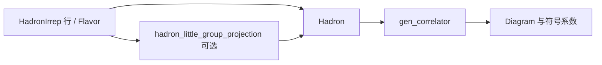

# S：符号粒子、投影与 Wick 图 L2

日期：2026-09-29。上层边界以 [L0/L1](../../architecture/correlator-l0-l1.md) 的 S.api 与 H01 为准。

S 描述用户要求的强子量子数、味结构和 Wick 图，不绑定 reader、配置、数组或缩并计划。
跨模块公开导入走 `lqcdweave.operators.correlator.api`。六种单夸克 flavor 的
`Literal` 只用于实现注解；公开构造器 `Flavor` 是
`HadronFlavorStructure` 的同一类别名。

<a id="全-diagram-整数连接格式目标待迁移"></a>

## 全 Diagram 整数连接格式（实现完成）

权威约定见[ARCHITECTURE](../../../ARCHITECTURE.md#diagram-的统一整数连接格式目标待迁移)。S 继续提供符号 Wick 图、连接矩阵、
有序腿槽和系数；C/E 将其降低为整数 `AxisPattern`。S 不分配连接 ID，也不要求用户生成
einsum 字母或执行转换。该改造不改变符号前端；受影响 CPU 模块验证通过；GPU/生产规模仍未验收。



## 唯一实现与公开接口

### 可选重子交换特征

`Hadron(irep_row, flavor_structure, *, quark_symmetry=None)` 可声明完整三夸克系数的
实标量交换特征；归一化群进入味结构及表示行身份，随时间、伴随、旋转、复制和序列化
保留。实现位于 `operators/correlator/quark_exchange.py`，仅在显式声明时按实际味道
稳定子群收集 Wick 图轨道，保留原费米子符号、总重数和零贡献。普通及结构化入口
复用 `quark_contract`；B/E 仍负责实际输入。默认不加标签。
用法、颜色约定和分块限制见[交换标签](../operators/baryon_quark_exchange.md)。

矩阵交换由 `QuarkExchange` 与 `Hadron.multiplet` 声明整个系数族，标准二分量基为
MS、MA；也支持精确数值生成矩阵和同子群的张量积。不可变族/分量记录进入行身份，
伙伴行沿当前量子数、Tag 和 dagger 重建。`quark_exchange_matrix.py` 在普通符号矩阵
及结构化 Wick 迭代中共用腿轨道规范化、稳定子投影与精确独立列选择；只使用保留实际
味道词的子群，保留原 Wick 符号。标量特征在联合约简中作为一维矩阵，源汇及输出矩阵
共用同一基；相同顶点重排也参与图规范化。普通、已按时间排序且顶点不重复的未标记图走快速路径。
source 矩阵使用共轭的 `r p r`，数值常量在 R 输出交接时转换；S 不读取或验证大型系数张量。
`QuarkExchange("all")` 提供 S/A/MS/MA 四分量目录；`QuarkExchange.pair` 在重子中
指定任意两条腿的 S2，可声明 S、A 或按 S/A 排列的完整二分量。完整关系下的独立性证明
及图数区别见上述交换标签页。`_expressions.word_factors` 按次数展开算符幂，避免重复插入遗漏。

### 零夸克插入

`Flavor("")` 表示保留时间和插入次数的零夸克味结构。Wick 仅对其它真实夸克配对，
Diagram 允许 `(0,0)` 度数并将孤立顶点保留为独立因子；重复插入仍保留乘方。
介子同端圈仍有自环，不能作为零度顶点。数值顶点类型由 native binding 核对。
`tests/correlator/symbolic/test_glueball.py` 对照原介子/重子 Wick 乘胶球因子，
并核验普通与 structured 的混合单强子矩阵、空味道共轭及重复插入。
数值交接已由 Glueball 绑定和原 term/result 管线实现，见[胶球接入](../../architecture/glueball_architecture.md)。

### 结构化单强子矩阵

`gen_correlator(hadrons, time_slice_list=None, dagger_list=None, *,
degenerate=True, structured=False)` 默认返回原有 object 矩阵。显式
`structured=True` 返回 `StructuredCorrelator`，保存每个输出轴的表示行、味结构
和系数；不先展开整张矩阵。独立实现位于 `operators/correlator/structured.py`。
支持一或两个插入，每个插入为单强子表示行的数值线性组合。
多强子乘积明确报 `NotImplementedError`。原时间和 dagger 规则不变。

`split_meson_mode_pairs(request, partitions=[0,16,32,48,70])` 对这种请求只记录
完整区间；输出轴为原矩阵轴后追加每个插入的 PC pair 轴。`request.shape`
可查询该布局。请求支持数值加减乘法、同形状请求之间的逐元素加减乘法；
一次分块调用内复用重复的不可变请求，例如 `full` 和 `full-connected` 中的
同一个 `full`；不重复登记区间或组装该请求。
`remove_disconneted_diagram` 记录待过滤的传播子标签。请求不是 NumPy 数组，
需要查看具体 Wick 图时使用原默认入口。E 在绑定时消费公开的
`iter_structured_wick_entries(request)`，逐输出位置提供数值系数和独立 Diagram
因子，复用原 Wick 算法；不引入新的物理图规则或强子分类开关。

```python
task = gen_correlator(hadrons, times, daggers, structured=True)
task = split_meson_mode_pairs(task, partitions=[0,16,32,48,70])
result = calculate(task, vertex_map=vertices, propagator_map=propagators,
                   configuration=cfg, usedNe=70)
```

`calculate` 来自 `lqcdweave.contraction.correlator`；其余两函数来自 S.api。
数值绑定、预算和档案参数与普通入口一致。分块限 dense V/V 介子；重子请求
不使用介子分块。边界与 CPU 数值对照见 `tests/test_structured_correlator.py`。

### 模式分块

`partition_mode="memory"` 保留原输出形状，表示分块仅作为完整模式求和的计算
安排。普通表达式对各独立 Diagram 的有序块用单位权重求和，独立圈保持因子化；
结构化请求仅记录边界与该模式，由 E 构造求和配方。`StructuredCorrelator` 的
`partition_mode` 字段默认 `"radial"`，此时追加 PC pair 轴；`"memory"` 时不追加。
未知模式报 ValueError，memory 请求必须声明 partitions；已分块请求仍不能再次分块。
两种模式都不读取数值或改变时间选择。具体调用及限制见[介子模式分块](../operators/meson_mode_blocks.md)。

S.api 导出 `split_eigenmodes(correlator, *, partitions)`、`ModeBlockedDiagram`、
`project_meson_mode_pairs(blocks, *, mode_axis=0, vertices=2)`、
`split_meson_mode_pairs(correlator, *, partitions, partition_mode="radial")`、
`split_baryon_eigenmodes(correlator, *, partitions)` 和
`project_baryon_mode_triples(blocks, *, mode_axis=0, vertices=2)`。
前两步的实现为 `operators/correlator/mode_blocks.py`；合并分块与投影的入口位于
`operators/correlator/mode_projection.py`。它们不读数组；介子的两条逻辑模式槽
及覆盖 extent 属于符号身份，相等性、哈希和复制都保留选择。原 Diagram 不被修改。
分块对象沿用 Diagram 图结构和原符号系数；不通过 `.value` 存放模式约束。
同一表达式的各项按共同具名顶点排列分块轴，独立闭合圈保留乘积。
合并入口在一次调用内复用每个独立 Diagram 的 PC 投影，再按线性及独立顶点的
乘积组装输出；每个顶点追加一条 pair 轴。它不构造整个任务的有序分块数组，
保留全部有序基础块，断开圈的输出仍保持乘积。符号模板仅在本次调用内保存，
公共数组拥有独立槽位。轴顺序、不等长区间、重复顶点与非线性表达式的拒绝规则
沿用有序分块入口；原接口仍可用于独立查看基础块或投影数值结果。
有序分块在验证区间后，内部符号构造复用同一基础 Diagram 的哈希及区间；
公开 `ModeBlockedDiagram` 构造仍检查完整选择。单 Diagram 直接调整预建槽位的
轴顺序，复合表达式才逐槽替换。两种构造得到相同名称、完整选择与哈希，
数值 `.value` 缓存不参与身份。
合并入口用既有 SymPy Add/Mul 保存投影的代数树，各输出位置不重复执行自动
展开、合并与排序；R 仍按既有 OutputRecipe 计算。这不新增 IR，全部系数恰好
应用一次，数值投影入口继续使用原有数组运算。
支持边界、轴顺序和 PC 配对见[使用说明](../operators/meson_mode_blocks.md)。

重子分块为每个 `(time, vertex)` 追加三条原始空间槽模式轴，槽顺序固定为 0、1、2；源端 dagger 不重排这些轴。三轴投影按 S3 不同排列形成全对称径向三元组，不构造重子的 C 本征分区。完整轴、归一化和限制见[重子模式分块说明](../operators/baryon_mode_blocks.md)。

规范实现位于 `operators/correlator/`。公开名字由 `api.py` 统一列入 `__all__`；
`operators/correlator/__init__.py` 只重导出。旧 contraction/hadron.py、symbolic_graph.py
及根级 base_types/quark_diagram/hadron/spatial_structure/flavor_structure/group_projection
六个纯转发入口已删除；仓库内调用方统一使用 S.api。已文档化的 operator_transform
现在由 S.api 导出同一既有函数，未新增旋转算法。投影实现实际调用的内部群函数仍保留在 S 中。
历史根级转发模块曾额外公开 `diagonalize_Cij`，但该旧 Cij 对角化实验不是当前 S.api 导出，也未获 L0/L2 作为接口承诺；
当前也无仓内消费者；旧功能登记表仍将其列为未实现。已退役的转发入口不构成兼容承诺，
因此不将它保留为受支持接口。

`copy.deepcopy(Diagram)`、`Propagator`、`HadronIrrep` 与 `HadronIrrepRow` 由 S 自己实现 Python
复制协议。副本保留符号名称、assumptions、相等性与初始 hash，并复制可变图、
味道/标签元数据及已附加的值；同一份复制中的重复传播子引用仍指向同一个副本。
它不会重新调用缓存的公开构造器，也不会重写调用者原对象的列表或属性。
调用方使用标准复制协议，不访问 SymPy 的底层构造或手工回填 S 的内部状态。
`tests/correlator/symbolic/test_symbolic_deepcopy.py` 验证非默认 assumptions、复制隔离和重复引用。

Diagram 相等性和本地字典哈希通过独立 `graph_identity.py` 规范化邻接矩阵、
时间、顶点和传播子序列。NumPy 坐标与列表按相同内容比较，嵌套重子矩阵也
支持；比较返回 bool，相等对象的哈希一致。数值缓存不参与身份，此哈希仅
用于本进程字典，科学身份和档案仍使用共同契约的既有编码。

### 味道与空间量子数

```text
Tag(tag: int, time: int | str)
HadronIrrep(
    hadron_name: str, momentum: Sequence[int], irrep_name: str,
    parity: int | None, tag: Tag, dagger: bool = False,
)
HadronIrrep.__getitem__(self, row_idx: int) -> HadronIrrepRow
HadronIrrep.copy(self) -> HadronIrrep
HadronIrrepRow(
    hadron_name: str, momentum: Sequence[int], irrep_name: str,
    row_idx: int, parity: int | None, tag: Tag, dagger: bool = False,
)
HadronIrrepRow.transform(self, group_element, time=None)
HadronIrrepRow.copy(self) -> HadronIrrepRow
HadronIrrepRow.conjugate(self) -> HadronIrrepRow
Flavor(flavor_str: str, time: int | str = 0)  # Flavor is HadronFlavorStructure
```

- `Tag.tag` 是算符槽/粒子内 quark-slot 的标识，`Tag.time` 是当前符号粒子的时间。
  meson 的一条 anti-quark/quark 线共享其一个粒子槽；baryon 的有序三条 quark 线
  使用连续三个槽。
- `HadronIrrep.momentum` 是有序三整数 `(px, py, pz)`；构造时保存副本，读取属性返回副本。
  `parity=None` 表示不带 g/u 标签，`-1` 表示 u，`+1` 表示 g。`dagger` 是场的共轭标记。
  `irrep_name` 和实际行维数按包内置格点群表示模块的 irrep 表解释。
  非三维/非整数 momentum、非法 parity、错误 Tag/dagger 类型分别报 `ValueError` 或 `TypeError`；
  标签编号及整数时间必须非负；时间也可为非空字符串键。无效行索引报 `IndexError`。
- `HadronIrrep[row_idx] -> HadronIrrepRow`。索引从 0 开始；超出当前表示行数报 `IndexError`。
  `HadronIrrepRow.transform(group_element, time=None)` 返回群变换后的行线性组合；
  `conjugate()` 翻转 dagger 标记，量子数、标签和动量保留。
- `Flavor` 的 meson 语法是 anti-quark 在前、quark 在后，例如 `Flavor("ud", t)` 表示
  `\bar u d`；三字母串表示按给定顺序排列的 baryon quarks，如 `Flavor("uds", t)`；
  反 baryon 使用 `Flavor("bar{uds}", t)`。物理 flavor 仅接受 `u/d/s/c/b/t`。
  味结构非字符串、时间不是非负整数或非空字符串时报 `TypeError`；不支持的字母、长度、负时间或空白时间键报 `ValueError`。
- `Flavor.conjugate()` 交换 meson 的 quark/anti-quark，baryon 与反 baryon 互换，保留时间。
  `quark_list` 与 `anti_quark_list` 各返回副本。

### 强子、投影与 correlator

```text
Hadron(irep_row: Expr, flavor_structure: Expr)
Hadron.set_time(self, time: int | str) -> Hadron
Hadron.conjugate(self) -> Hadron
Hadron.copy(self) -> Hadron

hadron_little_group_projection(
    hadron_irreps: Sequence[HadronIrrep], irrep_name: str, row_idx: int,
    parity: int | None = None, single_result: bool = False,
) -> list[Expr]

gen_correlator(
    hadrons: list[list[Hadron]],
    time_slice_list: Sequence[int | str | None] | None = None,
    dagger_list: Sequence[bool] | None = None,
    *, degenerate: bool = True,
) -> ndarray  # dtype=object; one axis per operator slot
```

- `Hadron.irep_row` 与 `Hadron.flavor_structure` 是 SymPy 表达式，可分别是单行或群投影线性组合。
  `set_time` 在两个表达式中同时改写粒子时间并返回新 `Hadron`；`conjugate` 对乘积反序并
  共轭各因子；这三种方法不读数据，也不执行 Wick 收缩。
- `hadron_little_group_projection` 先对输入总动量求 little group，在每个允许的旋转下组合
  各粒子的 irrep 行，再投影到所请求的整体 irrep/行。输入每个粒子的 momentum、Tag 时间和
  dagger 标记都会带入输出行。结果是线性独立的 SymPy 表达式列表；当前兼容选项
  `single_result=True` 返回至多一个元素的列表。
- `gen_correlator` 的第 `i` 个列表表示一个算符插入位置，该轴索引选择该位置的一项 `Hadron`。
  输出是 object ndarray，shape 为每个位置的候选数。默认时间依次是 `0, 1, ...`；显式
  `time_slice_list[i] is None` 时保留该候选各粒子原有时间。默认 dagger 将最后一个位置设为
  `True`（至少两个位置时），显式列表则逐位置使用。时间/ dagger 长度不匹配报 `ValueError`；
  时间须为非负整数、非空字符串键或 `None`（负值/空键报 `ValueError`），dagger 与 `degenerate` 须为 bool，
  错类型时报 `TypeError`。
- 为保持旧调用语义，`gen_correlator` 会用重写后的 `Hadron` 列表替换调用者外层 `hadrons`
  列表中对应位置。使用完调用输入后若需原模板，请调用方自行保留副本。
- 由已求值 Add/Mul 形成的数值系数与 Diagram 多项式直接交付，避免再次运行通用
  符号化简；符号系数、幂及其它代数形式继续使用原化简。Wick 图化简、系数与断开圈
  保持原语义，不保证输出使用通用化简选出的因式分解形式；前端参数不变。

### Wick 图对象与可调用图运算

```text
QuarkDiagram(adjacency_matrix, validate: bool = True)
Diagram(diagram, time_list, vertex_list, propagator_list)
Diagram.transform(self, group_element, time=None)
Diagram.conjugate(self)
Diagram.simplify(self)

validate_adjacency_matrix(adjacency_matrix) -> None
quark_contract(expr, particles, degenerate: bool = True) -> Expr
diagram_simplify(expr) -> Expr
diagram_vertice_replace(expr, replacements) -> Expr
remove_disconneted_diagram(expr, propagator_list) -> Expr
```

- `Diagram` 的符号身份由 adjacency matrix、每个 vertex 的显式时间、vertex 列表和
  propagator 列表共同确定。相同名字/同一构造键由 SymPy intern 成同一对象；值缓存槽
  `value`、`value_pointer` 供历史调用方兼容，S 不写入数值结果。
- `HadronIrrepRow` 的显示名为兼容旧符号写法，不包含 Tag 时间；不能用其打印名推导时间。
  真实 vertex 时间保存在 `Diagram.time_list` 和独立行的 `Tag.time`，并参与 Diagram 身份。
  `source`、`sink`、`current` 等名称没有保留含义；同一键代表同一变量，不同键保持独立。
  例如整数 `0` 和字符串 `"0"` 是不同键。`set_time` 保留已有 dagger；输出扫描轴顺序由
  `time_axes` 声明顺序决定，符号 canonicalization 的排序不改变它。
- adjacency entry 表示有序 source-slot 到 sink-slot 的 quark line 编号；重子相关项以
  source quark-slot 在前、sink quark-slot 在后保存。`validate_adjacency_matrix` 检查方阵和
  每顶点 quark-line 次数：meson `(1 out, 1 in)`、baryon source `(3,0)`、baryon sink `(0,3)`。
  非方阵、dangling line、度数错误或空孤立顶点报带 vertex 编号的 `ValueError`。
- Wick 递归每步选第一个 antiquark，与所有味道相同的 quark 配对；费米符号由原列表相对顺序
  计算。`degenerate=True` 只在同味配对成功后把 u/d 传播子数据标签合并为 `q`；
  不改变 physical-flavor matching，也不合并 s/c/b/t。计数不平衡、完全没有 anti-quark 或
  无匹配味道时返回符号零，不构造伪图。
- `Diagram.simplify()` 沿用旧图算法：规范化冗余顶点/传播子并把互不相连子图化为乘积。
  `diagram_vertice_replace` 只替换 vertex 符号；`remove_disconneted_diagram` 保留其旧拼写，
  递归地将命中指定 propagator 的 Diagram 替换为零。

## 数值语义、错误与依赖

- 投影、味、dagger、Wick 置换和外部费米符号只在 S 计算一次；下游不得重新 Wick 或再乘费米符号。
  `Operator` 的系数属于 O，不在 `gen_correlator` 的 Wick 系数里。
- 无合法配对是物理上的符号零，不是 reader 覆盖缺失；S 不补零数值数据。
- C 仅提供跨边界纯契约；S 使用随包内置的格点群表示模块、SymPy 与 NumPy 作为符号和投影基础库。
  S 不导入 B/E/P/X 的实现，不读取 reader、文件、配置或设备。
- object ndarray 由调用方持有；其中表达式与 Diagram 是符号对象，不包含缩并数组。
  行符号构造不再按可见名字共享可变 Tag；相同打印名的不同时间键保持独立对象，完整元数据仍决定相等性和 hash。

## 旧实现迁移与验证

| 目标实现 | 旧来源 / 处理 |
|---|---|
| `operators/correlator/hadron.py` | 从原 `contraction/hadron.py` 的 Hadron、时间/dagger 变换及 Wick 前端复制后适配 S 目录；改进输入长度/类型检查并显式 `None` 时间语义 |
| `operators/correlator/symbolic_graph.py` | 从原 `contraction/symbolic_graph.py` 迁移，保留 Diagram identity、Fermi 符号、图简化；增加无法配对的符号零 guard |
| `operators/correlator/{flavor_structure,spatial_structure,group_projection}.py` | 保留当前唯一实现；投影现在保留输入 HadronIrrep 的 dagger 及各粒子 Tag 时间；单夸克 literal 改名内部 `QuarkFlavor` |
| `contraction/hadron.py`、`contraction/symbolic_graph.py` | 旧转发入口已删除，唯一实现与用户交接均在 S |
| `lqcdweave/base_types.py` | 旧转发入口已删除；S.api 的 Flavor 仍是 HadronFlavorStructure 同一别名，Tag 仍是同一 NamedTuple 类 |

源码导入复核：示例与结果模块直接从 S.api 导入符号对象；contraction/vsv_graph.py
也已使用 S.api，无旧 shim 依赖。根级 Hadron/QuarkDiagram 转发包装已删除，实际
Wick、投影与时间/dagger 实现保留在 S。包级 S 导出仍提供相同对象。

| CPU 测试 | 输入与断言 | 保证 / 未覆盖 |
|---|---|---|
| `tests/correlator/symbolic/test_frontend_compat.py` 的公开对象身份检查 | 核对 S.api 和保留的 S 包级导出为相同对象 | 唯一类型/函数交接；不保留已删除的 import shim，不验证所有外部下游 |
| `...::test_public_flavor_alias_and_none_time_preservation` | 两个 pion Hadron、逐粒子原时间与显式 `None` time_slice | 检查公开 Flavor alias、时间列表与 dagger；不覆盖任意容器输入 |
| `...::test_projection_retains_each_particle_time_and_dagger` | 带 `Tag(4,7)` 与 dagger=True 的静止 HadronIrrep 投影到 A1 | 检查 projected rows 保留 time/dagger；不覆盖所有群/动量表示 |
| `...::test_diagram_name_interning_and_quark_link_check` | 重复同一完整图与错误 adjacency | 检查完整科学身份的 intern 与报 vertex 的度数 ValueError；显示同名不代表身份相同，不覆盖全部非法矩阵形状 |
| `...::test_source_sink_time_rewrite_uses_legacy_half_order` / `...::test_same_visible_row_reuses_legacy_symbol` | 不同 source/sink 时间和同显示行 | 锁定旧符号兼容性；显示 row tag 时间不能取代 Diagram.time_list |
| `...::test_identical_hadrons_follow_little_group_projection` / `...::test_moving_pair_projection_matches_reference_row_count` | 重复静止 pion 与 moving D*D pair | 检查旧投影结果/独立行数，不是所有有限群投影基准 |
| `...::test_three_point_keeps_all_symbolic_times` | 三个插入位置、两个介子端点和一个中间插入 | 检查 Diagram 保存全部显式时间；不跑数值收缩 |
| `...::test_neutral_flavor_graphs_and_disconnected_filter` | uu×uu 介子结构与指定 local propagator | 对照两类 Wick 图并删去断连图；不覆盖全部味组合 |
| `...::test_baryon_antibaryon_graph_retains_ordered_flavor_lines` | bar{uds}×uds、`degenerate=False` | 对照实际传播子味道和三 slot 矩阵顺序；不覆盖多重重子图的所有排列 |
| `...::test_unmatched_flavor_content_is_a_symbolic_zero` | 单独 uds、味不匹配 meson `ud`、以及 quark/anti 数不平衡结构 | 检查无合法配对返回零；合法配对符号由上一项和根目录参考测试覆盖 |

图的内部驻留身份包含完整插入标签、时间、dagger、传播子和连线；显示名称相同不能合并不同物理插入。完全相同的图仍复用符号对象。`test_same_visible_names_do_not_alias_distinct_insertion_tags` 从 `gen_correlator` 验证不同标签的差不会错误相消。

当前只验证 CPU；没有 GPU 或生产规模声明。

旧 contraction/根级转发入口已完成消费者迁移并删除；HadronFlavorStructure 与
旧拼写图工具仍在 S.api 提供同一功能，不另复制 Wick 算法。operator_transform(expr,
group_element, time=None) 直接公开原群变换函数；identity 示例与 CPU 回归不认证全部表示旋转。


## 可选依赖导入边界

S 的包级和 `api` 导出继续交付同一真实对象与 `__all__`，不使用懒代理或
替代类型。包级调用原 API 导入时，仅对 `ModuleNotFoundError.name` 精确为
`sympy` 或 `lazy_object_proxy` 的缺失增加 `correlator` extra 安装指引，保留
异常类型、name 和 cause。其它传递依赖缺失、ImportError 和 RuntimeError
原样传播，不将坏依赖伪装为可用功能。完整依赖仍使用已安装的原算法。

`flavor_structure` 中无消费者的 `convert_pow_to_mul` 导入已清理；hadron、
symbolic_graph 与群投影中实际使用的 library 调用保留。O 的 moving 小群
操作在原局部 import 处处理缺库，不经 S namespace 增加依赖。收缩编排的固定
Diagram 测量和 VSV 参考入口先经 S 公共边界处理符号依赖，再消费 SymPy。
缺库子进程与已安装依赖的对象身份/代表投影验收互相区分；二者均不代表
全部群表示或 GPU/MPI 验收。

自定义时间与行身份回归：`tests/correlator/symbolic/test_named_time_keys.py`；跨层具名绑定、同键对角与乱序扫描独立 trace 参考：`tests/test_correlator_named_bindings.py`。
