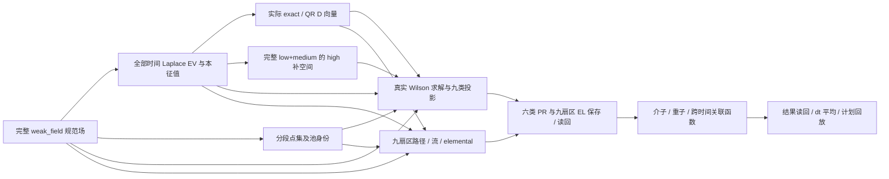

# weak_field 完整流程科学审计

本审计从项目随附的完整 `4×4×4×8` 规范组态重新计算基础数据，再通过公开
correlator 入口消费实际保存的数据。它补充以前主要检查归档 elemental 和
旧传播子消费的测试；历史传播子没有完整生产 manifest，不能据此推断或复现
当时的 clover、stout、各向异性和求解约定。

慢测只在明确请求时执行，普通开发不运行。

```sh
python tools/test_tiers.py --tier slow --list
python tools/test_tiers.py --tier slow --json /external/weak-field-audit.json
```

未安装项目时可按平台把 `src` 与 `tests` 加到 `PYTHONPATH`。NumPy/SciPy 的
线程设置属于本机运行条件，可按实际 CPU 配置调整；它不是数值精度或性能
验收结论。固定夹具由系统临时目录保存中间产物，运行完清理。

## 固定科学定义

| 项目 | 本次流程 |
|---|---|
| 规范场 | `tests/data/weak_field/weak_field.npy`，完整物理 `Lt=8`；同时核对 BIN 与 ILDG |
| 浮点精度 | `complex128`；对非有限值明确失败 |
| Laplace | 每个物理时间求解 6 个最低模，容差 `2e-11`，保存本征值和实际基底 |
| 分区 | low `(0,1,3)`；medium 父组 `(2,4,5)`；high 扣除完整 low+medium 六模 |
| D | exact `m=n=3` 与 QR `m=2,n=3`，另检查 rank-one QR；原始幅度，不额外归一化 |
| 随机空间点 | `Np=4`，每段 4 个连续物理时间片，seed=34；两段有实际交点，跨段 current 非零 |
| 完整空间对照 | `Np=64` 的全空间点基底，exact medium，两个物理源汇时间 `(4,0)` |
| Wilson | `m=0.4`，`r=a=1`，各向同性，无 clover，无 Dirac stout；空间周期、夸克时间反周期 |
| 自旋/尺度 | DeGrand–Rossi；未乘 kappa 的传播子，保存 Gamma5 厄米关系 |
| 求解 | 测试专用 CPU LU 缓存；生产 Wilson 矩阵和独立参考矩阵分别组装、分别分解 |
| 时间选择 | 默认完整 8 片；显式重排 `(7,0,4,3)`，Nt 槽不能代替物理 Lt |

测试选择这些固定参数是为了覆盖交接和数值行为，并不建议物理测量自动采用
它们。stout 的一步空间涂抹另行对照逐格点 `expm`；该结果没有隐式进入上述
Dirac 求解或基础 EV 数据。

## 流程与逐层证据



参考端不使用生产求解器返回的 RHS、解向量或投影结果构造真值。独立
Wilson 矩阵先用五个随机复数场与数组平移 stencil 对照，同时用时间边界
局部探针区分周期与反周期；随后对参考矩阵另行 LU 求解，再用物理
`(t,z,y,x,spin,color)` 嵌入逐端点核对 PR。两端均用 SciPy LU，因而这是
独立算子组装与完整生产/投影参考，不是两个无关线性代数库的交叉验收。

| 用例 | 主要验证内容 | 避免的假通过 |
|---|---|---|
| 01 | NPY/BIN/ILDG、SU(3)、输入 SHA256、Wilson stencil、反周期边界和 Gamma5 | 文件名、shape、同一个生产算子不能证明数值正确 |
| 02 | 全时间谱、残差、Gram 与相位无关投影；重排 compact EV 生产和读回 | 不比较任意本征矢相位，不把槽当物理时间 |
| 03 | 非连续 medium 父组、独立 QR 参考、raw 范数、实际 UUID；分段 SS、选择 RNG 流、overlap | 同 seed 不证明同 realization，不额外乘权重 |
| 04 | 六存九读的所有九产品、全部 64 个源汇时间对、high 投影、Gamma5 反向视图、无数值 IO 的 reuse 规划、serial/MRHS | 正反视图形状相同不能代替数值核对 |
| 05 | 九扇区，7 条路径、2 个动量、8 个时间、3 种相位、raw/preweighted 共 6048 个 block 对照 | 同池/跨池权重分开；颜色索引不作为新点标签 |
| 06 | 保存的 V/V elemental 与 PR、源 dagger、复系数、Wick 负号、64 对复数值、dt 归一化、结果保存和计划回放 | 两个实现共同漏源 dagger 或重复施加系数 |
| 07 | exact medium 加全空间 high 的九扇区总和；六类 PR 与九类 EL 真正保存读回；完整 Wilson 迹 | 用投影迹冒充完整空间迹，或把低秩 D 当完整 high 投影 |
| 08 | 实际 QR 与随机 high 的单份加权实现，对照 literal 物理空间矩阵迹；raw/preweighted | 一份随机数据不能宣称等于总体或证明无偏 |
| 09 | 纯时间 P/P 链接，段内、部分跨段、段边界、周期环绕；逐端点 pool ID，独立四标签包含概率；缺独立声明拒绝 | 逐局部权重直接相乘、按时间距离或坐标碰巧相同猜池关系 |
| 10 | V/V/V 重子逐点行列式、复数空间配方、登记读回、源自旋 adjoint、置换后三条传播子、literal 标量求和 | 重子稀疏自旋、三腿和 Wick 接线只检查 shape |
| 11 | 守恒时间流四项的九扇区插入、实际 `t±1`、环绕、物理三点迹；compact 成功对照与缺 anchor 拒绝 | 默认连接相邻 Nt 槽，或有向流端点互换；采样覆盖与 elemental anchor 覆盖不是同一选择 |
| 12 | 一步空间 stout/逐点 expm、SU(3) 投影、规范变换协变性、开放路径边界和时间 excursion | 涂抹只检查 SU(3)，或者闭合 excursion 越界仍当有效 |
| 13 | 有序左右导数、复系数组合、非连续动量字典 key/保存顺序 | 把 D_xD_y 与 D_yD_x 混同，或把动量 key 当槽 |
| 14 | 未完成覆盖与续写、实际保存字节、计权标记冲突在读数值前拒绝、错误 high 父身份拒绝 | 目录存在即算完成；shape 相同即宣称兼容 |

每项核验输出 count、最大绝对误差与相对 L2 误差；绝对误差适用于接近零的
分量，相对误差用于整体幅度。断言同时用固定 atol/rtol，报告误差不是通过
后才临时放宽的容差。失败保持 failure/error，缺依赖保持 incomplete。

单份随机点实现中，raw elemental 的 P 端是实际 delta 点，PR 的 P 端则投影到
high 补空间 Q。V/P、D/P 的交叉项在有限样本上一般不消失。用例 08 独立
拼接实际 raw/projected 端点，逐列施加 same/distinct 的包含概率，再构造物理
空间有效算符和 Wilson 迹；仅把 V、D 与 Q 点投影的三个对角部分相加会遗漏
这些交叉项。用例 11 也按该规则构造 current 的九扇区参考，并严格沿 Diagram
的有向三点环求迹，不能交换源、流、汇的顺序。

compact elemental 使用 anchor 选择 `(7,0,4,3)`，实际点集仍覆盖完整 8 片；
数组 reader 因而显式声明独立的 `sampling_selection` 为完整物理时间选择。
点池字典的时间索引属于这份采样记录，不能拿 anchor 槽号去查询。传播子也
声明实际 source/sink 时间记录；成功用例核对物理 t=3、7 的结果及 108 个
compact elemental block，物理 t=0 缺失的 backward anchor=1 必须拒绝。

## 验收边界与待补范围

2026-10-12，本地 Windows CPU 最终完整运行：**14/14 通过，0 failure、0 error、
0 skip，退出码 0**，总时间 **204.031 s**。共享 fixture 准备 32.681 s；测试中
实际记录 **6928 次数组/标量数值对照**，另有身份、覆盖、独立声明等契约断言。
线程设置为 `OPENBLAS_NUM_THREADS=4`，耗时只描述本次环境，不是速度门禁。

| 用例 | 数值对照次数 | 最大绝对误差 | 本次用时 / s |
|---|---:|---:|---:|
| 01 规范场与 Wilson | 15 | 1.42e-14 | 0.043 |
| 02 全时间 EV / compact | 40 | 5.63e-12 | 0.345 |
| 03 NV / 分段点集 | 28 | 5.08e-14 | 0.009 |
| 04 九类 PR | 584 | 7.77e-16 | 20.894 |
| 05 九扇区 EL | 6048 | 5.10e-14 | 19.086 |
| 06 全时间介子与回放 | 4 | 2.51e-19 | 1.574 |
| 07 完整空间闭环 | 5 | 1.67e-15 | 68.569 |
| 08 QR / 随机 high | 39 | 6.66e-16 | 4.614 |
| 09 时间路径与分段池 | 8 | 9.41e-13 | 0.483 |
| 10 VVV 重子 | 10 | 1.43e-17 | 0.327 |
| 11 时间流 / compact | 113 | 1.39e-16 | 53.842 |
| 12 规范场处理 | 17 | 1.89e-15 | 0.613 |
| 13 导数与动量 | 16 | 1.00e-15 | 0.644 |
| 14 恢复与身份 | 1 | 0 | 0.147 |

最大 Wilson 求解相对残差为 **5.93e-15**。九扇区完整空间参考迹为
`0.32357523420075285 - 1.61e-18j`。时间路径四标签对照的最大相对 L2 误差为
**1.81e-13**。EL 的 local V/D 交叉块理论为零，有限精度下两端都是约 1e-13
的舍入量；其中相对比值约 7.36e-3、最大分量绝对差约 1.26e-15，按固定
绝对容差通过。接近零的块不能用这类相对比值判断物理偏差。

完整 JSON 的 `audits` 保留每个标签的 count、最大绝对误差、相对 L2 误差、
fixture SHA256、各项用时、求解残差及科学参数，运行命令通过 `--json` 指定
项目外输出位置。它包含新测试的实际结果，不导入历史通过记录。

本次查出并修复了两处实现缺口：普通非零净时间位移 GaugePath 的传播子时间
与 P/D 池采用不同端点映射；直接扫描计划的预测报告携带内部 `AxisPattern`
等对象，无法保存为 strict JSON。两项均补入正常开发的小规模独立回归。
另同步了已实现的 `HighmodeBasis`、`ModePartition`、`project_highmode_block`
公开导出清单。相关时间路径/compact 回归 12 项、计划档案回归 6 项、架构与
公开 API/分层工具检查 29 项均通过；文档导入、调用签名与本地链接检查通过。
这不是全部 2620 项常规测试或真实设备回归的通过声明。

完整流程是固定 CPU 科学 gate；下面的缺口不能由其中某个局部或模拟用例
代替，也不能据本次通过声称任意作用量与平台已经全功能验收。

| 范围 | 当前边界 |
|---|---|
| 历史 weak_field 传播子重算 | 缺完整生产参数，归档的 clover/stout 传播子只能消费和做已有对称性检查 |
| GPU / QUDA / MPI | 本地 CPU 审计不验收这些平台；真实作用量、分布式域分解和设备求解须在对应环境独立验证 |
| clover / 各向异性 / multigrid | 本次新求解仅 unimproved isotropic Wilson；测试 LU 不能冒充公开生产后端支持其它作用量 |
| 任意 D 或采样 P 重子流 | 当前重子完整流程是 V/V/V；不能把介子九扇区支持扩展声称为任意重子扇区 |
| 重子时间扫描 / batching | 现有公开入口支持逐个标量时间对；本审计显式循环两对，原生批量时间扫描仍明确拒绝 |
| 分段时间路径 P/P 对角简化 | 生产端结构声明对全部 anchor 统一，尚未按每个 anchor 识别段内同池；一般展开可以更慢，rank-one 等可估计性边界需单独支持证明 |
| 紧凑时间与跨时间流 | 本次已验证重排 anchor、完整 endpoint/sampling 覆盖及缺 anchor 拒绝；任意独立、不完整 source/sink 选择须另有覆盖证明 |
| 随机估计的统计性质 | 本次 QR/P 检查单份 literal 实现与 exact 完整空间闭环；不把一份随机 realization 宣称为完整总体均值 |
| 性能和生产规模 | 无系综、多 cfg 吞吐、GPU 稀疏收缩或实际集群性能结论 |
